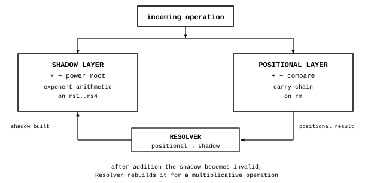

# ALU: the logic of the arithmetic unit

James Augustus

## Abstract

CTCPU's arithmetic unit is not a single circuit. It is an umbrella that directs an operation to one of two layers according to which representation of the number will be used. Addition, subtraction and comparison use the number's normal octal digits, with a carry chain. Multiplication, division, exponentiation and roots use the number's shadow, by adding, subtracting and halving prime exponents. Resolver is the bridge between the two layers. Here I describe the ALU's division of work. How each subunit works is described in its own folder: [Adder](Adder/Adder.md), [Multiplication and division](Multiply_Divide/Multiply_Divide.md), [Square root](Square_Root/Square_Root.md).

## Contents

| Section | Title |
|---|---|
| 1 | Introduction |
| 2 | Two layers |
| 2.1 | Shadow layer |
| 2.2 | Positional layer |
| 2.3 | Why separate |
| 3 | Routing rule |
| 4 | Input and output |
| 5 | A chain of operations |
| 6 | Verification |
| 7 | Limits |
| 8 | Subunits |

## 1. Introduction

In a conventional processor, a single arithmetic unit performs all operations digit by digit. The multiplication circuit is the largest and most expensive part of this unit. In CTCPU, a number is kept in two forms. The normal form contains octal digits, the shadow form contains the exponents of seven small primes and a residual. Since multiplication becomes addition of exponents in the shadow, there is no need for a large multiplier. Addition, however, cannot be done in the shadow. These two facts divide the ALU into two layers.

## 2. Two layers

### 2.1 Shadow layer

Multiplication is addition of exponents, division is subtraction of exponents. Exponentiation is multiplication of exponents by a constant, square root is halving of exponents. A common divisor is found by selecting the smaller exponent in each channel. Since the seven channels are independent, seven operations can be performed at once.

### 2.2 Positional layer

Addition and subtraction use normal digits, with a carry chain moving from digit to digit. Comparison is a subtraction whose result is not written.

### 2.3 Why separate

The shadow cannot add. Adding 7 to $360 = 2^3 \cdot 3^2 \cdot 5$ gives $367$. 367 is prime and its shadow has no connection to that of 360. Just as a logarithm turns multiplication into addition, the shadow makes things easier in only one direction. There is no general identity that turns addition into multiplication. This separation comes from arithmetic itself, rather than a design choice.

## 3. Routing rule

The incoming operation determines which layer the ALU will use.

| Operation | Layer | Fields used |
|---|---|---|
| Addition, subtraction, comparison | Positional | $rm$ |
| Multiplication, division | Shadow | $rs1..rs4$, $rc$ |
| Exponentiation, square root | Shadow, positional if needed | $rs1..rs4$, $rc$ |

After an addition, the result's old shadow becomes invalid. If the result will only enter more additions, no shadow is built. When a multiplicative operation arrives and there is no shadow, Resolver is called and the shadow is rebuilt. I call this lazy shadow. Loading a number alone does not require a conversion.

## 4. Input and output

| Direction | Contents |
|---|---|
| Input | operation code and mode bits |
| Input | operands: number, scale ($rpow$), type ($rtyp$) |
| Input | operand shadows, if valid |
| Output | result: number, scale, type |
| Output | result's shadow or a "shadow invalid" mark |
| Output | statuses: zero, overflow, rough, special |

## 5. A chain of operations

In $a \cdot b \cdot c / d$, for positive operands without rough factors and with ready shadows, I use two additions and one subtraction per prime channel. I keep intermediate results as exponents within the counter capacity. Rough factors require separate arithmetic. Example: $12 \cdot 15 \cdot 10 / 18$.

| Channel | 2 | 3 | 5 |
|---|---:|---:|---:|
| 12 | 2 | 1 | 0 |
| + 15 | 0 | 1 | 1 |
| + 10 | 1 | 0 | 1 |
| − 18 | 1 | 2 | 0 |
| result | 2 | 0 | 2 |

The result is $2^2 \cdot 5^2 = 100$. Indeed, $12 \cdot 15 \cdot 10 / 18 = 1800 / 18 = 100$.

## 6. Verification

I recompiled and ran the following emulator tests for the ALU's subunits on 25 October 2026, and they passed: the multiplication and division emulator, fraction emulator, exponent overflow (cascade) test, rough fallback circuit test and square root emulator. I did not rerun the separate addition and subtraction emulator for this publication, and retain its measurements as a historical record outside this package. These rerun tests are in the separate test package, each with its own description. Detailed measurements for the subunits are in their own pages.

## 7. Limits

The exponent-only path applies to numbers whose factors are all among the seven small primes. In the great majority of random number pairs, at least one operand has a rough factor and multiplication falls back to the positional path. This is why CTCPU is not faster than a conventional multiplier for every number. I seek its advantage in numbers without rough factors, chains of products and quotients, not needing a large multiplier circuit, and exponents holding a wide range within the counter capacity. Gate counts and cycle times are model estimates, not synthesis or silicon measurements.

## 8. Subunits

Alignment, carry chains and normalisation are described in [Adder](Adder/Adder.md), exponent arithmetic, fractions, exponent overflow and rough products in [Multiplication and division](Multiply_Divide/Multiply_Divide.md), and exponent halving, symbolic roots and continued fractions in [Square root](Square_Root/Square_Root.md).
