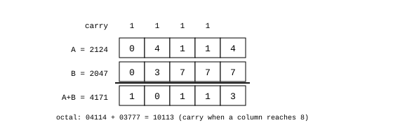

# Adder

James Augustus

## Abstract

The adder is the ALU's positional layer. It performs addition, subtraction and comparison on the number's normal octal digits. The operation has three steps: aligning the two numbers to the same scale, adding the digits with a carry chain, and keeping a result that fits in eight digits or can be normalised without loss. Subtraction is not a separate circuit. It uses two's complement in the same chain. Comparison is a subtraction whose result is not written. After addition, the number's shadow becomes invalid.

## Contents

| Section | Title |
|---|---|
| 1 | Why a separate unit |
| 2 | Three steps |
| 2.1 | Alignment |
| 2.2 | Addition |
| 2.3 | Normalisation |
| 3 | Carry chain |
| 3.1 | Subtraction |
| 3.2 | Comparison |
| 4 | After addition |
| 5 | Measurements |
| 6 | Limits |
| 6.1 | Loss of precision during normalisation |
| 6.2 | Non-overlapping digits |
| 6.3 | Overflow into a neighbouring register |

## 1. Why a separate unit

The shadow form makes multiplication easier but cannot add. In $360 + 7 = 367$, 367 is prime and cannot be derived from the shadow of 360. Trying to write addition in terms of multiplication does not work either: the right side of the identity $(c+d)^2 = c^2 + d^2 + 2cd$ still needs addition, and a square root is needed at the end. A separate unit for addition is therefore necessary.

## 2. Three steps

### 2.1 Alignment

If two numbers have different scales ($rpow$, the position of the radix point), they cannot be added directly. The larger scale, $P=\max(P_a,P_b)$, is chosen as the common scale. The mantissa of the number with the smaller scale is shifted left, and no digit is cut off as long as it fits. Shifting one digit in octal is multiplication by 8 and uses only wire connections.

$$471_8 + 5_8 \cdot 8^{-1}: \quad 471_8 \to 4710_8, \qquad 4710_8 + 5_8 = 4715_8, \qquad 4715_8 \cdot 8^{-1} = 471.5_8$$

### 2.2 Addition

Once the two numbers have the same scale, their digits are added from right to left. If a column's sum reaches 8, the excess passes to the column on the left as a carry.

### 2.3 Normalisation

If the sum exceeds eight digits, the scale is positive and the discarded digit is zero, I can preserve the value by shifting the result right by one octal digit and decreasing the scale by one. At scale 0, this field cannot represent the larger result this way. The current overflow behaviour is open.

Figure 1 shows $4114_8 + 3777_8 = 10113_8$. From right to left, the columns give $4+7 = 13_8$, $1+7+1 = 11_8$, $1+7+1 = 11_8$, $4+3+1 = 10_8$. Each column writes the result digit and passes a carry of 1 to the left. The decimal equivalent is $2124 + 2047 = 4171$.

## 3. Carry chain

An octal digit is three bits. At circuit level, addition uses one full adder per bit:

$$s = a \oplus b \oplus c_{\text{in}}, \qquad c_{\text{out}} = ab + a\,c_{\text{in}} + b\,c_{\text{in}}$$

The carry is 1 when at least two of the three inputs are 1. The chain is combinational. I treat propagation within one clock cycle as a timing target, which requires a clock period long enough for the carry delay.

### 3.1 Subtraction

I take the two's complement of the subtrahend at the working width and add it in the same chain.

### 3.2 Comparison

I compare the values with their type signs and scales taken into account, without writing the subtraction result. Zero and the difference's sign give the ordering only if the aligned difference is kept without overflow. Subtracting two unsigned 24-bit magnitudes at the same scale requires at least a 25-bit signed difference. The choice of widening or an equivalent borrow and magnitude comparison path remains open.

## 4. After addition

The result is in normal form and its old shadow is invalid. If the result is later used in a multiplication, division or root, Resolver rebuilds the shadow. If it will only enter more additions, no conversion is performed.

## 5. Measurements

Measurements recorded in earlier work:

| Test | Scope | Errors |
|---|---|---:|
| Full adder core, against a reference | $2^{24}$ inputs | 0 |
| Combined addition (number, scale, sign) | 20 million | 0 |
| Combined subtraction | 20 million | 0 |

I did not rerun the separate addition and subtraction emulator for this publication. I retain these measurements as a historical record, whose source and command are not included in this package.

## 6. Limits

### 6.1 Loss of precision during normalisation

If the discarded low digit is nonzero, truncating the magnitude loses precision and rounds towards zero. I do not treat this as the current exact-result path. According to the recorded measurement, this loss occurs in about 43.8 percent of random additions and about 87.5 percent of sums exceeding 24 bits. This is the natural cost of a fixed-width number field. How many guard digits to keep and the direction of rounding have not yet been decided.

### 6.2 Non-overlapping digits

If the occupied digits of two aligned numbers do not fall in the same columns, no carry arises and the sum is the two blocks placed side by side. According to the recorded measurement, only about 19 percent of random pairs are like this. This is an observation useful for suitable workloads, rather than a general gain.

### 6.3 Overflow into a neighbouring register

Adding wider numbers by connecting the chain's lowest carry input and highest carry output to a neighbouring register had been proposed. How this path terminates in the current design is open.

[ALU](../ALU.md)
