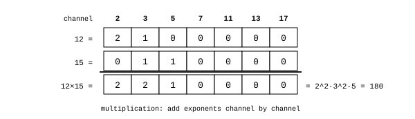
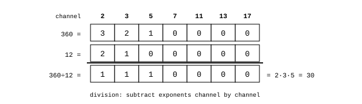
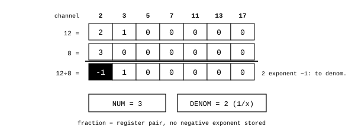

# Multiplication and division

James Augustus

## Abstract

Multiplication and division take place in the ALU's shadow layer. The product of two numbers with ready shadows is the sum of their exponents in each of the seven prime channels. Division is subtraction of exponents. There is no digit-by-digit multiplication and no need for a large multiplier circuit. If an exponent becomes negative, that factor moves to the denominator and the result is kept as a register pair. The product of rough factors not divisible by the seven primes cannot be calculated in the shadow and falls back to the positional path. Here I describe four cases in order: multiplication, exact division, fractions and rough products.

## Contents

| Section | Title |
|---|---|
| 1 | Multiplication |
| 2 | Exact division |
| 3 | Fractions |
| 3.1 | Absorption into scale |
| 3.2 | Division by a fraction |
| 4 | Large exponents |
| 5 | Rough products |
| 6 | Measurements |
| 7 | Limits |

## 1. Multiplication

If the shadows of two numbers are $e_q(a)$ and $e_q(b)$, the product's shadow in each channel is

$$e_q(a \cdot b) = e_q(a) + e_q(b), \qquad q \in \{2, 3, 5, 7, 11, 13, 17\}$$

The seven additions are independent and can be performed at once.

Figure 1 multiplies $12 = 2^2 \cdot 3$ and $15 = 3 \cdot 5$. The additions are $2+0$ in channel 2, $1+1$ in channel 3, and $0+1$ in channel 5. The result is $2^2 \cdot 3^2 \cdot 5 = 180$.

The sign is not kept as a separate bit, it is part of the number's type ($rtyp$). Multiplication combines the signs: minus times minus is plus.

## 2. Exact division

$$e_q(a / b) = e_q(a) - e_q(b)$$

For positive operands without rough factors, if the dividend's exponent is no smaller than the divisor's in every channel, the result is an integer.

Figure 2 divides $360 = 2^3 \cdot 3^2 \cdot 5$ by $12 = 2^2 \cdot 3$. The result is $2 \cdot 3 \cdot 5 = 30$.

## 3. Fractions

If the divisor's exponent is larger in a channel, the difference becomes negative. In $12 / 8$, channel 2 gives $2 - 3 = -1$. This means that factor moves to the denominator: $12 / 8 = 3/2$.

Negative exponents are not stored in hardware. Shadow exponents are always zero or positive. The denominator's factors are written into a separate register and that register's type is set to $1/x$. A fraction thus becomes a pair consisting of a numerator register and a denominator register. Reading its value does not require positional division.

### 3.1 Absorption into scale

If a reduced fraction's denominator consists only of 2s and both the mantissa and scale fit, I can complete the denominator to $8^k$ and absorb it into scale ($rpow$): $3/2 = 12 \cdot 8^{-1}$. This gives an exact octal number with a radix point. Fractions such as $1/3$ and $1/5$ cannot be absorbed. They remain as pairs and preserve their exactness.

### 3.2 Division by a fraction

The divisor's numerator and denominator swap places, and the operation becomes multiplication.

## 4. Large exponents

An exponent cell is 3 bits and holds a value from 0 to 7. Larger exponents spread across four rows ($rs1..rs4$). In the counter model, the four rows are the exponent's octal digits and hold at most $7777_8 = 4095$. When one row overflows, the carry passes to the next row up. This layout is described in detail in [Resolver's gear model](../../Resolver/Gear.md). In the ladder model, each row is a separate level. The choice of a unified record layout remains open. In an earlier version, the rows were used additively and the total capacity was taken as 28.

If an exponent exceeds the capacity, the result does not fit in the shadow. The current counter core returns an error. Automatic fallback to the positional path is a design goal. There is no silent truncation.

## 5. Rough products

The product of the parts of two numbers not divisible by the seven primes cannot be reduced to addition of exponents. In this case, the operation takes the positional path and rough status is marked. The positional path does not require a large multiplier array. In this example, rough numbers are expanded in the form $2^k \pm r$, and multiplication reduces to shifting and addition:

$$19 \cdot 23 = (2^4 + 3)(2^4 + 7) = 2^8 + 10 \cdot 2^4 + 3 \cdot 7 = 256 + 160 + 21 = 437$$

The largest basic multiplication operand in this example is 7. In general, the bound of 7 applies to the octal digit expansion $A=8a+r$, where $0\le r\le7$, not to every deviation from a power of two.

## 6. Measurements

Measurements recorded in earlier work:

| Test | Scope | Errors |
|---|---|---:|
| Multiplication: add exponents, decode, compare with $a \cdot b$ | 20 million pairs | 0 |
| Exact division | 10 million | 0 |
| General division (fractions, cross) | 10 million | 0 |
| Exponent overflow, spreading across layers | $e = 0..40$ | 0 |
| Fraction system | 19 manual tests and 200,000 random | 0 |
| Rough fallback circuit | 5 million | 0 |

The multiplication and division emulator, fraction emulator, exponent overflow test and rough fallback test were run again on 25 October 2026 and passed.

## 7. Limits

According to a recorded measurement, both operands have a rough factor in about 96 percent of 20 million random number pairs. This is why a conventional hardware multiplier is faster for a single rough product. I seek the shadow layer's advantage in numbers without rough factors, chains of products and quotients, and not needing a large multiplier circuit. Cycle times are model estimates.

[ALU](../ALU.md)
