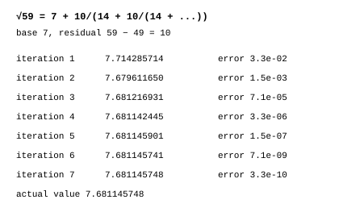

# Square root

James Augustus

## Abstract

The square root unit does not open the root until it is needed. It carries the root as a type and chooses one of three paths according to the number's form. The root of a positive number with even exponents and no rough factor is found by halving the exponents in the shadow. If an odd exponent remains, that factor's root is carried symbolically. The root of a rough number is found digit by digit in octal. To examine the accuracy of these paths, I use a continued fraction formula I found by working backwards from √59. The identity and rational iterations are exact, but each finite convergent remains an approximation.

## Contents

| Section | Title |
|---|---|
| 1 | A root is a type |
| 2 | Three paths |
| 2.1 | A number with even exponents |
| 2.2 | A number with an odd exponent left |
| 2.3 | A rough number |
| 3 | Mode selection |
| 4 | The formula from working backwards |
| 4.1 | Why it is correct |
| 4.2 | Its place in hardware |
| 5 | Measurements |
| 6 | Limits |

## 1. A root is a type

For real $x\ge0$, the value $\sqrt{x}$ can be carried without calculating it by setting the number's type ($rtyp$) to "square root". The root is opened only when the numerical value of the result is needed. In many operations, it need not be opened at all. For example, in $\sqrt{x} \cdot \sqrt{x} = x$, since the type is square root twice, the product turns directly into $x$.

## 2. Three paths

### 2.1 A number with even exponents

For a positive number without a rough factor, the root is found by halving the exponent in each shadow channel:

$$3600 = 2^4 \cdot 3^2 \cdot 5^2 \quad\Rightarrow\quad \sqrt{3600} = 2^2 \cdot 3 \cdot 5 = 60$$

### 2.2 A number with an odd exponent left

The even part is halved, and the root of the factor left with an odd exponent is carried symbolically:

$$72 = 2^3 \cdot 3^2 \quad\Rightarrow\quad \sqrt{72} = 2 \cdot 3 \cdot \sqrt{2} = 6\sqrt{2}$$

The roots of small primes can also be read from a table.

### 2.3 A rough number

The root is found digit by digit in octal. It is the octal version of the digit-by-digit root method learned at school. It needs no multiplier or divider. For a nonnegative integer $N$, the exact integer result is $r=\lfloor\sqrt N\rfloor$, with $r^2\le N<(r+1)^2$. With $f$ fractional digits, the result satisfies $R_f/8^f\le\sqrt N<(R_f+1)/8^f$. This finite value is distinct from the exact symbolic $\sqrt N$.

## 3. Mode selection

I show the historical two-bit root-opening mode proposal here. Its placement in the current 12-bit instruction and its shared encoding with fraction modes remain open:

| Mode | Name | Behaviour |
|---|---|---|
| 00 | symbolic | root is not opened, it is carried as a type |
| 01 | fast | approximate method (binomial expansion or logarithmic), for graphics, sound and similar work |
| 10 | exact | digit-by-digit root, for work needing an exact integer root or a stated fractional error bound, such as physics and finance |
| 11 | automatic | exact for small numbers, fast path for large numbers only if an approximate result at the accepted precision is allowed |

According to a recorded exhaustive scan, the single-term binomial path's largest relative error in $2^{18}\le N<2^{24}$ is approximately $4.8 \cdot 10^{-7}$.

## 4. The formula from working backwards

I started from √59 to derive a reference formula. I thought of $\sqrt{59} = 7.68\dots$ as $7 + 0.68$ and looked for the relation between 59 and the fractional part $0.68\dots$. When I subtracted the base square and divided the residual by twice the base, the denominator repeated itself:

$$\sqrt{p} = t + \dfrac{p - t^2}{2t + \dfrac{p - t^2}{2t + \dfrac{p - t^2}{2t + \cdots}}}$$

Here $t$ is the integer part of the root. For √59, $t = 7$ and the residual is $59 - 49 = 10$:

$$\sqrt{59} = 7 + \dfrac{10}{14 + \dfrac{10}{14 + \dfrac{10}{14 + \cdots}}}$$

Each repetition is one iteration, and the value approaches the exact result.

| Iteration | Value | Error |
|---:|---|---|
| 1 | 7.714285714 | $3.3 \cdot 10^{-2}$ |
| 2 | 7.679611650 | $1.5 \cdot 10^{-3}$ |
| 3 | 7.681216931 | $7.1 \cdot 10^{-5}$ |
| 4 | 7.681142445 | $3.3 \cdot 10^{-6}$ |
| 5 | 7.681145901 | $1.5 \cdot 10^{-7}$ |
| 6 | 7.681145741 | $7.1 \cdot 10^{-9}$ |
| 7 | 7.681145748 | $3.3 \cdot 10^{-10}$ |

The actual value is $\sqrt{59} = 7.681145747\dots$

### 4.1 Why it is correct

Let $x = \sqrt{p} - t$. The equality $(t + x)^2 = p$ gives $x(2t + x) = p - t^2$ and $x = (p - t^2)/(2t + x)$. Repeatedly substituting the same expression for $x$ on the right gives the formula. When I looked into it, I saw that this was a known result: the classical continued fraction expansion of the square root.

### 4.2 Its place in hardware

Each iteration needs a division, and CTCPU has no general divider. This is why I use the formula as a reference calculation for the other paths. I compare the decimal errors in the table with a separate 60-digit root calculation, as in [Final Form](../../../FINAL_FORM/CTCPU_FINAL_FORM.md). I do not treat a finite convergent as the exact root or use this as the hardware path.

## 5. Measurements

According to recorded measurements, more than 25 million checks were made across the square root paths, with no errors found. The square root emulator was run again on 25 October 2026 and passed.

## 6. Limits

A symbolic root has a cost when it needs to be opened. The roots of odd exponents and rough factors are not free in the shadow. Cycle times are model estimates, not circuit measurements.

[ALU](../ALU.md)
