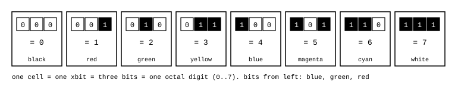

# Cell (xbit)

James Augustus

## Abstract

I began this work with colour. Three light channels mix to give eight colours, and eight colours make one octal digit. This is where the cell, CTCPU's smallest unit, came from: one cell holds three bits and carries a single value from 0 to 7. I call this unit xbit. All registers, numbers and shadow fields are built from cells. Since every digit has a colour, a number can also be read as a sequence of colours.

## Contents

| Section | Title |
|---|---|
| 1 | I started with colour |
| 2 | Definition |
| 3 | Colour |
| 4 | Why three bits |
| 5 | Sizes |

## 1. I started with colour

On 21 April 2026, I described CTCPU as a coprocessor with colour-labelled registers and numbers written in octal. I divided Mersenne prime exponents into classes modulo 3 and marked them with R and Y, then arranged Mersenne numbers in an octal table with a colour letter for every digit.

Looking through colours, I could see a pattern in Mersenne numbers. In octal the numbers in this table all started with a red or a yellow, followed by whites:

| $p$ | $2^p - 1$ | Octal | Colour |
|---:|---:|---|---|
| 5 | 31 | $37_8$ | Y W |
| 7 | 127 | $177_8$ | R W W |
| 11 | 2047 | $3777_8$ | Y W W W |
| 13 | 8191 | $17777_8$ | R W W W W |
| 17 | 131071 | $377777_8$ | Y W W W W W |

On 8 June 2026, I wanted to write Doom in assembly. To do that, I first had to understand how a processor works, then design my own. I thought of computing with light: three light channels give eight colours, and eight colours make one octal digit. I wrote this in my journal: 1 xbit = 3 bits = 1 octal digit = 1 colour. Decision: final. The whole machine language came from this.

On 2 August 2026, I began writing 1, 3, 7 instead of colour letters. I thought I could keep the repetition count instead of writing 734 copies of 7. The colours became numbers, but the processor's unit remained the three bits that came from colour.

Adding green to red gave yellow, and adding blue as well gave white, and I was connecting this mixture to numbers. On 4 September 2026, I wanted to build a colour gate from this notation. The leading digit's dependence on the remainder of $p$ modulo 3 held: if $p = 3t + 1$, the leading digit is 1 (red), if $p = 3t + 2$, it is 3 (yellow), and if $p$ is a multiple of 3, there is no leading digit and the number is only white. When I later looked into why, I found the source. The leading digit does not distinguish primality: $2^5 - 1$ is prime, $2^{11} - 1$ is composite, and both start with yellow.

## 2. Definition

One cell is three bits. The eight values that three bits can take are the eight digits of base eight:

$$\text{cell} \in \{0, 1, 2, 3, 4, 5, 6, 7\}, \qquad 1 \text{ cell} = 3 \text{ bits}$$

A number consists of eight cells. The cells are named $h_7 \dots h_0$ from left to right. $h_0$ is the lowest digit. For example, in the number $1342_8 = 738$, $h_3 = 1$, $h_2 = 3$, $h_1 = 4$, $h_0 = 2$. The largest value eight cells can carry is $77777777_8 = 16\,777\,215$.

## 3. Colour

The three bits correspond to the three primary colours of light. The right bit is red, the middle green, and the left blue. A bit being 1 means that colour is on. The eight values thus give eight colours:

| Value | Bits | Colour |
|---:|---|---|
| 0 | 000 | black |
| 1 | 001 | red |
| 2 | 010 | green |
| 3 | 011 | yellow (red + green) |
| 4 | 100 | blue |
| 5 | 101 | magenta (red + blue) |
| 6 | 110 | cyan (green + blue) |
| 7 | 111 | white |

Colour is a visually readable form of the same value. Since the code holding the number's type also takes one of the same eight values, the type can be shown with a colour too.

## 4. Why three bits

An octal digit fits in exactly three bits, leaving nothing unused. A decimal digit needs four bits and leaves six of the sixteen states unused. In octal, multiplying and dividing by 8 is a shift of one digit. In a circuit, this shift is made simply by rearranging wires. Both Resolver's level descent and the adder's alignment use this property.

## 5. Sizes

| Unit | Cells | Bits |
|---|---:|---:|
| cell | 1 | 3 |
| row | 8 | 24 |
| register | 64 | 192 |
| core (8 registers) | 512 | 1536 |

Related pages: [Register](../Register/Register.md) and [Parts](../README.md).
