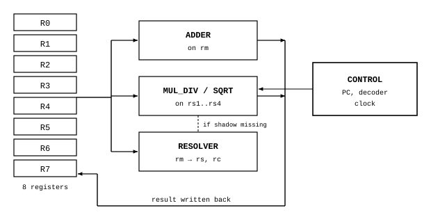
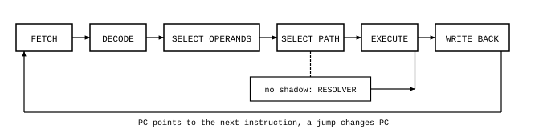

# Core

James Augustus

## Abstract

CTCPU's current design has one core, one thread and eight registers. The core connects the registers, the two layers of the ALU, Resolver and the control unit. The control unit fetches and decodes the instruction, selects the operands and arithmetic path, and writes the result back. If the shadow needed for a multiplicative operation is not ready, Resolver is called. Here I describe the parts of the core and the path of one instruction.

## Contents

| Section | Title |
|---|---|
| 1 | Parts |
| 2 | The path of one instruction |
| 3 | An example |
| 4 | Open questions |
| 5 | Parts in earlier designs |

## 1. Parts

| Part | Job |
|---|---|
| $R0 \dots R7$ | eight [registers](../Register/Register.md), each 192 bits |
| Adder | positional layer: addition, subtraction, comparison (on $rm$) |
| Multiplication, division, square root | shadow layer: exponent arithmetic (on $rs1..rs4$) |
| Resolver | conversion from normal form to shadow |
| Control | program counter, instruction decoder, clock |

The adder and the multiplication, division and square root units together form the [ALU](../ALU/ALU.md). The eight registers together are $8 \cdot 192 = 1536$ bits.

## 2. The path of one instruction

An instruction runs in six steps. First, the instruction pointed to by the program counter is fetched and decoded, meaning its operation code and mode bits are separated. Then the source and destination registers are selected. Next, the path is selected: the positional layer is used for the addition family, the shadow layer for the multiplication family. When the shadow layer is selected and the operand's shadow is invalid, Resolver is called first, then execution returns to the operation. The selected unit produces the result and the result is written back to the destination register. The result's other representation is also updated or invalidated.

The program counter points to the next instruction. A jump instruction changes the value of the program counter. The loop ends when the condition in the program is met.

## 3. An example

Let $R1 = 12$, $R2 = 15$, and let two instructions run:

| Step | Instruction | Path | Result |
|---|---|---|---|
| 1 | `MUL R1, R2` | shadow: $12 = 2^2 \cdot 3$, $15 = 3 \cdot 5$, exponents are added | $R1 = 2^2 \cdot 3^2 \cdot 5 = 180$ |
| 2 | `ADD R1, R2` | positional: $180 + 15$ | $R1 = 195$, shadow invalid |

After the second instruction, the shadow of $R1$ is invalid. At the next multiplicative operation, Resolver rebuilds the shadow of $195 = 3 \cdot 5 \cdot 13$.

## 4. Open questions

The control unit's clock schedule, the number of cycles instructions take and how Resolver connects to the core have not been measured in the current Hunter design. What I describe here are the tasks of execution. Instruction formats are in [ISA](../../ISA.md).

## 5. Parts in earlier designs

Earlier designs had an arrangement in which several cores worked together (cube, leader and workers), a separate controller distributing instructions and an overflow chain carrying into neighbouring registers. The current design has one core. The place of these parts in the current design has not yet been decided.

Related pages: [Register](../Register/Register.md), [ALU](../ALU/ALU.md) and [Parts](../README.md).
