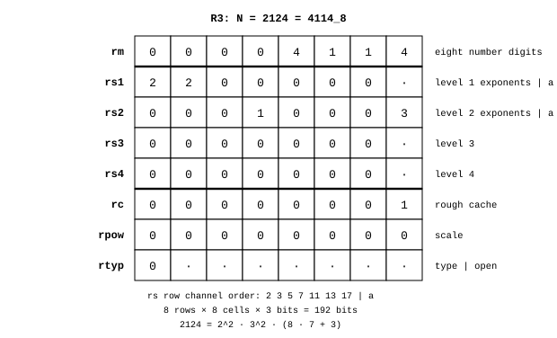

# Register

James Augustus

## Abstract

A CTCPU register holds the complete record of one number. It consists of eight rows, each with eight cells. Since a cell is three bits, the register is 192 bits. Each row has a separate job: the number's octal digits, four shadow rows, rough cache, scale and type. These 192 bits are not all the number itself. The number is only in the eight digits of the first row. The other seven rows hold other representations of the same number and information about it.

## Contents

| Section | Title |
|---|---|
| 1 | Capital R and small r |
| 2 | Rows |
| 3 | An example: 2124 |
| 4 | Rules |
| 5 | Open questions |

## 1. Capital R and small r

There are eight registers in the core: $R0 \dots R7$. Operations use them, for example `ADD R3, R5`. Each large register contains eight rows. I give these small $r$ names: $rm$, $rs1 \dots rs4$, $rc$, $rpow$, $rtyp$. $R3$ has its own $rm$ and its own $rs1$. $rs1$ is not $R1$.

## 2. Rows

| Row | Name | Contents |
|---:|---|---|
| r0 | $rm$ | the number's eight octal digits, $h_7 \dots h_0$ |
| r1 | $rs1$ | shadow, first level: seven exponent cells, $a$ cell empty |
| r2 | $rs2$ | shadow, second level: seven exponents, digit $a$ cut on descent |
| r3 | $rs3$ | shadow, third level: seven exponents, $a$ |
| r4 | $rs4$ | shadow, fourth level: seven exponents, $a$ |
| r5 | $rc$ | rough cache, eight digits |
| r6 | $rpow$ | scale declaration: value $= rm \cdot 8^{-rpow}$ |
| r7 | $rtyp$ | type: cell 0 is the type code, the other seven cells are open |

In the shadow rows, the cells from left to right are the exponents of 2, 3, 5, 7, 11, 13 and 17. The last cell is $a$. In $rs1$, the $a$ cell is empty, because there is no descent from $rm$ to $rs1$. The chain starts at $rs1$. Three descents leave three filled $a$ cells.

## 3. An example: 2124

I write the number $2124 = 4114_8 = 2^2 \cdot 3^2 \cdot 59$ into a register. Resolver's conversion is Example 4 in the [gear model](../Resolver/Gear.md).

The $rm$ row holds the number itself, $00004114$. In the $rs1$ row, the exponents of 2 and 3 are 2, meaning $2^2 \cdot 3^2 = 36$ has been stripped at the first level. In the $rs2$ row, the exponent of 7 is 1 and $a = 3$: the last digit of 59 has been cut and 7 has descended to the second level, $59 = 8 \cdot 7 + 3$. The $rc$ row holds the final residual 1. The initial rough factor 59 is reconstructed from the lower level. $rpow$ is 0, because the number is an integer. Cell 0 of $rtyp$ is also 0, meaning the type is a positive integer.

Reading the shadow rows upwards reconstructs the number:

$$2124 = 2^2 \cdot 3^2 \cdot (8 \cdot 7 + 3)$$

## 4. Rules

If all eight cells of $rm$ are 0, no shadow is built, because zero has no factors. When $rc$ holds the first rough factor, $rc \ne 1$ says that the number has a rough part and removes the need for a separate rough flag. When $rc$ holds the final residual, the lower ladder levels must also be read to determine the initial rough factor. $rc$ is full width, because a number can be entirely rough. For example, $77777775_8 = 16\,777\,213$ is prime and its rough part is itself.

$rpow$ exists to declare the number's precision. With $rm$ fixed, increasing $rpow$ makes the value $rm\cdot8^{-rpow}$ smaller. The value is only scaled down. There is no separate status field. Statuses and type are in $rtyp$. Details are in [Types](../Types/Types.md).

## 5. Open questions

Exactly how the eight cells of the $rpow$ row will be used and the layout of the seven cells of $rtyp$ other than cell 0 have not yet been decided. Whether $rc$ holds the entire first rough factor or the last unprocessed residual is also open. These two meanings cannot replace one another when reading back. The need for a separate ROUGH status depends on this choice.

There is another use for the shadow rows. In the [gear model](../Resolver/Gear.md), the same four rows are used as the octal digits of a single exponent, and an exponent can reach 4095. In the layout described here, each row is a level and each cell holds an exponent from 0 to 7. Which of the two uses will be settled on is open.

Related pages: [Cell](../Cell/Cell.md), [Core](../Core/Core.md) and [Parts](../README.md).
