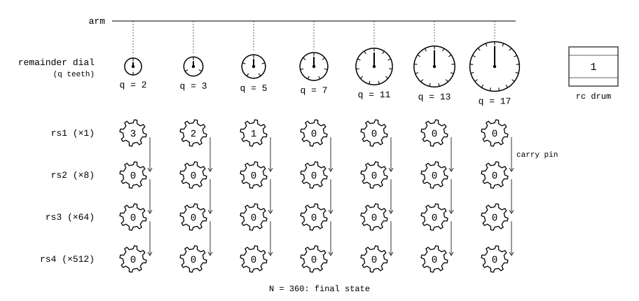
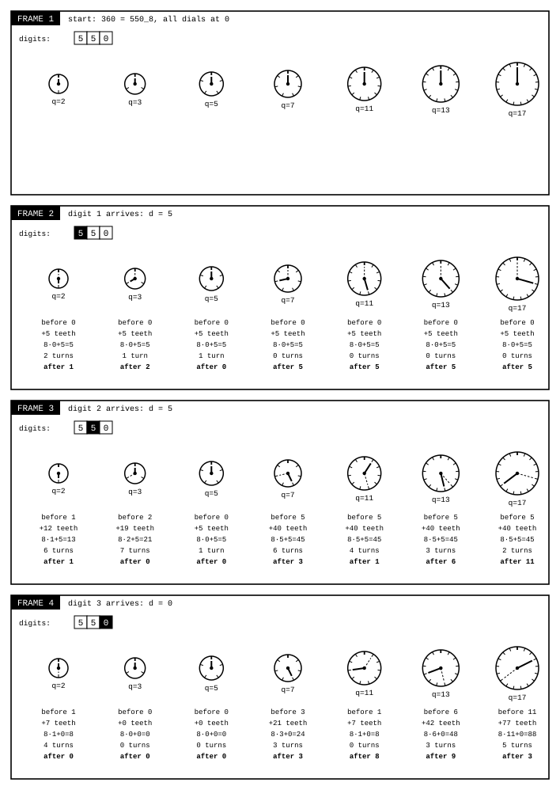
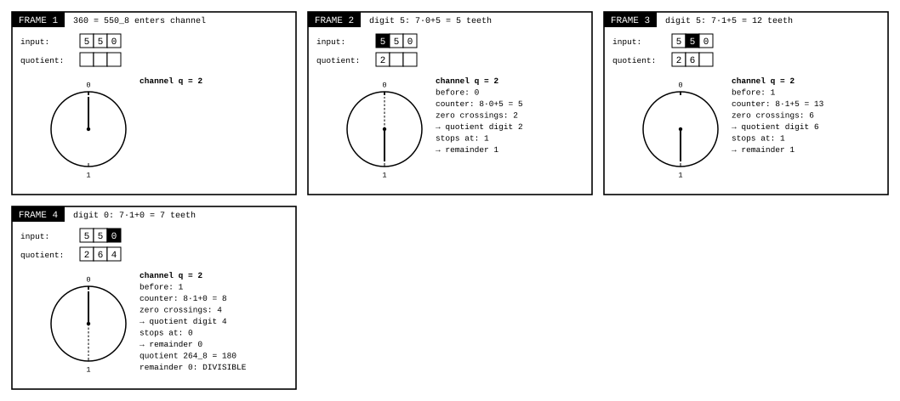
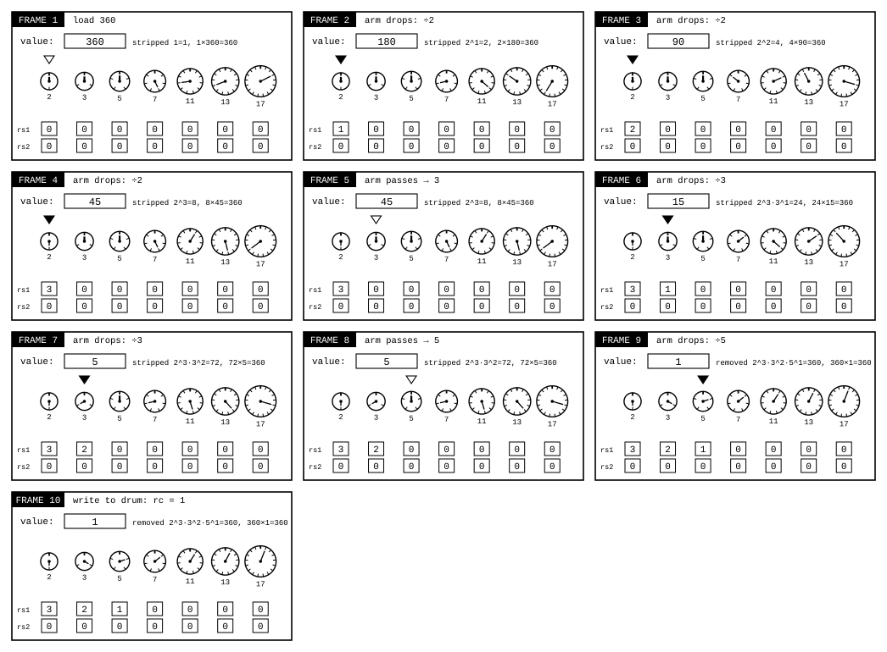
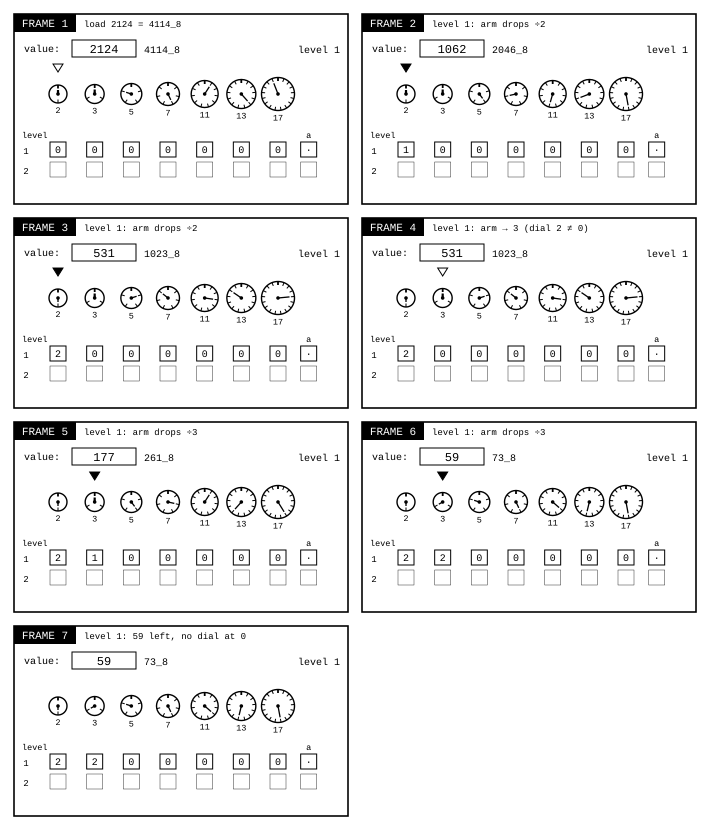
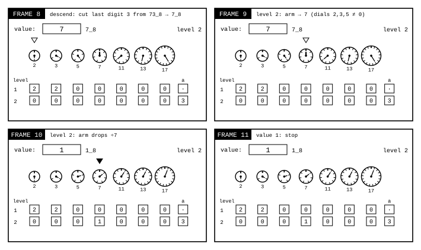

# A gear model for Resolver

James Augustus

## Abstract

Here I describe how the Resolver unit in the CTCPU/Hunter design works through a mechanical analogy. Resolver produces a positive integer's exponents for seven fixed primes (2, 3, 5, 7, 11, 13, 17) and its residual not divisible by these primes. The model has four parts: a remainder dial for each prime, a probing arm, octal exponent counters and a residual drum. The dials do not divide. They turn as the number's octal digits arrive. Where they stop gives the remainder, and the number of times they pass zero gives the quotient digit. The exponent counters advance with carries in base eight. In the experimental layered ladder, a residual not divisible by any of the seven primes is taken down one level by cutting off its last octal digit. The single-level counter form has been tested on a core written in C for every integer in $1 \le N \le 2^{24}$. This is an emulation result, not a circuit measurement.

## Contents

| Section | Title |
|---|---|
| 1 | Introduction |
| 2 | Definitions and notation |
| 3 | Mechanism |
| 3.1 | Remainder dial |
| 3.2 | How the dial finds the remainder without division |
| 3.3 | Probing arm |
| 3.4 | Exponent counters and carry |
| 3.5 | Residual and levels |
| 3.6 | Reading the dials |
| 4 | Examples |
| 4.1 | Example 1 |
| 4.2 | Example 2 |
| 4.3 | Example 3 |
| 4.4 | Example 4 |
| 5 | Reconstruction |
| 6 | Verification |
| 7 | Limits |

## 1. Introduction

In CTCPU, a number is kept in two forms. The normal form consists of octal digits, and addition and subtraction are done in this form. The shadow form keeps the number as prime exponents and a residual. Multiplication and division become addition and subtraction of exponents in this form. Resolver is the unit that converts the normal form to the shadow form.

Here I explain Resolver as a gear mechanism. The aim is to make visible what state the unit holds and what changes at each step.

## 2. Definitions and notation

Let the channel set be $Q = \{2, 3, 5, 7, 11, 13, 17\}$. The physical $rm$ field holds a positive integer $N$ with at most eight digits in base eight. The software core has a wider model, so its test range $1 \le N \le 2^{24}$ also includes $2^{24}$, which does not fit in eight octal digits. The subscript $_8$ marks octal notation. All other numbers are decimal.

For each channel $q \in Q$, $r_q$ is the remainder when the value being processed is divided by $q$, and is shown on the remainder dial. $e_q$ is the number of $q$ factors stripped off, that is, the exponent. $rs1_q, rs2_q, rs3_q, rs4_q \in \{0, \dots, 7\}$ are the octal digits of $e_q$ in the single-level counter form.

The exponent is read from four counters as follows:

$$e_q = rs1_q + 8\,rs2_q + 64\,rs3_q + 512\,rs4_q, \qquad 0 \le e_q \le 7777_8 = 4095$$

In the separate experimental ladder form, the residual is kept in levels. Here the rows are levels, not the octal digits of one exponent. The combined record format remains an open design choice. I call the product of prime powers stripped off at level $k$ $s_k$, the octal digit cut during descent to that level $a_k$, and the value arriving at that level $v_k$. At the first level, $v_1 = N$ and there is no cut digit. I call the value remaining at the last level $rc$. The relation between levels:

$$v_k = s_k \cdot (8\,v_{k+1} + a_{k+1}), \qquad v_{\text{last}} = s_{\text{last}} \cdot rc$$

When a single level is used, this reduces to $N = rc \cdot 2^{e_2}\, 3^{e_3} \cdots 17^{e_{17}}$.

## 3. Mechanism

Figure 1 shows the machine's layout. Each column is one channel. At the top is the channel's remainder dial, with four exponent gears below it. The dial's size is proportional to its number of teeth. The arrows show carry pins.

### 3.1 Remainder dial

Each channel has a dial with $q$ teeth. The thick notch at the top of the dial is 0, and the notches are counted clockwise as 1, 2, …. The dial shows the remainder when the current value is divided by $q$. A dial showing 0 means the value is divisible by $q$.

### 3.2 How the dial finds the remainder without division

The dial does not divide. It only turns. The number enters the machine as octal digits, from left to right. At the start, all dials are at 0. If the dial is at position $r$ when a new digit $d$ arrives, the dial turns another $7r + d$ teeth. This brings its counter to $8r + d$:

$$r_q \leftarrow (8\,r_q + d) \bmod q$$

Since the dial has only $q$ teeth, it passes zero as it turns and wraps around. This wrapping is the $\bmod q$ operation itself. Where it stops is the new remainder. The number of times it passes zero is that digit of the quotient:

$$\text{quotient digit} = \left\lfloor \frac{8\,r_q + d}{q} \right\rfloor$$

The counter never exceeds $8q - 1$. The large number never enters the dial. Only the small remainder moves around it. In channel $q = 7$, a turn of $8r$ means full turns plus $r$, because $8 = 7 + 1$. This channel gives the sum of the octal digits modulo 7.

Figure 2 shows the loading of 360 = $550_8$ digit by digit. In each frame, each dial's previous position is drawn with a dashed pointer and its new position with a solid pointer. The lines below give the previous position, turn, counter, number of turns and new position, in that order. When the three digits are finished, the seven dials show the remainders of 360: 0, 0, 0, 3, 8, 9, 3.

When the arm drops in a channel, the same turn also produces the quotient. In Figure 3, 360 passes through channel 2. Over three digits, the dial makes 2, 6 and 4 turns, in that order. These turn counts are the quotient digits: $264_8 = 180$. Since the dial stops at 0, the remainder is 0, and 360 is divisible by two. The quotient digits enter the next pass in order, and the dials are set again for the new value. The number starts being divided as it enters the machine.

### 3.3 Probing arm

The arm probes the channels in order. If the dial is at 0, the arm drops, the value is divided by $q$, and $e_q$ increases by one. If the dial is not at 0, the arm moves to the next channel.

### 3.4 Exponent counters and carry

Below each channel are four gears with eight teeth each. Each drop of the arm turns the $rs1_q$ gear by one tooth. If $rs1_q$ is at 7 and turns one more tooth, it moves to 0, and a carry pin advances the $rs2_q$ gear by one tooth. The same rule applies to $rs2_q \to rs3_q$ and $rs3_q \to rs4_q$. The counter works like an odometer in base eight. The exponent increases only through the movement of teeth and pins. It does not need an addition circuit.

### 3.5 Residual and levels

In the experimental ladder form, when the arm has passed all channels, if the remaining value is not 1 and is greater than 8, the value goes down one level. Subtracting the remainder and dividing by 8 means cutting off the last digit in octal notation. The cut digit is written as $a$ to the row of the lower level being entered, and the remaining digits pass to that level. At the lower level, the arm starts probing again. When the value becomes 1 or falls below 8, the machine stops, and the final value is written to the $rc$ drum.

### 3.6 Reading the dials

The dial always shows the remainder of the current value. So the positions of the pointers change as the value changes. When the value reaches 1, all dials point to notch 1. On the dial with 17 teeth, notch 1 is just to the right of the top, and the pointer turns to the upper right. On the dial with 2 teeth, notch 1 is at the very bottom. This is why the pointers in the last frame of Figure 4 stand at different angles. They all show the same number, 1.

## 4. Examples

### 4.1 Example 1

$N = 360 = 550_8$.

| Channel | Value sequence | Drop count | $rs1$ |
|---|---|---:|---:|
| 2 | 360 → 180 → 90 → 45 | 3 | 3 |
| 3 | 45 → 15 → 5 | 2 | 2 |
| 5 | 5 → 1 | 1 | 1 |
| 7, 11, 13, 17 | 1 | 0 | 0 |

The result is $360 = 2^3 \cdot 3^2 \cdot 5$, $rc = 1$.

Figure 4 shows the same conversion frame by frame. A filled triangle marks the channel where the arm drops, and an empty triangle marks the channel the arm only passes. Each frame shows the product of the stripped factors multiplied by the remaining value, and it always gives $N$. For example, in the sixth frame, the stripped product is $2^3 \cdot 3 = 24$, and the remaining value is 15: $24 \cdot 15 = 360$.

### 4.2 Example 2

$N = 256 = 2^8$. It shows the carry mechanism.

| Drop | 1 | 2 | 3 | 4 | 5 | 6 | 7 | 8 |
|---|---:|---:|---:|---:|---:|---:|---:|---:|
| $rs1_2$ | 1 | 2 | 3 | 4 | 5 | 6 | 7 | 0 |
| $rs2_2$ | 0 | 0 | 0 | 0 | 0 | 0 | 0 | 1 |

The number on the gear shows what has been stripped, and the value box shows what remains. In the seventh frame, the gear has turned 6 teeth: stripped $2^6 = 64$, remaining value 4, $64 \cdot 4 = 256$. On the eighth drop, $rs1_2$ makes a full turn and $rs2_2$ increases by one. In Figure 5, this moment is in the ninth frame. The exponent read is $e_2 = 0 + 8 \cdot 1 = 8$, $rc = 1$.

### 4.3 Example 3

$N = 59 = 73_8$, in the experimental ladder form. None of the seven dials shows 0, and no gear turns. All exponents are zero. A row with all exponents zero has value 1, because $2^0 \cdot 3^0 \cdots 17^0 = 1$. Since the value is greater than 8, it goes down a level: the last digit 3 is cut from $73_8$, and $7_8 = 7$ passes to the second level. At the second level, the dial of channel 7 shows 0, and the arm drops once.

$$59 = 1 \cdot (8 \cdot 7 + 3)$$

### 4.4 Example 4

A number with a residual in the experimental ladder form: $N = 2124 = 4114_8 = 2^2 \cdot 3^2 \cdot 59$. At the first level, the arm drops twice in channel 2 and twice in channel 3. There is 59 left, and no dial shows 0. The value goes down a level, the cut digit is $a_2 = 3$, and 7 passes to the second level. At the second level, the arm passes channels 2, 3 and 5, and drops in channel 7. The value becomes 1, and the machine stops.

$$2124 = 2^2 \cdot 3^2 \cdot (8 \cdot 7 + 3)$$

Figures 6a and 6b show this conversion. Each row of the table at the bottom is one level, and the last column is the digit cut during descent to that level.

## 5. Reconstruction

In the experimental ladder form, the normal form is built upwards from the lowest level. At each level, the value is first multiplied by 8 and the cut digit is added, then it is multiplied by that level's prime powers. For Example 4: second level $7$, while rising to the first level $8 \cdot 7 + 3 = 59$, then $59 \cdot 2^2 \cdot 3^2 = 2124$. The operation contains only multiplication by small constants and addition of a single digit.

## 6. Verification

The single-level counter form is implemented in a single-file core written in C99. The following tests concern that form, not the layered ladder examples above. The following tests were rerun on 25 October 2026:

| Test | Scope | Errors |
|---|---|---:|
| Conversion and reconstruction | $1 \le N \le 2^{24}$, every value | 0 |
| Comparison with the division-free sieve | same range | 0 |
| Addition, subtraction, multiplication, division | 100,000 random pairs, up to 200 octal digits | 0 |

On 13 October 2026, three deliberately broken copies (counter carry, subtraction borrow, multiplication carry) were also tested, and errors were caught in all three.

Every frame in the figures is an actual state calculated by the program that produces the drawing. The remainder, number of turns and quotient digits were also checked for each example with the equality $N = q \cdot \text{quotient} + \text{remainder}$.

## 7. Limits

These results belong to a software emulation and give no information about circuit area, clock cycles or energy. The tests in the C core cover single-level conversion. Descent between levels (Section 3.5) is shown here only through examples. It has not been implemented and tested in the C core. What happens when an exponent exceeds 4095, how the end of the levels is marked, and zero, negative and fractional inputs are outside the scope here.
