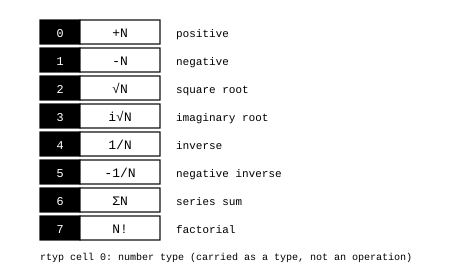

# Types and statuses

James Augustus

## Abstract

In CTCPU, I carry some values as types rather than operations. $\sqrt{x}$, $1/x$, $\Sigma x$ and $x!$ are kept by changing the number's type without calculating them, and opened only when a numerical value is needed. The type is in the first cell of the register's $rtyp$ row and takes one of eight codes. Arithmetic statuses (overflow, zero and the like) are also kept in $rtyp$, rather than in a separate bitmap.

## Contents

| Section | Title |
|---|---|
| 1 | Eight types |
| 2 | Why types |
| 3 | Multiplying types |
| 4 | Statuses |
| 5 | Open questions |

## 1. Eight types

| Code | Name | Meaning |
|---:|---|---|
| 0 | POS | $+N$ |
| 1 | NEG | $-N$ |
| 2 | SQRT | $\sqrt{N}$, $N\ge0$ |
| 3 | ISQRT | $\sqrt{-N}=i\sqrt{N}$, $N\ge0$ |
| 4 | INV | $1/N$, $N\ne0$ |
| 5 | NINV | $1/(-N)$, $N\ne0$ |
| 6 | SIGMA | $1 + 2 + \dots + N$ |
| 7 | FACT | $N!$ |

Eight codes fit in exactly one cell. The sign is also part of the type. There is no separate sign bit.

## 2. Why types

Carrying a value as a type means putting off its calculation until it is needed. In many operations, no calculation is needed at all.

For real $x\ge0$, the product of two SQRT types, $\sqrt{x} \cdot \sqrt{x}$, is directly $x$. For $x\ne0$, the product of INV and POS, $1/x \cdot x$, is 1. For an integer $N\ge1$, the quotient of two FACT types, $N!/(N-1)!$, is $N$. And $\Sigma N$, without adding up $1 + 2 + \dots + N$ one by one, is known as $N(N+1)/2$.

As long as the type information is preserved, the result is exact. A value is opened only when its numerical result is requested. The ways of opening a root are in [Square root](../ALU/Square_Root/Square_Root.md).

## 3. Multiplying types

For sign types, multiplication combines the signs. The product of NEG and NEG is POS. For inverse types, multiplication becomes division. A fraction is kept in two registers, a numerator and a denominator, and the denominator's type is INV. This layout is described in [Multiplication and division](../ALU/Multiply_Divide/Multiply_Divide.md).

## 4. Statuses

The old design had eight independent status bits: overflow (OVF), zero (ZERO), rough (ROUGH), prefix (PREFIX), suffix (SUFFIX), special (SPEC), off (OFF) and wait (WAIT). The current layout has no separate status field.

If $rc$ holds the first rough factor, ROUGH is unnecessary, because $rc \ne 1$ already says there is a rough part. If $rc$ holds the final residual, the lower ladder levels must also be read, and the need for ROUGH depends on this layout choice. In the first case, seven statuses remain, and $rtyp$ has exactly seven cells other than cell 0. If statuses move into cells, they become cells rather than bits, and each can carry a value from 0 to 7. For example, PREFIX and SUFFIX can say which digit they point to instead of being on or off. There is no separate status for sign or division by zero.

## 5. Open questions

If ROUGH is omitted, which cell of $rtyp$ will hold each of the seven statuses has not yet been decided. In the previous emulator, SPEC, OFF and WAIT were defined but never written. In practice, five statuses worked. Not all codes in the type table have implemented behaviour either. The previous emulator core actually assigned only POS and NEG types.

Related pages: [Register](../Register/Register.md), [ISA](../../ISA.md) and [Parts](../README.md).
