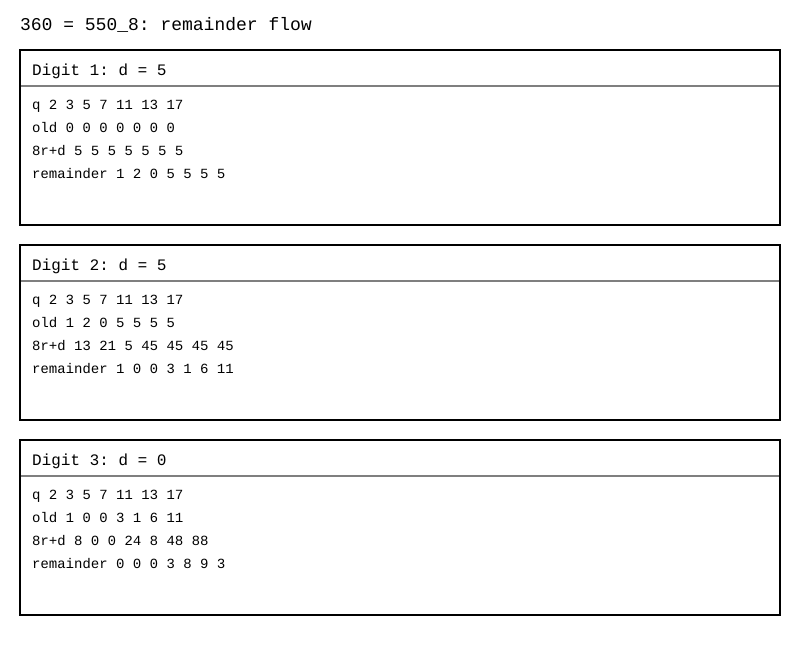
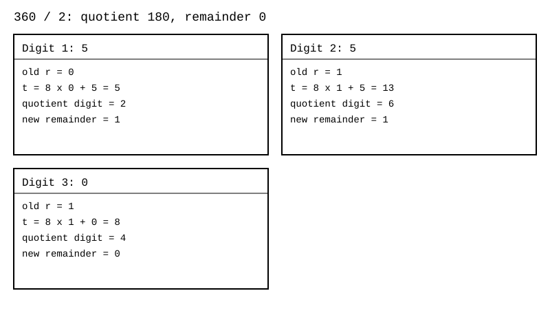
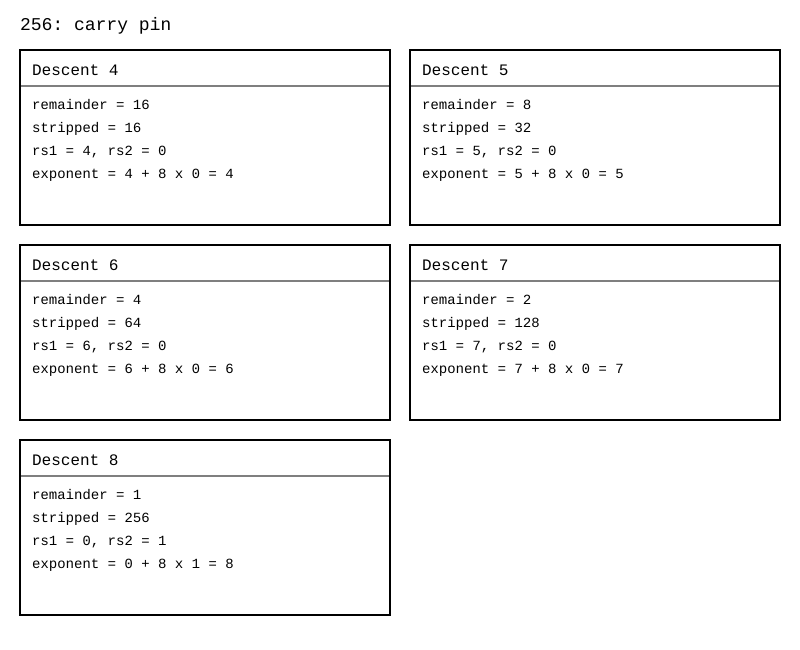
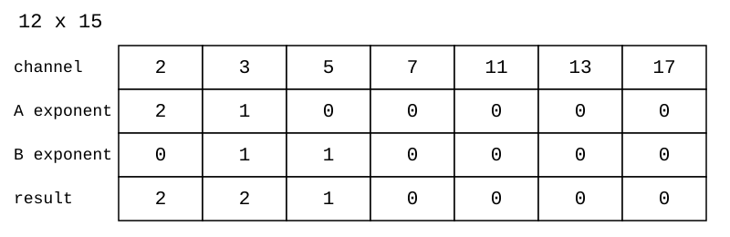
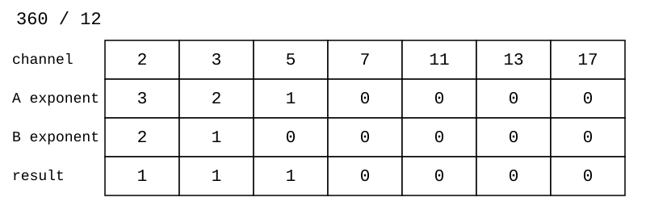
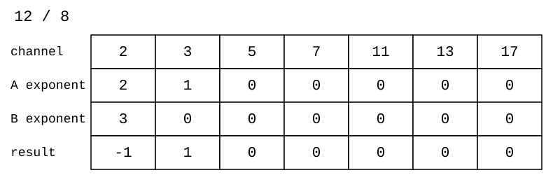
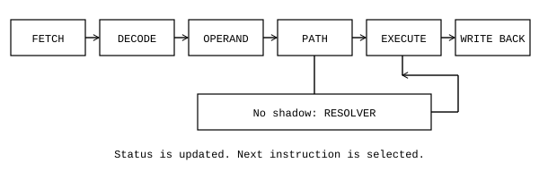

# CTCPU and Hunter

James Augustus

## Abstract

I started this work with colour. I put the eight states of three light channels into a cell, and the cells into an octal number system. I thought of a machine that uses ordinary digits for addition and prime exponents for suitable multiplication and division. I moved between these faces with Resolver. I kept the rough ladder, exponent counters and old cascade form under separate reading rules. I deferred unnecessary opening by carrying the root, inverse, series and factorial as types. I preserved the exact relationship in the fraction pair and the error state whose opening was blocked in quarantine. On 25 October 2026 I reran the examples and selected source tests. I separated what the finite test showed, the old recorded measurement and the open design decision. The idea I am publishing is to keep the number in a form suited to the operation and make the cost of conversion visible. I draw no general conclusion about speed, energy or completed hardware from this idea.

## Contents

| Section | Title |
|---|---|
| 1 | The machine that started with colour |
| 2 | The cell, light sets and colour gates |
| 3 | Register |
| 4 | Resolver forms |
| 5 | Multiplication methods |
| 6 | Division methods |
| 7 | Square root methods |
| 8 | Formulas |
| 9 | Overflow, normalisation and continuation record |
| 10 | Types, statuses and keeping the formula |
| 11 | Quarantine and undefined value |
| 12 | Core, execution and ISA |
| 13 | Decisions I made in Hunter |
| 14 | Verification |
| 15 | What is it for? |
| 16 | Open questions |
|  | About this work |
|  | References |

## 1. The machine that started with colour

### 1.1 I started with colour

I started this work with colour. On 21 April 2026 I thought of a coprocessor with colour-labelled registers and numbers written in octal. When I put Mersenne numbers side by side, I saw sequences of red, yellow and white. A number became a colour sequence that could be read along its digits.

| Exponent $p$ | $2^p-1$ | Octal notation | Colour sequence |
|---:|---:|---|---|
| 3 | 7 | $7_8$ | W |
| 5 | 31 | $37_8$ | Y W |
| 7 | 127 | $177_8$ | R W W |
| 11 | 2047 | $3777_8$ | Y W W W |
| 13 | 8191 | $17777_8$ | R W W W W |
| 17 | 131071 | $377777_8$ | Y W W W W W |

On 8 June 2026 I wanted to write Doom in assembly. First I began to understand how a processor works. I thought of computing with light. Three light channels, eight colours and one octal digit met in the same box. I called the smallest unit xbit. One xbit is three bits.

When I added green to red, I saw yellow, and when blue was added too, I saw white. On 2 August 2026 I began reading the colour letters as numbers. Instead of writing a long sequence of whites one by one, I thought of keeping its repetition count. On 4 September 2026 I returned to the idea of building a colour gate from this notation. Colour remained the visible face of the number.

When I looked into the leading colour in the Mersenne sequence, I found the source. Octal notation groups binary digits in threes. For $p=3t+r$ and $0\le r<3$

$$2^p-1=(2^r-1)8^t+(8^t-1).$$

When $r=1$, the leading digit is red 1. When $r=2$, it is yellow 3. When $r=0$, I add no leading digit, and all the digits are white 7. This pattern does not tell me primality. $31$ is prime. $2047=23\cdot89$ is composite. Both start with yellow. I do not use the pattern I saw in colour as a primality test.

### 1.2 A machine that calculates like a person

On 8 July 2026 I wrote the backbone of the project in one sentence: a machine that calculates like a person. It factors, keeps the symbol, and opens it only at the end.

People found easy ways because they are not computers, and abstraction and mathematics developed partly this way. For $10\cdot9$, a person does not add nine tens, but says 90 directly. They turn $21\cdot36$ into $7\cdot108$. They do not open $2^3+2^4$, but factor it: $2^3\cdot3=24$. In an exam they leave $3\sqrt2$, rather than writing a decimal number with ten digits. A conventional processor, however, calculates blindly, digit by digit. I wanted to build Hunter to calculate like a trained student in an exam.

Multiplication in the shadow behaves a little like a logarithm: the product becomes a sum of exponents. The difference is that the finite-precision logarithmic representation is approximate, while the shadow stays exact with integer exponents within its capacity.

I wrote what I wanted in a manifesto on 18 July 2026. That text is in [A Little Message](../A_LITTLE_MESSAGE.md). I also wrote in my [journal](../THE_ROAD_SO_FAR.md), date by date, what I thought along the way, what I tried, what held and what failed.

### 1.3 Deep breath

On 18 July 2026 I wrote my aim as a machine that wins through calmness rather than speed. I did not want to open a number down to its last digit in every operation. I wanted to carry the necessary information and defer unnecessary calculation. I called this deep breath.

The face of a number suited to addition does not have to be the same as the face suited to multiplication. On the ordinary face I keep octal digits. On the shadow face I keep the exponents of the prime channels I chose and the remainder structure. When addition comes, I go to the ordinary face. When suitable multiplication comes, I go to the shadow face. If one face changes, I also need to track the validity of the other face.

I had the same thought for $\sqrt{x}$, $i\sqrt{x}$, $1/x$, $\Sigma x$ and $x!$. I carry these as types. The type tells me how to interpret the number. I do not need to turn the root into an approximate number immediately. I can keep a fraction as its numerator and denominator without opening it. Cancelling a factorial pair can prevent the large factorial value from ever arising.

Deferring also has a cost. I need to store the type, the link, the validity of the shadow and the opening request. Resolver does work when it converts the number to shadow. If all the digits are wanted in the end, they need to be produced. I do not count these costs as gone.

### 1.4 Hunter's limit

I built the current Hunter with one core, one thread and eight registers. A register is eight rows, and a row is eight cells. I do not count the old multicore cube and this core as the same completed machine. The old models show how the parts were conceived. I leave open the place of parts with no counterpart in the current layout.

A calculation coming out correctly in software does not tell me how many cycles it will take in a circuit. I have no silicon measurement. I keep the old times as measurements in the records. I distinguish the experiments I reran by the date 25 October 2026. I tried the numerical examples with integer and exact fraction arithmetic on the same day.

I started this work with colour. On 18 July 2026 I had written the machine's aim as "a machine that wins through calmness rather than speed". I renamed the machine record from BILINEN.txt to HUNTER.txt on 3 September 2026. Here I describe the same machine from colour to the register, types and core.

## 2. The cell, light sets and colour gates

### 2.1 The cell's eight states

I put three binary channels in a cell. I read the channel on the right as red, the one in the middle as green and the one on the left as blue. At any one time a cell carries one of these eight states. I do not mean eight possibilities existing at once or a quantum state.

$$d=b_R+2b_G+4b_B,\qquad b_R,b_G,b_B\in\{0,1\}.$$

| Digit | Bits $BGR$ | Letter | Colour | Lit channels |
|---:|---|---|---|---|
| 0 | 000 | K | black | $\varnothing$ |
| 1 | 001 | R | red | $\{R\}$ |
| 2 | 010 | G | green | $\{G\}$ |
| 3 | 011 | Y | yellow | $\{R,G\}$ |
| 4 | 100 | B | blue | $\{B\}$ |
| 5 | 101 | M | magenta | $\{R,B\}$ |
| 6 | 110 | C | cyan | $\{G,B\}$ |
| 7 | 111 | W | white | $\{R,G,B\}$ |

The octal digit and colour code describe the same value. The type code also fits in a cell of the same size. Even so, I do not read a number digit and a type cell with the same meaning. The field in which the cell sits determines how the code is interpreted.

When I looked into using the eight colours of three light channels as octal states, I found the source. Talal, Abu-Elnasr and Elmougy built an octal-valued logic model on eight light colours and designed an optical full adder with it ([Talal, Abu-Elnasr and Elmougy, 2021, A Novel Design of Octal-Valued Logic Full Adder Using Light Color State Model](https://doi.org/10.32604/cmc.2021.015759)). In my design the eight colours are the digits of the cell and of the number system, and the number also has a second form, the shadow.

### 2.2 Regions where the light overlaps

I named the regions in space illuminated by three beams of light $L_R$, $L_G$ and $L_B$. Reading which regions a point belongs to gives me a colour. The membership pattern of the three sets gives eight separate regions.

| Region | Set expression | Digit |
|---|---|---:|
| No light | $(L_R\cup L_G\cup L_B)^c$ | 0 |
| Red only | $L_R\setminus(L_G\cup L_B)$ | 1 |
| Green only | $L_G\setminus(L_R\cup L_B)$ | 2 |
| Red and green | $(L_R\cap L_G)\setminus L_B$ | 3 |
| Blue only | $L_B\setminus(L_R\cup L_G)$ | 4 |
| Red and blue | $(L_R\cap L_B)\setminus L_G$ | 5 |
| Green and blue | $(L_G\cap L_B)\setminus L_R$ | 6 |
| All three lights together | $L_R\cap L_G\cap L_B$ | 7 |

Two readings can get mixed up here, so I separate them. Looking from where the light falls, the yellow region is where red AND green light both fall and blue light does not: $(L_R\cap L_G)\setminus L_B$. This is the intersection of the regions outside the blue region. Looking from the colour codes, however, yellow is red OR green: $001\lor010=011=3$. This is the union of the codes, and I turn both lights on together. If I give the codes to an AND gate, $001\land010=000$, there is no shared open channel and the result is black. I see the same yellow from two different places: intersection as a region, union as a code. The gate tables here operate on codes.

The light ratio idea aims to read intensity beyond this presence information. The intensity threshold, sensor response and noise margin are not encoded in the eight-state cell. I left the LIGHT / RATIO PERCEPTION heading in the PROJE record open. I do not describe the three-channel digital model as though a physical optical gate has been built.

### 2.3 A gate from colour to colour

I called the open channels of a colour code $C(d)$. Let the channel universe be $U=\{R,G,B\}$. The gate takes two colours and gives one colour. Since each input takes eight values, a two-input gate has an $8\times8$ table. I did not reduce the output to a single bit meaning only true or false.

$$C(a\mathbin{\mathrm{AND}}b)=C(a)\cap C(b).$$

$$C(a\mathbin{\mathrm{OR}}b)=C(a)\cup C(b).$$

$$C(a\mathbin{\mathrm{XOR}}b)=C(a)\mathbin{\triangle}C(b).$$

$$C(\mathrm{NOT}(a))=U\setminus C(a).$$

NAND is the complement of the AND result. NOR is the complement of the OR result. XNOR is the complement of the XOR result. I take the complement only within the cell's three channels. Thus NOT gives $7-d$ numerically. I do not confuse it with the infinitely wide signed complement in the program.

| Input | 0 | 1 | 2 | 3 | 4 | 5 | 6 | 7 |
|---|---:|---:|---:|---:|---:|---:|---:|---:|
| NOT | 7 | 6 | 5 | 4 | 3 | 2 | 1 | 0 |

I gave the gate two cells, yellow and magenta. For $3=011_2$ and $5=101_2$, AND gave red 1, OR gave white 7 and XOR gave cyan 6. NAND was cyan 6, NOR was black 0 and XNOR was red 1. Six separate colour operations came from the same two cells.

I did not generalise colour mixing as integer addition. Red OR red is still red. As numbers, $1+1=2$ goes to the green code. The adder has carry and numerical weight. The colour gate has the set operation I chose.

When I looked into building logic gates from colours and light, I found the source. Timchenko, Kondratenko and Kreinovich took the colour of a light emitter as the logic variable and built optical OR and AND gates with colour filters ([Timchenko, Kondratenko and Kreinovich, 2023, Implementation of Optical Logic Gates Based on Color Filters](https://doi.org/10.1007/978-3-031-36118-0_12)). The same group extended this to fuzzy colour computing ([Timchenko, Kondratenko, Kozlov and Kreinovich, 2023, Fuzzy Color Computing Based on Optical Logical Architecture](https://doi.org/10.1007/978-3-031-39774-5_55)). Kawano overlaid colour coded films to compute a Boolean AND ([Kawano, 2013, Primitive Optical Computing Model with Films](https://doi.org/10.20965/jaciii.2013.p0791)). I use an idea of the same kind, with the eight colours of a cell and an 8 × 8 table for each gate.

### 2.4 Gate tables

In the tables, the row shows the first input and the column shows the second input. The value at each intersection is the code of the output colour. I generated the tables with a program. I also calculated each cell on the channel sets and compared them.

#### 2.4.1 AND

| A / B | 0 | 1 | 2 | 3 | 4 | 5 | 6 | 7 |
|---|---:|---:|---:|---:|---:|---:|---:|---:|
| 0 | 0 | 0 | 0 | 0 | 0 | 0 | 0 | 0 |
| 1 | 0 | 1 | 0 | 1 | 0 | 1 | 0 | 1 |
| 2 | 0 | 0 | 2 | 2 | 0 | 0 | 2 | 2 |
| 3 | 0 | 1 | 2 | 3 | 0 | 1 | 2 | 3 |
| 4 | 0 | 0 | 0 | 0 | 4 | 4 | 4 | 4 |
| 5 | 0 | 1 | 0 | 1 | 4 | 5 | 4 | 5 |
| 6 | 0 | 0 | 2 | 2 | 4 | 4 | 6 | 6 |
| 7 | 0 | 1 | 2 | 3 | 4 | 5 | 6 | 7 |

#### 2.4.2 OR

| A / B | 0 | 1 | 2 | 3 | 4 | 5 | 6 | 7 |
|---|---:|---:|---:|---:|---:|---:|---:|---:|
| 0 | 0 | 1 | 2 | 3 | 4 | 5 | 6 | 7 |
| 1 | 1 | 1 | 3 | 3 | 5 | 5 | 7 | 7 |
| 2 | 2 | 3 | 2 | 3 | 6 | 7 | 6 | 7 |
| 3 | 3 | 3 | 3 | 3 | 7 | 7 | 7 | 7 |
| 4 | 4 | 5 | 6 | 7 | 4 | 5 | 6 | 7 |
| 5 | 5 | 5 | 7 | 7 | 5 | 5 | 7 | 7 |
| 6 | 6 | 7 | 6 | 7 | 6 | 7 | 6 | 7 |
| 7 | 7 | 7 | 7 | 7 | 7 | 7 | 7 | 7 |

#### 2.4.3 XOR

| A / B | 0 | 1 | 2 | 3 | 4 | 5 | 6 | 7 |
|---|---:|---:|---:|---:|---:|---:|---:|---:|
| 0 | 0 | 1 | 2 | 3 | 4 | 5 | 6 | 7 |
| 1 | 1 | 0 | 3 | 2 | 5 | 4 | 7 | 6 |
| 2 | 2 | 3 | 0 | 1 | 6 | 7 | 4 | 5 |
| 3 | 3 | 2 | 1 | 0 | 7 | 6 | 5 | 4 |
| 4 | 4 | 5 | 6 | 7 | 0 | 1 | 2 | 3 |
| 5 | 5 | 4 | 7 | 6 | 1 | 0 | 3 | 2 |
| 6 | 6 | 7 | 4 | 5 | 2 | 3 | 0 | 1 |
| 7 | 7 | 6 | 5 | 4 | 3 | 2 | 1 | 0 |

#### 2.4.4 NAND

| A / B | 0 | 1 | 2 | 3 | 4 | 5 | 6 | 7 |
|---|---:|---:|---:|---:|---:|---:|---:|---:|
| 0 | 7 | 7 | 7 | 7 | 7 | 7 | 7 | 7 |
| 1 | 7 | 6 | 7 | 6 | 7 | 6 | 7 | 6 |
| 2 | 7 | 7 | 5 | 5 | 7 | 7 | 5 | 5 |
| 3 | 7 | 6 | 5 | 4 | 7 | 6 | 5 | 4 |
| 4 | 7 | 7 | 7 | 7 | 3 | 3 | 3 | 3 |
| 5 | 7 | 6 | 7 | 6 | 3 | 2 | 3 | 2 |
| 6 | 7 | 7 | 5 | 5 | 3 | 3 | 1 | 1 |
| 7 | 7 | 6 | 5 | 4 | 3 | 2 | 1 | 0 |

#### 2.4.5 NOR

| A / B | 0 | 1 | 2 | 3 | 4 | 5 | 6 | 7 |
|---|---:|---:|---:|---:|---:|---:|---:|---:|
| 0 | 7 | 6 | 5 | 4 | 3 | 2 | 1 | 0 |
| 1 | 6 | 6 | 4 | 4 | 2 | 2 | 0 | 0 |
| 2 | 5 | 4 | 5 | 4 | 1 | 0 | 1 | 0 |
| 3 | 4 | 4 | 4 | 4 | 0 | 0 | 0 | 0 |
| 4 | 3 | 2 | 1 | 0 | 3 | 2 | 1 | 0 |
| 5 | 2 | 2 | 0 | 0 | 2 | 2 | 0 | 0 |
| 6 | 1 | 0 | 1 | 0 | 1 | 0 | 1 | 0 |
| 7 | 0 | 0 | 0 | 0 | 0 | 0 | 0 | 0 |

#### 2.4.6 XNOR

| A / B | 0 | 1 | 2 | 3 | 4 | 5 | 6 | 7 |
|---|---:|---:|---:|---:|---:|---:|---:|---:|
| 0 | 7 | 6 | 5 | 4 | 3 | 2 | 1 | 0 |
| 1 | 6 | 7 | 4 | 5 | 2 | 3 | 0 | 1 |
| 2 | 5 | 4 | 7 | 6 | 1 | 0 | 3 | 2 |
| 3 | 4 | 5 | 6 | 7 | 0 | 1 | 2 | 3 |
| 4 | 3 | 2 | 1 | 0 | 7 | 6 | 5 | 4 |
| 5 | 2 | 3 | 0 | 1 | 6 | 7 | 4 | 5 |
| 6 | 1 | 0 | 3 | 2 | 5 | 4 | 7 | 6 |
| 7 | 0 | 1 | 2 | 3 | 4 | 5 | 6 | 7 |

### 2.5 The gate's place in the machine

I get these tables when I apply the same Boolean rule to the three channels in parallel. I keep the single cell with eight states. A gate does not have to produce only a single condition bit. For a more general colour operation, an output code can be assigned to each input pair. In that case I need to choose separately how to implement the table. The six gates here are the gates I defined by channel.

In my project notes from June 2026, I had thought of the colour gate through AND, OR, XOR, NAND, NOR and NOT. On 8 June 2026 I had written the idea of computing with light and the colour map. I have not yet defined AND, OR, XOR and NOT instructions in Hunter's instruction set. So these tables show the logic of colour gates. They are not implemented Hunter instructions.

On 25 October 2026 I tried all 384 input pairs of the six gates. I also tested NOT and De Morgan's identities over all cell values. I found no difference between the bit operations and set operations.

## 3. Register

### 3.1 Capital R and small r

I named the core's registers from $R0$ to $R7$. Each large register contains eight small rows. $R3$ and $rs3$ are different things. $R3$ is the whole record of a number. $rs3$ is one of that record's shadow rows. Each large register has its own shadow.

$$8\ \text{rows}\times8\ \text{cells}\times3\ \text{bits}=192\ \text{bits}.$$

I do not write one large integer across this whole field. The ordinary form of the number is in one row. The remaining rows carry the shadow, residual, scale and type.

| Row | Name | Content |
|---|---|---|
| r0 | $rm$ | The eight number digits from $h_7$ to $h_0$ |
| r1 | $rs1$ | The first level's seven exponent cells, empty $a$ cell |
| r2 | $rs2$ | The second level's seven exponents, $a_2$ cut during descent |
| r3 | $rs3$ | The third level's seven exponents, $a_3$ |
| r4 | $rs4$ | The fourth level's seven exponents, $a_4$ |
| r5 | $rc$ | Eight-digit rough cache |
| r6 | $rpow$ | Scale declaration |
| r7 | $rtyp$ | Type in cell 0, layout of the other cells open |

I read the number digits from left to right as $h_7,\ldots,h_0$. The lowest digit is on the right.

$$rm=\sum_{j=0}^{7}h_j8^j,\qquad 0\le rm\le8^8-1=16\,777\,215.$$

In the example $1342_8=738$, $h_3=1$, $h_2=3$, $h_1=4$ and $h_0=2$. I fill the upper four digits with zero. The register being 192 bits does not make the ordinary number field 192 bits. The ordinary number field is 24 bits.

### 3.2 Reading the shadow row

In the shadow row I keep the exponents of channels 2, 3, 5, 7, 11, 13 and 17 from left to right. The cell at the right end is the digit cut during descent. The channel names are decimal prime names. Channel 11 denotes the prime $13_8$ in octal.

The $a$ cell of the first shadow row is empty. There is no descent by division by eight between $rm$ and $rs1$. $rm$ is the ordinary face of the number. The shadow chain starts with $rs1$. The digit cut by the descent is written into the destination row. There are three descents and three remainder cells between the four rows.

The product with zero exponents gives 1. This does not mean I automatically read an unused row as 1. I need to know the number of levels used and where they end. Otherwise a row I thought was empty adds another $8\times$ step to reconstruction.

### 3.3 The whole record of a number

For $2124=4114_8$, I strip $2^2\cdot3^2=36$ at the first level. The remainder is 59. With the relation $59=8\cdot7+3$, I take 7 down to the second level. I put the cut digit 3 in cell $rs2.a$. At the second level, the exponent of channel 7 is 1.

$$2124=2^2\cdot3^2\cdot(8\cdot7+3).$$

In this example, if I read $rc$ as the last unprocessed residual, $rc=1$. If I read it as the cache of the first rough factor, $rc=59$. I used $rc=1$ in the figure. I have not yet chosen the exact meaning of $rc$. I do not use these two readings interchangeably in the same resolver.

For $rpow$, this example's scale is zero. Cell 0 of $rtyp$ contains the POS code 0. A cell already carries eight values. Eight type codes fit in one cell. If the scale will also stay between 0 and 7, it fits in a single cell too. Then one cell each is enough for $rpow$ and $rtyp$ instead of two full rows, leaving two rows for other work. This is an option I am considering. I have not yet chosen the final layout. So I do not show these two rows as a settled bit sequence in the figure.

### 3.4 Rough and validity

$rc$ is a full row wide. In the interpretation that keeps the first rough factor, the whole number can be rough. $16\,777\,213=77777775_8$ is an example. On 25 October 2026 I tried every candidate divisor up to its square root and verified that it is prime. This number is not divisible by any of the seven channels in the first decomposition.

Reading the presence of rough through the condition $rc\ne1$ is reliable only when I know what $rc$ holds. The ladder can reduce the final residual to 1. In that case, the rough factor of the first level has not disappeared. It has been distributed across the lower levels. This is the arithmetic consequence of leaving the meaning of $rc$ open.

When $rm=0$, I do not build a shadow. Zero has no finite product of prime powers. Even so, I do not mistake an invalid shadow or one not yet built for zero. After LOAD, a nonzero number can also stand without a shadow. For the zero check I need to use valid $rm$ digits and status information.

### 3.5 Three separate readings of the rows

| Source date | Meaning of the rows | Exponent reading |
|---|---|---|
| 6 July 2026, updated 12 July | Exponent parts of the same prime, additive cascade | Sum of four cells, at most 28 |
| 3 September 2026 | Ladder levels of the rough or overflowing number | Smooth and $8v+a$ at each level |
| 13 October 2026, gear model | Octal digits of one exponent | $d_0+8d_1+64d_2+512d_3$, at most 4095 |

I based the register drawing on the ladder layout. In the gear model I use the same four rows for a different job, the octal digits of an exponent. Which reading will settle the physical record is open. I do not assume I can keep ladder levels and exponent counters in the same four rows at the same time.

### 3.6 The core's capacity

| Unit | Cells | Bits | Bytes |
|---|---:|---:|---:|
| Row | 8 | 24 | 3 |
| Register | 64 | 192 | 24 |
| Eight registers | 512 | 1536 | 192 |

When I lay only the $rm$ faces side by side, I see an eight by eight plane. This plane is 64 cells. The whole core also includes the other rows of each register. Full addressing specifies the register, subrow and cell together.

On 25 October 2026 I verified the dimensions, octal conversions, the 2124 record and reconstruction with code.

### 3.7 No separate cache

I did not plan a separate cache layer in Hunter. The ordinary form of a number, its shadow and its rough cache sit together inside a register. Representations that would be calculated separately and written to a cache in a conventional processor are kept in the register itself here. Once built, the shadow is reused, and it is considered invalid after an addition. So the cache operates inside the register.

The limit is clear too. Eight registers are 1536 bits, or 192 bytes. Data and programs larger than this still need memory and a path to bring them in. I am not saying I have removed the need for memory. I am saying that I cache the representations of working values in the register.

## 4. Resolver forms

### 4.1 The information Resolver keeps

For a positive integer I took the channel set $Q=\{2,3,5,7,11,13,17\}$. I keep the exponent $e_q$ in each channel. I call the final factor that is not divisible by the seven primes $rc$. The equality for single-level decomposition is $N=rc\prod_{q\in Q}q^{e_q}$. Here $rc$ does not have to be prime. It only needs to be indivisible by these seven primes.

For $360=2^3\cdot3^2\cdot5$, I found the exponent vector $(3,2,1,0,0,0,0)$ and $rc=1$. For $59$, all exponents are zero and $rc=59$. The product of a row of zero exponents is one, not zero. I recognise zero input separately. I do not put zero into the prime-stripping loop. I separate the sign from the magnitude and carry it in the type. I also treat a fraction as a numerator and denominator. Their register linkage is not something the positive integer Resolver solves by itself.

| Form | Source date | How it finds the remainder and exponent | Scope of the code |
|---|---|---|---|
| Flowing counter | 12 and 13 October 2026 | Octal digit flow, quotient flow, exponent counter with carry | C core, single-level decomposition and wide arithmetic |
| Mersenne flow folding | 13 September 2026 | Adding the high part to the low part | Remainder for a particular modulus |
| Folding gate and exponent digits | 9 September 2026 | Adding or subtracting binary chunks | Remainder gate for six odd primes |
| Digit weights and cutting | 20 July, updated 2 August 2026 | Fixed digit weights, cutting the low three bits | Weight calculation and descent examples |
| Two-beat pipeline | 30 June 2026 | Divisibility first, then division by a fixed prime | First complete decomposition for seven primes |

I ordered the forms from newest to oldest. I separated those with written and tested code from the experimental ones. A working remainder gate does not mean the whole shadow layout is complete in the same code.

### 4.2 Flowing counter

#### 4.2.1 Date, idea and source

I built this form on 12 and 13 October 2026 and wrote it in C. Instead of starting division after the whole number arrived in the register, I thought of producing the quotient as each digit arrived. I kept the remainder in a small state. I passed the quotient digits to the next pass. I accumulated the number of stripped factors in an octal counter.

#### 4.2.2 Remainder flow

I read the digits from left to right. If the channel's old remainder is $r_q$ and the incoming digit is $d$, I form $t_q=8r_q+d$. The new remainder is $r'_q=t_q\bmod q$. The initial remainder is zero. At the end of each step I have the true remainder of the processed prefix. The reason is the Horner step. I have multiplied the old prefix by eight and added the new digit.

Since $0\le r_q<q$ and $0\le d\le7$, $0\le t_q\le8q-1$. The whole large number does not travel around the dial. Only the small remainder does. The seven channels can read the same digit independently. In channel $q=7$, $8\equiv1\pmod7$. In this channel I read the remainder of the digit sum modulo 7. In channel $q=3$, $8\equiv-1\pmod3$. The weights change sign. In channel $q=2$, the last bit is enough.

In the last frame I found the remainders $(0,0,0,3,8,9,3)$ in order. This says that 360 is divisible by 2, 3 and 5. It does not yet say what the exponents are. I do not read a zero remainder and an exponent counter as the same cell.

#### 4.2.3 Quotient flow

From the same $t$ value I take the quotient digit $h=\lfloor t/q\rfloor$. I make the new remainder $r'=t-qh$. $h$ is again an octal digit. I checked the integrity of the quotient flow with the equality $N=qB+r$.

When I passed $360=550_8$ through channel 2, the quotient digits came out as $2,6,4$. $264_8=180$. The final remainder is zero. When I passed $45=55_8$ through channel 3, $17_8=15$ came out. Keeping the leading zeros in the quotient is not necessary. It is enough to preserve the numerical value when moving to the next stage.

#### 4.2.4 Exponent counter and carry

At each exact division I increase the exponent of the corresponding channel by one. I read the four rows as the octal digits of a single exponent:

$$e_q=rs1_q+8rs2_q+64rs3_q+512rs4_q.$$

Each cell is between $0$ and $7$. A full cell returns to zero. The carry goes to the cell above. The largest exponent is $7777_8=4095$. This differs from the old limit of 28, where I simply added the cell values in the four rows.

In the example $3^{14}=4782969=22175571_8$, I passed through channel 3 fourteen times. In the end the residual became one. The exponent digits from low to high are $(6,1,0,0)$. The exponent I read is $6+8=14=16_8$. On the eighth division the first gear returned to zero and advanced the second gear.

#### 4.2.5 Code, testing and the difference

The flowing counter core performs single-level prime decomposition and keeps the exponents as octal counters. The same core also has octal big integer arithmetic. I reran it on 25 October 2026. Over 16,777,216 inputs in the range $1\le N\le2^{24}$, reconstruction differences and disagreements with an independent sieve were zero. Over a hundred thousand random pairs, up to 200 octal digits, the error counters for addition, subtraction, multiplication and exact division were also zero. Test: [hunter_cekirdek](../../TESTLER/HUNTER/01_RESOLVER/hunter_cekirdek).

This scan does not test the layered ladder code. In the flowing counter, what is carried to the lower row is an exponent digit. In the ladder, the part of the value being processed that has been divided by eight goes down. I did not combine the two under the same test result.

### 4.3 Mersenne flow folding

#### 4.3.1 Date, idea and source

I built this form on 13 September 2026 in my Mersenne research. It is the second working form. For $M=2^p-1$, I used the equality $2^p\equiv1\pmod M$. Instead of discarding the high part, I added it back to the low part.

#### 4.3.2 Mechanism and example

Writing $V=HIGH\cdot2^p+LOW$ gives $V\equiv HIGH+LOW\pmod M$. The operation is $V\leftarrow(V\gg p)+(V\mathbin{\&}M)$. If the value exceeds $M$, I fold again. If $V=M$ remains, I turn it into zero. Without this final correction I would show the zero remainder incorrectly.

For $p=13$ and $M=8191$, $37634=4\cdot8192+4866$. Folding gave $4+4866=4870$. I compared it with the direct remainder. $37634\bmod8191=4870$.

In a number made of several chunks, the $w$-bit chunk $i$ has weight $2^{iw}$. I move this weight to position $(iw)\bmod p$ on the ring. If the chunk width exceeds $p$, I fold the chunk itself too. I do not just shift the chunks and leave them in an adder that grows without limit.

#### 4.3.3 Code, testing and the difference

The published [folding test](https://github.com/JamesAugustus/ctcpu-hunter/blob/main/TESTLER/HUNTER/11_DEX_ARASTIRMALARI/hunter_stream026_9dd5af2c/stream026.py) compares streamed folding with direct remainder calculation for $p=13,31,61,127,521$. Its scope is five moduli.

This form does not find the exponents of the seven small primes. It finds the remainder for a single large modulus. The choice $p=4096$ is not a primality claim either. $p$ does not need to be prime for the folding equality.

### 4.4 Folding gate and exponent digits

#### 4.4.1 Date, idea and source

In the channel and register models dated 9 September 2026, I folded binary chunks instead of using octal flow. For a channel I chose $2^w\equiv s\pmod q$ and $s\in\{-1,1\}$. If the number is $LOW+2^wHIGH$, $LOW+sHIGH$ gives the same remainder.

| Prime $q$ | Chunk width $w$ | Equality | New value |
|---:|---:|---|---|
| 3 | 2 | $2^2\equiv1\pmod3$ | $LOW+HIGH$ |
| 7 | 3 | $2^3\equiv1\pmod7$ | $LOW+HIGH$ |
| 5 | 2 | $2^2\equiv-1\pmod5$ | $LOW-HIGH$ |
| 17 | 4 | $2^4\equiv-1\pmod{17}$ | $LOW-HIGH$ |
| 11 | 5 | $2^5\equiv-1\pmod{11}$ | $LOW-HIGH$ |
| 13 | 6 | $2^6\equiv-1\pmod{13}$ | $LOW-HIGH$ |

I did not put channel 2 in this table. The remainder is the last bit. The exponent is the number of trailing zero bits.

#### 4.4.2 Mechanism and example

I folded $738$ in channel 7 as $738\to2+92=94\to6+11=17\to1+2=3$. In channel 11 the low five bits are 2 and the high part is 23. The result was $2-23=-21$. Adding 11 twice gave remainder 1. The direct operation also gave $738\bmod7=3$ and $738\bmod11=1$.

Subtractive folding can produce a negative intermediate value. I do not lose its sign. In the final correction I return to the range $0\le r<q$. Just taking the absolute value can change the remainder.

#### 4.4.3 Code, testing and the difference

I rescanned the range $0\le N\le65535$ in each of the six channels. I compared a total of 393,216 results with the direct remainder. It was rerun on 25 October 2026. There were no errors.

The same 9 September record also had a proposed reading of the exponents as $e_1+8e_2+64e_3+512e_4$. The flowing counter is the working continuation of this exponent layout. I keep the folding gate and exponent layout separate. The first describes divisibility, and the second describes how many factors I stripped.

### 4.5 Digit weights and cutting

#### 4.5.1 Date, idea and source

In the shadow mechanism dated 20 July 2026 and the simple descent card updated on 2 August, I added the digits with fixed weights. Since $N=\sum_kd_k8^k$, $r_q=\sum_kd_k(8^k\bmod q)\bmod q$. I read the weights starting from the lowest digit.

| Prime | One weight cycle |
|---:|---|
| 3 | $1,2$ |
| 5 | $1,3,4,2$ |
| 7 | $1$ |
| 11 | $1,8,9,6,4,10,3,2,5,7$ |
| 13 | $1,8,12,5$ |
| 17 | $1,8,13,2,16,9,4,15$ |

#### 4.5.2 Mechanism and example

For $360=550_8$, the digits from low to high are $0,5,5$. In channel 11 I found $0\cdot1+5\cdot8+5\cdot9=85$. $85\bmod11=8$. In channel 13, $0+40+60=100$ and $100\bmod13=9$. The results are the same as with the flow method.

I used the cutting idea on $59=73_8$. $a=59\mathbin{\&}7=3$. What remained was $59\gg3=7$. The operation I write as $(59-a)/8$ can be done by separating three bits at fixed positions. Its mathematics is easy to prove. I do not infer the physical cost of variable-length transfer, storage and control circuitry from this equality.

#### 4.5.3 Code, testing and the difference

The source has a recorded measurement of the weights tested up to $2^{24}$. I did not rerun this full scan with the weight implementation. On 25 October 2026 I regenerated the cycle tables with $8^k\bmod q$. I compared the 360 example in six channels. The full scan of the old Resolver emulator tested Horner flow.

In the Horner form the digits flow in order. In the weight form each digit's contribution comes from its own position. They are two calculation arrangements of the same remainder equality. Cutting alone does not prove that the next level has been placed in the shadow.

### 4.6 Two-beat pipeline

#### 4.6.1 Date, idea and source

I wrote the first complete unit description on 30 June 2026. I rewrote its abstract on 3 August and 1 September 2026. Instead of a general divider, I built paths that work only for seven fixed primes. The first beat finds divisibility. The second beat strips the same prime repeatedly and counts the exponent.

#### 4.6.2 Mechanism and example

In the first beat I stream eight octal digits into seven channels. In the second beat I divide by a prime whose remainder is zero. I increase the counter until the number is no longer divisible. In channel 2 I can count the trailing zeros by scanning bits.

$510510=2\cdot3\cdot5\cdot7\cdot11\cdot13\cdot17=01745056_8$. At the end of the eight digits all remainders are zero. For $360$, I made three divisions in channel 2, two in channel 3 and one in channel 5. The final residual is one. $59$ passed through all the channels and remained an ordinary residual.

This first version ran on every load. The simple Resolver card dated 29 August records the decision not to run it on loading. The lazy path that builds the shadow at the first multiplicative operation is the current basis. I do not hide the trigger time inside the arithmetic equality.

#### 4.6.3 Code, testing and the difference

I reran the Resolver emulator on 25 October 2026. There were no errors in 117,440,512 remainder comparisons for $0\le N<2^{24}$ and seven primes. There were no errors in 16,777,215 reconstructions over $1\le N<2^{24}$. The checks for correct exponents, no small prime remaining in rough and an odd residual after stripping all the 2s passed. Test: [resolver_emulator](../../TESTLER/HUNTER/01_RESOLVER/resolver_emulator).

This version carries $rc$ in ordinary form. Taking the residual down through levels is not what the code does. The cycle lines in the output are the emulator's model calculation. I did not use them as measured clock time.

### 4.7 Experimental Resolver forms

#### 4.7.1 Resolving through the exponent

On 4 September 2026, while processing a twenty-five-digit number from beginning to end, I tried reading its form without building the body of the number. This form is experimental. For $2^p-1$, $p\bmod3$ determines the octal leading digit. If the remainder is 1, the leading digit is 1. If the remainder is 2, the leading digit is 3. If the remainder is zero, there is no separate short head, and all the digits are 7.

For $p=83$, $83=3\cdot27+2$. So $2^{83}-1$ in octal is a 3 followed by 27 copies of 7. A total of 28 octal digits, 25 decimal digits. I cannot fit the body into the ordinary eight-digit mantissa. The exponent 83 stays small.

$83\equiv3\pmod4$ and $2\cdot83+1=167$ is prime. I opened the $2p+1$ gate from here. Since $2^{83}\bmod167=1$, 167 divides this Mersenne number. I did not put the whole body in the register to say that it is not prime.

For an odd prime exponent $p$, I narrow the prime divisor candidates with the conditions $q=2kp+1$ and $q\equiv\pm1\pmod8$. If $p\equiv3\pmod4$, then $k\equiv0,1\pmod4$. If $p\equiv1\pmod4$, then $k\equiv0,3\pmod4$. These are necessary candidate conditions. Not every candidate is a divisor. The final test is $2^p\bmod q=1$.

This form was demonstrated with a script. It was not coded as a separate Resolver unit. I verified the digit count of the 83 example, the primality of 167 and the divisibility again. I also ran the Lucas Lehmer sequence for $p=13$ for eleven steps and found the final remainder to be zero. I did not confuse this separate primality test with the candidate sieve.

#### 4.7.2 Layered ladder

In the register template dated 3 September 2026, I thought of the four shadow rows as four levels. At each level I strip the small prime factors of the number arriving there. I cut the last octal digit of the remainder. The remaining digits go down one level.

$$v_k=s_k(8v_{k+1}+a_{k+1}).$$

$s_k$ is the smooth product at that level. $a_{k+1}$ is the digit cut during descent. I store the digit in the row descended into. The first row's $a$ cell is empty. I did not descend from the normal number to the first shadow row by dividing by eight.

For $2124=4114_8$, I stripped $2^2\cdot3^2$ at the first level. 59 remained. Since $59=8\cdot7+3$, I took 7 down to the second level. At the second level I stripped channel 7 once. The equality I reconstructed is $2124=2^2\cdot3^2(8\cdot7+3)$.

The remaining value also goes down when the exponent cell fills up. $3^{10}=3^7(8\cdot3+3)=59049$. Here I do not directly add the exponent of 3 at the second level to the one at the first. There is multiplication by eight and addition of three in between.

The layered Resolver has not been coded and tested over the whole input space. I calculated the examples in the drawings and verified their equalities. The level's end marker, the continuation link when four rows run out and the placement of a value below eight after the cell ceiling are open. Reconstructing one example does not close these gaps.

#### 4.7.3 The $a$ cell's double duty and the plain factor

In the shadow scheme of July and August 2026, I gave the $a$ cell two separate duties. If all the 2s have been stripped, rough is odd. In that case the last digit left on descent can be $1,3,5,7$. I thought of using the unused even codes for the row type.

| $a$ code | Historical meaning |
|---|---|
| $1,3,5,7$ | Remainder digit of a real ladder descent |
| $0$ | Plain factor row joining the upper product without descent |
| $2$ | Rough row whose cells are read as a normal number |
| $4,6$ | Prefix or suffix marking the neighbouring register boundary |

In the example $2^{11}=2048=2^7\cdot2^4$, I wrote 7 in the first row and 4 in the second. The second row's $a=0$ value is not a real descent. This version's capacity is 28, the simple sum of four cells. The overflow test runs in the old cascade emulator.

This double duty relies on the reasoning that the remainder is odd only if all the 2s have been stripped. If stripping 2 stops at the cell ceiling, an even remainder can descend. In the example $7936=2^8\cdot31=2^7(8\cdot7+6)$, the descent digit is 6. So I did not directly carry the old type encoding into the new ladder where each level makes a real descent.

### 4.8 Gear model

#### 4.8.1 Dial, arm and drum

I used the gear analogy to picture the remainder, quotient and exponent count. Each prime has a dial with $q$ teeth. The notch where the pointer stops is the remainder. The sensing arm checks the zero notch. If division succeeds, the arm drops. The quotient flow carries the new value. The exponent gear advances one tooth. After all the small primes are finished, the residual of the single level stays in the $rc$ drum.

When the dial is at notch $r$, I turn it another $7r+d$ teeth. Including the starting position, the total becomes $8r+d$. The number of zero crossings is the quotient digit. The notch where it stops is the new remainder. For $360/2$, the zero crossings are $2,6,4$. I read these three numbers side by side as an octal quotient.

Each tooth of the exponent gear is one successful exact division. One turn of the remainder dial is one unit of the quotient digit currently being produced. These two movements are not the same thing. Several turns within one quotient digit do not mean that several primes have been stripped at once.

#### 4.8.2 The carry pin's movement frame by frame

In the example $256=2^8$, I increased the exponent after each division. On the seventh division the first gear became 7. On the eighth division the first gear returned to zero. The carry pin made the second gear 1. I read $(0,1,0,0)$ from low to high. This exponent is eight.

#### 4.8.3 The place of level descent in the gear model

The dial and counter description corresponds to the working single-level core. Cutting the rough in the drum and taking it down a level corresponds to the layered ladder experiment. I can show these side by side in the mechanical analogy. I cannot assume that the same four physical rows are both exponent digits for each prime and ladder levels for the whole number. If a four-digit exponent counter is also to be added to the layered form, each level will need its own counter field. This layout is open.

### 4.9 Dated distinctions and rerun

| Topic | Old record | Current basis and open decision |
|---|---|---|
| rs1..rs4 | Plain factors in July and August, ladder levels on 3 September | Octal digits of the exponent in the flowing counter of 12 and 13 October. I use this in the working arithmetic. Integration of the layered representation is open |
| Exponent capacity | $4\cdot7=28$ in the cascade of 6 and 10 July | $7777_8=4095$ in the flowing counter. One is not the test scope of the other |
| $a=0$ | Plain factor without descent in the old form | Real descent in the 3 September ladder. It cannot be read silently with the same resolver |
| $rc$ | The names first rough or last unprocessed residual were used | The final rough is clear for a single level. Which residual will be kept permanently in the layered form is open |
| Trigger | Loading in the 30 June version | First multiplicative operation in the 29 August card. The current lazy path uses this |

I reran them on 25 October 2026. There were no errors in the full tests of [resolver_emulator](../../TESTLER/HUNTER/01_RESOLVER/resolver_emulator) and [hunter_cekirdek](../../TESTLER/HUNTER/01_RESOLVER/hunter_cekirdek). In a separate example program I tried the octal flow equalities, folding gates, exponent codes and ladder reconstructions. Every value in the figures is a calculation from this program. This run has no general code for the layered ladder or FPGA measurement.

## 5. Multiplication methods

### 5.1 Adding exponents in seven channels

#### 5.1.1 Idea, source and equality

I laid the basis of the multiplication unit on 6 July 2026. I follow the same path in the current representation.

If $A=r_A\prod_q q^{a_q}$ and $B=r_B\prod_q q^{b_q}$, then

$$AB=(r_Ar_B)\prod_q q^{a_q+b_q}.$$

The seven exponent sums are independent of each other. Addition in one channel does not wait for another prime's result. A carry can propagate through the exponent digits of the same channel. So seven independent channels do not mean a single physical cycle at every width. Whether the shadow is ready, the carry chain, the rough product and the register write also involve work.

#### 5.1.2 Example by channel

I multiplied $12=2^2\cdot3$ by $15=3\cdot5$. I found $2+0=2$ in channel 2, $1+1=2$ in channel 3 and $0+1=1$ in channel 5. The other exponents stayed zero. The result is $2^2\cdot3^2\cdot5=180$.

If there is no shadow before adding the exponents, Resolver is needed. If addition or subtraction changed the mantissa, I do not count the old shadow as valid. I build the new shadow at the first multiplicative operation. I wanted to avoid repeating the same decomposition over and over in a long product chain.

#### 5.1.3 The sign is inside the type

In the product of ordinary positive and negative numbers, I combine the signs. For the magnitude I use the same exponent and rough calculation. $(-6)\cdot7=-42$. I carry the product of two negative operands with a positive type. I do not define the architectural sign as a separate independent flag.

For root, imaginary root and inverse types, the sign rule alone is not enough. I use the rule $\sqrt{A}\sqrt{B}=\sqrt{AB}$ for real, nonnegative inputs. The closure $\sqrt{A}\sqrt{A}=A$ works without opening the root. I do not directly write $AB$ for the product of two different roots. The implementation status of the full type operation table is separate from the test of the ordinary signed number emulator.

### 5.2 Exponent carry and overflow

In the July cascade I carried a large exponent as the sum of four cells. $23=7+7+7+2$. The old code's capacity is 28. In the flowing counter of 12 and 13 October, however, the four cells are octal digits. I read the same value 23 as $(7,2,0,0)$ from low to high. The current capacity is 4095.

In multiplication, $s=a_q+b_q$ is calculated for each channel. In digit notation, when a cell's sum exceeds seven, the carry goes to the higher digit. If a carry leaves the final top digit, the result does not fit in the shadow. I do not truncate silently. The latest draft describes reporting overflow and switching to the ordinary path in this case. In the boundary check of 25 October 2026, the working counter core returned an error. Automatic fallback to the ordinary path was not verified in this core. Linking overflow to other registers is a separate system contract.

The old boundary example is $(2^{23})(2^{23})=2^{46}$. 46 does not fit the old capacity of 28. The same exponent fits as $56_8$ in the current counter. I did not read the overflow seen in the old emulator as meaning the current counter would overflow at the same point.

### 5.3 Rough multiplication

#### 5.3.1 Why there is a separate path

If $r_A$ and $r_B$ are greater than one, their product does not come from just seven exponent sums. Rough does not mean worthless or approximate. It means the exact factor outside the seven primes. I preserve this factor in the product.

$19$ and $23$ are not divisible by any of the seven channels. Both have a zero exponent vector. Adding these vectors gives only a zero vector. The result cannot be 1. The rough product $19\cdot23=437$ is needed separately.

#### 5.3.2 Binomial around a power of two

I wrote one number as $2^k+u$ and the other as $2^m+v$. $u$ and $v$ can be signed. The expansion is

$$AB=2^{k+m}+u2^m+v2^k+uv.$$

I can multiply by powers using shifts. The cost of the product $uv$ depends on the size of the deviations. Binomial notation alone does not guarantee small deviations.

I calculated the example in the final multiplication record exactly as given:

$$19\cdot23=(2^4+3)(2^4+7)=2^8+10\cdot2^4+3\cdot7=256+160+21=437.$$

I can also write the same product as $(32-13)(32-9)$. The result is the same. But with this choice the small remainders are 13 and 9. It does not meet the small multiplication path's limit of seven in one step. I do not choose the power anchor just because it is the nearest larger power.

#### 5.3.3 Octal binomial and recursion

The rough fallback emulator has a more regular split. I write $A=8a+r_A$, $B=8b+r_B$ and $0\le r_A,r_B\le7$. Then

$$AB=64ab+8(ar_B+br_A)+r_Ar_B.$$

I make the same split again for $ab$. When one operand is smaller than eight, I switch to the small multiplication routine. The factors $64$ and $8$ are fixed shifts. In small multiplication, at most three shifted contributions are added according to the bits of the narrow operand. The wide operand itself does not need to be smaller than seven. The limit concerns the value of the small factor.

$19=8\cdot2+3$ and $23=8\cdot2+7$. The expansion is $64\cdot4+8(2\cdot7+2\cdot3)+3\cdot7=437$. It gave the same numerical terms as the example around a power of two. In the general method, octal cutting determines the remainder at each step.

#### 5.3.4 Code and testing

I reran the rough fallback circuit on 25 October 2026. When both numbers are rough, multiplication does not reduce to adding exponents. Then I expand the number into an octal binomial as $A=8a+r_A$ and find the product as $64ab+8(a\,r_B+b\,r_A)+r_A r_B$ using shifts and small additions. Over five million pairs, this expansion gave the same result as direct wide integer multiplication. The error counter was zero, and the largest narrow factor seen was 7. Test: [rough_fallback_devre_test](../../TESTLER/HUNTER/04_CARPMA_BOLME/rough_fallback_devre_test).

In this run, the number of pairs in which both operands contained rough was 4,960,826. About 99.2 percent of the total five million pairs. In the main multiplication emulator, which ran with a different input distribution, the rate was 96.6 percent. I do not use these rates as fixed rates for all numbers.

### 5.4 Hunter8 shift-and-add path

#### 5.4.1 Source and status

In a separate teaching model I called Hunter8, I performed multiplication by shifting and adding in binary. I wrote the multiplication extension on 10 September 2026. I do not count this state machine as the same hardware as the prime-exponent shadow. It stands as an explicit calculation of binary shift-and-add.

#### 5.4.2 Mechanism

I took the accumulated result as $S=0$, the shifted multiplicand as $A$ and the scanned multiplier as $B$. If the lowest bit of $B$ is one, I add $A$ to $S$. Then I shift $A$ one bit left and $B$ one bit right. At each step $S+A B$ stays equal to the initial product. When $B=0$, the result is $S$.

For $6\cdot7$, $7=111_2$. The contributions are $6$, $12$, $24$. The sum is $42$. If a bit of the multiplier had been zero, I would not have added that position's contribution. The fixed-width teaching model can visit all bit positions. The short loop can stop when the remaining multiplier is zero.

A wide adder can work in one multiplication step. I do not count a step in Hunter8 as the same amount of work as a single-bit step of the serial adder. I also do not confuse this path's bit shift with the octal digit shift in Hunter's main instruction draft.

#### 5.4.3 Code and testing

In the example program I wrote shift-and-add and octal binomial multiplication separately. For the example pairs I compared both with direct Python integer multiplication. Hunter8's C counterpart was also run separately with its own test command. The result being correct is not a measurement showing that it is faster than the built-in processor multiplier.

### 5.5 Digit multiplication in a small base

I read the octal digits as $A=\sum_i a_i8^i$ and $B=\sum_jb_j8^j$. The product is $AB=\sum_{i,j}a_ib_j8^{i+j}$. Each small digit product is between $0$ and $49$. The largest single-digit product is $7\cdot7=49=61_8$. I also include the previous carry in the digit sum. The new digit at that position is the sum's remainder modulo eight, and the new carry is the integer part of its quotient by eight.

$19=23_8$, $23=27_8$. In the lowest column, $3\cdot7=21=25_8$. I wrote 5 in the last digit and carried 2. In the next column, $2\cdot7+3\cdot2+2=22=26_8$. I wrote 6 in the digit and 2 in the carry. At the top, $2\cdot2+2=6$. The result is $665_8=437$.

This arrangement and the octal binomial use the same distributive law. Digit multiplication adds contributions into columns. The binomial path applies the same operation recursively to the high part. I can implement small digit multiplication with a table, shift-and-add or a small multiplier. I did not infer the final physical choice from this equality.

### 5.6 Keeping the binomial and factor forms together

On 25 October 2026 I stated my direction for the shadow system clearly. I can both keep the number as a binomial and factor it. $19=2^4+3$ is a binomial record. $360=2^3\cdot3^2\cdot5$ is a factor record. $2124=2^2\cdot3^2(8\cdot7+3)$ is a ladder example where a factor and a sum in the base sit together.

A pure exponent vector is closed under multiplication. A binomial containing addition has cross terms. I cannot add all the exponents I see at different ladder levels into one vector. A prime at a lower level may not be a direct prime factor of the upper number. For example, the second level of 59 contains 7, but 7 does not divide 59.

I need to know which rule to use when reading the form. Even if the numerical value stays the same, an exponent digit, a ladder level and a binomial deviation do not give a field the same meaning. The choice of a common record format is open. I did not present the existing arithmetic equalities as though a new type or cell code had been settled.

### 5.7 Complementary paths in the idea records

#### 5.7.1 Preserving the common factor

On 8 July 2026 I thought of taking out the common factor before addition: $a+b=g(a'+b')$. In the shadow channels the smallest exponents give the common part. I add the small cofactors positionally. $2^3+2^4=2^3(1+2)=24$. A person does this too. They do not open the two powers one by one, but factor them.

This operation does not directly perform addition on two exponent vectors. The common factor is preserved. If the shadow of the cofactor sum is needed, it is resolved again. It helps me see which part stays unchanged in the product chain.

#### 5.7.2 Conjugates and quarter-squares

On 3 July 2026 I thought of keeping the number as directions rather than an address and considered the path $(a+b)(a-b)=a^2-b^2$. $(5+4)(5-4)=25-16=9$. The quarter-square equality is $ab=((a+b)^2-(a-b)^2)/4$. $19\cdot23=(42^2-(-4)^2)/4=437$.

These are known algebraic identities. In the square of a number whose shadow is ready, the exponents are multiplied by two. But the preceding $a+b$ and $a-b$ operations may require positional work and a new decomposition. I did not present the quarter-square as hardware that had replaced the working rough binomial emulator. I kept it as a candidate path in the idea record.

#### 5.7.3 Power and deviation record

On 1 July 2026 I thought of a power register that keeps the number as a base, exponent and deviation. For pure powers, $a^xa^y=a^{x+y}$. When a deviation is added, $(a^x+u)(a^y+v)$ needs cross terms. So compact storage and cheap multiplication are not the same promise. The record format of the dynamic base, field width and opening time are open.

### 5.8 Rerun and scope

It was rerun on 25 October 2026. I read the results for the representation that the source code actually tested.

| Program | Check in this run | Result |
|---|---|---|
| `mul_div_emulator` | 20 million signed products | 0 errors |
| `kaskad_uctan_uca_test` | 3 million smooth products, old cell layout | 0 errors |
| `kaskad_uctan_uca_test` | Reconstruction up to 28, overflow from 29 to 56 | Expected behaviour |
| `rough_fallback_devre_test` | 5 million octal binomial products | 0 errors |
| `hunter_cekirdek` | 100,000 wide multiplication pairs, including lazy shadow | 0 errors |
| `multiply_add` | 69,664 valid multiplication calls and 26 invalid input checks | 69,690 calls passed |

The output text of the main multiplication emulator still has the old base 10 POW description. I did not say this program integrates POW with the current base 8 contract. I tested POW behaviour separately in the fraction emulator. I also did not rename the cascade's limit of 28 as the current limit of 4095.

The multiplication emulator produced 19,327,807 pairs in which both operands contained rough. The denominator is 20 million pairs. I kept this distribution when considering the benefit of the shadow. In smooth products the exponent operation stays small. In rough multiplication there is extra work. I made no circuit measurement for gains in area, energy or clock speed.

The same verification program calculated the examples and figure values here. Tests: [mul_div_emulator](../../TESTLER/HUNTER/04_CARPMA_BOLME/mul_div_emulator), [kaskad_uctan_uca_test](../../TESTLER/HUNTER/04_CARPMA_BOLME/kaskad_uctan_uca_test) and [rough_fallback_devre_test](../../TESTLER/HUNTER/04_CARPMA_BOLME/rough_fallback_devre_test).

## 6. Division methods

### 6.1 Division in the shadow

#### 6.1.1 Subtracting exponents

On 6 July 2026, I built division as the inverse of multiplication, and I follow the same path in the current representation. If $A=r_A\prod_q q^{a_q}$ and $B=r_B\prod_q q^{b_q}$, then

$$\frac AB=\frac{r_A}{r_B}\prod_q q^{a_q-b_q}.$$

I subtract the exponents separately in seven channels. For two smooth numbers, the quotient is an integer if all the differences are nonnegative. If there is rough, this condition alone is not enough. The rough ratio must also divide exactly. In the example $19/23$, all the exponent differences are zero, but the quotient is not an integer. I put this limit explicitly into the general rule.

#### 6.1.2 Exact division example

$360=2^3\cdot3^2\cdot5$ and $12=2^2\cdot3$. I found the exponent differences to be $(1,1,1,0,0,0,0)$. The result is $2\cdot3\cdot5=30$. The rough ratio is also $1/1$, so no other work remained.

In the core that accepts exact division, I formed $A=BX$ and then tried $A/B=X$. I do not force a truncation on an input that does not divide exactly and present it as an integer result. I move to the layer that supports fractions or reject it according to that instruction's contract. These two behaviours belong to the scope of different emulators.

### 6.2 Keeping a fraction as a pair

#### 6.2.1 A negative exponent is a calculation sign

In $12/8$, the 2 channel gave $2-3=-1$. The 3 channel kept $1-0=1$. The mathematical expression is $2^{-1}3=3/2$. I do not store a negative exponent cell in hardware. I move the missing factor of 2 into a separate denominator record.

The numerator and denominator stay in separate registers. I read the denominator side with the inverse type. The exponent cells are zero or positive. The sign also travels with the type information. This representation does not produce an approximate number. The pair $3/2$ stays exact internally at whatever precision I display it.

#### 6.2.2 Common factors and rough policy

I can subtract the common exponent of the same small prime on both sides. If the denominator falls to one, the pair can close. I did not require general factorisation for the rough sides. The multiplication and division record dated 12 July 2026 has a lazy policy that does not automatically perform general simplification for double rough. If needed, I carry the ratio with its correct value without simplifying it.

The fraction emulator includes small-factor removal and its own simplification calls. I do not interpret the call count in its output as general GCD hardware for all rough pairs. How the old model's register pair and flag names connect to the current Hunter layout is open. Test: [kesir_emulator](../../TESTLER/HUNTER/04_CARPMA_BOLME/kesir_emulator).

### 6.3 Exact absorption into POW

#### 6.3.1 Base eight

On 6 July 2026, I corrected the old base 10 expression. Here $10_8$ is eight. I read the Hunter scale as $V=NUM\cdot8^{-POW}$. POW scales down. If the scale is kept in a single cell, then $0\le POW\le7$. I have not yet decided whether to make $rpow$ a full row or a single cell.

If the denominator of the simplified fraction is $2^u$, I choose $k=\lceil u/3\rceil$. The fraction is

$$\frac{A}{2^u}=A2^{3k-u}\,8^{-k}.$$

When I complete the numerator with $2^{3k-u}$, the denominator becomes $8^k$. For this step to open exactly, $k$ must fit in the POW field and the new mantissa must fit in the number field. The denominator consisting only of factors of 2 is necessary, but it does not replace the capacity check.

#### 6.3.2 Example and limit

For $3/2$, $u=1$, $k=1$. I multiplied the numerator by four. $3/2=12\cdot8^{-1}=1.4_8$. The decimal value is $1.5$. $1/3$ and $1/5$ do not become finite octal fractions, so they stay as pairs.

$1/2^{21}=1\cdot8^{-7}$ fits within the single-cell POW limit. But $1/2^{23}=2\cdot8^{-8}$ needs POW 8. I saw the fraction emulator reject this and preserve the exact pair. I did not take the $5^{23}$ reasoning in the old opening document as the current base 8 rule. The reason for rejection in the rerun code is the POW field.

### 6.4 Division by a fraction and the inverse type

If the divisor is not zero, I swap its numerator and denominator. Then I move to the multiplication path:

$$\frac ab\div\frac cd=\frac{ad}{bc}.$$

I first make the necessary zero checks for $b,c,d$. $(3/2)/(3/4)=12/6=2$. When the common factors of the numerator and denominator cancel, the result becomes a single number.

Fraction addition is not as easy. $3/2+1/3=(3\cdot3+1\cdot2)/(2\cdot3)=11/6$. After the two cross products, I add the numerators positionally. An inverse type does not automatically turn addition into exponent subtraction.

I do not use a quarantined $1/0$ record as an ordinary inverse number. In the fraction emulator, $5/0$ forms a locked pair that produces no numerical result. When it is then multiplied by three, the trace becomes 15 and the lock remains. The opening path does not extract a number from this record. I keep this example to avoid losing the trace of the operation, not because division by zero has a value in mathematics. The full connection of quarantine is a separate status contract.

### 6.5 Division by a fixed prime

#### 6.5.1 A quotient digit in the flow

In the Resolver description of 30 June 2026, I used fixed prime paths instead of a general divisor. In the octal flow, $t=8r+d$. The channel's divisor $q$ is fixed. The quotient digit is $h=\lfloor t/q\rfloor$, the remainder is $r'=t-qh$. $h$ does not exceed seven. Small comparison and subtraction networks can select this digit.

In the $360/2$ flow, the quotient is $264_8=180$ and the remainder is zero. In the $45/3$ flow, the quotient is $17_8=15$ and the remainder is zero. Because I preserve $0\le r<q$ at each digit, only the small remainder enters the next step.

#### 6.5.2 A fixed divisor through shifts and addition

Opening the inverse of a fixed divisor as a binary fraction gives a shift-and-add path. For division by 3,

$$\frac13=\sum_{j=1}^{\infty}2^{-2j}.$$

At finite width, I truncate this sum. I correct the quotient candidate obtained with the truncated inverse using the remainder. Multiplying only by an approximate inverse and skipping the correction does not guarantee exact division.

I built the example with integers. For six terms, $S=1+4+16+64+256+1024=1365$ and the scale is $4096$. For $n=30$, $q_0=\lfloor30S/4096\rfloor=9$. The remainder candidate is $30-3\cdot9=3$. I subtracted 3 once more and made the quotient 10. The final remainder is zero. Here $30S$ can also be formed as a sum of fixed shifts.

This example shows why a fixed divider needs correction. I did not say that the same number of terms or corrections is enough for every width and every prime. The input width, inverse coefficient and correction bound need separate verification. I did not count the mathematical quotient correctness of the Resolver emulator as synthesis of a physical fixed division network.

### 6.6 Mersenne folding and candidate gates

#### 6.6.1 LOW and HIGH

In the flow folding of 13 September 2026, for $M=2^p-1$ I wrote $V=HIGH\cdot2^p+LOW$. I continued the remainder on $HIGH+LOW$. For $p=13$, $37634\to4+4866=4870$. I did not produce all the digits of the quotient. What I obtain here is the remainder.

If $M$ remains at the end of the operation, I reduce it to zero. Moving the upper part down does not by itself give the final remainder at every width. If needed, I fold again and then return to the canonical remainder range.

#### 6.6.2 The $2p+1$ gate

In the experiment record of 4 September 2026, when $p\equiv3\pmod4$ and $q=2p+1$ is prime, I used the gate $q\mid2^p-1$. For $p=83$, $q=167$. This is a way to recognise a divisor. I do not need to divide $2^p-1$ by 167 and extract the whole quotient.

This gate works in the Mersenne primality sieve. Its failure to open does not say that the number is prime. If one of the gate conditions is not met, other divisors may still be found.

#### 6.6.3 The $k$ walk

For an odd prime exponent $p$ and a prime divisor $q$, I use the form $q=2kp+1$. It must satisfy $q\equiv1$ or $7\pmod8$. If $p\equiv3\pmod4$, I pass only the classes $k\equiv0,1\pmod4$. If $p\equiv1\pmod4$, I pass the classes $k\equiv0,3\pmod4$.

For $p=11$, the $k=1$ candidate is 23, and the $k=4$ candidate is 89. Both really are divisors. $2^{11}-1=2047=23\cdot89$. A class passing the gate is not enough. I also test the candidate's condition $2^p\bmod q=1$. Finding no divisor in a finite walk does not by itself decide primality.

### 6.7 Repeated subtraction

In the simplest quotient path, I subtract the divisor from the remainder candidate and increase the counter. I start with $r=N$, $b>0$, $q=0$. While $r\ge b$, $r\leftarrow r-b$ and $q\leftarrow q+1$. When it ends, $N=qb+r$, $0\le r<b$.

For $19/3$, the remainder sequence is $19,16,13,10,7,4,1$. I made six subtractions. The quotient is 6 and the remainder is 1. The method is correct, but the number of steps grows as the quotient grows. Resolver subtracting within a bounded range at each small digit step does not have the same cost as subtracting the divisor one at a time from the whole large number.

I keep the subtraction path as a reference and a mechanism. I have not added a general MOD or a new division instruction to Hunter's main ISA. I did not include a general remainder instruction in the scope of the multiplication and division unit.

### 6.8 Opening mode

#### 6.8.1 The number's form and the decision to use it

On 6 July 2026, while thinking about opening mode, I considered how a calculator would choose between a fraction and a numerical display. Storing $3/7$ and opening it approximately are separate decisions. In the chain $(3/7)\cdot14=6$, there is no need to open the fraction first.

| Mode | Name | What I do with the division result |
|---|---|---|
| 00 | Keep exact | I preserve the numerator-denominator pair or symbolic form |
| 01 | Open exactly | I open it if there is exact division or base 8 POW absorption that fits |
| 10 | Open approximately | I produce a finite-precision value and mark its approximate status |
| 11 | Automatic | I open it if it can be opened without loss, otherwise I preserve the exact form |

In the fraction emulator, modes 00, 01 and 11 preserved the pair for $3/7$. Mode 10 produced an approximate value and turned on the SPEC status. The decimal text in the output does not determine the pair's internal value. The pair itself is an exact numerator and denominator.

#### 6.8.2 The dated distinction in mode codes

Although the opening document and the square root record share the same selection idea, they do not name codes 01 and 10 in the same order. In the fraction table, 01 is exact and 10 is approximate. In the square root table, 01 is fast and 10 is exact. I did not write them as though a single common bit table had been settled. The common mode record, per-operation override and ISA layout are open. I do not replace the type cell with these modes.

### 6.9 Code and rerun

It was rerun on 25 October 2026. I kept the compilation options of the source emulators. I kept the executables and outputs outside the source directories.

| Program | Test | Result |
|---|---|---|
| `mul_div_emulator` | 10 million exact divisions | 0 errors |
| `mul_div_emulator` | 10 million general divisions, fraction check | 0 errors |
| `kaskad_uctan_uca_test` | 2 million exact divisions, old layout with capacity 28 | 0 errors |
| `kesir_emulator` | 25 manual and behaviour checks, including 200,000 random operation tests | 25 passed, 0 failed |
| `hunter_cekirdek` | 100,000 wide exact divisions and checks for non-divisibility in the reverse direction | 0 errors |

The general division emulator's test and the numerator-denominator pair's test are not the same thing. The first checks the numerical value of the prime exponents and rough ratio. The second also tests preservation of the pair, POW, mode, quarantine and overflow behaviour. I did not stop at checking whether the exit code was zero. I also read the error and failure counters.

The flow equalities in the examples, fixed division by three, repeated subtraction result, POW completion and candidate gates were calculated in the verification program. These tests are not a measurement of a new general divider circuit or a common ISA layout. Test: [kesir_emulator](../../TESTLER/HUNTER/04_CARPMA_BOLME/kesir_emulator).

## 7. Square root methods

### 7.1 Carrying the root without opening it

I separated the three root paths on 1 July 2026. I gathered my thoughts on going backwards on 28 July 2026. In the current design, I use these paths together with type, mode and the exactness limit.

In a $\sqrt{x}$ record, I can carry $x$ and the root type. I do not immediately produce a decimal or octal approximate root. For $x\ge0$, the root closes when $\sqrt{x}\sqrt{x}=x$. With two different roots, $\sqrt{x}\sqrt{y}=\sqrt{xy}$. I do not read the result as $xy$.

The low cost of writing the type does not mean that opening it is cheap in every case. When a numerical result is requested, I do the remaining work. There is no real square root for a negative input. The imaginary root type has a separate meaning. A minus sign outside and a minus taken inside the root are not the same either. I do not turn $-\sqrt{x}$ into $\sqrt{-x}$.

### 7.2 Three paths according to the number's form

#### 7.2.1 All exponents are even

If $N=\prod_q q^{e_q}$ and all $e_q$ are even, then $\sqrt N=\prod_q q^{e_q/2}$. I divide the values of the exponent counters by two. In a multi-digit exponent record, simply halving each cell separately is not correct. The single bit from the higher digit must pass to the next digit. Division on the numerical exponent or a correctly connected shift preserves this.

$3600=2^4\cdot3^2\cdot5^2$. I made the exponents $(2,1,1,0,0,0,0)$. $\sqrt{3600}=2^2\cdot3\cdot5=60$.

For exact output, the odd-exponent mask being zero is not enough. Rough must also be one. In the example $2124=2^2\cdot3^2\cdot59$, the small-prime exponents are even. But $\sqrt{2124}=6\sqrt{59}$. If I discard the information $rc=59$, I wrongly produce 6.

#### 7.2.2 An odd exponent remains

I separate each exponent as $e_q=2a_q+b_q$, $b_q\in\{0,1\}$. I take the even part outside. I keep the odd parts inside the root:

$$\sqrt N=\left(\prod_q q^{a_q}\right)\sqrt{rc\prod_q q^{b_q}}.$$

For $72=2^3\cdot3^2$, $\sqrt{72}=6\sqrt2$. I can show the primes left odd with a seven-bit mask. The mask has $2^7=128$ possible states. If numerical opening is requested, the root of the product indicated by the mask can be read from a table. The finite-precision value in this table is approximate. The symbolic meaning of the mask is exact.

I do not count the table as consisting of only seven separate roots. More than one odd prime can be in the same mask. In the source emulator, the mask determines the prime product inside the root. The table precision and how this value combines with the outside coefficient must be set separately in the physical implementation.

#### 7.2.3 A rough number

If rough remains, I direct exact numerical opening to the digit-by-digit root. The octal base is the same as the base of the multiplication and addition paths. First I find the integer root $R=\lfloor\sqrt N\rfloor$ and the residual $N-R^2$. If it is not a perfect square, giving only this integer root does not mean an exact finite representation of the whole square root. I also need to state the remainder and the requested fractional precision.

### 7.3 Digit-by-digit octal root

#### 7.3.1 The basic binary cell

In the source C emulator, I built the basic step with binary pairs. Let the partial root be $R$, the residual $U$, and the value of the incoming two bits $g$. The new residual candidate is $T=4U+g$. The trial cost is $D=4R+1$. If $T\ge D$, I append a one bit to the root and subtract $D$. Otherwise, I append a zero bit to the root:

$$b=\begin{cases}1,&T\ge D\\0,&T<D\end{cases}\qquad R'=2R+b,\qquad U'=T-bD.$$

The reason is $(2R+1)^2-(2R)^2=4R+1$. This is the exact difference I must pay to make the next root bit one. Comparison, shifting and subtraction are enough, without a general multiplier or divider.

#### 7.3.2 Calculating 59 square by square

$59=111011_2$. The bit pairs from left to right are $11,10,11$. At the first pair, the residual candidate is 3 and the cost is 1. The bit is one, the root is 1 and the residual is 2. At the second pair, the residual candidate is 10 and the cost is 5. The bit is one, the root is 3 and the residual is 5. At the last pair, the residual candidate is 23 and the cost is 13. The bit is one, the root is 7 and the residual is 10.

| Step | Value of incoming pair | Residual candidate | Cost | New bit | Partial root | Residual |
|---:|---:|---:|---:|---:|---:|---:|
| 1 | 3 | 3 | 1 | 1 | 1 | 2 |
| 2 | 2 | 10 | 5 | 1 | 3 | 5 |
| 3 | 3 | 23 | 13 | 1 | 7 | 10 |

At each complete step, the processed prefix is reconstructed as $R^2+U$. At the end, $59=7^2+10$. Also, $7^2\le59<8^2$. These two equalities independently check the integer part of the root and the residual.

#### 7.3.3 Octal digit and fractional continuation

Connecting three binary root cells in sequence produces one octal root digit. If I want to write it directly in octal, the next two octal digits become a group $g\in\{0,\ldots,63\}$. I form $T=64U+g$. From $d\in\{0,\ldots,7\}$, I choose the largest digit satisfying $16Rd+d^2\le T$. The new root is $R'=8R+d$, the residual is $U'=T-(16Rd+d^2)$.

This second form comes from the equality $(8R+d)^2=64R^2+16Rd+d^2$. The C emulator chains three binary cells instead of directly calculating eight candidate products. This is how I distinguished which implementation is the path without a multiplier.

In the example $3969=63^2$, the result is $77_8$. I produced two octal root digits. Placing an octal root digit in one model cycle does not remove the delay of three serial cells. Fewer model cycles do not mean proportionally higher physical speed.

For fractional continuation, I append pairs of zeros to the input. Three extra binary pairs give one octal fractional digit. For $f$ octal fractional digits, the exact integer target is $R_f=\lfloor\sqrt{N8^{2f}}\rfloor$. The number I display is $R_f/8^f$. This truncated approximation has the bound $R_f/8^f\le\sqrt N<(R_f+1)/8^f$.

For 59, at three fractional digits I found $R_f=3932=7534_8$ and residual 5872. The representation is $7.534_8$. The check is $59\cdot8^6=3932^2+5872$. I did not discard the remainder and call this finite representation exactly $\sqrt{59}$. The symbolic root or the root together with the residual preserves exact information.

### 7.4 Mode system

| Square root mode | Name | Behaviour I choose |
|---|---|---|
| 00 | Symbolic | I carry the root type without opening it |
| 01 | Fast | I choose the binomial or logarithmic approximate path |
| 10 | Exact | I work with the digit-by-digit integer root, residual and selected precision |
| 11 | Automatic | I choose the path according to the number's form and the exactness needed |

The square root record of 1 July says to return to the exact path if automatic selection is in doubt. The final draft points to the exact path for small numbers and the fast path for large numbers. I did not read these as allowing an approximate result based only on the size of the number. Acceptance of an approximate result is also needed.

In the fraction opening table, 01 and 10 were used with different names. For fractions, 01 is open exactly and 10 is open approximately. Merging the code mapping of square root modes into the common ISA is open. I did not overlay these two dated tables as a single code table.

### 7.5 The formula for going backwards

#### 7.5.1 Going back from the root to the residual

I thought of $\sqrt{59}$ as $7$ and the small part above it. I wrote $\sqrt p=t+x$. $t$ is the integer part of the root. Expanding its square gives $t^2+2tx+x^2=p$. From this came $x(2t+x)=p-t^2$ and $x=(p-t^2)/(2t+x)$. The $x$ in the denominator is the same small part again.

$$\sqrt p=t+\dfrac{p-t^2}{2t+\dfrac{p-t^2}{2t+\dfrac{p-t^2}{2t+\cdots}}}.$$

For 59, $t=7$ and $p-t^2=10$. The formula is

$$\sqrt{59}=7+\dfrac{10}{14+\dfrac{10}{14+\dfrac{10}{14+\cdots}}}.$$

When I looked into it, I saw that this was a known result. This is the known generalised continued fraction form for a square root. My own path was to go backwards from the visible fractional part of the root.

#### 7.5.2 Iteration and error

I started with $x_0=0$. I wrote $x_{n+1}=10/(14+x_n)$ and read the value $7+x_n$ at each step. I did the calculation with rational numbers. I printed the decimal values in the table at the end. I took the error column as the absolute difference from an independent root calculation with 60 decimal places.

| Iteration | Rational approximation | Decimal value | Absolute error |
|---:|---|---:|---|
| 1 | $54/7$ | $7.714285714286$ | $3.314\cdot10^{-2}$ |
| 2 | $791/103$ | $7.679611650485$ | $1.534\cdot10^{-3}$ |
| 3 | $5807/756$ | $7.681216931217$ | $7.118\cdot10^{-5}$ |
| 4 | $85253/11099$ | $7.681142445265$ | $3.303\cdot10^{-6}$ |
| 5 | $625806/81473$ | $7.681145901096$ | $1.532\cdot10^{-7}$ |
| 6 | $9187549/1196117$ | $7.681145740759$ | $7.109\cdot10^{-9}$ |
| 7 | $67441873/8780184$ | $7.681145748198$ | $3.298\cdot10^{-10}$ |

The fixed point is $x=\sqrt p-t$. For $t\ge1$ and a positive integer that is not a perfect square, $0<x<1$. The iteration function is decreasing. Consecutive approximations move to opposite sides of the root. The error relation is $x_{n+1}-x=-x(x_n-x)/(2t+x_n)$. The initial value is nonnegative and all denominators are positive. In this example, the error multiplier satisfies $0<x/(2t+x_n)<1$, so the error decreases. For a perfect square, the residual is zero and the root is already an integer. I handle zero directly as zero. For $0<p<1$, I do not choose $t=0$ and use the same zero start. Scaling or another starting value is needed first.

#### 7.5.3 Its place in hardware

Each continued fraction iteration needs a division. So I did not directly choose the formula as the cheapest hardware root path. The mathematical relation is exact. The value after a finite number of iterations is approximate. Exact rational iteration lets me measure this approximation without introducing floating-point rounding into the iteration.

Finding the value $t$ that gives the integer part of the root is work too. A priority encoder can find the size of the number. I did not assume that it provides $\lfloor\sqrt p\rfloor$ on its own for every input. The source C routine chooses $t$ through a reference root call. The verification code can do this. It is not a free step in hardware without a multiplier.

### 7.6 Binomial and LNS fast paths

#### 7.6.1 Relying on a nearby square

I wrote $N=a^2+\delta$. $\sqrt N=a\sqrt{1+\delta/a^2}$. For a small deviation, the first correction is $a+\delta/(2a)$. For more terms,

$$\sqrt{1+u}=1+\frac12u-\frac18u^2+\frac1{16}u^3-\frac5{128}u^4+\cdots.$$

For 59, I chose 64 as the nearby square. $a=8$, $\delta=-5$. The first approximation is $8-5/16=7.6875$. The root itself is $7.681145747\ldots$. One term gives a fast approximation. I do not count it as an exact result without showing the remainder or an error bound.

The source emulator also has a five-term Taylor path. It generates the coefficient with the relation $c_0=1$, $c_k=c_{k-1}(1/2-k+1)/k$. It does not form large factorials. I kept the fact that this is still a reference implementation using multiplication and division. It does not fit unchanged into a general circuit without a multiplier at no cost.

#### 7.6.2 The logarithmic path

In the LNS path, $\sqrt N=2^{\log_2N/2}$. Keeping the logarithm at finite precision makes halving the exponent easier. But conversion to and from the logarithm is approximate. It is not the same representation as the exact shadow made of seven separate prime exponents.

In the source emulator, $L$ is rounded to intervals of $1/4096$. For 59, the result is approximately $7.68094692$. I recalculated this value with the program. Keeping the root exactly in symbolic form, taking a logarithmic approximation and producing a digit-by-digit lower bound are three different result contracts.

#### 7.6.3 Scope of the error measurements

The final draft records the largest relative error of the binomial fast path between $2^{18}$ and $2^{24}$ as $4.8\cdot10^{-7}$. In the verification of 25 October 2026, the separate test_dogruluk program also scanned this range. The result is in the Verification record. In the binomial test of the emulator I reran, sampling the whole 24-bit range, the largest relative error was $6.07\cdot10^{-2}$. The range and scan are different. I did not present the two values as a single conflicting measurement.

In the continued fraction, the absolute error after five iterations is approximately $1.532\cdot10^{-7}$. The approximately $2.0\cdot10^{-8}$ printed by the C emulator is the relative error. I did not use one in place of the other.

### 7.7 Code and rerun

I recompiled and ran the square root emulator on 25 October 2026. Test: [karekok_emulator](../../TESTLER/HUNTER/05_KAREKOK/karekok_emulator).

| Test | Scope | Result |
|---|---|---|
| Perfect squares | $n=0$ to $3000$, input $n^2$ | 0 errors in 3001 examples |
| Binary and octal paths | $N=0$ to $200000$ | 0 mismatches |
| Integer root bound | $N=0$ to $1000000$ | 0 errors in the condition $R^2\le N<(R+1)^2$ |
| Rough and odd-exponent examples | Coefficient, mask and residual examples selected in the source | Expected decompositions |
| Wide integer boundaries | Three 64-bit boundary inputs | 0 errors |

The total of more than 25 million checks in the old record covers multiple programs. I do not count running only this emulator as repeating the whole old scan. I regenerated the continued fraction table, the octal root with three fractional digits and the figures in this section with the verification program.

The number of digits, rounding direction, acceptance of an approximate result and common mode layout are open. I did not write the numerical correctness tests as measurements of circuit area, clock frequency or energy.

## 8. Formulas

### 8.1 Number, shadow and ladder

#### 8.1.1 Reading octal cells

The definition is $R_y=\sum_{k=0}^{7}C[y][k]8^k$. I read the cells of a subregister from low to high as an ordinary octal number. I wrote this reading on 3 and 4 September 2026. My example is $550_8=0\cdot8^0+5\cdot8^1+5\cdot8^2=360$.

One cell is three bits, eight cells are 24 bits. Eight rows are 192 bits. Eight registers are 1536 bits. These are total field widths. I do not read all 192 bits as mantissa capacity.

#### 8.1.2 The Horner atom

The definition is $acc' = b\,acc+h$. I append the new digit to the right of the previous prefix. I wrote this reading on 3 and 4 September 2026. For $550_8$, $((0\cdot8+5)\cdot8+5)\cdot8+0=360$. In Resolver, I run this equality within a modulus.

#### 8.1.3 Single-level prime shadow

The definition is $N=rc\prod_{q\in Q}q^{e_q}$, $Q=\{2,3,5,7,11,13,17\}$. I read the small-prime exponents of the positive number together with its remaining factor. The sources are the Resolver record of 30 June, multiplication and division of 6 July, and flowing counter records of 12 and 13 October. $360=1\cdot2^3\cdot3^2\cdot5$.

#### 8.1.4 Reading the exponent in octal

The definition is $e_q=rs1_q+8rs2_q+64rs3_q+512rs4_q$. I wrote this exponent layout as a candidate on 9 September 2026 and used it in the flowing counter on 12 and 13 October 2026. The cells $(6,1,0,0)$ from low to high give the exponent $14=16_8$. The largest reading of four cells is $7777_8=4095$.

#### 8.1.5 Reading the ladder

The definition is $val_k=smooth_k(8val_{k+1}+a_{k+1})$. I wrote this ladder on 3 September 2026 and added its explanations on 4 September. The example is $2124=2^2\cdot3^2(8\cdot7+3)$. Here the 7 on the lower level is not a direct prime factor of 2124.

At the last level, I use $val_L=smooth_L\,rc$. I open the upper levels from bottom to top. If all the smooth factors are one, then for four levels $val_1=8^3val_4+8^2a_4+8a_3+a_2$. This is a Horner chain. The $a$ cell of the first row is empty. Encoding the number of levels used is open.

#### 8.1.6 Descent and the range of two

The definition is $r=8\lfloor r/8\rfloor+(r\bmod8)$. I cut off the last digit and store the remainder digit in the lower row. I wrote this on 3 and 4 September 2026. $59=8\cdot7+3$. In an actual descent with $a=0$, the factor of eight adds three to the exponent of two.

The four-level range of two given in the source is $7+(3+7)+(3+7)+(3+7)=37$. This counts the factor contribution of three actual descents whose last digit is zero. It is separate from the plain sum of four cells, 28, and the limit of 4095 for a four-digit octal counter. In the example $2^{11}=2^7(8\cdot2)$, $7+3+1=11$. If I build the same arrangement in the 3 channel, it gives $3^7(8\cdot3)=8\cdot3^8$. It does not give $3^{11}$.

### 8.2 Multiplication, division and root algebra

#### 8.2.1 Exponent operations

I formed these equalities on 1 and 6 July 2026, and I also use them in the current design. I preserve the rough part in every equality.

| Definition | Example |
|---|---|
| In a product, $e_q(AB)=e_q(A)+e_q(B)$ | $12\cdot15=2^2\cdot3^2\cdot5=180$ |
| Exponent difference in a ratio, $e_q(A/B)=e_q(A)-e_q(B)$ | $360/12=2\cdot3\cdot5=30$ |
| Moving the missing factor to the denominator | $12/8=2^{-1}3=3/2$ |
| In an exact smooth root, $e_q(\sqrt N)=e_q(N)/2$ | $\sqrt{3600}=60$ |
| Separating the odd exponent, $e_q=2a_q+b_q$ | $\sqrt{72}=6\sqrt2$ |

The multiplication rule turns the multiplicative structure of positive smooth integers into exponent addition in $\mathbb N^7$. When a denominator enters, mathematical exponent differences can be read in $\mathbb Z^7$. I do not keep a negative exponent in a hardware cell. I separate the numerator and denominator with two positive records. Arbitrary addition is not closed in these exponent vectors. $2^3+2^4=24=2^3\cdot3$ brings a new prime contribution.

#### 8.2.2 Binomial multiplication

The definition is $(2^k+u)(2^m+v)=2^{k+m}+u2^m+v2^k+uv$. The sources are the multiplication and division record of 6 July and the direction of keeping binomial and factor representations together on 25 October. $19\cdot23=(16+3)(16+7)=437$.

The octal recursive version is $(8a+r)(8b+s)=64ab+8(as+br)+rs$. The source is the rough fallback closure record of 10 July. For $a=b=2$, $r=3$, $s=7$, $256+160+21=437$. The limit of seven belongs to the narrow remainders.

#### 8.2.3 Reading the type

I wrote this table on 4 September 2026. I read the numerical meaning of the type separately from the body.

| Type | Meaning | Example |
|---:|---|---|
| 0 | $+N$ | For $N=12$, $12$ |
| 1 | $-N$ | For $N=12$, $-12$ |
| 2 | $\sqrt N$ | For $N=144$, $12$ |
| 3 | $\sqrt{-N}=i\sqrt N$, $N\ge0$ | For $N=144$, $12i$ |
| 4 | $1/N$, $N\ne0$ | For $N=3$, $1/3$ |
| 5 | $-1/N$, $N\ne0$ | For $N=3$, $-1/3$ |
| 6 | $N(N+1)/2$, nonnegative integer $N$ | For $N=5$, $15$ |
| 7 | $N!$, nonnegative integer $N$ | For $N=5$, $120$ |

This table gives the meanings of the types. It does not say that the operation table for every type pair has been implemented in code. I look for the algebraic condition before removing a root or inverse type. $\sqrt{144}\sqrt{144}=144$. $12\cdot(1/3)=4$. $(-6)\cdot7=-42$. I do not combine types just because I see the same number. Sigma and factorial do not give simple type closure under general multiplication.

#### 8.2.4 The relation for going backwards from the root

The definition is $x=(p-t^2)/(2t+x)$ and $\sqrt p=t+x$. I gathered this formula for going backwards on 28 July 2026. For $p=59$, $t=7$, $x=10/(14+x)$. The first approximation starting from zero is $7+10/14=54/7$. The limit is the root, the finite approximation is a fraction.

### 8.3 POW and scale

#### 8.3.1 Reading the value

The definition is $V=NUM\,8^{-POW}$. I wrote the base 8 correction on 6 July 2026 and this definition on 4 September 2026. For $NUM=12$, $POW=1$, $V=12/8=3/2=1.4_8$. Writing the exponent as negative expresses the mathematical value. In the register, POW holds positive 1.

#### 8.3.2 Absorption

The definition is $A/2^u=A2^{3k-u}8^{-k}$, $k=\lceil u/3\rceil$. The sources are the fraction system of 6 July and the final multiplication and division draft. $3/2=12\cdot8^{-1}$. If the denominator contains 3 or 5, this completion does not give a finite octal fraction. Field limits are also needed.

#### 8.3.3 Common scale

The definition is $a+b=8^k(a'8^m+b')$. I wrote the common factor on 3 and 4 September 2026. $5\cdot8^7+3\cdot8^3=8^3\cdot50003_8$. I cannot directly place the positive power of eight outside into POW, which only scales down. The choice of a signed scale or a separate field is open.

### 8.4 Remainder and turn algebra

#### 8.4.1 Quotient and remainder

The definition is $n=tm+r$, $0\le r<m$, $m>0$. I called this a screwdriver on 3 and 4 September 2026. $360=32\cdot11+8$. Here the turn count is the quotient, the angle is the remainder.

#### 8.4.2 Digit sums

The definition is $N\equiv\sum d_k\pmod{b-1}$ and $N\equiv\sum(-1)^kd_k\pmod{b+1}$. I start the signed sum at the units digit. I used these rules on 3 and 4 September 2026. When I looked into them, I saw that these were known results. For $550_8$, the sum modulo 7 is $0+5+5=10$, the remainder is 3. The signed sum modulo 9 is $0-5+5=0$.

#### 8.4.3 A turn in the prime channel

The definition is $t=\operatorname{ord}_q(2)$, the multiplicative order of two for an odd prime $q$. $q\mid2^p-1$ if and only if $t\mid p$. I called this the turn law on 3 and 4 September 2026. When I looked into it, I saw that this was a known result. I list related works in the [journal bibliography](../THE_ROAD_SO_FAR.md#literature). For $q=7$, $2^3\equiv1\pmod7$, the turn is 3. The remainder of $2^{83}-1$ modulo 7 is $2^{83\bmod3}-1=3$.

If $t$ is odd, I do plain folding with block width $t$. If $t$ is even, then in an odd prime modulus $2^{t/2}\equiv-1\pmod q$, and I can do signed folding with block width $t/2$. I wrote this channel mechanism in September 2026. For $q=5$, the turn is 4 and the block is 2. $2^2\equiv-1\pmod5$. For an arbitrary nonprime modulus, I do not unconditionally infer the same minus one result from an even turn.

#### 8.4.4 Resolver flow

The definition is $t=8r+d$, $h=\lfloor t/q\rfloor$, $r'=t-qh$. The sources are Resolver of 30 June and the flowing counter of 12 and 13 October. For $360/2$, the quotient digits are $264_8=180$ and the final remainder is zero. Reading the same step in seven channels in parallel and streaming the quotient from the selected channel are separate tasks.

### 8.5 Archive cards T4 leading digit and T5 divisor gate

#### 8.5.1 T4, three leading states

The definition is $M_p=2^p-1$. I worked with Mersenne numbers in this form on 3 and 4 September 2026.

| Exponent | Octal representation | Example I calculated |
|---|---|---|
| $p=3k+1$ | One 1 followed by $k$ copies of 7 | $p=7$, $M_p=177_8=127$ |
| $p=3k+2$ | One 3 followed by $k$ copies of 7 | $p=5$, $M_p=37_8=31$ |
| $p=3k$ | $k$ copies of 7 | $p=3$, $M_p=7_8=7$ |

I do not read the source's brief expression, leading digit equals $p\bmod3$, as the numerical value of the leading digit. When the remainder is 2, the leading digit is 3. $2^{p\bmod3}-1$ gives the leading value. If the remainder is zero, I do not write a separate short head.

The growth relation is $M_{p+3}=8M_p+7$. $M_{16}=8M_{13}+7$. This is an equality for appending a digit. A number starting with 1 or 3 and continuing with 7s determines the form $2^p-1$. In general, any leading digit followed by 7s is not enough. $27_8=23$ is not in Mersenne form. Recognising the form does not say that it is prime either.

#### 8.5.2 T5, the divisor candidate's class

The definition, for an odd prime $p$ and prime $q\mid M_p$, is $q=2kp+1$ and $q\equiv\pm1\pmod8$. I used this condition on 3 and 4 September 2026. When I looked into it, I saw that this was a known result. $M_{11}=2047=23\cdot89$. For 23, $k=1$, and for 89, $k=4$.

| Exponent class | Allowed $k$ classes |
|---|---|
| $p\equiv1\pmod4$ | $k\equiv0,3\pmod4$ |
| $p\equiv3\pmod4$ | $k\equiv0,1\pmod4$ |

These classes are necessary conditions. Passing the class check is not proof of divisibility. The final check is $2^p\bmod q=1$. I preserved the prime exponent and prime divisor conditions from the T5 record, which were not written in the short line of the source formula.

#### 8.5.3 The $2p+1$ gate

The definition is that if $p\equiv3\pmod4$ and $2p+1$ is prime, then $(2p+1)\mid M_p$. The sources are T5 and the experiment account of 4 September. For $p=83$, $q=167$, $2^{83}\bmod167=1$. The gate gave a divisor. When the gate stays closed, it does not give a primality result.

### 8.6 Mersenne and repunit equalities

I defined a repunit as $R_a(x)=\sum_{j=0}^{a-1}x^j=(x^a-1)/(x-1)$. In the quotient form, $x\ne1$. For $x=1$, the sum definition gives $R_a(1)=a$. I wrote the following equalities on 3 and 4 September 2026.

| Definition | An example |
|---|---|
| Tail cancellation $(b+1)^a-1=bR_a(b+1)$ | $4^3-1=3(1+4+16)=63$ |
| Cutting, if $d\mid n$, then $M_n=M_dR_{n/d}(2^d)$ | $M_6=7\cdot9=63$ |
| Equal joining $M_a(2^a+1)=M_{2a}$ | $31\cdot33=1023=M_{10}$ |
| Repunit generation $R' =bR+1$ | In base 8, $1\to9\to73=111_8$ |
| CLIMB $M_{be+d}=M_eR_b(2^e)2^d+M_d$ | For $b=3,e=2,d=1$, $3\cdot21\cdot2+1=127$ |
| Y1, $\gcd(M_a,M_b)=M_{\gcd(a,b)}$ | $\gcd(63,511)=7$ |
| Y2, $M_{a+b}=M_a2^b+M_b$ | $M_5=7\cdot4+3=31$ |
| Y3, $M_{ab}=M_aR_b(2^a)$ | $M_6=7(1+8)=63$ |
| Y4, $M_p\equiv2^{p\bmod t}-1\pmod q$ | For $t=3,q=7,p=83$, remainder 3 |
| Mersenne clock $M_p\bmod M_r=M_{p\bmod r}$ | $8191\bmod31=7=M_3$ |

In tail cancellation, for $b\ge2$ and $a>1$, I see two actual factors. When $a=1$, the repunit factor is one. Without this limit, I do not conclude that every exponent gives a composite. In the $b=1$ family, the visible outside factor is one, so $2^a-1$ stays bare.

The pure-level relation is the equivalence between $p$ written in base $b$ having its last $d$ digits zero and the condition $b^d\mid p$. I wrote this on 3 and 4 September 2026. For $512=1000_8=8^3$, there are three pure levels. There is no fourth.

### 8.7 Folding, Lucas Lehmer and the tower

#### 8.7.1 Folding the remainder

The definition is $V\equiv(V\gg p)+(V\mathbin{\&}M_p)\pmod{M_p}$. I wrote this on 3 and 4 September 2026 and put it into flow form on 13 September. When I looked into it, I saw that this was a known result. $37634\bmod8191=4870$. I calculate the remainder instead of the quotient. I turn the remainder $M_p$ into zero.

For a general repunit, $b^p\equiv1\pmod{R_p(b)}$. So I can add blocks of $p$ digits. The block sum can still be larger than the modulus. Final reduction is needed. I do not take the moduli $R_p(b)$ and $b^p-1$ to be the same number.

#### 8.7.2 Lucas Lehmer and the trace

The definition is $s_0=4$, $s_{i+1}=s_i^2-2\pmod{M_p}$. For an odd prime $p$, zero at the end of $p-2$ steps gives the Mersenne primality test. $p=2$ is handled separately. This is the Lucas-Lehmer test. I used it on 3 and 4 September 2026. When I looked into it, I saw that this was a known result. For $p=13$, I found zero at the end of eleven steps.

Writing $\omega=2+\sqrt3$ and $\bar\omega=2-\sqrt3$ gives $\omega\bar\omega=1$. The trace equality is $s_i=\omega^{2^i}+\bar\omega^{2^i}$. The initial trace is 4. The trace of its first square is 14. When using the expression containing $\sqrt3$ over a modulus, I calculate in an extended ring with two coefficients. I do not put a real numerical root approximation into the modulus.

The source also describes the primality verdict through $\omega^{2^{p-1}}=-1\pmod{M_p}$ and the turn being exactly $2^p$. I keep this expression in archive card T16's context of an odd prime exponent and an extended ring. An arbitrary floating-point calculation of $\omega$ is not a primality test.

#### 8.7.3 The distinction between the final square and the seal

The definition is $(2^{(p+1)/2})^2=2^{p+1}\equiv2\pmod{M_p}$ for odd $p$. This square equality is true for both $p=13$ and $p=11$. The second Mersenne number is composite. So the final square being two does not by itself show primality.

The source has a seal record $s_{p-3}=\pm2^{(p+1)/2}$ for the Lucas Lehmer value before zero. I tried this match in the $p=13$ trace. I did not extend the general verdict based only on this one example. I do not abandon the full Lucas Lehmer zero test and look only at this square.

#### 8.7.4 The tower record

The definition is $c_0=2$, $c_{k+1}=2^{c_k}-1$. I wrote this chain on 3 and 4 September 2026. I calculated its first values as $2,3,7,127$. The remainders modulo 3 are $2,0,1,1$ in order. After the second index, the remainder stays at one in this example.

The source writes general stabilisation using the depth $D(q)$ of the turn chain, in the form $k\ge D(q)+1$. The condition of being coprime to two can change in successive turn moduli. I did not use it as a general core rule without showing the definition of $D(q)$ and these side conditions. The implementation contract for this formula over all moduli is open. I did not put the small example I retried in place of a general proof.

### 8.8 Pascal, threshold and square generation

#### 8.8.1 The threshold for carry-free representation

The definition, for keeping the coefficients of the expansion of $(x+1)^n$ as base $x$ digits without carries, is $x>\binom n{\lfloor n/2\rfloor}$. The smallest base is $\binom n{\lfloor n/2\rfloor}+1$. I wrote this on 3 and 4 September 2026. For $n=4$, the threshold is $6+1=7$. In base 8, $9^4=14641_8$ is read without carries.

The source writes the threshold ladder as $2,3,4,7,11,21,36,71,127,253,463,925$. I regenerated it starting from $n=1$. If $n=0$ is added, another 2 comes at the beginning. I do not shift the same sequence without stating the index.

#### 8.8.2 The pulse of the central coefficient

The definition is $\binom{2m}{m}/\binom{2m-1}{m-1}=2$ and $\binom{2m+1}{m}/\binom{2m}{m}=(2m+1)/(m+1)$. For $m=3$, the first ratio is $20/10=2$ and the second is $35/20=7/4$.

#### 8.8.3 Pascal row and base family

The definition is $\binom nk=\binom{n-1}{k-1}+\binom{n-1}k$. $\binom52=4+6=10$. Shifting the row cells right or left depends on the index direction I choose in the drawing. The mathematical operation is adding the two neighbouring previous coefficients. In carry-free packing, the new row is the old row multiplied by $11_b=b+1$.

The source also has each diagonal as the accumulation of the previous diagonal. I read this through the equality $\sum_{j=k}^{n}\binom jk=\binom{n+1}{k+1}$. The example is $1+2+3+4=10=\binom52$. The generation seed is a single 1 with zeros outside.

I read the families $121_b=(b+1)^2$, $1331_b=(b+1)^3$, $14641_b=(b+1)^4$ as digit sequences where the coefficients fit in the base. In base 8, $121_8=81=9^2$. There is no digit 2 in base 2. So $121_2$ is not standard digit notation.

#### 8.8.4 Gnomon

The definition is $(n+1)^2=n^2+2n+1$. I corrected this on 4 September 2026. With $X=1$, $G=1$, first $G\leftarrow G+2$, then $X\leftarrow X+G$. The squares I produce are $1,4,9,16,25$. I did not use it as an equality requiring a new ISA instruction.

### 8.9 Address and capacity formulas

I wrote the address form as `[AREA][CORE][REGISTER][subREG][CELL]` on 3 and 4 September 2026. Each field is one octal digit. Adding one to the final cell address indicates the next cell, adding $10_8$ the next row, and adding $100_8$ the next register. $01200_8+10_8=01210_8$. $01200_8+100_8=01300_8$. Whether a carry may cross a field boundary, and within what scope, must be set separately.

In the source capacity note, the raw Pascal layout gives $n\le4$ with a ceiling of seven per cell. Indeed, $\binom42=6$ fits and $\binom52=10$ does not. When a number row of eight cells is allocated per coefficient, the limit is $n\le26$. The value $\binom{26}{13}=10400600$ fits within the limit $8^8-1=16777215$. $\binom{27}{13}=20058300$ does not fit. This is a calculation that allocates a separate row per coefficient. It does not mean that the whole Pascal row fits in a single register.

I also read the three-axis expression separately. In an ordinary digit, the carry goes to the higher positional digit. In the old ladder, the value descends to the lower level. In the flowing counter, the exponent carry goes to the higher octal exponent digit. If a Pascal coefficient exceeds the base, the carry-free digit reading breaks. Using the same word overflow does not require the same record form.

### 8.10 Expressions left as estimates in the source

#### 8.10.1 Density and the next-exponent model

On 3 and 4 September 2026, I used $e^\gamma$ for the density per doubling and $(e^\gamma/\ln2)/p$ for the density around an exponent, with approximate coefficient $2.57$. When I looked into it, I saw that this was a known model. I do not take these as a law guaranteeing the next Mersenne prime. I keep them as a distribution model.

In the same model, the expected count is $\lambda(P,X)=2.57\ln(X/P)$. Choosing $X=2P$ gives $2.57\ln2$. The source writes the median as $X=P\exp(\ln2/2.57)$, the lower quartile as $X=P\exp(-\ln0.75/2.57)$, and the upper quartile as $X=P\exp(-\ln0.25/2.57)$. These values follow under the probability assumption of the same model. They do not say that the actual next exponent will lie in this range.

#### 8.10.2 Average row fit

I had written the average row count for seven channels as $0.49\log_{10}N+0.33$. This is an experimental fit. Substituting $N=1000$ gives 1.8. It does not mean that a single number uses 1.8 physical rows. Since I have not recovered the dataset and fitting error, I do not use it as a new measurement. I do not take it as a capacity law for the exponent digit layout either.

### 8.11 Source dates and test record

I gathered most of the formulas in this section into one record on 3 and 4 September 2026. Since the first writing date of some lines was not kept separately, their dates are the dates of this record. I gave the Resolver, multiplication, division and root formulas their own dates. I did not delete old formulas describing different representations. I put the current one beside them.

I reran them on 25 October 2026. The numerical examples were checked with exact integer or rational calculations. I used a high-precision decimal reference for approximate root errors. I checked only numerical substitution in the estimate models. This is not experimental verification of the models. I did not write the Mersenne candidate sieve as a primality proof, a single ladder example as general code, or an old measurement as a new circuit result.

I recompiled and ran the examples and C programs with the same verification program. I did not write to the source code. Readers can repeat each test on their own machine with the command in the test folder.

## 9. Overflow, normalisation and continuation record

### 9.1 The cell's carry

I did not read overflow as a single event. A carry in a number digit, overflow in an exponent cell, a full scale field and the end of a register chain are different events. The solution to one must not change the meaning of another.

When I add two number digits with an incoming carry,

$$t_j=a_j+b_j+c_j,\qquad h_j=t_j\bmod8,\qquad c_{j+1}=\left\lfloor t_j/8\right\rfloor.$$

For $7+7+1=15$, 7 is written to the cell and 1 goes to the higher digit. The carry moves from right to left. The carry leaving the last cell $h_7$ is now outside the number field. $rc$ is the rough cache. Despite the similarity of the names, I do not read the carry as $rc$.

In the example $4114_8+3777_8=10113_8$, I obtain $2124+2047=4171$. This result fits in the number field. The boundary example is

$$77777777_8+1=100000000_8=16\,777\,216.$$

The result needs nine octal digits. The lower eight digits turning to zero and detecting overflow are separate jobs. Whether Hunter wraps or saturates in this case is not written. The path for transferring the correct overflowing value to a new register has not yet been settled either.

### 9.2 Prefix and suffix chain

In the F_TASMA design dated 17 June 2026, I built a chain continuing into the neighbouring register. Suffix meant there is a continuation after me. Prefix meant I am the continuation of the previous one. The overflow status was reported by OVF.

| Place in the chain | Prefix | Suffix | Reading |
|---|---|---|---|
| Head | Absent | Present | The value starts here |
| Intermediate record | Present | Present | Continues the previous record |
| End | Present | Absent | The continuation ends here |

In the old model, in core $n$, when $R_y$ overflowed, the target was selected as follows:

$$y<7\Rightarrow R_{y+1}\text{ in the same core},$$

$$y=7\Rightarrow R_0\text{ in the next core}.$$

The CYCLE_ADIMLARI record dated 13 July 2026 describes setting the suffix after the carry, the neighbour receiving the prefix, and the communication handshake at the core boundary. These describe the order of functions. I do not count each line as a measured clock cycle. The handshake between cores is open in that record too.

The current Hunter has one core. Which record comes after the last register is undefined. I do not automatically bring the old cube's neighbourhood here. Which cells in $rtyp$ will hold the prefix and suffix is also open.

### 9.3 Capacity of the number chain

In the positional chain where I use only the 24-bit number field of each part, the base is $B=2^{24}$. The value of $L$ parts is

$$N=\sum_{j=0}^{L-1}w_jB^j,\qquad 0\le w_j<B.$$

| Number of parts | Number bits | Octal digits | Largest value |
|---:|---:|---:|---|
| 1 | 24 | 8 | $2^{24}-1=16\,777\,215$ |
| 2 | 48 | 16 | $2^{48}-1=281\,474\,976\,710\,655$ |
| 3 | 72 | 24 | $2^{72}-1=4\,722\,366\,482\,869\,645\,213\,695$ |
| 8 | 192 | 64 | $2^{192}-1$ |

Here 192 bits is the total of the number rows of eight registers. In the current model, a whole single register is also 192 bits, but most of that field is shadow and status. The two capacity calculations concern different objects.

The wiring record dated 19 June 2026 assumed 32,768 records for the whole old system. The bit count of this many number parts is $24\cdot32768$. The value capacity is $2^{24\cdot32768}-1$. Writing bits beside the exponential expression in the source confuses these two quantities. In my recalculation, I separated bit width from the number of values.

### 9.4 The additive version of exponent overflow

In the 12 July update of the Number Representation Guide dated 6 July, I carry the exponent of the same prime by splitting it across four rows. Each cell stays between 0 and 7. I read the exponent by adding the cells.

$$e_q=u_{1,q}+u_{2,q}+u_{3,q}+u_{4,q},\qquad e_q\le28.$$

For example, for $2^{23}$, 7, 7, 7 and 2 are written to the 2 channel in order. This gives $7+7+7+2=23$. In this model, when the first cell fills, its contribution stays at 7 and a new exponent contribution is written to the next cell.

This representation does not belong to the rough ladder. I cannot skip the factor $8v+a$ formed at each ladder descent without adding it to these four contributions. Calling the additive cascade and the ladder rows by the same name does not mean that they have the same decoding rule.

### 9.5 The octal counter version of exponent overflow

In the gear model used after the description of 13 October 2026, each prime's exponent is an octal counter. A full cell turns from 7 to 0 and increments the next cell by one.

$$e_q=d_{0,q}+8d_{1,q}+64d_{2,q}+512d_{3,q}.$$

| Exponent | $d_0$ | $d_1$ | $d_2$ | $d_3$ | Carry beyond four cells |
|---:|---:|---:|---:|---:|---:|
| 7 | 7 | 0 | 0 | 0 | 0 |
| 8 | 0 | 1 | 0 | 0 | 0 |
| 23 | 7 | 2 | 0 | 0 | 0 |
| 4095 | 7 | 7 | 7 | 7 | 0 |
| 4096 | 0 | 0 | 0 | 0 | 1 |

The zeros in the last row do not mean that the exponent is zero. If I do not store the outgoing carry, I lose information. In the gear model, I use the limit of 4095 for four cells. This limit is the counter capacity. In a 24-bit number input, the exponent that a single prime can reach is much smaller. Carrying large exponents symbolically and opening a plain 24-bit number have separate limits.

### 9.6 The overflowing exponent in the ladder

In the ladder, after taking an exponent of at most seven into a cell, I cut the remaining number in octal. The remainder does not have to be only rough. It may also contain a prime power that has not yet been stripped.

For $2^{11}$, I take $e_2=7$ in the first row. The remainder is 16. Since $16=8\cdot2+0$, the second row has $e_2=1$ and $a_2=0$.

$$2^{11}=2^7\cdot(8\cdot2+0).$$

If I add the exponents in the rows here, I find 8. The correct exponent is 11. The difference of three comes from the factor of 8 in the descent. This example shows why I must not read four rows each carrying an exponent of seven as a general exponent limit of 28 for the ladder.

Overflow of a single prime does not have to stay in the same channel either. For $3^{10}=59049$, I take $3^7$ in the first row. The remainder is $27=8\cdot3+3$.

$$3^{10}=3^7\cdot(8\cdot3+3).$$

Termination becomes important at smaller residuals. For $3^8$, the remainder is 3. I must close this as $8\cdot0+3$. If I read the lower value as 1 because it is an unused row, I get $3^7\cdot11=24057$. The correct value is $6561$. Without a row counter or termination mark, decoding is not complete.

### 9.7 Scale alignment and normalisation

For a plain value, I use the reading $x=S8^{-P}$. When adding two scales, if I choose the larger $P$ value as the common scale, I need to shift the other number's mantissa to the left. This operation is exact as long as the number fits.

$$S_a8^{-P_a}+S_b8^{-P_b}
=\left(S_a8^{P-P_a}+S_b8^{P-P_b}\right)8^{-P},$$

$$P=\max(P_a,P_b).$$

When $76543210_8$ and $7/8$ are added, the common scale becomes 1. The first number's scaled mantissa needs nine digits. The exact result mantissa is $765432107_8$. It does not fit in one number field. Rounding the small term to zero is not exact addition. Either a wider record is needed or the exact fraction form must be preserved. The choice of current overflow behaviour is open.

Normalisation is a separate operation. If $S$ is divisible by eight and $P>0$, I preserve the same value by dividing $S$ by eight and decreasing the scale counter by one.

$$S8^{-P}=(S/8)8^{-(P-1)}.$$

The pair $1200_8$ and $P=1$ becomes the pair $120_8$ and $P=0$. Both are 80. This conversion removes the trailing zero. It does not shrink an arbitrary mantissa and hide a loss of precision.

For a common large scale, I can write $5\cdot8^7+3\cdot8^3=8^3\cdot50003_8$. But Hunter's POW field, which only scales down, cannot by itself encode the outside positive factor $8^3$. The options of a signed scale, a separate field or an inverse scale in the fraction pair remain open.

### 9.8 Scope of the wiring calculation

The KABLOLAMA_8LI_GOLGE_TASMA_HESAP record dated 19 June 2026 assumes the old 30-bit register and a four-direction neighbourhood. I kept the fact that these numbers are not physical measurements of the current 192-bit register.

| Old assumption | Calculation | Result |
|---|---|---:|
| One-way data in four directions | $4\cdot30$ | 120 lines |
| Three control lines per direction | $4\cdot3$ | 12 lines |
| Data and control together | $120+12$ | 132 lines |
| Separate outgoing and returning paths | $2\cdot132$ | 264 lines |

In an $n\times n$ network where I count edges once, the number of connections is $2n(n-1)$.

| $n$ | Cores | Connections | One way with 30 lines | Two ways with 60 lines |
|---:|---:|---:|---:|---:|
| 8 | 64 | 112 | 3360 | 6720 |
| 16 | 256 | 480 | 14400 | 28800 |
| 32 | 1024 | 1984 | 59520 | 119040 |
| 64 | 4096 | 8064 | 241920 | 483840 |

Making shadow rows into extra mantissa storage is also an assumption in the same record. The main number and three shadow rows together make 96 bits. The main number and four shadow rows make 120 bits. In this use, I spend the cells allocated to the prime-exponent shadow on another job. I do not count both tasks as done at the same time in the current register.

If I carry one cell on three binary wires, eight cells still need 24 wires. If I use a single multilevel line per cell, the line count becomes eight. This needs a physical arrangement that reliably distinguishes eight levels. It is not a speed or energy result derived only from the encoding.

On 25 October 2026, I recalculated the carry, capacity, scale, two cascade versions, ladder examples and wiring tables. The check is an arithmetic and model check. I did not measure physical lines, delay or power.

## 10. Types, statuses and keeping the formula

### 10.1 The meaning I give a number

I thought that when carrying a number, I did not have to keep only its opened value. In the type cell, I wrote how that number should be read. The eight type codes are as follows:

| Code | Type | Meaning for the plain argument $N$ |
|---:|---|---|
| 0 | POS | $+N$ |
| 1 | NEG | $-N$ |
| 2 | SQRT | $\sqrt{N}$ |
| 3 | ISQRT | $\sqrt{-N}=i\sqrt{N}$ |
| 4 | INV | $1/N$ |
| 5 | NINV | $-1/N$ |
| 6 | SIGMA | $1+2+\cdots+N$ |
| 7 | FACT | $N!$ |

The type cell carries only this code. It does not store a general formula tree on its own. The argument is supplied by the number field, a link pointing to another record or a separately stored program. If the location of the link has not been set, I do not count the whole formula as encoded.

A type being semantically defined and being executed in the emulator are also different. In the previous core, I actually wrote only POS and NEG. I do not read eight names appearing in the type table as eight behaviours being implemented in every ISA path.

### 10.2 Ten representation forms

I read the forms in the Number Representation Guide dated 6 July 2026 and updated on 12 July together with the current register. I did not bring the old guide's 30-bit box into the current 192-bit layout. I preserved the meaning of the representation.

| Form | Example | What I store |
|---|---|---|
| Plain integer | $360=2^3\cdot3^2\cdot5$ | $rm=360$, POS and a shadow when needed |
| Negative number | $-500$ | Magnitude 500, NEG |
| Exact fractional notation | $3/2=12\cdot8^{-1}$ | Mantissa 12, scale 1 |
| Fraction pair | $3/7$ | Numerator 3, denominator 7 with INV type |
| Fraction with two scales | $3/(7\cdot8^{-1})=24/7$ | Separate scales for numerator and denominator |
| Inverse | $1/7$ | Numerator 1 and denominator 7 |
| Root | $\sqrt5$, $i\sqrt2$ | Argument and root type |
| Symbolic series | $\Sigma100$, $100!$ | Argument 100 and the corresponding type |
| Large exponent | $2^{23}$ | Exponent under the selected cascade rule |
| Rough or invalid shadow | $59$ | Plain value and Resolver again if needed |

The exactness of these forms depends on preserving the stored relation. When a field fills, I cannot truncate it and maintain the same claim of exactness. A symbolic form can be exact. A numerically opened approximate form must be marked separately.

### 10.3 POW and exact fractional notation

In the plain type, $x=S8^{-P}$. The octal base consists only of the prime 2. So if the prime factors of the simplified denominator are only 2, I obtain exact fractional notation, provided there is enough number and scale space.

$$\frac{a}{2^k}=a2^{3P-k}8^{-P},\qquad P\ge\left\lceil\frac{k}{3}\right\rceil.$$

For $3/2$, I chose $P=1$. I multiplied the numerator by 4 and wrote $12/8$. For $5/64$, $S=5$, $P=2$ is enough. I cannot use the same path for $7/25=0.28$. The 5 in the denominator is not absorbed into powers of eight. I keep this number as an exact fraction.

In the old single-cell POW layout, the range was 0 to 7. The current $rpow$ is a row, but the exact use of its eight cells is open. So I neither limited the current scale capacity to a single cell nor expanded it as though it used the whole row.

### 10.4 Fraction pair and inverse

I keep a fraction in two linked registers. One contains the numerator, the other the denominator with the inverse type. In the July model, the link is adjacency. In the current Hunter, the status layout needed to separate, move and preserve this adjacency is open.

$$x=\frac{A8^{-P_A}}{B8^{-P_B}}
=\frac{A}{B}8^{P_B-P_A},\qquad B\ne0.$$

The denominator's scale moves the whole value upwards. For $A=3$, $B=7$, $P_A=0$ and $P_B=1$, the result is $24/7$. When each of the old two POW cells is between 0 and 7, their difference is between minus 7 and plus 7. This gives a scale in both directions without storing a negative number inside the fields.

In my July guide, INV is not left alone. It is the denominator half of the pair. In the current types, I also keep a fraction in two registers. I separated the meaning $1/N$ in the type table from the physical link of the pair. When the denominator falls to 1, the pair can simplify to a single value if no other scale or status remains.

### 10.5 Root type and the place of scale

For $\sqrt5$, I keep the argument 5 and the SQRT type. I do not produce approximate digits. For $i\sqrt2$, I keep the argument 2 with ISQRT. But the negative real root $-\sqrt5$ is not $i\sqrt5$. Changing the type code from 2 to 3 does not solve this.

In my old guide, I carried the outside sign of a negative root with SPEC. On 12 July 2026, I separated the outside sign from the approximate mark. In the current Hunter, the exact place of this outside sign in $rtyp$ is open. I do not combine different versions as one settled cell assignment.

In the root fractional notation decision of 9 July 2026, the scale is inside the root:

$$x=\sqrt{S8^{-P}}.$$

If $P$ is odd, when opening it,

$$\sqrt{S8^{-P}}=\sqrt{8S}\,8^{-(P+1)/2}.$$

This reading is not the same as a rule that applies the type first and then multiplies by the same $8^{-P}$ for every type. I read the root's scale under its own contract. The SQRT tag preserves the number inside the root. This July contract must be stated explicitly when placing it in the current register.

### 10.6 Series, factorial and simplification

I did not use the SIGMA type as an arbitrary sum program. Its meaning in the current type table is $1+2+\cdots+N$. When I looked into the formula, I saw that it was a known result:

$$\Sigma N=\frac{N(N+1)}2.$$

For $N=100$, I obtain 5050. In the FACT type, as long as the argument remains 100, I do not need to open the 158-digit value $100!$. The simplification $100!/98!=100\cdot99=9900$ can be done without producing the larger number.

If a factorial shadow is requested, the Legendre sum gives the exponent of the corresponding prime:

$$v_q(N!)=\sum_{j\ge1}\left\lfloor\frac{N}{q^j}\right\rfloor.$$

For $100!$, the exponents of the first seven channels are 97, 48, 24, 16, 9, 7 and 5. There are larger primes too. Writing the seven channels does not mean that I have completed all the factors of the factorial. The different behaviour of the octal counter version with exponents exceeding the additive limit of 28 also appears here.

| Expression | Condition I preserve | Simplification |
|---|---|---|
| $\sqrt{x}\sqrt{x}$ | $x\ge0$ | $x$ |
| $(1/x)x$ | $x\ne0$ | 1 |
| $N!/(N-1)!$ | Integer $N\ge1$ | $N$ |
| $i\sqrt{x}\,i\sqrt{y}$ | $x,y\ge0$ | $-\sqrt{xy}$ |

I do not remove the tag without checking the condition. In particular, simplification of the inverse is not valid for $x=0$. Quarantine carries this separately.

### 10.7 Where the formula is stored

| Way of keeping it | Preserved information | Opening cost |
|---|---|---|
| Type and argument | Root, inverse, series or factorial interpretation | Numerical calculation of the requested type |
| Prime-exponent vector | Powers of selected factors | Generating and combining the powers |
| Rough ladder | Smooth factors and the $8v+a$ chain | Building the levels from bottom to top |
| Fraction pair | Numerator and denominator relation | Division and rounding if needed |
| Base, exponent and correction description | Short definition of a large power | Calculation of the requested digit or remainder |
| Operation flow | Sequence of operations producing the value | Executing the flow in the requested algebra |

I keep the last two paths as representation ideas. My July power register and the idea of carrying a program instead of a value relate to these. I have not yet written their bit-level layout in the current $rtyp$ or $rpow$ cells. Being able to write a formula briefly in text does not mean that the formula fits in the existing instruction word.

The rough ladder carries both multiplication and addition within itself. So I do not reduce the shadow to just a flat list of prime factors. But I cannot multiply two arbitrary ladders by adding only the top-row exponents. I must also account for the lower-level and residual relations.

### 10.8 Opening modes

The July ISA has four modes for symbolic keeping, exact opening, approximate opening and automatic selection. Where I use the name fast opening, I also preserve which mark carries the approximate result.

| Mode | Old code | Behaviour |
|---|---|---|
| Symbolic, KEEP-EXACT | 00 | I preserve the unopened value |
| Exact, OPEN-EXACT | 01 | I open it only if an exact representation can be produced |
| Fast, OPEN-APPROXIMATE | 10 | I produce the approximate value with an approximate mark |
| Automatic | 11 | I choose according to a suitable opportunity and the set policy |

These modes are not the same as the instruction's three-bit MOD field. In the old model, I also described a persistent opening record and a per-instruction override. Their full layout in Hunter's instruction word is open. Automatic selection is not yet a measured advantage for every workload either.

### 10.9 Choosing the form

| Situation I encounter | Path I choose | Check |
|---|---|---|
| Root, series or factorial argument | I keep it as a type | Argument and domain |
| Integer | Plain record, with shadow when needed | Limit of the number field |
| Fraction whose simplified denominator contains only 2 | Candidate for absorption into POW | Do the mantissa and scale fit |
| Fraction with a different denominator | Fraction pair | Is the denominator zero |
| Multiplication with an invalid shadow | Resolver | Is the plain value valid |
| Overflowing exponent or number | Selected overflow path | Is information lost |
| Undefined input | Quarantine | Is plain opening blocked |

### 10.10 Status cells

In the old design, OVF, ZERO, ROUGH, PREFIX, SUFFIX, SPEC, OFF and WAIT were separate bits. The current Hunter removes the separate FLAG field. The type and statuses are in $rtyp$. Deriving information from the interpretation of $rc$ instead of ROUGH is being considered.

Placing the remaining seven statuses in seven cells is a candidate. The layout is not settled. If moved to a cell, a status does not have to remain only on or off. Prefix and suffix cells can also indicate a digit position. The code table for this is open.

On 25 October 2026, I tested the fraction, POW, series, factorial, exponent and simplification examples with exact arithmetic. I did not take the old box and timing estimates in the Number Representation Guide as current circuit results.

## 11. Quarantine and undefined value

### 11.1 Keeping the accident inside the value

I did not want to lock the whole program when division by zero occurred. I did not want it to produce an incorrect ordinary number either. In the flow decision of 10 July 2026, I began carrying undefinedness on the value. On 12 July I extended this with a quarantine pair. I contained the accident and allowed independent calculation to flow.

The denominator in quarantine does not produce a number. The locked cell is recognised by the INV type and a zero number field. The numerator side keeps a trace of the calculation that led to the accident.

$$a\div0\ \longmapsto\ [\text{numerator}=a,\ \text{locked denominator}=(\mathrm{INV},0)].$$

This is not an equality of real numbers. I use the expression $1/0$ as a representation of the error record. I do not allow a numerical result to be opened from the locked record.

### 11.2 Old and new encoding

In the first trial, I tried reading the pattern with NUMBER zero and SPECIAL on as undefined. This pattern collided with approximate zero. The old negative root sign could also lead to the same pattern. I needed to distinguish approximate zero from division by zero.

| Status | Type | Number field | Additional meaning |
|---|---|---:|---|
| Exact zero | POS | 0 | Defined number |
| Approximate zero | POS | 0 | Approximation stamp is preserved |
| Root of zero | SQRT | 0 | Defined, value 0 |
| Undefined denominator | INV | 0 | Opening is locked |

I check for zero before producing a legitimate denominator. This prevents the INV and zero pattern from arising as a normal fraction denominator. How to canonicalise a negative inverse and the undefined pattern is also the execution path's job. I do not consider all error propagation solved by looking at a type name alone.

On 25 October 2026 I compiled and ran the tanimsiz_kodlama_test program without changing it. The old pattern produced 4,668 collisions, the new pattern zero collisions. The program's small-value scan has the form $8^\ell$. It uses the interval $-12\le\ell<-6$. I did not take the base-ten account in the short test introduction in place of the code.

The other part of the test traverses the divisor range $0\le d<2^{24}$ as a model. It counts a zero divisor as a separate event. It checks that denominators formed from nonzero divisors do not produce a zero number field. This test shows the distinction in the encoding. It does not test the error paths of the whole Hunter ISA or the physical circuit.

### 11.3 Numerator trace

After the $6/0$ accident, I applied multiplication by 1,365,613. The numerator became 8,193,678. The denominator lock remained.

$$6\times1365613=8193678.$$

The visible record becomes $8193678\times(1/0)$. The multiplication sign here describes the trace accompanying the locked error. It does not turn subsequent operations into ordinary number arithmetic.

| Operation | Numerator | Lock | Opening as an ordinary number |
|---|---:|---|---|
| $6\div0$ | 6 | Present | Blocked |
| $\times1365613$ with the previous record | 8193678 | Present | Blocked |
| $0\div0$ | 0 | Present | Blocked |
| 42 through a new LOAD | 42 | Absent | Allowed |

$0/0$ and $6/0$ do not turn into the same ordinary number. Opening is blocked for both, but their numerators differ. A new LOAD means the program deliberately writes a new value. It clears the previous lock. The values of independent registers are not changed because of this accident.

On 25 October 2026 I ran the karantina_cift_demo program. The scenarios for the numerator trace, blocked opening, distinguishing a zero numerator and clearing with LOAD passed. The program reported zero errors. The demo is a small C state model. It does not cover every combination of the general MUL, DIV and ADD contract.

### 11.4 Accident counter

In the evening record of 12 July 2026, I assigned the unused POW cell of the locked denominator to the accident counter. In this old model it is one xbit. The representation has the form

$$\text{trace}\times(1/0)^k$$

Here the exponent is not an arithmetic power, but a record of the accumulated number of undefined inputs. The counter saturates at 7. I read code 7 as 7 or more.

$$k_{\mathrm{new}}=\min(7,k+1).$$

When two quarantine records combine, the counters are added and saturated:

$$k_{\mathrm{merged}}=\min(7,k_a+k_b).$$

| Counter calculation | Code | Meaning |
|---|---:|---|
| Five accidents | 5 | Five undefined inputs |
| Records with five and four accidents | 7 | Seven or more |
| 1,000,001 accidents | 7 | Seven or more |

The counter does not keep a full list of the history. On its own, it does not give the source location or the instruction number either. The numerator trace and saturating counter are part of the debugging information. For a full count and detailed trace, STOP mode needs to keep a separate record.

The records contain v1.4 trials of the accident counter in the July ISA. I also verified the counter examples given here with integer calculations on 25 October 2026. This independent calculation does not mean the counter field is implemented in the current Hunter.

### 11.5 Propagation and control

A result that depends on a quarantined value must carry the quarantine. The quarantine pair is a way to update the numerator trace while preserving the error status. I do not output the numerator update as a valid numerical result. CMP does not treat an undefined value as true in ordinary equality. Comparing an undefined value with itself does not count as equal either.

The July contract has two behaviours. FLOW mode continues independent work. STOP mode makes the fault visible for debugging. Letting the program flow and allowing the erroneous value to be used are different things. Continuing the flow does not release the lock.

The current Hunter does not carry a separate DIVZERO bit. This agrees with the idea of keeping undefinedness on the value. Still, which cells I will use in $rtyp$ and $rpow$ for the quarantine pair's link, accident counter, approximation stamp and external sign remains open. I do not present the July ISA's bit layout as though it has been transferred to the 192-bit scheme.

## 12. Core, execution and ISA

### 12.1 The parts I connected

The current core has eight registers, an ordinary arithmetic path, a shadow arithmetic path, Resolver and control tasks.

| Part | Task | Validity relationship |
|---|---|---|
| Registers | Hold value, shadow, residual, scale and type | Preserve which face is valid |
| Adder | Addition, subtraction, comparison | Reads the ordinary face |
| Multiplication and division path | Exponent calculation in suitable shadows | Requests a shadow to be built if absent |
| Root path | Carrying a type or calculating the selected opening | Depends on the opening mode |
| Resolver | Build a shadow from the ordinary value | Requires the ordinary face to be valid |
| Control | Select instruction, operands, path and writeback | Organises state changes |

I separated the task of control from a control circuit completed at the bit level. I have not yet determined the location of the instruction source and program counter in Hunter. I do not put the old PCCPU (Program Counter CPU) into this gap as a finished part.

### 12.2 The path of an instruction

First I fetch the instruction. I read the operation family and mode. I select the source and destination registers. Then I select the arithmetic path. If a shadow is needed and is not ready, I run Resolver. The result of the operation is written to the destination. I also record the effect of the changed face on the other face.

LOAD does not build the shadow immediately. MOV must carry the valid shadow along with the value being moved. ADD changes the ordinary face. If the old shadow is to be used again, it must first be marked invalid. It can be rebuilt at the next multiplicative operation. The current location of the shadow's validity bits or cells remains open.

| Start or instruction | $R1$ | $R2$ | Path used |
|---|---:|---:|---|
| Start | 12 | 15 | Ordinary values |
| `MUL R1, R2` | 180 | 15 | Combining the exponents of $2^2\cdot3$ and $3\cdot5$ |
| `ADD R1, R2` | 195 | 15 | Ordinary addition |
| Resolver for the next multiplication | 195 | 15 | Building the shadow $195=3\cdot5\cdot13$ |

I verified this flow table by calculation on 25 October 2026. The table is not a cycle simulation. It shows which data changes.

### 12.3 Hunter instruction word

In the Hunter draft, an instruction is four xbits. Each field is three bits, making 12 bits in total.

$$[\mathrm{OP}\mid\mathrm{MOD}\mid A\mid B].$$

| Code | Instruction family | Meaning | Status in the record |
|---:|---|---|---|
| 0 | LOAD | Load a value | Exact source of the literal is open |
| 1 | MOV | Move the value and its shadow | Transfer principle is defined |
| 2 | ADD | ADD, SUB, CMP | Distinguished by mode |
| 3 | MUL | SMUL, SDIV and extended pool | Pool layout is open |
| 4 | J | Jump conditionally or unconditionally | Target location is open |
| 5 | LD | Read from memory | Absent from the code |
| 6 | ST | Write to memory | Absent from the code |
| 7 | SYS | Stop, system, extension | Subcode arrangement is open |

The S in SMUL and SDIV means shadow. With the naming of 1 September 2026, I distinguished these as shadow multiplication and division. These names do not say that every rough and multilevel case is solved with one exponent operation.

### 12.4 Mode and extended pool

| MOD bit | Task in the ADD family | Task in the MUL family |
|---|---|---|
| Bit 0 | Subtraction | Division or inverse direction |
| Bit 1 | Extended operation selection | Opening the extended pool |
| Bit 2 | Suppressing the result write | Determining write behaviour |

MOD 0 is used for ADD, MOD 1 for SUB. CMP combines subtraction with write suppression and becomes MOD 5. In Hunter, CMP's task is to store the comparison status. Not writing the numerical result to the destination does not mean writing no status at all.

| Expression | Instruction word | Fields |
|---|---|---|
| $R3\leftarrow R3+R5$ | $2035_8$ | OP 2, MOD 0, A 3, B 5 |
| $R3\leftarrow R3-R5$ | $2135_8$ | OP 2, MOD 1, A 3, B 5 |
| CMP for the same subtraction | $2535_8$ | OP 2, MOD 5, A 3, B 5 |

The three-bit extended pool lists 000 for SQRT, 001 for SQR, 010 for SHL, 011 for SHR and 111 for extension. But when the EXTENDED bit is used inside MOD, the other two bits distinguish only four states. Where the three-bit pool code will be kept in the instruction remains open. Without a decision on an extra word or another field, this map is not a complete machine-code solution.

SHL and SHR shift one octal digit here. This is a shift of three binary bit positions. It is not a one-bit or two-bit shift. Unless saved, the digit overflowing at the top in SHL or dropping off the bottom in SHR is lost. Shifting alone does not change the POW value.

### 12.5 Jump conditions

| J mode | Condition |
|---:|---|
| 0 | $a<b$ |
| 1 | $a=b$ |
| 2 | $a>b$ |
| 3 | Undefined condition |
| 4 | $a\mid b$ |
| 5 | $b\mid a$ |
| 6 | $\gcd(a,b)=1$ |
| 7 | Unconditional |

For single-row smooth values with no rough residual, I can read divisibility by comparing exponents. When there is a lower level or a residual, comparing only the first row is not enough. $288=2^5\cdot3^2$ and $8928=2^5\cdot3^2\cdot31$ can carry the same first exponents. 8928 does not divide 288. I cannot treat both directions as the same without seeing the next level.

The multilevel version of the GCD condition and the exact status reading of the undefined condition remain open. I wrote the ordered comparison conditions into the draft but did not add them to the code. I have not yet assigned a place outside the four fields for the jump target either.

### 12.6 Address and execution limits

The Hunter address draft has AREA, CORE, REGISTER, subREG and CELL fields. Each was conceived as one octal digit. This logical path describes a cell's location. Five digits total 15 bits. This is not the same field allocation as the four-digit core identifier and one-digit register address in the old multicore model.

Where I will put the CORE selection in the instruction for the current single core is not written down. The meaning of AREA is also open. The encoding of square brackets and braces in the instruction word, LOAD's wide literal and program memory need separate decisions.

In Hunter I gave each opcode its own wire. I wrote this as a control selection, not as a ready physical circuit. Reading the instruction field, generating the selection, holding state and timing must still be defined.

### 12.7 Difference from the July ISA

| Field | ISA of 9 to 12 July 2026 | Hunter draft |
|---|---|---|
| Register box | 8 number cells, POW and TYPE | Eight-row 192-bit record |
| Opcode 4 | JMP | J and condition MOD |
| Opcode 5 | JEQ | LD |
| Opcode 6 | JNE | ST |
| Extended 010 and 011 | Reserved for CUBE and CBRT | SHL and SHR |
| Status field | Separate flag map | Inside $rtyp$, layout open |
| Quarantine | Pair and saturating counter described | Transfer to cells open |

I cannot execute the July program's JEQ and JNE instructions as LD and ST in Hunter. The same numerical code has a different meaning in another version. The old program passing does not verify the whole current Hunter instruction map.

The cube, leader, workers, separate PCCPU (Program Counter CPU) and overflow between cores were in my earlier designs. I did not add them to the current core as completed units. The cycle schedule, control signals, memory path and implementation of the Resolver connection remain open.

## 13. Decisions I made in Hunter

### 13.1 The structure I settled on

I renamed the machine record from BILINEN.txt to HUNTER.txt on 3 September 2026. I did not later invent dates for entries where I had not written a separate decision date. I use the word settled for a design choice. I do not use it to mean that the circuit is complete.

| Date or record | Decision | Status |
|---|---|---|
| 8 June 2026 R&D | A cell is three bits, an octal digit and a colour code | Settled |
| 8 June 2026 R&D | Colour order K R G Y B M C W | Settled |
| 18 July 2026 manifesto | Preserve the type, defer unnecessary opening | Aim and design principle |
| 31 August 2026 journal | Wide TYPE field instead of separate FLAG | Applies in Hunter |
| Naming of 1 September 2026 | Shadow multiplication and division named SMUL, SDIV | Settled naming |
| 3 September 2026 | One core and one thread | Settled scope |
| 3 September 2026 | Eight registers in the core | Settled |
| 3 September 2026 | Eight rows per register, eight cells per row | Applies in the current design |
| 3 September 2026 | Seven prime channels, one remainder cell | Settled row arrangement |

### 13.2 Representation and operation decisions

| Date or record | Decision | Status |
|---|---|---|
| 3 September 2026 | The shadow belongs to the number's own register | Settled |
| 3 September 2026 | $rs1.a$ is empty, the descent digit is in the lower row | Applies in the current design |
| 3 September 2026 | Each descent in the ladder carries $8v+a$ | Mathematical rule, differs from the old engine |
| 3 September 2026 | No shadow is built for zero | Settled |
| July ISA and Hunter | No mandatory Resolver during LOAD | Lazy shadow principle |
| July ISA and Hunter | MOV carries the shadow with the value | Transfer principle |
| 3 September 2026 | POW only scales down | Current single-value rule |
| 3 September 2026 | Sign is in the type, not a separate bit | Applies to the eight basic types |
| 3 September 2026 | No separate bit for DIVZERO | Consistent with undefinedness on the value |
| 3 September 2026 | CMP stores status | Which cell it writes to is open |

### 13.3 Decisions between code and draft

| Date or record | Topic | Status |
|---|---|---|
| 3 September 2026 | Four-xbit instruction, eight opcodes | Draft structure |
| 3 September 2026 | J condition inside MOD | Target field open |
| 3 September 2026 | LD and ST | In the map, absent from the code |
| 3 September 2026 | AND, OR, XOR and NOT | Absent from the code |
| 3 September 2026 | SHL and SHR | Shift one octal digit |
| 3 September 2026 | CALL and RET | Undefined |
| 3 September 2026 | Arbitrary $a\bmod b$ operation | The existing seven-channel path does not provide this |
| 3 September 2026 | Sine, cosine, logarithm, exponential function | Absent as instructions |
| 25 October 2026, current types | Execution of all eight types | Only POS and NEG writes recorded in the old core |

### 13.4 Where old decisions stand now

| Date | Previous decision or model | Current reading |
|---|---|---|
| 17 June 2026 | Overflow to a neighbouring register and the next core | Continuation path in a single core open |
| 19 June 2026 | 30-bit data path, multicore network | Wiring assumption, not a current circuit measurement |
| 9 July 2026 | Root scale inside the root | Preserved as the type's scale contract |
| 10 July 2026 | Division by zero does not lock the flow | Basis of the quarantine idea |
| 12 July 2026 | Quarantine pair and accident counter | Placement in current cells open |
| 12 July 2026 guide | Sum of exponent contributions at most 28 | Additive cascade version |
| 13 October 2026 description | Exponent counters use octal digit positions | Capacity 4095 in the gear model |
| 25 October 2026 Register | Ladder and counter described with the same four row names | Choice of physical representation open |

### 13.5 Open record decisions

| Open topic in Hunter | Meaning that needs to be completed |
|---|---|
| End of the chain | Number of levels used or terminator code |
| Positional shadow row | Marker for reading cells as digits instead of exponents |
| Edge marker | New location of the old $a=4$ and $a=6$ markers |
| Common upward scale | Choice of signed POW, separate scale or linked record |
| Inside $rpow$ | Scale cell and meaning of the other cells |
| $rtyp$ cells 1 to 7 | Exact codes and placement of statuses |
| OVF and ZERO | Which cells CMP will write |
| $rc$ | First rough factor or final unprocessed residual |
| VLINK | Counterpart of the link after removal of the old field |

I do not use VLINK as a field present in the current record. It was the link cell of the old 137-bit layout. It has no place in the new layout. If I use a behaviour that needs a link, I must assign its location separately.

### 13.6 Open execution decisions

| Open topic in Hunter | Meaning that needs to be completed |
|---|---|
| Inside square brackets | Register, literal or sum address |
| AREA | What the field selects and its default |
| J target | Source of the target in the full instruction word |
| Square brackets and braces | Encoding in MOD, opcode or extra word |
| Extended pool | Location of the subcode in the instruction |
| SYS | Subcode table |
| LOAD literal | Where the wide literal will be read from |
| Program counter | Location, instruction source and update path |
| CORE selection | Its counterpart in the instruction or address |

### 13.7 Open arithmetic decisions

| Open topic in Hunter | Meaning that needs to be completed |
|---|---|
| Descent gate | Fixed 8, the pair 7 and 8 or another policy |
| One-bit or two-bit shift | Path separate from digit shifting |
| Carry between registers | Continuation record of the number field |
| Overflow of the last register | End of the chain |
| Behaviour when the number overflows | Wrapping, saturation or transfer to a wide record |
| Multilevel divisibility | Beyond first-row comparison |
| Rough division | Completion of the general path |
| Colour gate | ISA and circuit counterpart of the calculated table |

I did not close these open questions as though they were completed decisions. I kept different representation contracts separate by their dates.

## 14. Verification

Execution tables use PASS or MEASURED. Journal claims use HOLDS, FAILS or UNTESTED. In the historical Turkish outputs, GECTI means passed, KALDI means the claim failed, and OLCUM means a measurement without a pass threshold. MEASURED and UNTESTED are different statuses.

### 14.1 Run method

I selected 30 runs from the test archive. I used the command in each test's own description. I did not change the compilation option or run arguments. I ran each test in a temporary copy and did not write to the source code. I set a limit of 180 seconds for each run, including compilation. The times are total wall time for compilation and execution, measured in a single run, not a speed comparison.

I did not trust the exit code alone. Some old tests finish with a zero code even after counting errors. I read the error counters in the raw outputs, the acceptance conditions and the scan limits in the source code. PASS says that the stated acceptance condition was met in the tested range. FAILS says that there is a counterexample to the claim or a violation of the acceptance condition. MEASURED is an experiment with no acceptance threshold or an observation that gives no verdict. I also marked untested cards as open within MEASURED.

I classified 26 of the 30 runs as PASS and four as MEASURED. All finished before the time limit. Compilation and execution times totalled 50.420 seconds. The longest run was the flowing counter core and took 11.830 seconds. The four claims marked FAILS in the journal were identified by the program correctly producing counterexamples without errors. I did not accept them on the grounds that the program passed.

### 14.2 Tests rerun

| Claim and test | Scope | Result | Time, seconds |
|---|---|---|---:|
| Flowing counter, reconstruction and lazy shadow. [hunter_cekirdek](../../TESTLER/HUNTER/01_RESOLVER/hunter_cekirdek) | $1..2^{24}$ reconstruction. Four operations on 100000 pairs. Independent wide-integer checker. Zero errors | PASS | 11.830 |
| Flowing counter execution trace. [hunter_iz](../../TESTLER/HUNTER/01_RESOLVER/hunter_iz) | $744=1350_8$ reconstruction matches exactly | PASS | 0.314 |
| Horner remainder flow and initial decomposition. [resolver_emulator](../../TESTLER/HUNTER/01_RESOLVER/resolver_emulator) | 24-bit range and seven channels. Decomposition round trip. Zero errors in extra exponent and rough scans | PASS | 2.066 |
| Multiplication in the historical N6 ladder. [golge_carpma](../../TESTLER/HUNTER/02_MERDIVEN/golge_carpma) | 8386560 small pairs, 5000000 large pairs. Wide result and small-product limit. Zero errors | PASS | 6.322 |
| Historical shadow acceptance. [golge_emulator](../../TESTLER/HUNTER/02_MERDIVEN/golge_emulator) | 23 acceptance checks passed. Zero, multiplication, division, factorial and root | PASS | 0.214 |
| Historical N6 round trip and record digest. [golge_nihai](../../TESTLER/HUNTER/02_MERDIVEN/golge_nihai) | $1..16777215$. Zero round-trip errors, numbers that do not fit and identical digests | PASS | 3.369 |
| Main shadow implementation. [test_golge_merdiven](../../TESTLER/HUNTER/02_MERDIVEN/test_golge_merdiven) | 24-bit round trip. 8386560 small, 2000000 large products. 999999 overflows and 1000000 divisions. Zero errors | PASS | 7.424 |
| Historical N6 scope. [test_tum_sayilar](../../TESTLER/HUNTER/02_MERDIVEN/test_tum_sayilar) | $1..16777215$. Zero round-trip failures and failures to fit. Rough tail included | PASS | 3.669 |
| Additive exponent overflow. [kaskad_uctan_uca_test](../../TESTLER/HUNTER/04_CARPMA_BOLME/kaskad_uctan_uca_test) | $e=0..56$ boundary scan. 3000000 products, 2000000 divisions. Overflow above 28. Zero errors | PASS | 0.815 |
| Fraction and quarantine v1.4. [kesir_emulator](../../TESTLER/HUNTER/04_CARPMA_BOLME/kesir_emulator) | 25 acceptance checks. Includes 200000 random chains. 25 OK, 0 FAIL | PASS | 0.164 |
| No number leakage in quarantine. [kesir_v13_v14_kiyas](../../TESTLER/HUNTER/04_CARPMA_BOLME/kesir_v13_v14_kiyas) | 1000000 clean chains and 1000000 chains with division by zero. Clean value and locked numerator trace correct | PASS | 0.615 |
| Multiplication and division with exponent arithmetic. [mul_div_emulator](../../TESTLER/HUNTER/04_CARPMA_BOLME/mul_div_emulator) | 20000000 products, 10000000 exact and 10000000 general divisions. Old limit of 28. Zero errors | PASS | 3.469 |
| Multiplication with shifts and addition. [multiply_add](../../TESTLER/HUNTER/04_CARPMA_BOLME/multiply_add) | 65536 byte pairs, 128 wide boundaries, 4000 samples, 26 invalid calls. PASS | PASS | 0.064 |
| Concrete examples of multiplication and division. [ornekler](../../TESTLER/HUNTER/04_CARPMA_BOLME/ornekler) | 41 examples passed. Smooth, rough, sign, fraction and simplifying chain | PASS | 0.114 |
| Canonical form of octal scale. [pow_tam_tarama](../../TESTLER/HUNTER/04_CARPMA_BOLME/pow_tam_tarama) | Zero value, idempotence and structure errors in 134217728 states | PASS | 0.264 |
| Small-operation path in rough multiplication. [rough_fallback_devre_test](../../TESTLER/HUNTER/04_CARPMA_BOLME/rough_fallback_devre_test) | Equal to wide-integer multiplication on 5000000 pairs. Basic small-product operand at most 7 | PASS | 0.965 |
| Product coefficient and carry. [test_gate_model](../../TESTLER/HUNTER/04_CARPMA_BOLME/test_gate_model) | Four unittests passed. Byte squares, weighted sum, carry and invalid inputs | PASS | 0.114 |
| Fixed-point root approximation. [frac_test](../../TESTLER/HUNTER/05_KAREKOK/frac_test) | 12 root inputs, five products and symbolic simplification. No numerical acceptance threshold | MEASURED | 0.064 |
| Exact integer square root. [karekok_emulator](../../TESTLER/HUNTER/05_KAREKOK/karekok_emulator) | 3001 perfect squares, 200001 method equalities, 1000001 floor conditions, three wide boundaries. Zero errors | PASS | 0.114 |
| Scale inside the root. [kok_virgul_icinde_test](../../TESTLER/HUNTER/05_KAREKOK/kok_virgul_icinde_test) | 134217728 canonical states and 10000000 root products. Six opening examples. Zero errors | PASS | 0.314 |
| Relative error of the approximate root. [test_dogruluk](../../TESTLER/HUNTER/05_KAREKOK/test_dogruluk) | $2..16777215$. Error scan of five approximations. No acceptance threshold. The exact root row is not measured | MEASURED | 0.364 |
| Lock, numerator trace and new load. [karantina_cift_demo](../../TESTLER/HUNTER/06_TIPLER/karantina_cift_demo) | Lock on division by zero, trace accumulation, zero numerator distinction and LOAD clearing. Zero errors | PASS | 0.032 |
| Distinguishing approximate zero from undefined. [tanimsiz_kodlama_test](../../TESTLER/HUNTER/06_TIPLER/tanimsiz_kodlama_test) | 6001 small values, 24-bit divisor scan. 4668 collisions in the old code, zero in the new | PASS | 0.032 |
| Type and scale canonicity. [tur_pow_tam_tarama](../../TESTLER/HUNTER/06_TIPLER/tur_pow_tam_tarama) | Zero value, idempotence and structure errors in 1073741824 states. Not ISA completeness | PASS | 4.771 |
| Type multiplication, inverse and sign. [tur_x_tur_test](../../TESTLER/HUNTER/06_TIPLER/tur_x_tur_test) | 22500 products, 14400 divisions, 150 sign trials. Zero errors. An auxiliary algebraic record is used | PASS | 0.114 |
| Journal claims. [journal_tests](../../TESTLER/HUNTER/07_GUNLUK_IDDIALARI/journal_tests) | 22 cards. 15 HOLDS, 4 FAILS, 3 UNTESTED. Zero execution errors. Details below | MEASURED | 0.564 |
| Rough distribution and operation cost. [hunter_golge_vs_klasik_ad96e0c4](../../TESTLER/HUNTER/09_CPU_ARITMETIGI/hunter_golge_vs_klasik_ad96e0c4) | 24-bit distribution, model operation counts on 200000 pairs. Hardware time and power are not measured | MEASURED | 0.715 |
| Binary channel folding. [hunter_hunter_channel_fold_bb562e20](../../TESTLER/HUNTER/14_DEX_MATEMATIK_KAPILARI/hunter_hunter_channel_fold_bb562e20) | 393216 remainders, 1681095 folding invariants and five invalid inputs. PASS | PASS | 0.565 |
| Mersenne flow folding. [hunter_stream026_9dd5af2c](../../TESTLER/HUNTER/11_DEX_ARASTIRMALARI/hunter_stream026_9dd5af2c) | $p=13,31,61,127,521$. Cells of 3,8,16 bits and 2,3,4,8 rows. Equal to direct mod | PASS | 0.114 |
| Error detection by the folding gate. [hunter_test_hunter_channel_fold_32b15897](../../TESTLER/HUNTER/10_DEX_MODELLERI/hunter_test_hunter_channel_fold_32b15897) | Seven unittests passed. Full scan, trace invariant, invalid input and deliberately wrong remainder | PASS | 0.865 |

All runs in the table are dated 25 October 2026.

### 14.3 Independent additional check

In addition to the counts from the archive, I calculated the publication examples separately. I constructed the sets of the three light channels and verified AND, OR, XOR, NAND and NOR on every cell pair. I recounted the rough distribution by separately generating all suitable products of small prime powers. The modulus product and collision example of the remainder dials are also in this check. This small program does not test an optical circuit.

| Claim and test | Scope | Result | Time, seconds |
|---|---|---|---:|
| Numerical correctness of the examples. [ornekleri_dogrula](../../TESTLER/NIHAI_EK/ornekleri_dogrula) | 39046 exact equality checks. Smooth count, CRT, digit weights, colour sets and rational continued fraction convergents | PASS | 0.041213 |
| Current counter limit. [sayac_siniri](../../TESTLER/NIHAI_EK/sayac_siniri) | All counter values in seven channels. $2^{4095}$ reconstruction. Rejection at the next exponent and product. Rough exact division and rejection of division by zero | PASS | 0.329562 |

All runs in the table are dated 25 October 2026.

I tested the counter limit by calling the core's actual functions. I included the source file in the build without changing it. $4095$ is represented. Resolver returns an error for $4096$. The product $2^{4095}\cdot2$ is also rejected. I did not verify an automatic fallback to positional form in this core. The returned error code must not be used as a successful result.

### 14.4 Separate verdict on the journal claims

The journal program finished in 0.564 seconds. The journal_tests cards below belong to the same run. I use their numbers separately from the archive card numbers in section 8. I did not measure a separate time for each card. I did not treat the HOLDS label as a general proof. I only recorded that the equality did not break in the stated finite scope. I read the FAILS label as the claim falling to a counterexample. I left UNTESTED cases open.

| Card | Claim and scope | Result | Reason |
|---|---|---|---|
| T01 | d101 family. Prime $p=3..31$, $k=0..3$ | HOLDS | 40 equalities correct |
| T02 | Mersenne mod 8. $p=3..79$ | HOLDS | 77 exponents correct |
| T03 | Mersenne divisor condition. Prime $p=3..31$ | HOLDS | 14 prime factors meet the condition |
| T04 | $2p+1$ gate. Eligible prime $p<100$ | HOLDS | Three eligible divisors. At $p=3$, the divisor is the number itself |
| T05 | Octal leading digit. $p=3..300$ | HOLDS | 298 forms correct. Not a primality result |
| T06 | Primality from the leading digit | FAILS | $31=37_8$ is prime. $2047=3777_8=23\cdot89$ is composite. Same leading digit |
| T07 | Pascal digits | HOLDS | 65 digit checks. Small decimal examples and suitable bases for $n=1..30$ |
| T08 | Carry-free Pascal base threshold | HOLDS | 44 base checks. At the threshold and one above for $n=1..15$, one below for $n=2..15$ |
| T09 | Value of 11 in a base and its square | HOLDS | 99 bases and 98 squares |
| T10 | Primality verdict through the square seal | UNTESTED | Open. Small Lucas Lehmer traces exist, seal criterion undefined |
| T11 | Primality through a short packed sieve | FAILS | $2^{41}-1$ has the divisor $13367=2\cdot163\cdot41+1$. The $k\le64$ search misses it |
| T12 | Remainder from digit flow | HOLDS | 491520 equalities. $n=0..32767$ and $p=3..17$ |
| T13 | Prime exponent vector in multiplication | HOLDS | 4096 comparisons for $a,b=1..64$ |
| T14 | General primality from a quadratic expression | FAILS | The example $M=3$, $k=3$ gives $42=2\cdot21$ |
| T15 | Primality after reversing a prime's digits | FAILS | Reversing $19$ gives $91=7\cdot13$ |
| T16 | The infinitude of Mersenne primes following from this route | UNTESTED | Open. No written test or proof |
| T17 | Historical signature filter | UNTESTED | Open. Signature function and fixed set absent |
| T18 | Pascal central coefficient ladder | HOLDS | Step with the neighbouring coefficient correct within $n=0..60$ |
| T19 | Base difference and neighbouring coefficient | HOLDS | $n=1..60$ |
| T20 | Central coefficient by adding from the ends | HOLDS | Rows 0..37 carry-free for the recorded $N=26321361382$. At 38, the central coefficient exceeds the limit |
| T21 | Pascal row in a Mersenne base | HOLDS | Finite exponent and modulus examples. Overflow at $p=5$ also preserved |
| T22 | Base 3 chain and related equalities | HOLDS | 6156 formula equalities. 11 and 1006003 in a limited prime scan |

All cards belong to the same journal run dated 25 October 2026.

I did not correct the cards marked FAILS. In the leading colour claim, the same leading digit gives both a prime and a composite number. In the short sieve claim, the search limit leaves the actual divisor outside. The quadratic expression and reversal claims give directly composite results. The test program exits successfully because it expects these counterexamples. Test: [journal_tests](../../TESTLER/HUNTER/07_GUNLUK_IDDIALARI/journal_tests).

### 14.5 Version and scope distinctions

| Topic | Historical record | Limit of the current source and test |
|---|---|---|
| Four shadow rows | Exponent parts are added in the July and August 2026 models. Limit 28 | Octal digit positions in the flowing counter of 12 and 13 October 2026. Limit 4095. I tested the two separately |
| Layered ladder | Each descent is $8v+a$ in the 3 September 2026 draft | Current Resolver experiments say this form is not implemented in the code. The old N6 test does not verify it |
| $a=0$ | Plain factor row in the old N6 implementation | Does not have the same meaning in the experiment where each level is divided by eight |
| Rough tail | Old N6 tests use RR and a positional row when needed | It does not follow that four rows alone hold all numbers. The tail and tags are within the scope |
| Record width | Old shadow and type emulators use separate C structures | These runs have not verified the current 192-bit layout and the whole ISA together |
| Type and status | Old type tests have extra sign, imaginary, numerator, denominator and root fields | Current $rtyp$ cell layout open. Type algebra passing does not mean it fits in one cell in hardware |
| Scale | Old mul_div output also includes a decimal POW example | Current fraction and POW tests tested octal scale. I did not take the decimal example as the current definition |
| Overflow | The old additive model shows a positional path above 28 | The current flowing counter core has an overflow error. Integration of automatic fallback is open |

I left the final choice of shadow row and the meaning of $rc$ open in the current design. I do not present the working flowing counter as the final physical layout already decided on.

### 14.6 Where I did not make claims beyond the result

Having sufficient small prime exponents is not enough for exact division on its own. The rough part must also divide exactly. In the example $19/23$, the quotient is not an integer even though all channel exponents are zero. I also tried this rejection path in the actual core.

The square root emulator's exact result is $r=\lfloor\sqrt N\rfloor$ and its test is $r^2\le N<(r+1)^2$. This is not keeping all the digits of an irrational root in a finite record. The octal d-by-d zero-error row in test_dogruluk is printed as a fixed value. That row is not an independent full-range measurement. The binomial starting value in the same program is also chosen with a standard sqrt call. The measured approximation error therefore depends on this starting condition. It does not measure the latency of a ready square root unit.

The largest relative error measured for the approximate root in the interval $2^{18}\le N<2^{24}$ is $4.76\cdot10^{-7}$. Over the whole interval $2\le N<2^{24}$, the largest error of the same single-term binomial path is $6.07\cdot10^{-2}$. I did not use the small error value without stating the interval. I constructed finite continued fraction convergents with exact fractions. I made the decimal error comparison with a high-precision square root approximation. The finite convergent itself is not equal to the root.

In the quarantine v1.4 trial, opening as an ordinary number was blocked after division by zero. When a fractional dividend is divided by zero, only the numerator trace is preserved. The history of the original denominator is lost in this model. That is why I did not say the full error trace was preserved.

The rough multiplication test verified the use of shifts and small operations instead of multiplication with large operands. This does not mean the whole circuit was synthesised without a multiplier or consumes less energy. Operation count, gate count and physical cycle time are different measures. I did not extend the expressions free, proof and all functions work in the source outputs beyond these limits.

The machine path and checker path of the type multiplication test share some normalisation helpers. There is a separate algebraic comparison, not two fully independent implementations. The full type and POW scan also tested single-record canonicity. It has not tested every operand pair or every instruction chain. I did not count copies of a common source passing as independent proof.

### 14.7 Reproduction record

Each selected test is in its test folder with its own description, code and run command. The reader can repeat it on their own machine with the same command. I did not change the raw outputs, and I took the numbers in the publication from them.

In these runs I did not test a physical FPGA, optical gate, power, area, clock frequency, multicore cube or integrated execution of the current ISA. These topics are open. Experiments mentioned in earlier texts but not rerun here remain recorded measurements.

### 14.8 Additional check of cell and architecture examples

The published [example verifier](https://github.com/JamesAugustus/ctcpu-hunter/blob/main/TESTLER/NIHAI_EK/ornekleri_dogrula/ornekleri_dogrula.py) compares all 384 ordered input pairs of six colour gates with set operations. Including XNOR, it performs 39,110 equality checks. The 25 October table above records the earlier version with 39,046 checks. The new scope is not included in that historical runtime.

## 15. What is it for?

### 15.1 Remainder dials and the Chinese Remainder Theorem

In Resolver I kept a separate remainder for each prime. When a new octal digit arrives, $r_q\leftarrow(8r_q+d)\bmod q$. After the last digit passes, the dial shows the number's remainder for that prime. When I looked into it, I found the source. Keeping numbers with pairwise coprime moduli is known as a residue number system. The Chinese Remainder Theorem says that the remainders uniquely determine the number within the product of the moduli. Garner's 1959 work The Residue Number System describes how this arithmetic requires no carry between channels in addition, subtraction and multiplication. It also discusses the difficulty of comparison and division. [Garner, 1959, The Residue Number System](https://bitsavers.org/pdf/afips/1959-03_%2315.pdf).

The moduli I use are $Q=\{2,3,5,7,11,13,17\}$. Their product is $M=510510$. So if I am to reconstruct the integer from the remainders alone, I need to know an interval such as $0\le N<M$. $360$ and $510870$ give the same remainder vector. In channel order, this vector is $(0,0,0,3,8,9,3)$. The dials alone cannot distinguish these two numbers. I verified the modulus product, remainders and reconstruction with independent code on 25 October 2026. An exact check.

In the prime exponent shadow, however, I do not store remainders. I keep the decomposition $N=\rho\prod_{q\in Q}q^{e_q}$. Here $\rho$ is the residual not divisible by the primes I chose. $N\bmod q$ and $e_q$ are different information. A zero remainder tells me divisibility. To tell me the exponent, repeated division is needed. I cannot call the whole CTCPU an RNS processor. Resolver's remainder channels are related to RNS. The exponent shadow is a factor representation.

### 15.2 Signal processing

When I saw the remainder channels, I wondered whether they could be used in filters. When I looked into it, I found the source. Cardarilli, Nannarelli and Re compared FIR filters using RNS and two's complement representation. They studied reduced power consumption in certain filter implementations. This shows that remainder channels have an actual application in signal processing. I did not treat the result as a measurement transferred to my own core. [Cardarilli, Nannarelli and Re, 2007, Residue number system for low-power DSP applications](https://art.torvergata.it/handle/2108/292998).

Within RNS, both multiplication and addition can be done channel by channel. General addition is not as easy in my exponent shadow. When filter products are added, it may be necessary to return to ordinary representation and rebuild the shadow. That is why counting only exponent addition in a general audio or image filter is misleading. Input conversion, the location of additions, the overflow limit and output conversion must be measured together. A filter path that stays in the same representation for a long time may be a candidate. The existing Resolver tests do not show a working FIR accelerator.

### 15.3 Cryptography

When I looked into the use of residue arithmetic in cryptography, I found the source. Imbert and Bajard built a Montgomery multiplication arrangement that runs RSA operations within RNS. Extension is performed between modulus bases. The cost of this operation is also part of the calculation. The parallelism of remainder channels can be used in long chains of modular multiplication. [Imbert and Bajard, 2004, A Full RNS Implementation of RSA](https://www.lirmm.fr/~imbert/pdfs/rsa_rns_ieeetc_2004.pdf).

The candidate I take from this for my machine is a subunit for remainder generation and modular reduction. Stripping small primes from a large number does not solve the RSA factorisation problem. Large prime factors remain in rough. The existing seven small channels do not carry cryptographic number widths on their own. I also cannot claim a secure implementation without examining the timing and power traces of the flow that varies with the number of divisions. A published RSA implementation using RNS and CTCPU being a ready cryptographic core are different claims.

### 15.4 Link to the logarithmic number system

When I looked into multiplication turning into addition, I found the source. In a logarithmic number system, the logarithm is kept instead of the number. For $L(x)=\log_2 x$, $L(xy)=L(x)+L(y)$ and $L(x/y)=L(x)-L(y)$. This approach was studied at the hardware level in Coleman and Chester's arithmetic unit. Addition and subtraction require nonlinear correction functions. [Coleman and Chester, 1999, A 32-Bit Logarithmic Arithmetic Unit and Its Performance Compared to Floating-Point](https://www.acsel-lab.com/arithmetic/arith14/papers/ARITH14_Coleman.pdf).

I do not keep a single approximate logarithm. I keep the integer exponents of selected primes separately. The equality $\log_2 N=\sum_{q\in Q}e_q\log_2 q+\log_2\rho$ shows the link between the two representations. Exponent addition in the shadow is exact if the capacity is sufficient. Rough multiplication is paid for separately. In LNS, the precision of converting the input into a finite logarithm field must be accounted for. In both structures, multiplication becomes easier while the cost of general addition does not disappear.

A suitable candidate for me is a chain of products and divisions that does not require general addition in between. If factors resolved once at the start are used many times, repeated resolution may decrease. Going through Resolver and then opening the result for a single product may consume this opportunity. I cannot give a speed ratio by looking only at exponent addition without measuring the total cost of the chain.

### 15.5 Carrying as a type and computer algebra

I did not want to open the values $\sqrt{x}$, $1/x$, $\Sigma x$ and $x!$ immediately. When I looked into it, I found the source. Computer algebra systems keep expressions as trees and perform transformations on that structure. SymPy is an open-source example. [Meurer and others, 2017, SymPy: symbolic computing in Python](https://peerj.com/articles/cs-103/). SymPy's expression control can defer automatic simplification. Numerical approximation is requested separately. [SymPy, accessed 2026, Advanced Expression Manipulation](https://docs.sympy.org/latest/tutorials/intro-tutorial/manipulation.html), [Numerical Evaluation](https://docs.sympy.org/latest/modules/evalf.html).

My type cell may be a form of this idea connected to a small instruction set. The transformations for $x\ge0$, $\sqrt{x}\sqrt{x}=x$, and for $x\ne0$, $(1/x)x=1$, do not require a numerical root or division. I need to preserve which rule is valid under which condition. The root's branch in the complex plane, the inverse of zero and sign information do not follow automatically from the type name.

Eight type codes do not provide the expression tree of a general computer algebra system. Mixed expressions require an extra record, a pair or a wider expression structure. The auxiliary algebraic fields used in the type test are also part of this cost. My candidate use is a symbolic calculation unit working with limited and explicit rules. I do not claim general equation solving, compressing every expression into one cell or removing all intermediate calculations.

### 15.6 Exact fraction and quarantine

When I looked into carrying a fraction as numerator and denominator, I found the source. GMP's rational arithmetic also keeps a numerator and denominator. In canonical form, no common factor remains and the denominator is positive. [GNU MP development team, accessed 2026, Rational Number Functions](https://gmplib.org/manual/Rational-Number-Functions).

This approach suits operations where ratios need to remain exact throughout the chain. In the example $12/8=3/2$, a denominator pair or exact octal scale can be used. $3/7$, however, cannot be converted exactly into a finite octal fraction. As long as I keep it as a pair, I do not need to round. If the factors are known, I can simplify through the exponents. Rough common divisors may also require a GCD or division calculation. Exactness does not make record capacity unlimited.

I separated quarantine from the numerical value. Keeping a locked record and trace on division by zero is an attempt to prevent an erroneous result from being used as an ordinary number. $1/0$ here is not a rational number. It is the label of the locked state. The fraction model I ran tested this. In the same model, only the numerator trace remains after a fractional value is divided by zero. This trace is not enough to reconstruct the full expression. The use is an execution check that keeps a calculation error from disappearing in later operations. A full error history or general error recovery has not yet been shown.

### 15.7 Mersenne folding and prime search

For $M=2^p-1$, I built folding from the relation $2^p\equiv1\pmod M$. If $N=L+2^pH$, then $N\equiv L+H\pmod M$. The operation is repeated if needed. If the final remainder is $M$, it is converted to zero. When I looked into it, I found the source. GIMPS's mathematical explanation describes the high bits returning to the low end in a Mersenne modulus and transform methods for calculating large squares. [GIMPS, accessed 2026, The Math](https://www.mersenne.org/various/math.php).

In the example $37634=4\cdot2^{13}+4866$, folding gives $4870$. This is the same as calculating $37634\bmod8191$ directly. I ran this equality and flow examples of different widths on 25 October 2026. The possible gain here is using folding for the special modulus instead of general division. Folding alone does not calculate the large square. It does not say that the number is prime either.

GIMPS's explanation distinguishes PRP with proof files for searching from Lucas Lehmer for exact primality verification. My producing correct remainders in small examples does not show that I have accelerated this entire flow. Large-number multiplication, reduction, memory traffic and error checking must be compared together. The journal tests also contain a counterexample to the claim that primality follows from a short divisor search. A sieve leaving a candidate does not prove that the remaining candidate is prime.

### 15.8 FPGA and multiplierless arithmetic

When I looked into building multiplication with shifts and addition, I found the source. FIR structures that share common intermediate sums in constant-coefficient products are known. Kumm, Volkova and Filip published methods that optimise adder count and depth under filter constraints. [Kumm, Volkova and Filip, 2019, Design of Optimal Multiplierless FIR Filters](https://arxiv.org/abs/1912.04210).

I see two separate opportunities for CTCPU here. In a chain with small prime exponents already available, I can reduce large multiplications. On the rough path I can also produce the correct result with shifts and small products without using a large multiplier array. The second path still does the work of multiplying through digits. I replace the multiplier with time, adders and control logic. Rough multiplication of two variable operands is not the same problem as constant-coefficient optimisation.

The FPGA's built-in DSP blocks must also enter the comparison. The work of Mert, Azgın, Kalalı and Hamzaoğlu shows that constant multiplications can be built efficiently with these blocks. [Mert and others, 2018, Efficient multiple constant multiplication using DSP blocks in FPGA](https://research.sabanciuniv.edu/id/eprint/36265/). Not using DSP does not on its own mean consuming less energy. Resource use, latency and energy must be measured at the same accuracy, workload and output rate. My existing tests have no hardware measurements of these.

### 15.9 A visible machine and education

To understand the machine, I first wanted to see the movement of numbers. When I looked into it, I found the source. Nisan and Schocken used an approach of learning by building the system from gates to the processor and software. [Nisan and Schocken, 2021, The Elements of Computing Systems](https://mitpress.mit.edu/9780262361002/the-elements-of-computing-systems/).

My candidate for education is showing the transition between the digit, prime exponent and type forms of the same number. Which cell a carry changes, why a remainder reaches zero and why rough stays separate can be followed step by step. The eight states of three light channels make a cell visible. Set intersection can be read as AND, union as OR and symmetric difference as XOR. All input states of the gate can be shown. I am not saying that this is a physical optical processor or that it improves learning by a measured rate. I keep colour coding separate from a physical light circuit.

### 15.10 Where it does not help and the limit to be measured

In the positive 24-bit scan I reran on 25 October 2026, of the $16777215$ numbers, only $15748$ consisted entirely of the selected primes. A rough residual remained in $16761467$ numbers. The proportion is about $99.9061$ percent. I independently generated products of prime powers and recounted the smooth numbers. In the multiplication emulator's separate distribution, of the $20000000$ pairs, $19327807$ had rough on both sides. This is $96.639035$ percent. The two proportions belong to different experiments. I do not use them as though they were one constant value for all random distributions. [Full-range scan](../../TESTLER/HUNTER/02_MERDIVEN/test_tum_sayilar), [multiplication sampling](../../TESTLER/HUNTER/04_CARPMA_BOLME/mul_div_emulator), independent count.

For a single rough product, I accept the conventional hardware multiplier as the faster path. Resolver, serial small products and opening back up add work. I do not turn this into a measured CTCPU hardware speed ratio. The benefit of keeping the shadow decreases in addition-heavy work, with constantly changing rough inputs and in a chain that needs numerical output at every step. A symbolic root also has to be opened when numerical digits are requested. A finite convergent of a continued fraction can be an exact rational number. It is not the exact value of the irrational root.

| Candidate use | Why I saw it as a candidate | Missing evidence |
|---|---|---|
| Smooth multiplication and division chain | Reuse exponents and cancel common factors early | End-to-end comparison including conversions |
| Exact ratio and symbolic type | Defer rounding and unnecessary opening | Capacity, mixed expression and common divisor cost |
| Modular flow subunit | Produce the remainder in small channels or with Mersenne folding | Comparison with the whole application |
| FPGA research core | Build narrow adders and explicit overflow paths | Synthesis, timing, power and DSP comparison |
| Education and error trace | Show the movement of representations and the undefined state | Learning effect and usage experiment |

I checked the sources online on 25 October 2026. The suggested uses for CTCPU are research directions I drew from the work I read and the tests I ran. They are not results of ready applications.

### 15.11 A short statement of the theory

I built the cell as a three-bit octal digit. The eight states of three light channels show the digit as a colour. In colour gates I define set operations with full truth tables.

For $Q=\{2,3,5,7,11,13,17\}$, I decomposed the positive integer as $N=\rho\prod_{q\in Q}q^{e_q}$. $\rho$ is the residual not divisible by the selected primes. Resolver derives remainders from digits and exponents from the number of exact divisions. In a ready shadow, multiplication adds exponents and division subtracts them. Rough arithmetic must be done separately. I handle zero separately.

In the flowing counter dated 12 and 13 October 2026, the four rows are the octal digits of one exponent. $e=rs1+8rs2+64rs3+512rs4$ and the limit is $4095$. The additive limit of $28$ in the July and August arrangement is another representation. In the layered ladder of 3 September 2026, the rows are descent levels. The choice between the working counter and experimental ladder in the final record layout remains open.

I performed addition in ordinary representation. I rebuilt the stale shadow at the next multiplicative operation. I carried the fraction as a numerator and denominator pair, the root as a symbolic type. The $1/0$ label in quarantine is not a number, but a state whose opening is blocked. Their integration into the current instruction and status arrangement remains open.

When I looked into it, I found the source. Remainder dials are related to the Chinese Remainder Theorem, exponent addition to factor arithmetic and logarithmic representation, and carrying types to computer algebra. Mersenne folding rests on the relation $2^p\equiv1\pmod{2^p-1}$. I combined known mathematics in a visible execution arrangement.

On 25 October 2026 I reran the tests. Value preservation passed within their finite scopes. Leading colour and a short divisor scan do not prove primality. I do not claim cost-free factor finding or unlimited capacity. Optical hardware, speed and energy superiority have not been measured. The benefit must be tested across the whole chain, including conversions and the rough path.

## 16. Open questions

### 16.1 Moving to a single bit layout

The methods that decompose and reconstruct a number and the complete cell layout of a single CPU are not at the same level of completion. I can run the mathematical examples. But a record's representation form, how many levels it uses and which face is valid need to be encoded.

I used the same names $rs1$ to $rs4$ for ladder rows, additive cascade and octal exponent counters. I showed the ladder in the register drawing and the counter reading in the gear model. Which form will be the physical record remains open. If more than one form is to remain, the cell for form selection and the conversion rule are also open.

A general resolver cannot be built without determining whether $rc$ is the first rough factor or the final residual. Without the number of levels, I do not know how to read an unused row either. I do not leave these as assumptions hidden inside the arithmetic formula.

### 16.2 Exactness and field limit

The exactness of a value kept as a type does not mean that every number can be opened into a finite number field. If exact opening does not fit, I must preserve the form or use an explicitly defined wide record. If approximate opening is chosen, the stamp and meaning of the error must be preserved.

The points requiring decisions are number overflow behaviour, common scale, placement of the quarantine link and the external sign. If the quarantine numerator trace is also to be written into a finite field, it needs an overflow rule. The wide C integer in the small demo does not replace the current register limit.

### 16.3 Completing execution

The fields in the instruction word have been listed. The extended operation pool, LOAD literal, J target and program counter location are not yet settled. Code coverage for LD, ST and comparison jumps must also be completed. I do not count a test of one version as proof for another version's opcode table.

I cannot derive measurements for clock cycle, gate layout, energy or memory latency from this mathematics file. If a physical implementation is made, it first needs a complete behaviour contract, then a comparable experiment with the same input. I keep the calculations I verified today as a basis for those later measurements.

### 16.4 The limit of the claim I publish

My claim is that a number need not be confined to a single opened form. Octal digits, prime channels, the rough ladder, fraction pairs and type information do different work for different operations. When I write the transitions between them and the reconstruction explicitly, it becomes possible to see what is gained and what is paid for in each calculation.

Colour gate tables complete the logic of the representation. Remainder dials let a large value be read through small remainders. Symbolic types defer unnecessary opening. I do not infer a general speed advantage from these. I do not count open decisions as finished circuit features.

## About this work

This project started as an obsessive hobby project, turned into a curiosity, and I am still continuing it. I do it to improve myself and to share my point of view instead of keeping it to myself. My intention is to develop my skills in practice, move beyond theory and continue my research.

I am still not very comfortable with Python. I am not good at C either, and sometimes even that feels high-level to me. My coding lessons are continuing. I keep reading new books and new techniques about computers. Of course AI tools were used in this process, both for putting the documents together, fonts and page layout, and as a mentor while learning. Ten years ago, I would most likely have used Microsoft Word's ready-made templates and WordArt, and would not have spent so much time on fonts and page layout. From Times New Roman to choosing a comfortable keyboard, it is true that I have received help in this life. I could not have turned the things I wrote out by hand, in their funny and messy state, into something I could share like this. The ideas, calculations and experiments are mine. My goal is to reach the point where I can carry out these methods with just a notebook, without needing any program.

I did most of the work by hand first. The twenty pages where I looked for a square root method from a single Pythagorean triangle, the binomial expansions I worked out crosswise by hand and the notes I took on any blank paper I found are at home. Anyone who wants to see them can come and look, but they are all in rather poor condition.

I thank in advance the people I cited and everyone I could not name who contributed to this work in some way.

## References

The author and work names in the text link to the sources in this list. When I looked into the known mathematical and engineering results, I found their sources.

| No | Source |
|---|---|
| [1] | Garner, H. L. (1959). The Residue Number System. |
| [2] | Imbert, L. and Bajard, J.-C. (2004). A Full RNS Implementation of RSA. IEEE Transactions on Computers. |
| [3] | Cardarilli, G. C., Nannarelli, A. and Re, M. (2007). Residue number system for low-power DSP applications. |
| [4] | Coleman, J. N. and Chester, E. I. (1999). A 32-Bit Logarithmic Arithmetic Unit and Its Performance Compared to Floating-Point. ARITH 14. |
| [5] | Meurer, A. and others (2017). SymPy: symbolic computing in Python. PeerJ Computer Science. |
| [6] | SymPy documentation (accessed 2026). Advanced Expression Manipulation and Numerical Evaluation. |
| [7] | GNU MP development team (accessed 2026). Rational Number Functions. |
| [8] | GIMPS (accessed 2026). The Math. |
| [9] | Kumm, M., Volkova, A. and Filip, S.-I. (2019). Design of Optimal Multiplierless FIR Filters. |
| [10] | Mert, A. C. and others (2018). Efficient multiple constant multiplication using DSP blocks in FPGA. |
| [11] | Nisan, N. and Schocken, S. (2021). The Elements of Computing Systems, 2nd edition. MIT Press. |
| [12] | Timchenko, V., Kondratenko, Y. and Kreinovich, V. (2023). Implementation of Optical Logic Gates Based on Color Filters. Lecture Notes on Data Engineering and Communications Technologies, 181, 126-136. Springer. |
| [13] | Timchenko, V., Kondratenko, Y., Kozlov, O. and Kreinovich, V. (2023). Fuzzy Color Computing Based on Optical Logical Architecture. Lecture Notes in Networks and Systems, 758, 491-498. Springer. |
| [14] | Kawano, T. (2013). Primitive Optical Computing Model with Films: Boolean Conjunction of the Square Matrix-Arrayed Color Codes. Journal of Advanced Computational Intelligence and Intelligent Informatics, 17(6), 791-798. |
| [15] | Talal, A., Abu-Elnasr, O. and Elmougy, S. (2021). A Novel Design of Octal-Valued Logic Full Adder Using Light Color State Model. Computers, Materials & Continua, 67(3), 3487-3503. Tech Science Press. |

Links are given beside the citations in the text.
