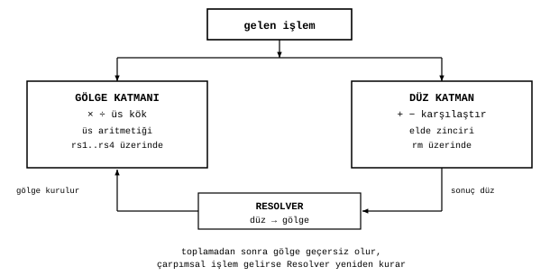

# ALU: aritmetik birimin mantığı

James Augustus

## Özet

CTCPU'nun aritmetik birimi tek bir devre değildir. İşlemi, sayının hangi gösterimde işleneceğine göre iki katmandan birine yönlendiren bir şemsiyedir. Toplama, çıkarma ve karşılaştırma sayının normal sekizlik basamakları üzerinde, bir elde zinciriyle yapılır. Çarpma, bölme, üs alma ve kök ise sayının gölgesi üzerinde, asal üslerinin toplanması, çıkarılması ve yarılanmasıyla yapılır. İki katman arasındaki köprü Resolver'dır. Burada ALU'nun iş bölümünü anlatıyorum. Her alt birimin nasıl çalıştığı kendi klasöründeki belgededir: [Toplayıcı](Toplayici/Toplayici.md), [Çarpma ve bölme](Carpma_Bolme/Carpma_Bolme.md), [Karekök](Karekok/Karekok.md).

## İçindekiler

| Bölüm | Başlık |
|---|---|
| 1 | Giriş |
| 2 | İki katman |
| 2.1 | Gölge katmanı |
| 2.2 | Düz katman |
| 2.3 | Neden ayrı |
| 3 | Yönlendirme kuralı |
| 4 | Girdi ve çıktı |
| 5 | Bir işlem zinciri |
| 6 | Doğrulama |
| 7 | Sınırlar |
| 8 | Alt birimler |

## 1. Giriş

Klasik bir işlemcide tek bir aritmetik birim bütün işlemleri basamak basamak yapar. Çarpma devresi bu birimin en büyük ve en pahalı parçasıdır. CTCPU'da bir sayı iki biçimde tutulur. Normal biçimde sekizlik basamaklar, gölge biçiminde yedi küçük asalın üsleri ve bir artık bulunur. Çarpma gölgede üslerin toplanmasına dönüştüğü için büyük bir çarpıcıya gerek kalmaz. Toplama ise gölgede yapılamaz. Bu iki gerçek, ALU'yu iki katmana ayırır.

## 2. İki katman

### 2.1 Gölge katmanı

Çarpma üslerin toplanması, bölme üslerin çıkarılmasıdır. Üs alma üslerin bir sabitle çarpılması, karekök üslerin yarılanmasıdır. Ortak bölen, her kanalda küçük üssün seçilmesiyle bulunur. Yedi kanal birbirinden bağımsız olduğu için yedi işlem aynı anda yapılabilir.

### 2.2 Düz katman

Toplama ve çıkarma normal basamaklar üzerinde, haneden haneye ilerleyen bir elde zinciriyle yapılır. Karşılaştırma, sonucu yazılmayan bir çıkarmadır.

### 2.3 Neden ayrı

Gölge toplayamaz. $360 = 2^3 \cdot 3^2 \cdot 5$ sayısına 7 eklenirse $367$ elde edilir. 367 asaldır ve gölgesinin 360'ınkiyle hiçbir bağı yoktur. Logaritmanın çarpmayı toplamaya çevirmesi gibi, gölge de yalnız tek yönde kolaylık sağlar. Toplamayı çarpmaya çeviren genel bir özdeşlik yoktur. Bu ayrım bir tasarım tercihi değil, aritmetiğin kendisinden gelir.

## 3. Yönlendirme kuralı

Gelen işlem, ALU'nun hangi katmanı kullanacağını belirler.

| İşlem | Katman | Kullandığı alanlar |
|---|---|---|
| Toplama, çıkarma, karşılaştırma | Düz | $rm$ |
| Çarpma, bölme | Gölge | $rs1..rs4$, $rc$ |
| Üs alma, karekök | Gölge, gerekirse düz | $rs1..rs4$, $rc$ |

Bir toplamadan sonra sonucun eski gölgesi geçersiz olur. Sonuç yalnız başka toplamalara girecekse gölge hiç kurulmaz. Bir çarpımsal işlem geldiğinde gölge yoksa Resolver çağrılır ve gölge yeniden kurulur. Buna tembel gölge diyorum. Sayının yüklenmesi tek başına bir çevirme gerektirmez.

## 4. Girdi ve çıktı

| Yön | İçerik |
|---|---|
| Giren | işlem kodu ve mod bitleri |
| Giren | operandlar: sayı, ölçek ($rpow$), tür ($rtyp$) |
| Giren | operandların gölgeleri, geçerliyse |
| Çıkan | sonuç: sayı, ölçek, tür |
| Çıkan | sonucun gölgesi ya da "gölge geçersiz" işareti |
| Çıkan | durumlar: sıfır, taşma, rough, özel |

## 5. Bir işlem zinciri

$a \cdot b \cdot c / d$ işleminde rough çarpanı olmayan ve gölgesi hazır pozitif operandlar için her asal kanalında iki toplama ve bir çıkarma kullanırım. Ara sonuçları sayaç kapasitesi içinde üsler olarak tutarım. Rough çarpanlar ayrıca aritmetik gerektirir. Örnek: $12 \cdot 15 \cdot 10 / 18$.

| Kanal | 2 | 3 | 5 |
|---|---:|---:|---:|
| 12 | 2 | 1 | 0 |
| + 15 | 0 | 1 | 1 |
| + 10 | 1 | 0 | 1 |
| − 18 | 1 | 2 | 0 |
| sonuç | 2 | 0 | 2 |

Sonuç $2^2 \cdot 5^2 = 100$. Gerçekten $12 \cdot 15 \cdot 10 / 18 = 1800 / 18 = 100$.

## 6. Doğrulama

ALU'nun alt birimlerine ait şu emülatör testlerini 25 Ekim 2026'da yeniden derleyip çalıştırdım ve geçtiler: çarpma ve bölme emülatörü, kesir emülatörü, üs taşması (cascade) testi, rough geri düşüş devresi testi ve karekök emülatörü. Ayrı toplama ve çıkarma emülatörünü bu yayın için yeniden çalıştırmadım, ölçümlerini paket dışı tarihsel kayıt olarak koruyorum. Yeniden çalıştırdığım bu testler, her biri kendi açıklamasıyla, ayrı test paketinde durur. Alt birimlerin ayrıntılı ölçümleri kendi belgelerindedir.

## 7. Sınırlar

Yalnız üslerle yürüyen yol, çarpanlarının tamamı yedi küçük asal arasında olan sayılar için geçerlidir. Rastgele sayı çiftlerinin büyük çoğunluğunda en az bir operandın rough çarpanı vardır ve çarpma düz yola düşer. Bu yüzden CTCPU her sayıda klasik bir çarpıcıdan hızlı değildir. Üstünlüğünü rough çarpanı olmayan sayılarda, çarpım ve bölüm zincirlerinde, büyük çarpıcı devresi gerektirmemesinde ve üslerin sayaç kapasitesi içinde geniş bir aralığı tutmasında arıyorum. Kapı sayıları ve çevrim süreleri model tahminidir, sentez ya da silikon ölçümü değildir.

## 8. Alt birimler

Hizalama, elde zinciri ve normalize etme [Toplayıcı](Toplayici/Toplayici.md) belgesinde, üs aritmetiği, kesir, üs taşması ve rough çarpım [Çarpma ve bölme](Carpma_Bolme/Carpma_Bolme.md) belgesinde, üs yarılama, sembolik kök ve sürekli kesir [Karekök](Karekok/Karekok.md) belgesinde anlatılır.
