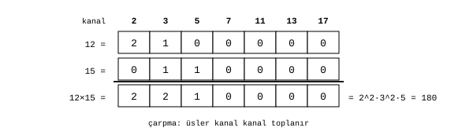
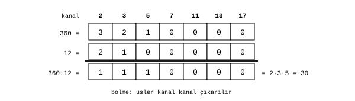
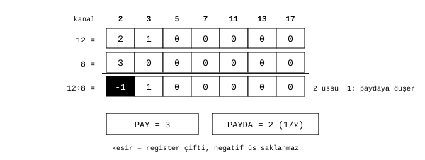

# Çarpma ve bölme

James Augustus

## Özet

Çarpma ve bölme, ALU'nun gölge katmanında yapılır. Gölgesi hazır iki sayının çarpımı, yedi asal kanalının her birinde üslerin toplanmasıdır. Bölme, üslerin çıkarılmasıdır. Basamak basamak çarpma yapılmaz ve büyük bir çarpıcı devresine gerek kalmaz. Bir üs negatife düşerse o çarpan paydaya geçer ve sonuç bir register çifti olarak tutulur. Yedi asala bölünmeyen rough çarpanların çarpımı ise gölgede yapılamaz ve düz yola düşer. Burada dört durumu sırayla anlatıyorum: çarpma, tam bölme, kesir ve rough çarpım.

## İçindekiler

| Bölüm | Başlık |
|---|---|
| 1 | Çarpma |
| 2 | Tam bölme |
| 3 | Kesir |
| 3.1 | Ölçeğe emilim |
| 3.2 | Kesirle bölme |
| 4 | Büyük üsler |
| 5 | Rough çarpım |
| 6 | Ölçülenler |
| 7 | Sınırlar |

## 1. Çarpma

İki sayının gölgesi $e_q(a)$ ve $e_q(b)$ ise çarpımın gölgesi her kanalda

$$e_q(a \cdot b) = e_q(a) + e_q(b), \qquad q \in \{2, 3, 5, 7, 11, 13, 17\}$$

olur. Yedi toplama birbirinden bağımsızdır ve aynı anda yapılabilir.

Şekil 1'de $12 = 2^2 \cdot 3$ ve $15 = 3 \cdot 5$ çarpılır. 2 kanalında $2+0$, 3 kanalında $1+1$, 5 kanalında $0+1$ toplanır. Sonuç $2^2 \cdot 3^2 \cdot 5 = 180$.

İşaret ayrı bir bit olarak tutulmaz, sayının türünün ($rtyp$) içindedir. Çarpımda işaretler birleştirilir: eksi ile eksinin çarpımı artıdır.

## 2. Tam bölme

$$e_q(a / b) = e_q(a) - e_q(b)$$

Pozitif ve rough çarpan içermeyen operandlarda, her kanalda bölünenin üssü bölenin üssünden küçük değilse sonuç bir tamsayıdır.

Şekil 2'de $360 = 2^3 \cdot 3^2 \cdot 5$ sayısı $12 = 2^2 \cdot 3$ ile bölünür. Sonuç $2 \cdot 3 \cdot 5 = 30$.

## 3. Kesir

Bir kanalda bölenin üssü daha büyükse fark negatife düşer. $12 / 8$ işleminde 2 kanalında $2 - 3 = -1$ çıkar. Bu, o çarpanın paydaya geçtiği anlamına gelir: $12 / 8 = 3/2$.

Donanımda negatif üs saklanmaz. Gölge üsleri her zaman sıfır ya da pozitiftir. Paydanın çarpanları ayrı bir register'a yazılır ve o register'ın türü $1/x$ yapılır. Böylece kesir, bir pay ve bir payda register'ından oluşan bir çift olur. Değeri okumak için pozisyonel bölme gerekmez.

### 3.1 Ölçeğe emilim

Sadeleşmiş kesrin paydası yalnız 2'lerden oluşuyorsa ve hem mantis hem ölçek sığıyorsa paydayı $8^k$ olacak biçimde tamamlayıp ölçeğe ($rpow$) emebilirim: $3/2 = 12 \cdot 8^{-1}$. Böylece kesin bir sekizlik virgüllü sayı elde edilir. $1/3$ ve $1/5$ gibi kesirler emilemez. Çift olarak kalırlar ve kesinliklerini korurlar.

### 3.2 Kesirle bölme

Bölenin payı ile paydası yer değiştirir ve işlem çarpmaya döner.

## 4. Büyük üsler

Bir üs hücresi 3 bittir ve 0 ile 7 arasında bir değer tutar. Daha büyük üsler dört satıra ($rs1..rs4$) yayılır. Sayaç modelinde dört satır, üssün sekizlik haneleridir ve en fazla $7777_8 = 4095$ değerini tutar. Bir satır taşınca elde bir üst satıra geçer. Bu düzen [Resolver'ın dişli modelinde](../../Resolver/Cark.md) ayrıntılı olarak anlatılmıştır. Merdiven modelinde ise her satır ayrı bir kattır. Birleşik kayıt biçiminin seçimi açıktır. Daha önceki bir sürümde satırlar toplamalı kullanılıyor ve toplam kapasite 28 kabul ediliyordu.

Üs kapasiteyi aşarsa sonuç gölgeye sığmaz. Mevcut sayaç çekirdeği hata döndürür. Otomatik olarak düz yola geçiş bir tasarım hedefidir. Sessiz bir kırpma yapılmaz.

## 5. Rough çarpım

İki sayının yedi asala bölünmeyen kısımlarının çarpımı üs toplamaya indirgenemez. Bu durumda işlem düz yola gider ve rough durumu işaretlenir. Düz yol büyük bir çarpıcı dizisi gerektirmez. Bu örnekte rough sayılar $2^k \pm r$ biçiminde açılır ve çarpım kaydırma ile toplamaya iner:

$$19 \cdot 23 = (2^4 + 3)(2^4 + 7) = 2^8 + 10 \cdot 2^4 + 3 \cdot 7 = 256 + 160 + 21 = 437$$

Bu örnekte en büyük temel çarpım işleneni 7'dir. Genel olarak 7 sınırı, $0\le r\le7$ koşullu $A=8a+r$ sekizlik hane açılımına aittir, ikinin kuvvetinden her sapmaya değil.

## 6. Ölçülenler

Önceki çalışmalarda kaydedilen ölçümler:

| Sınama | Kapsam | Hata |
|---|---|---:|
| Çarpma: üsleri topla, geri çöz, $a \cdot b$ ile karşılaştır | 20 milyon çift | 0 |
| Tam bölme | 10 milyon | 0 |
| Genel bölme (kesir, çapraz) | 10 milyon | 0 |
| Üs taşması, katmanlara yayma | $e = 0..40$ | 0 |
| Kesir sistemi | 19 el testi ve 200.000 rastgele | 0 |
| Rough geri düşüş devresi | 5 milyon | 0 |

Çarpma ve bölme emülatörü, kesir emülatörü, üs taşması testi ve rough geri düşüş testi 25 Ekim 2026'da yeniden çalıştırılmış ve geçmiştir.

## 7. Sınırlar

Kayıtlı bir ölçüme göre rastgele 20 milyon sayı çiftinin yaklaşık yüzde 96'sında her iki operandın da rough çarpanı vardır. Bu yüzden tek bir rough çarpımda klasik bir donanım çarpıcısı daha hızlıdır. Gölge katmanının üstünlüğünü rough çarpanı olmayan sayılarda, çarpım ve bölüm zincirlerinde ve büyük çarpıcı devresi gerektirmemesinde arıyorum. Çevrim süreleri model tahminidir.

[ALU](../ALU.md)
