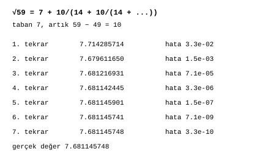

# Karekök

James Augustus

## Özet

Karekök birimi, kökü gerekene kadar açmaz. Kökü bir tür olarak taşır ve sayının biçimine göre üç yoldan birini seçer. Üsleri çift olan ve rough çarpanı bulunmayan pozitif bir sayının kökü, gölgede üslerin yarılanmasıdır. Tek bir üs kalırsa o çarpanın kökü sembolik olarak taşınır. Rough bir sayının kökü sekizlik basamaklarla, hane hane bulunur. Bu yolların doğruluğunu incelemek için √59'dan geriye giderek bulduğum bir sürekli kesir formülünü kullanıyorum. Özdeşlik ve rasyonel iterasyonlar kesindir, fakat her sonlu yakınsak yaklaşık kalır.

## İçindekiler

| Bölüm | Başlık |
|---|---|
| 1 | Kök bir türdür |
| 2 | Üç yol |
| 2.1 | Üsleri çift olan sayı |
| 2.2 | Tek üs kalan sayı |
| 2.3 | Rough sayı |
| 3 | Mod seçimi |
| 4 | Geri gitme formülü |
| 4.1 | Neden doğru |
| 4.2 | Donanımdaki yeri |
| 5 | Ölçülenler |
| 6 | Sınırlar |

## 1. Kök bir türdür

Gerçek $x\ge0$ için $\sqrt{x}$ değeri hesaplanmadan, sayının türü ($rtyp$) "karekök" yapılarak taşınabilir. Kök ancak sonucun sayısal değeri gerektiğinde açılır. Birçok işlemde açılmasına hiç gerek kalmaz. Örneğin $\sqrt{x} \cdot \sqrt{x} = x$ işleminde tür iki kez karekök olduğu için çarpım doğrudan $x$'e döner.

## 2. Üç yol

### 2.1 Üsleri çift olan sayı

Rough çarpanı bulunmayan pozitif bir sayının kökü, gölgede her kanalda üssün yarılanmasıyla bulunur:

$$3600 = 2^4 \cdot 3^2 \cdot 5^2 \quad\Rightarrow\quad \sqrt{3600} = 2^2 \cdot 3 \cdot 5 = 60$$

### 2.2 Tek üs kalan sayı

Çift kısım yarılanır, tek kalan çarpanın kökü sembolik olarak taşınır:

$$72 = 2^3 \cdot 3^2 \quad\Rightarrow\quad \sqrt{72} = 2 \cdot 3 \cdot \sqrt{2} = 6\sqrt{2}$$

Küçük asalların kökleri bir tablodan da okunabilir.

### 2.3 Rough sayı

Kök, sekizlik tabanda hane hane bulunur. Okulda öğrenilen basamak basamak kök alma yönteminin sekizlik sürümüdür. Çarpıcı ve bölücü gerektirmez. Negatif olmayan bir $N$ tamsayısı için kesin tamsayı sonucu $r=\lfloor\sqrt N\rfloor$ olur ve $r^2\le N<(r+1)^2$ koşulunu sağlar. $f$ kesir hanesinde sonuç $R_f/8^f\le\sqrt N<(R_f+1)/8^f$ sınırını sağlar. Bu sonlu değer, kesin sembolik $\sqrt N$ değerinden ayrıdır.

## 3. Mod seçimi

Burada kökün nasıl açılacağına ilişkin tarihsel iki bitlik mod önerisini gösteriyorum. Güncel 12 bitlik komuttaki yeri ve kesir modlarıyla ortak kodlaması açıktır:

| Mod | Ad | Davranış |
|---|---|---|
| 00 | sembolik | kök açılmaz, tür olarak taşınır |
| 01 | hızlı | yaklaşık yöntem (binom açılımı ya da logaritmik), grafik, ses ve benzeri işler için |
| 10 | kesin | hane hane kök, fizik ve finans gibi kesin tamsayı kökü veya belirtilmiş kesir hata sınırı isteyen işler için |
| 11 | otomatik | küçük sayıda kesin, büyük sayıda yalnız kabul edilen hassasiyette yaklaşık sonuca izin veriliyorsa hızlı yol |

Kayıtlı bir tam taramaya göre tek terimli binom yolunun $2^{18}\le N<2^{24}$ aralığındaki en büyük bağıl hatası yaklaşık $4{,}8 \cdot 10^{-7}$'dir.

## 4. Geri gitme formülü

Bir referans formülü türetmek için √59'dan başladım. $\sqrt{59} = 7{,}68\dots$ sayısını $7 + 0{,}68$ diye düşündüm ve 59 ile kesirli kısım $0{,}68\dots$ arasındaki ilişkiyi aradım. Taban karesini çıkarıp artığı iki tabana böldüğümde payda kendini tekrar etti:

$$\sqrt{p} = t + \dfrac{p - t^2}{2t + \dfrac{p - t^2}{2t + \dfrac{p - t^2}{2t + \cdots}}}$$

Burada $t$, kökün tam kısmıdır. √59 için $t = 7$ ve artık $59 - 49 = 10$:

$$\sqrt{59} = 7 + \dfrac{10}{14 + \dfrac{10}{14 + \dfrac{10}{14 + \cdots}}}$$

Her tekrar bir iterasyondur ve değer kesin sonuca yaklaşır.

| Tekrar | Değer | Hata |
|---:|---|---|
| 1 | 7,714285714 | $3{,}3 \cdot 10^{-2}$ |
| 2 | 7,679611650 | $1{,}5 \cdot 10^{-3}$ |
| 3 | 7,681216931 | $7{,}1 \cdot 10^{-5}$ |
| 4 | 7,681142445 | $3{,}3 \cdot 10^{-6}$ |
| 5 | 7,681145901 | $1{,}5 \cdot 10^{-7}$ |
| 6 | 7,681145741 | $7{,}1 \cdot 10^{-9}$ |
| 7 | 7,681145748 | $3{,}3 \cdot 10^{-10}$ |

Gerçek değer $\sqrt{59} = 7{,}681145747\dots$

### 4.1 Neden doğru

$x = \sqrt{p} - t$ olsun. $(t + x)^2 = p$ eşitliğinden $x(2t + x) = p - t^2$ ve $x = (p - t^2)/(2t + x)$ çıkar. Sağ taraftaki $x$ yerine aynı ifade tekrar tekrar konunca formül elde edilir. Araştırınca bunun bilinen bir sonuç olduğunu gördüm: karekökün klasik sürekli kesir açılımı.

### 4.2 Donanımdaki yeri

Her tekrar bir bölme ister ve CTCPU'da genel bir bölücü yoktur. Bu yüzden formülü diğer yollar için bir referans hesabı olarak kullanıyorum. Tablodaki ondalık hataları, [Nihai Form](../../../NIHAI_FORM/CTCPU_NIHAI.md) belgesindeki gibi ayrı bir 60 basamaklı kök hesabıyla karşılaştırıyorum. Sonlu yakınsağı kesin kök saymıyorum ve bu yolu donanımda kullanmıyorum.

## 5. Ölçülenler

Kayıtlı ölçümlere göre karekök yollarında toplam 25 milyonun üzerinde kontrol yapılmış ve hata bulunmamıştır. Karekök emülatörü 25 Ekim 2026'da yeniden çalıştırılmış ve geçmiştir.

## 6. Sınırlar

Sembolik kök, açılması gerektiğinde bir maliyet taşır. Tek üslerin ve rough çarpanların kökü gölgede bedava değildir. Çevrim süreleri model tahminidir, devre ölçümü değildir.

[ALU](../ALU.md)
