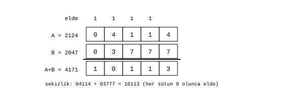

# Toplayıcı

James Augustus

## Özet

Toplayıcı, ALU'nun düz katmanıdır. Sayının normal sekizlik basamakları üzerinde toplama, çıkarma ve karşılaştırma yapar. İşlem üç adımdan oluşur: iki sayıyı aynı ölçeğe hizalamak, basamakları elde zinciriyle toplamak ve sekiz haneye sığan ya da kayıpsız normalize edilebilen sonucu tutmak. Çıkarma ayrı bir devre değildir, ikiye tümleyen ile aynı zincirde yapılır. Karşılaştırma, sonucu yazılmayan bir çıkarmadır. Toplamadan sonra sayının gölgesi geçersiz olur.

## İçindekiler

| Bölüm | Başlık |
|---|---|
| 1 | Neden ayrı bir birim |
| 2 | Üç adım |
| 2.1 | Hizalama |
| 2.2 | Toplama |
| 2.3 | Normalize etme |
| 3 | Elde zinciri |
| 3.1 | Çıkarma |
| 3.2 | Karşılaştırma |
| 4 | Toplamadan sonra |
| 5 | Ölçülenler |
| 6 | Sınırlar |
| 6.1 | Normalize etmede hassasiyet kaybı |
| 6.2 | Çakışmayan haneler |
| 6.3 | Komşu register'a taşma |

## 1. Neden ayrı bir birim

Gölge biçimi çarpmayı kolaylaştırır ama toplamayı yapamaz. $360 + 7 = 367$ işleminde 367 asaldır ve 360'ın gölgesinden türetilemez. Toplamayı çarpmalar cinsinden yazma denemesi de işe yaramaz: $(c+d)^2 = c^2 + d^2 + 2cd$ özdeşliğinin sağ tarafı yine toplama ister ve sonunda bir karekök gerekir. Bu yüzden toplama için ayrı bir birim zorunludur.

## 2. Üç adım

### 2.1 Hizalama

İki sayının ölçeği ($rpow$, virgülün yeri) farklıysa doğrudan toplanamaz. Ortak ölçek olarak büyük ölçek, $P=\max(P_a,P_b)$ seçilir. Küçük ölçekli sayının mantisi sola kaydırılır ve sığdığı sürece hiçbir hane kırpılmaz. Sekizlikte bir hane kaydırmak 8 ile çarpmaktır ve yalnız tel bağlantısıyla yapılır.

$$471_8 + 5_8 \cdot 8^{-1}: \quad 471_8 \to 4710_8, \qquad 4710_8 + 5_8 = 4715_8, \qquad 4715_8 \cdot 8^{-1} = 471{,}5_8$$

### 2.2 Toplama

İki sayı aynı ölçeğe geldikten sonra basamaklar sağdan sola toplanır. Bir sütunun toplamı 8'e ulaşırsa fazlası elde olarak sol sütuna geçer.

### 2.3 Normalize etme

Toplam sekiz haneyi aşarsa, ölçek pozitifse ve atılan hane sıfırsa sonucu sekizlikte bir hane sağa kaydırıp ölçeği bir azaltarak değeri koruyabilirim. Ölçek 0 olduğunda bu alan daha büyük sonucu bu yolla gösteremez. Güncel taşma davranışı açıktır.

Şekil 1'de $4114_8 + 3777_8 = 10113_8$ işlemi görülür. Sağdan sola sütunlar $4+7 = 13_8$, $1+7+1 = 11_8$, $1+7+1 = 11_8$, $4+3+1 = 10_8$ verir. Her sütun sonuç hanesini yazar ve 1 eldeyi sola geçirir. Onluk karşılığı $2124 + 2047 = 4171$.

## 3. Elde zinciri

Bir sekizlik hane üç bittir. Devre düzeyinde toplama, her bit için bir tam toplayıcıyla yapılır:

$$s = a \oplus b \oplus c_{\text{gir}}, \qquad c_{\text{çık}} = ab + a\,c_{\text{gir}} + b\,c_{\text{gir}}$$

Elde, üç girişten en az ikisi 1 olduğunda 1'dir. Zincir kombinasyoneldir. Tek saat çevrimi içinde yayılmayı bir zamanlama hedefi olarak alıyorum, bunun için saat süresinin elde gecikmesine yetmesi gerekir.

### 3.1 Çıkarma

Çıkarılan sayının ikiye tümleyenini işlem genişliğinde alıp aynı zincirde toplarım.

### 3.2 Karşılaştırma

Çıkarma sonucunu yazmadan, tür işaretlerini ve ölçeklerini hesaba katarak değerleri karşılaştırırım. Sıfır ve farkın işareti, yalnız hizalanmış fark taşmadan tutulursa sıralamayı verir. Aynı ölçekte iki 24 bit işaretsiz büyüklüğü çıkarmak için en az 25 bit işaretli fark gerekir. Genişletme veya eşdeğer borç ve büyüklük karşılaştırma yolunun seçimi açıktır.

## 4. Toplamadan sonra

Sonuç normal biçimdedir ve eski gölgesi geçersizdir. Sonuç ileride bir çarpma, bölme ya da kökle karşılaşırsa Resolver gölgeyi yeniden kurar. Yalnız başka toplamalara girecekse hiçbir çevirme yapılmaz.

## 5. Ölçülenler

Önceki çalışmalarda kaydedilen ölçümler:

| Sınama | Kapsam | Hata |
|---|---|---:|
| Tam toplayıcı çekirdeği, referansla | $2^{24}$ giriş | 0 |
| Birleşik toplama (sayı, ölçek, işaret) | 20 milyon | 0 |
| Birleşik çıkarma | 20 milyon | 0 |

Ayrı toplama ve çıkarma emülatörünü bu yayın için yeniden çalıştırmadım. Bu ölçümleri, kaynağı ve komutu bu pakette bulunmayan tarihsel kayıt olarak koruyorum.

## 6. Sınırlar

### 6.1 Normalize etmede hassasiyet kaybı

Atılan alt hane sıfır değilse büyüklüğü kırpmak hassasiyet kaybettirir ve sıfıra doğru yuvarlar. Bunu güncel kesin sonuç yolu olarak almıyorum. Kayıtlı ölçüme göre rastgele toplamaların yaklaşık yüzde 43,8'inde, 24 biti aşan toplamların yaklaşık yüzde 87,5'inde böyle bir kayıp oluşur. Bu, sabit genişlikteki sayı alanının doğal bedelidir. Kaç koruma hanesi tutulacağı ve yuvarlama yönü henüz belirlenmedi.

### 6.2 Çakışmayan haneler

Hizalanmış iki sayının dolu haneleri aynı sütunlara düşmüyorsa elde hiç oluşmaz ve toplam, iki bloğun yan yana konmasıdır. Kayıtlı ölçüme göre rastgele çiftlerin yalnız yaklaşık yüzde 19'u böyledir. Bu bir genel kazanç değil, uygun iş yüklerinde işe yarayan bir gözlemdir.

### 6.3 Komşu register'a taşma

Zincirin en alt elde girişi ve en üst elde çıkışı komşu register'a bağlanarak daha geniş sayıların toplanması önerilmişti. Bu yolun güncel tasarımda nasıl sonlandığı açıktır.

[ALU](../ALU.md)
