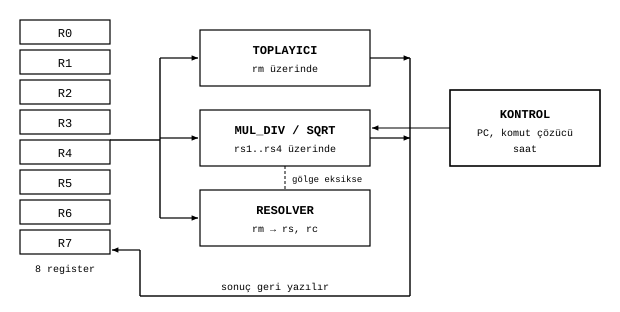
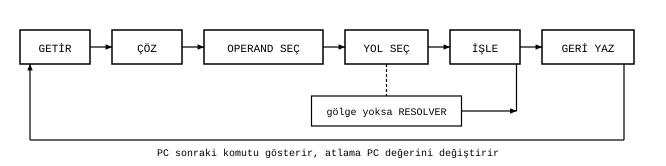

# Çekirdek

James Augustus

## Özet

CTCPU'nun güncel tasarımında tek bir çekirdek, tek bir iş parçacığı ve sekiz register vardır. Çekirdek, register'ları, ALU'nun iki katmanını, Resolver'ı ve kontrol birimini birbirine bağlar. Kontrol birimi komutu getirir, çözer, operandları ve aritmetik yolunu seçer, sonucu geri yazar. Çarpımsal bir işlem için gerekli gölge hazır değilse Resolver çağrılır. Burada çekirdeğin parçalarını ve bir komutun yolculuğunu anlatıyorum.

## İçindekiler

| Bölüm | Başlık |
|---|---|
| 1 | Parçalar |
| 2 | Bir komutun yolculuğu |
| 3 | Bir örnek |
| 4 | Açık kalanlar |
| 5 | Önceki tasarımlardaki parçalar |

## 1. Parçalar

| Parça | Görev |
|---|---|
| $R0 \dots R7$ | sekiz [register](../Register/Register.md), her biri 192 bit |
| Toplayıcı | düz katman: toplama, çıkarma, karşılaştırma ($rm$ üzerinde) |
| Çarpma, bölme, karekök | gölge katmanı: üs aritmetiği ($rs1..rs4$ üzerinde) |
| Resolver | normal biçimden gölgeye çevirme |
| Kontrol | program sayacı, komut çözücü, saat |

Toplayıcı ile çarpma, bölme ve karekök birimleri birlikte [ALU](../ALU/ALU.md)'yu oluşturur. Sekiz register birlikte $8 \cdot 192 = 1536$ bittir.

## 2. Bir komutun yolculuğu

Bir komut altı adımda yürür. Önce program sayacının gösterdiği komut getirilir ve çözülür, yani işlem kodu ile mod bitleri ayrılır. Ardından kaynak ve hedef register'lar seçilir. Sonra yol seçilir: işlem toplama ailesindense düz katman, çarpma ailesindense gölge katmanı kullanılır. Gölge katmanı seçildiğinde operandın gölgesi geçerli değilse önce Resolver çağrılır, sonra işleme dönülür. Seçilen birim sonucu üretir ve sonuç hedef register'a geri yazılır. Sonucun diğer gösterimi de güncellenir ya da geçersiz sayılır.

Program sayacı bir sonraki komutu gösterir. Bir atlama komutu program sayacının değerini değiştirir. Döngü, programdaki koşul sağlandığında biter.

## 3. Bir örnek

$R1 = 12$, $R2 = 15$ olsun ve iki komut çalışsın:

| Adım | Komut | Yol | Sonuç |
|---|---|---|---|
| 1 | `MUL R1, R2` | gölge: $12 = 2^2 \cdot 3$, $15 = 3 \cdot 5$, üsler toplanır | $R1 = 2^2 \cdot 3^2 \cdot 5 = 180$ |
| 2 | `ADD R1, R2` | düz: $180 + 15$ | $R1 = 195$, gölgesi geçersiz |

İkinci komuttan sonra $R1$'in gölgesi geçersizdir. Bir sonraki çarpımsal işlemde Resolver $195 = 3 \cdot 5 \cdot 13$ sayısının gölgesini yeniden kurar.

## 4. Açık kalanlar

Kontrol biriminin saat çizelgesi, komutların kaç çevrim sürdüğü ve Resolver'ın çekirdeğe nasıl bağlandığı güncel Hunter tasarımında ölçülmüş değildir. Burada anlatılan, yürütmenin görevleridir. Komut biçimleri [ISA](../../ISA.md) belgesindedir.

## 5. Önceki tasarımlardaki parçalar

Önceki tasarımlarda birkaç çekirdeğin birlikte çalıştığı bir düzen (küp, lider ve işçiler), komutları dağıtan ayrı bir kontrolcü ve komşu register'lara elde taşıyan bir taşma zinciri vardı. Güncel tasarım tek çekirdeklidir. Bu parçaların güncel tasarımdaki yeri henüz belirlenmedi.

İlgili belgeler: [Register](../Register/Register.md), [ALU](../ALU/ALU.md) ve [Parçalar](../README.md).
