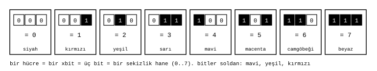

# Hücre (xbit)

James Augustus

## Özet

Bu işe renkten başladım. Üç ışık kanalı karışınca sekiz renk verir, sekiz renk de bir sekizlik hane eder. CTCPU'nun en küçük birimi olan hücre buradan doğdu: bir hücre üç bit tutar ve 0 ile 7 arasında tek bir değer taşır. Bu birime xbit diyorum. Bütün register'lar, sayılar ve gölge alanları hücrelerden kurulur. Her hanenin bir rengi olduğu için bir sayı renk dizisi olarak da okunabilir.

## İçindekiler

| Bölüm | Başlık |
|---|---|
| 1 | Renkten başladım |
| 2 | Tanım |
| 3 | Renk |
| 4 | Neden üç bit |
| 5 | Ölçüler |

## 1. Renkten başladım

21 Nisan 2026'da CTCPU'yu, kayıtları renk etiketli ve sayıları sekizlik yazan bir yardımcı işlemci olarak tarif ettim. Mersenne asal üslerini 3'e göre sınıflarına ayırıp R ve Y renkleriyle işaretledim, Mersenne sayılarını her hanesi bir renk harfi olan sekizlik bir tabloya dizdim.

Renkle bakınca Mersenne sayılarında bir düzen görüyordum. Sekizlikte bu tablodaki sayıların hepsi bir kırmızı ya da sarı ile başlıyor, ardından beyazlarla sürüyordu:

| $p$ | $2^p - 1$ | Sekizlik | Renk |
|---:|---:|---|---|
| 5 | 31 | $37_8$ | Y W |
| 7 | 127 | $177_8$ | R W W |
| 11 | 2047 | $3777_8$ | Y W W W |
| 13 | 8191 | $17777_8$ | R W W W W |
| 17 | 131071 | $377777_8$ | Y W W W W W |

8 Haziran 2026'da Doom'u assembly ile yazmak istiyordum. Bunun için önce bir işlemcinin nasıl çalıştığını anlamam, sonra kendi işlemcimi tasarlamam gerekiyordu. Işıkla hesap düşündüm: üç ışık kanalı sekiz renk verir, sekiz renk bir sekizlik hane eder. Günlüğüme şunu yazdım: 1 xbit = 3 bit = 1 sekizlik hane = 1 renk. Karar: kesin. Bütün makine dili buradan çıktı.

2 Ağustos 2026'da renk harfleri yerine 1, 3, 7 yazmaya başladım. 734 tane 7 yazmak yerine bu tekrarın sayısını tutabileceğimi düşündüm. Renkler sayılara döndü ama işlemcinin birimi renkten gelen üç bit olarak kaldı.

Kırmızıya yeşil eklenince sarı, mavi de eklenince beyaz oluyordu ve ben bu karışımla sayılar arasında bir bağ kuruyordum. 4 Eylül 2026'da bu yazımdan bir renk kapısı kurmak istedim. Baş hanenin $p$'nin 3'e göre kalanına bağlı olduğu tuttu: $p = 3t + 1$ ise baş hane 1 (kırmızı), $p = 3t + 2$ ise 3 (sarı), $p$ 3'ün katıysa baş hane yoktur ve sayı yalnız beyazdır. Bunun nedenini sonradan araştırınca kaynağını buldum. Baş hane asallığı ayırmıyor: $2^5 - 1$ asal, $2^{11} - 1$ bileşik, ikisi de sarıyla başlıyor.

## 2. Tanım

Bir hücre üç bittir. Üç bitin alabileceği sekiz değer, sekizlik tabanın sekiz rakamıdır:

$$\text{hücre} \in \{0, 1, 2, 3, 4, 5, 6, 7\}, \qquad 1 \text{ hücre} = 3 \text{ bit}$$

Bir sayı sekiz hücreden oluşur. Hücreler soldan sağa $h_7 \dots h_0$ diye adlandırılır. $h_0$ en düşük hanedir. Örneğin $1342_8 = 738$ sayısında $h_3 = 1$, $h_2 = 3$, $h_1 = 4$, $h_0 = 2$'dir. Sekiz hücrenin taşıyabileceği en büyük değer $77777777_8 = 16\,777\,215$'tir.

## 3. Renk

Üç bit, ışığın üç ana rengine karşılık gelir. Sağdaki bit kırmızı, ortadaki yeşil, soldaki mavidir. Bir bitin 1 olması o rengin yandığı anlamına gelir. Sekiz değer böylece sekiz renk verir:

| Değer | Bitler | Renk |
|---:|---|---|
| 0 | 000 | siyah |
| 1 | 001 | kırmızı |
| 2 | 010 | yeşil |
| 3 | 011 | sarı (kırmızı + yeşil) |
| 4 | 100 | mavi |
| 5 | 101 | macenta (kırmızı + mavi) |
| 6 | 110 | camgöbeği (yeşil + mavi) |
| 7 | 111 | beyaz |

Renk aynı değerin gözle okunabilen biçimidir. Sayının türünü tutan kod da aynı sekiz değerden birini aldığı için tür de bir renkle gösterilebilir.

## 4. Neden üç bit

Sekizlik bir hane tam üç bite sığar ve hiç boş kalmaz. Onluk bir hane dört bit ister ve on altı durumdan altısı kullanılmaz. Sekizlik tabanda 8 ile çarpmak ve 8'e bölmek bir hane kaydırmaktır. Bu kaydırma devrede yalnız tellerin yerini değiştirerek yapılır. Resolver'ın kat inişi de, toplayıcının hizalaması da bu özellikten yararlanır.

## 5. Ölçüler

| Birim | Hücre | Bit |
|---|---:|---:|
| hücre | 1 | 3 |
| satır | 8 | 24 |
| register | 64 | 192 |
| çekirdek (8 register) | 512 | 1536 |

İlgili belgeler: [Register](../Register/Register.md) ve [Parçalar](../README.md).
