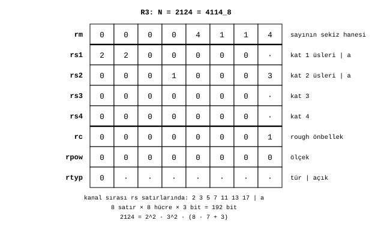

# Register

James Augustus

## Özet

Bir CTCPU register'ı, bir sayının bütün kaydını tutar. Sekiz satırdan oluşur ve her satır sekiz hücredir. Bir hücre üç bit olduğundan register 192 bittir. Satırların her birinin ayrı bir görevi vardır: sayının sekizlik haneleri, dört gölge satırı, rough önbellek, ölçek ve tür. Bu 192 bitin tamamı sayının kendisi değildir. Sayı yalnız ilk satırda, sekiz hanededir. Diğer yedi satır aynı sayının başka gösterimlerini ve ona ait bilgileri tutar.

## İçindekiler

| Bölüm | Başlık |
|---|---|
| 1 | Büyük R ve küçük r |
| 2 | Satırlar |
| 3 | Bir örnek: 2124 |
| 4 | Kurallar |
| 5 | Açık kalanlar |

## 1. Büyük R ve küçük r

Çekirdekte sekiz register vardır: $R0 \dots R7$. İşlemler bunlarla yapılır, örneğin `ADD R3, R5`. Her büyük register'ın içinde sekiz satır bulunur. Bunlara küçük $r$ adlarını veriyorum: $rm$, $rs1 \dots rs4$, $rc$, $rpow$, $rtyp$. $R3$'ün kendi $rm$'i, kendi $rs1$'i vardır. $rs1$, $R1$ değildir.

## 2. Satırlar

| Satır | Ad | İçerik |
|---:|---|---|
| r0 | $rm$ | sayının sekiz sekizlik hanesi, $h_7 \dots h_0$ |
| r1 | $rs1$ | gölge, birinci kat: yedi üs hücresi, $a$ hücresi boş |
| r2 | $rs2$ | gölge, ikinci kat: yedi üs, inişte kesilen hane $a$ |
| r3 | $rs3$ | gölge, üçüncü kat: yedi üs, $a$ |
| r4 | $rs4$ | gölge, dördüncü kat: yedi üs, $a$ |
| r5 | $rc$ | rough önbellek, sekiz hane |
| r6 | $rpow$ | ölçek beyanı: değer $= rm \cdot 8^{-rpow}$ |
| r7 | $rtyp$ | tür: hücre 0 tür kodu, diğer yedi hücre açık |

Gölge satırlarında hücreler soldan sağa 2, 3, 5, 7, 11, 13 ve 17'nin üsleridir. Son hücre $a$'dır. $rs1$'in $a$ hücresi boştur, çünkü $rm$'den $rs1$'e bir iniş yoktur. Zincir $rs1$'de başlar. Üç iniş üç dolu $a$ hücresi bırakır.

## 3. Bir örnek: 2124

$2124 = 4114_8 = 2^2 \cdot 3^2 \cdot 59$ sayısını bir register'a yazıyorum. Resolver'ın çevirmesi [çark modeli](../Resolver/Cark.md) belgesindeki Örnek 4'tür.

$rm$ satırında sayının kendisi, $00004114$ durur. $rs1$ satırında 2'nin ve 3'ün üssü 2'dir, yani birinci katta $2^2 \cdot 3^2 = 36$ soyulmuştur. $rs2$ satırında 7'nin üssü 1 ve $a = 3$'tür: 59'un son hanesi kesilmiş, ikinci kata 7 inmiştir, $59 = 8 \cdot 7 + 3$. $rc$ satırında son artık 1 vardır. İlk rough çarpanı 59 alt kattan geri kurulur. $rpow$ 0'dır, çünkü sayı tamsayıdır. $rtyp$'in hücre 0'ı da 0'dır, yani tür pozitif tamsayıdır.

Gölge satırları yukarı doğru okununca sayı geri kurulur:

$$2124 = 2^2 \cdot 3^2 \cdot (8 \cdot 7 + 3)$$

## 4. Kurallar

$rm$'in sekiz hücresi de 0 ise gölge kurulmaz, çünkü sıfırın çarpanı yoktur. $rc$ ilk rough çarpanı tuttuğunda, $rc \ne 1$ olması sayının rough bir kısmı olduğunu söyler ve ayrı bir rough bayrağına gerek kalmaz. $rc$ son artığı tuttuğunda, ilk rough çarpanı belirlemek için merdivenin alt katları da okunmalıdır. $rc$ tam genişliktedir, çünkü bir sayı tamamen rough olabilir. Örneğin $77777775_8 = 16\,777\,213$ asaldır ve rough kısmı kendisidir.

$rpow$ sayının hassasiyetini bildirmek için vardır. $rm$ sabitken $rpow$ arttığında $rm\cdot8^{-rpow}$ değeri küçülür. Değer yalnız aşağı ölçeklenir. Ayrı bir durum alanı yoktur, durumlar ve tür $rtyp$ içindedir. Ayrıntılar [Türler](../Turler/Turler.md) belgesindedir.

## 5. Açık kalanlar

$rpow$ satırının sekiz hücresinin tam olarak nasıl kullanılacağı ve $rtyp$'in hücre 0 dışındaki yedi hücresinin yerleşimi henüz belirlenmedi. $rc$'nin ilk rough çarpanın tamamını mı, son işlenmemiş artığı mı tuttuğu da açıktır. Bu iki anlam geri okumada birbirinin yerine geçemez. Ayrı bir ROUGH durumunun gerekip gerekmediği bu seçime bağlıdır.

Gölge satırlarının bir başka kullanımı da var. [Dişli modelinde](../Resolver/Cark.md) aynı dört satır, tek bir üssün sekizlik haneleri olarak kullanılır ve bir üs 4095'e kadar çıkabilir. Bu notta anlatılan düzende ise her satır bir kattır ve her hücre 0 ile 7 arasında bir üs tutar. İki kullanımdan hangisinin kesinleşeceği açıktır.

İlgili belgeler: [Hücre](../Hucre/Hucre.md), [Çekirdek](../Cekirdek/Cekirdek.md) ve [Parçalar](../README.md).
