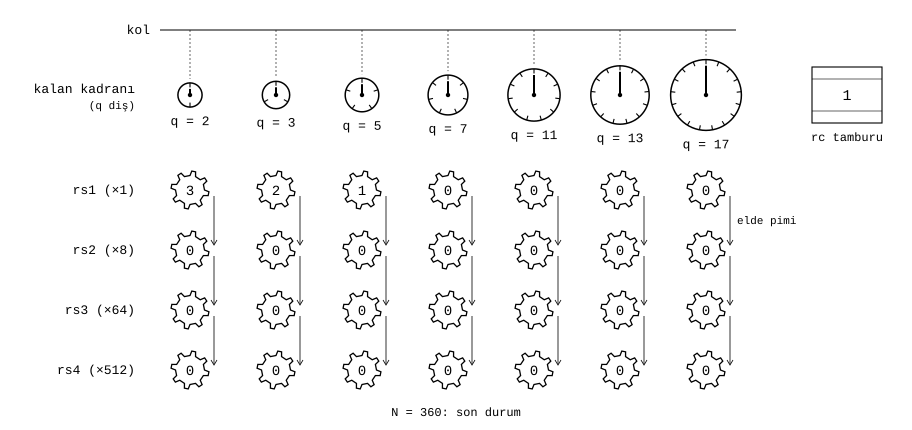
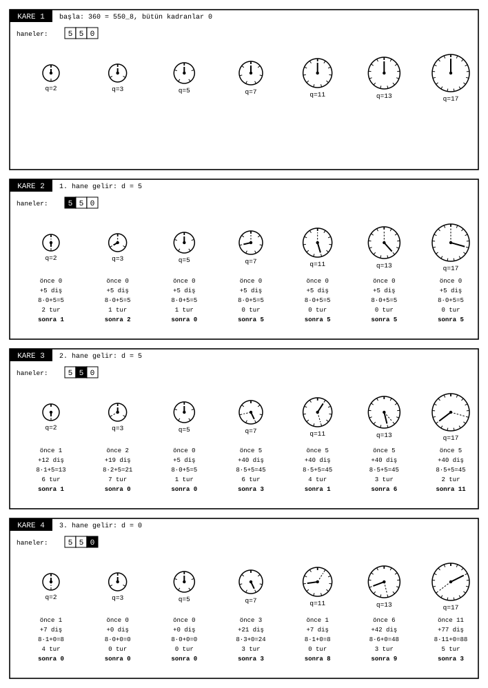
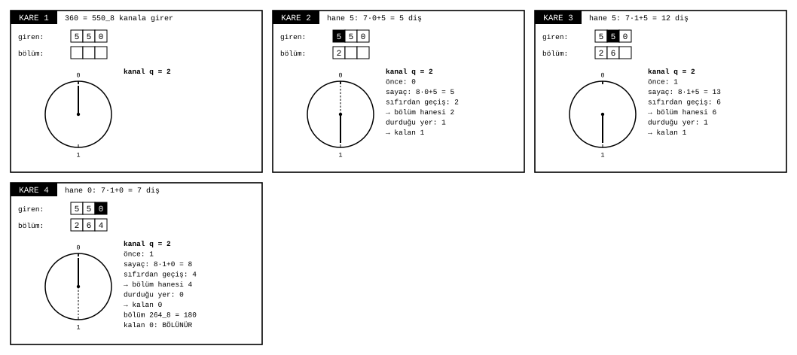
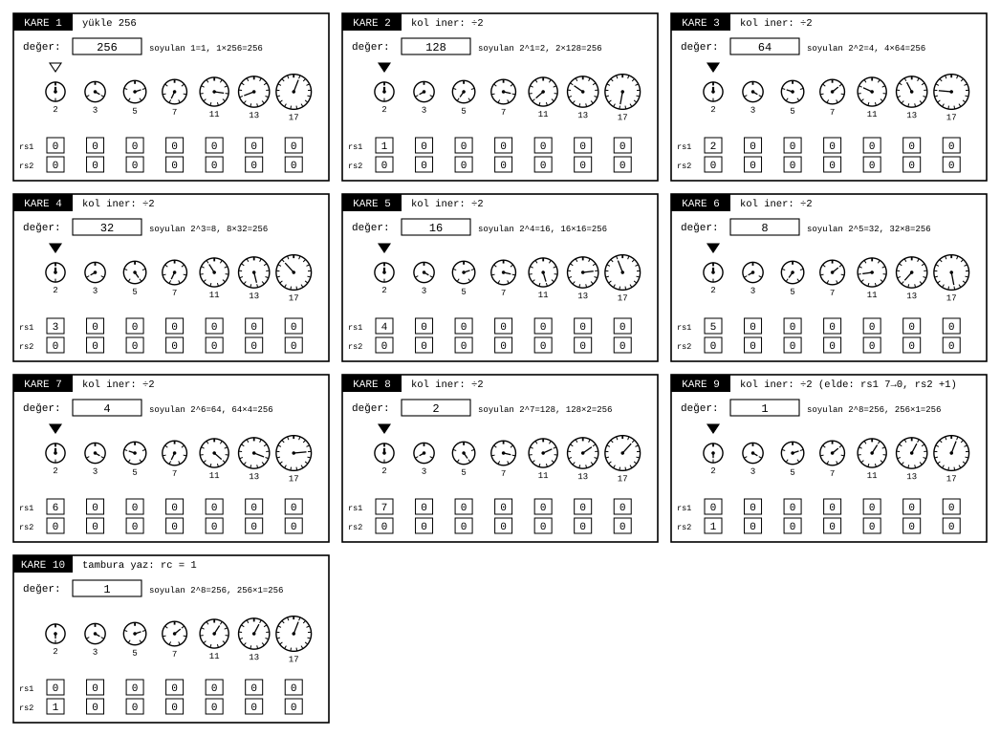

# Resolver için bir dişli modeli

James Augustus

## Özet

Burada CTCPU/Hunter tasarımındaki Resolver biriminin işleyişini mekanik bir benzetmeyle tanımlıyorum. Resolver, pozitif bir tamsayının yedi sabit asala (2, 3, 5, 7, 11, 13, 17) göre üslerini ve bu asallara bölünmeyen artığını üretir. Model dört parçadan oluşur: her asal için bir kalan kadranı, bir yoklama kolu, sekizlik üs sayaçları ve bir artık tamburu. Kadranlar bölme yapmaz. Sayının sekizlik haneleri geldikçe döner, durdukları yer kalanı, sıfırdan geçiş sayıları bölümün hanesini verir. Üs sayaçları sekizlik tabanda elde ile ilerler. Deneysel katlı merdivende yedi asalın hiçbirine bölünmeyen artık, son sekizlik hanesi kesilerek bir alt kata indirilir. Tek katlı sayaç biçimi, C dilinde yazılmış bir çekirdek üzerinde $1 \le N \le 2^{24}$ aralığındaki bütün tamsayılar için sınanmıştır. Bu bir emülasyon sonucudur, devre ölçümü değildir.

## İçindekiler

| Bölüm | Başlık |
|---|---|
| 1 | Giriş |
| 2 | Tanımlar ve gösterim |
| 3 | Mekanizma |
| 3.1 | Kalan kadranı |
| 3.2 | Kadran bölmeden kalanı nasıl bulur |
| 3.3 | Yoklama kolu |
| 3.4 | Üs sayaçları ve elde |
| 3.5 | Artık ve katlar |
| 3.6 | Kadranların okunuşu |
| 4 | Örnekler |
| 4.1 | Örnek 1 |
| 4.2 | Örnek 2 |
| 4.3 | Örnek 3 |
| 4.4 | Örnek 4 |
| 5 | Geri kurma |
| 6 | Doğrulama |
| 7 | Sınırlar |

## 1. Giriş

CTCPU'da bir sayı iki biçimde tutulur. Normal biçim sekizlik basamaklardan oluşur ve toplama ile çıkarma bu biçimde yapılır. Gölge biçimi ise sayıyı asal üsleri ve bir artık olarak tutar. Çarpma ve bölme bu biçimde üslerin toplanması ve çıkarılmasına dönüşür. Resolver, normal biçimden gölge biçimine çeviren birimdir.

Bu notta Resolver'ı bir dişli düzeneği olarak anlatıyorum. Amaç, birimin hangi durumu tuttuğunu ve her adımda neyin değiştiğini görünür kılmaktır.

## 2. Tanımlar ve gösterim

Kanal kümesi $Q = \{2, 3, 5, 7, 11, 13, 17\}$ olsun. Fiziksel $rm$ alanı, sekizlik tabanda en fazla sekiz basamaklı pozitif bir $N$ tamsayısı tutar. Yazılım çekirdeğinin modeli daha geniştir, bu yüzden $1 \le N \le 2^{24}$ sınama aralığı sekiz sekizlik haneye sığmayan $2^{24}$ değerini de kapsar. $_8$ alt indisi sekizlik yazımı gösterir. Diğer bütün sayılar onluktur.

Her $q \in Q$ kanalı için $r_q$, işlenmekte olan değerin $q$ ile bölümünden kalandır ve kalan kadranında görünür. $e_q$, soyulan $q$ çarpanlarının sayısı, yani üstür. $rs1_q, rs2_q, rs3_q, rs4_q \in \{0, \dots, 7\}$ ise tek katlı sayaç biçiminde $e_q$ değerinin sekizlik basamaklarıdır.

Üs, dört sayaçtan şöyle okunur:

$$e_q = rs1_q + 8\,rs2_q + 64\,rs3_q + 512\,rs4_q, \qquad 0 \le e_q \le 7777_8 = 4095$$

Ayrı bir deneysel merdiven biçiminde artık katlar halinde tutulur. Burada satırlar bir üssün sekizlik haneleri değil, katlardır. Birleşik kayıt biçimi açık bir tasarım kararıdır. $k$. katta soyulan asal kuvvetlerinin çarpımına $s_k$, o kata inerken kesilen sekizlik haneye $a_k$, o kata gelen değere $v_k$ diyorum. Birinci katta $v_1 = N$ ve kesilen hane yoktur. Son katta kalan değere $rc$ diyorum. Katlar arasındaki bağıntı:

$$v_k = s_k \cdot (8\,v_{k+1} + a_{k+1}), \qquad v_{\text{son}} = s_{\text{son}} \cdot rc$$

Tek kat kullanıldığında bu, $N = rc \cdot 2^{e_2}\, 3^{e_3} \cdots 17^{e_{17}}$ eşitliğine indirgenir.

## 3. Mekanizma

Şekil 1 makinenin düzenini gösterir. Her sütun bir kanaldır. Üstte kanalın kalan kadranı, altında dört üs çarkı yer alır. Kadranın büyüklüğü diş sayısıyla orantılıdır. Oklar elde pimlerini gösterir.

### 3.1 Kalan kadranı

Her kanalın $q$ dişli bir kadranı vardır. Kadranın tepesindeki kalın çentik 0'dır, çentikler saat yönünde 1, 2, … diye sayılır. Kadran, o anki değerin $q$ ile bölümünden kalanı gösterir. Kadranın 0 göstermesi, değerin $q$ ile bölündüğü anlamına gelir.

### 3.2 Kadran bölmeden kalanı nasıl bulur

Kadran bölme yapmaz, yalnız döner. Sayı makineye sekizlik haneleriyle, soldan sağa girer. Başta bütün kadranlar 0'dadır. Kadran $r$ konumundayken yeni hane $d$ gelirse kadran $7r + d$ diş daha döner. Böylece sayacı $8r + d$ değerine çıkar:

$$r_q \leftarrow (8\,r_q + d) \bmod q$$

Kadranın yalnız $q$ dişi olduğu için dönerken sıfırdan geçip başa sarar. Bu sarma, $\bmod q$ işleminin kendisidir. Durduğu yer yeni kalandır. Kaç kez sıfırdan geçtiği ise bölümün o hanesidir:

$$\text{bölüm hanesi} = \left\lfloor \frac{8\,r_q + d}{q} \right\rfloor$$

Sayaç hiçbir zaman $8q - 1$ değerini aşmaz. Büyük sayı kadranın içine hiç girmez, kadranda yalnız küçük kalan dolaşır. $q = 7$ kanalında $8r$ dönüş tam turlar artı $r$ demektir, çünkü $8 = 7 + 1$. Bu kanal sekizlik haneler toplamının 7'ye göre kalanını verir.

Şekil 2, 360 = $550_8$ sayısının yüklenmesini hane hane gösterir. Her karede her kadranın önceki konumu kesikli, yeni konumu düz ibreyle çizilmiştir. Altındaki satırlar sırasıyla önceki konumu, dönüşü, sayacı, tur sayısını ve yeni konumu verir. Üç hane bittiğinde yedi kadran 360'ın kalanlarını gösterir: 0, 0, 0, 3, 8, 9, 3.

Kol bir kanalda indiğinde aynı dönüş, bölümü de üretir. Şekil 3'te 360, 2 kanalından geçer. Kadran üç hanede sırasıyla 2, 6 ve 4 tur atar. Bu tur sayıları bölümün haneleridir: $264_8 = 180$. Kadran 0'da durduğu için kalan 0'dır, 360 ikiye bölünür. Bölümün haneleri sırayla bir sonraki geçişe girer ve kadranlar yeni değere göre yeniden kurulur. Sayı makineye girerken bölünmeye başlar.

### 3.3 Yoklama kolu

Kol kanalları sırayla yoklar. Kadran 0 ise kol iner, değer $q$ ile bölünür ve $e_q$ bir artar. Kadran 0 değilse kol bir sonraki kanala geçer.

### 3.4 Üs sayaçları ve elde

Her kanalın altında sekiz dişli dört çark bulunur. Kolun her inişi $rs1_q$ çarkını bir diş döndürür. $rs1_q$ 7 iken bir diş daha dönerse 0 değerine geçer ve bir elde pimi $rs2_q$ çarkını bir diş ilerletir. Aynı kural $rs2_q \to rs3_q$ ve $rs3_q \to rs4_q$ için geçerlidir. Sayaç, sekizlik tabanda bir kilometre sayacı gibi çalışır. Üs artırımı yalnız diş ve pim hareketiyle yapılır, bir toplama devresi gerektirmez.

### 3.5 Artık ve katlar

Deneysel merdiven biçiminde kol bütün kanalları geçtiğinde kalan değer 1 değilse ve 8'den büyükse, değer bir kat aşağı iner. Kalanı çıkarıp 8'e bölmek, sekizlik yazımda son haneyi kesmektir. Kesilen hane $a$ olarak inilen alt katın satırına yazılır, kalan haneler o kata geçer. Alt katta kol yeniden yoklamaya başlar. Değer 1 olduğunda ya da 8'in altına düştüğünde makine durur ve son değer $rc$ tamburuna yazılır.

### 3.6 Kadranların okunuşu

Kadran her zaman o anki değerin kalanını gösterir. Bu yüzden ibrelerin konumu değer değiştikçe değişir. Değer 1'e indiğinde bütün kadranlar 1. çentiği gösterir. 17 dişli kadranda 1. çentik tepenin hemen sağındadır, ibre sağ üste döner. 2 dişli kadranda ise 1. çentik tam alttadır. Şekil 4'ün son karesindeki ibreler bu yüzden farklı açılarda durur. Hepsi aynı sayıyı, 1'i gösterir.

## 4. Örnekler

### 4.1 Örnek 1

$N = 360 = 550_8$.

| Kanal | Değer dizisi | İniş sayısı | $rs1$ |
|---|---|---:|---:|
| 2 | 360 → 180 → 90 → 45 | 3 | 3 |
| 3 | 45 → 15 → 5 | 2 | 2 |
| 5 | 5 → 1 | 1 | 1 |
| 7, 11, 13, 17 | 1 | 0 | 0 |

Sonuç $360 = 2^3 \cdot 3^2 \cdot 5$, $rc = 1$.

Şekil 4 aynı çevirmeyi kare kare gösterir. Dolu üçgen kolun indiği, boş üçgen kolun yalnız geçtiği kanalı işaret eder. Her karede soyulan çarpım ile kalan değerin çarpımı yazılıdır ve her zaman $N$ değerini verir. Örneğin altıncı karede soyulan $2^3 \cdot 3 = 24$, kalan değer 15'tir: $24 \cdot 15 = 360$.

### 4.2 Örnek 2

$N = 256 = 2^8$. Elde mekanizmasını gösterir.

| İniş | 1 | 2 | 3 | 4 | 5 | 6 | 7 | 8 |
|---|---:|---:|---:|---:|---:|---:|---:|---:|
| $rs1_2$ | 1 | 2 | 3 | 4 | 5 | 6 | 7 | 0 |
| $rs2_2$ | 0 | 0 | 0 | 0 | 0 | 0 | 0 | 1 |

Çarktaki sayı soyulanı, değer kutusu kalanı gösterir. Yedinci karede çark 6 diş dönmüştür: soyulan $2^6 = 64$, kalan değer 4, $64 \cdot 4 = 256$. Sekizinci inişte $rs1_2$ tam tur atar ve $rs2_2$ bir artar. Şekil 5'te bu an dokuzuncu karededir. Okunan üs $e_2 = 0 + 8 \cdot 1 = 8$, $rc = 1$.

### 4.3 Örnek 3

Deneysel merdiven biçiminde $N = 59 = 73_8$. Yedi kadranın hiçbiri 0 göstermez, hiçbir çark dönmez. Bütün üsler sıfırdır. Üslerin tamamı sıfır olan satırın değeri 1'dir, çünkü $2^0 \cdot 3^0 \cdots 17^0 = 1$. Değer 8'den büyük olduğu için kat iner: $73_8$ sayısının son hanesi 3 kesilir, $7_8 = 7$ ikinci kata geçer. İkinci katta 7 kanalının kadranı 0'ı gösterir ve kol bir kez iner.

$$59 = 1 \cdot (8 \cdot 7 + 3)$$

### 4.4 Örnek 4

Deneysel merdiven biçiminde kalanlı bir sayı: $N = 2124 = 4114_8 = 2^2 \cdot 3^2 \cdot 59$. Birinci katta kol 2 kanalında iki, 3 kanalında iki kez iner. Elde 59 kalır ve hiçbir kadran 0 göstermez. Kat iner, kesilen hane $a_2 = 3$, ikinci kata 7 geçer. İkinci katta kol 2, 3 ve 5 kanallarını geçer, 7 kanalında iner. Değer 1 olur ve makine durur.

$$2124 = 2^2 \cdot 3^2 \cdot (8 \cdot 7 + 3)$$

Şekil 6a ve 6b bu çevirmeyi gösterir. Alt kısımdaki tablonun her satırı bir kattır, son sütun o kata inerken kesilen hanedir.

## 5. Geri kurma

Deneysel merdiven biçiminde normal biçim, en alt kattan yukarı doğru kurulur. Her katta değer önce 8 ile çarpılıp kesilen hane eklenir, sonra o katın asal kuvvetleriyle çarpılır. Örnek 4 için: ikinci kat $7$, birinci kata çıkarken $8 \cdot 7 + 3 = 59$, sonra $59 \cdot 2^2 \cdot 3^2 = 2124$. İşlem yalnız küçük sabitlerle çarpma ve tek hane ekleme içerir.

## 6. Doğrulama

Tek katlı sayaç biçimi, C99 ile yazılmış tek dosyalık bir çekirdekte uygulanmıştır. Aşağıdaki sınamalar bu biçime aittir, yukarıdaki katlı merdiven örneklerine değil. Aşağıdaki sınamalar 25 Ekim 2026 tarihinde yeniden çalıştırılmıştır:

| Sınama | Kapsam | Hata |
|---|---|---:|
| Çevirme ve geri kurma | $1 \le N \le 2^{24}$, her değer | 0 |
| Bölmesiz elekle karşılaştırma | aynı aralık | 0 |
| Toplama, çıkarma, çarpma, bölme | 100.000 rastgele çift, 200 sekizlik basamağa kadar | 0 |

Ayrıca 13 Ekim 2026'da bilerek bozulmuş üç kopya (sayaç eldesi, çıkarma ödüncü, çarpma eldesi) sınamaya sokulmuş ve üçünde de hata yakalanmıştır.

Şekillerdeki her kare, çizimi üreten programın hesapladığı gerçek durumdur. Kalan, tur sayısı ve bölüm haneleri her örnek için ayrıca $N = q \cdot \text{bölüm} + \text{kalan}$ eşitliğiyle denetlenmiştir.

## 7. Sınırlar

Bu sonuçlar bir yazılım emülasyonuna aittir ve devre alanı, saat çevrimi ya da enerji hakkında bilgi vermez. C çekirdeğindeki sınamalar tek kat çevirmeyi kapsar. Katlar arası iniş (Bölüm 3.5) bu notta yalnız örneklerle gösterilmiştir, C çekirdeğinde uygulanmış ve sınanmış değildir. Bir üs 4095 değerini aştığında ne olacağı, katların bittiği yerin nasıl işaretleneceği ile sıfır, negatif ve kesirli girdiler bu notun kapsamı dışındadır.
