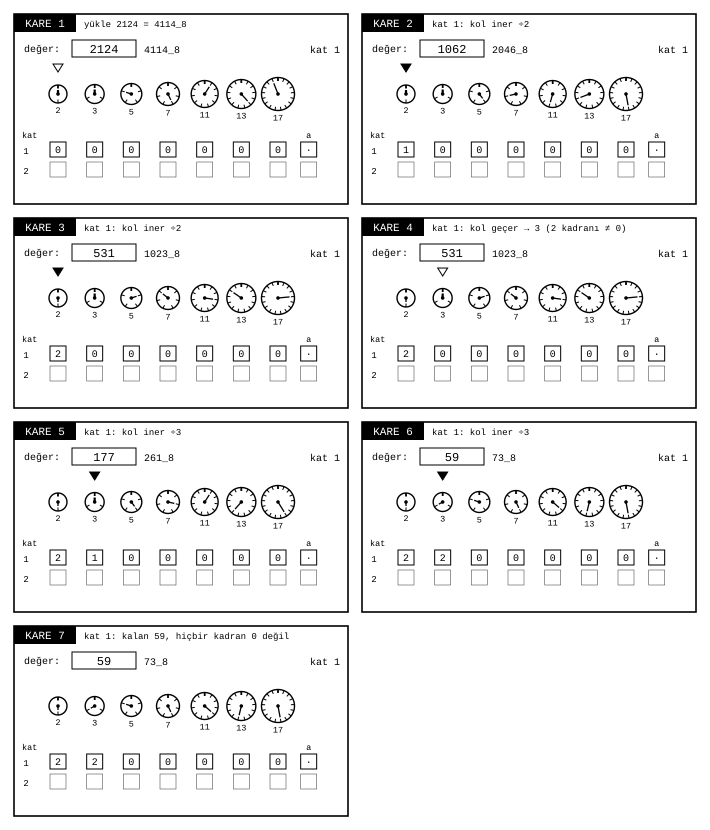
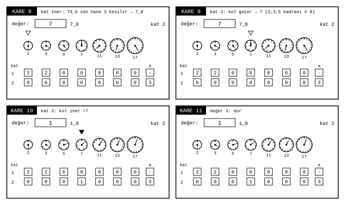

# Resolver deneyleri

James Augustus

Bu belgede Resolver'ın kodda uygulanmamış ya da yalnız örnek ve betik düzeyinde kalmış biçimlerini anlatıyorum. Çalışan ve sınanmış biçimler [Resolver](../Resolver.md) belgesindedir. Biçimler en yeniden en eskiye sıralıdır. Sayılar, $_8$ ile işaretlenmedikçe onluktur.

| Sıra | Biçim | Tarih | Durum |
|:---:|---|---|---|
| 1 | Üs üzerinden çözme, $2^p - 1$ biçimi | 4 Eylül 2026 | betikle gösterildi, Resolver birimi olarak kodlanmadı |
| 2 | Katlı merdiven | 3 Eylül 2026 | kodda uygulanmadı |
| 3 | $a$ hücresinin çift görevi ve düz çarpan | Temmuz-Ağustos 2026 | üs yayma kısmı sınandı |

## İçindekiler

| Bölüm | Başlık |
|---|---|
| 1 | Üs üzerinden çözme, $2^p - 1$ biçimi |
| 1.1 | Tarih ve kaynak |
| 1.2 | Fikir |
| 1.3 | Mekanizma |
| 1.3.1 | Şekilden okuma |
| 1.3.2 | $2p + 1$ kapısı |
| 1.3.3 | $k$ yürüyüşü |
| 1.3.4 | Gövde gerekirse katlama |
| 1.4 | Örnek |
| 1.5 | Kod ve sınama |
| 1.6 | Farkı |
| 2 | Katlı merdiven |
| 2.1 | Tarih ve kaynak |
| 2.2 | Fikir |
| 2.3 | Mekanizma |
| 2.4 | Örnek |
| 2.5 | Kod ve sınama |
| 2.6 | Farkı |
| 3 | $a$ hücresinin çift görevi ve düz çarpan |
| 3.1 | Tarih ve kaynak |
| 3.2 | Fikir |
| 3.3 | Mekanizma |
| 3.4 | Örnek |
| 3.5 | Kod ve sınama |
| 3.6 | Farkı |
| 4 | Açık kalanlar |

## 1. Üs üzerinden çözme, $2^p - 1$ biçimi

### 1.1 Tarih ve kaynak

4 Eylül 2026. Yirmi beş haneli bir sayının baştan sona süreç anlatımı.

### 1.2 Fikir

Bazı sayılar register'a sığmaz ama biçimleri bilinir. $2^p - 1$ biçimindeki bir sayıyla çalışırken sayının kendisini hiç kurmadan, yalnız üs $p$ ve küçük kalanlarla 1’den büyük ve sayının kendisinden küçük bir bölen bulunduğunda bileşiklik hükmü verilir. Sınırlı aramada bölen bulunmaması asallık hükmü vermez.

### 1.3 Mekanizma

Dört adım vardır.

#### 1.3.1 Şekilden okuma

$2^p - 1$'in sekizlik yazımı $p \bmod 3$'e bağlıdır: kalan 1 ise baş hane 1, kalan 2 ise baş hane 3, kalan 0 ise baş hane yoktur. Ardından hep 7 gelir.

#### 1.3.2 $2p + 1$ kapısı

$p \equiv 3 \pmod 4$ ve $2p + 1$ asalsa, $2p + 1$ sayıyı böler.

#### 1.3.3 $k$ yürüyüşü

$p$ tek asal olduğunda, kapı açılmazsa bölenler yalnız $q = 2kp + 1$ ve $q \equiv \pm 1 \pmod 8$ biçiminde aranır. $p \equiv 3 \pmod 4$ için yalnız $k \equiv 0, 1 \pmod 4$ sınıfları denenir. Diğer sınıflar hesaplanmadan elenir.

#### 1.3.4 Gövde gerekirse katlama

Gövdenin kendisi gerekiyorsa bölme yerine [Resolver](../Resolver.md) belgesindeki akış katlaması kullanılır.

### 1.4 Örnek

$p = 83$, $N = 2^{83} - 1$, 25 onluk hane, 28 sekizlik hane. Register'a sığmaz.

$83 = 3 \cdot 27 + 2$ olduğundan kalan 2'dir ve sekizlik yazım bir 3 ile başlayıp 27 tane 7 ile devam eder. Ayrıca $83 \equiv 3 \pmod 4$ ve $2 \cdot 83 + 1 = 167$ asaldır. Dolayısıyla 167, $N$'yi böler ve $N$ bileşiktir.

Bu bilgiler iki haneli sayılarla yapılan iki işlemden çıkar. Doğrulama için $N \bmod 167 = 0$ ayrıca hesaplandı.

### 1.5 Kod ve sınama

Python, süreç anlatımının her sayısı betikle üretildi. Lucas-Lehmer adımları $p = 13$ için tek tek izlendi ve son değer 0 çıktı, $8191$ asaldır.

### 1.6 Farkı

Sayı çözülmez, biçiminden okunur. Resolver'ın konusu sayının kendisi değil, onu üreten üstür.

## 2. Katlı merdiven

### 2.1 Tarih ve kaynak

3 Eylül 2026. Register şablonu ve formül kaydı.

### 2.2 Fikir

Gölgenin dört satırı bir merdivenin katlarıdır. Her katta yedi asal soyulur. Kalan değer bölünmüyorsa son sekizlik hanesi kesilir ve geri kalanı bir alt kata iner. Her kat inmek 8'e bölmektir.

### 2.3 Mekanizma

$$v_k = s_k \cdot (8\,v_{k+1} + a_{k+1})$$

Burada $s_k$, $k$. katta soyulan asal kuvvetlerinin çarpımı, $a_{k+1}$ inişte kesilen hanedir. $rs1$'in $a$ hücresi boştur, çünkü normal sayıdan ilk kata iniş yoktur. Bir üs hücresi en fazla 7 tutar. Hücre dolunca kalan değer yine merdivenden iner:

$$3^{10} = 3^7 \cdot 27 = 3^7 \cdot (8 \cdot 3 + 3) = 59049$$

### 2.4 Örnek

$2124 = 4114_8$. Birinci katta $2^2 \cdot 3^2$ soyulur, 59 kalır. $59 = 73_8$, son hane 3 kesilir, 7 ikinci kata iner ve orada 7 soyulur:

$$2124 = 2^2 \cdot 3^2 \cdot (8 \cdot 7 + 3)$$

### 2.5 Kod ve sınama

Katlı iniş kodda uygulanmadı. Örnekler çizim programıyla hesaplandı ve eşitlikle denetlendi.

### 2.6 Farkı

Önceki biçimde üs taşması bir alt satıra "düz çarpan" olarak yazılıyordu. Burada her satır gerçek bir iniştir ve hiçbir satır 8'e bölmeden okunmaz.

## 3. $a$ hücresinin çift görevi ve düz çarpan

### 3.1 Tarih ve kaynak

Temmuz ve Ağustos 2026. Gölge mekanizması şeması ve ana tasarım belgesi.

### 3.2 Fikir

Yedi asal soyulduktan sonra kalan değer tektir, çünkü bütün 2'ler soyulmuştur (üs hücresi dolmadığı sürece). Tek bir sayının son sekizlik hanesi her zaman 1, 3, 5 ya da 7'dir. Bu yüzden inişte kesilen $a$ hanesi hiçbir zaman çift değildir. Çift değerler boşta kalır ve satırın türünü bildirmek için kullanılabilir. Satır ya bir kalan hanesi taşır ya bir tür bildirir, ikisini birden asla.

### 3.3 Mekanizma

| $a$ | Satırın anlamı |
|---|---|
| 1, 3, 5, 7 | merdiven: üst satırın rough'u $= 8 \cdot \text{ben} + a$ |
| 0 | düz çarpan: merdiven değilim, üst satırın çarpımına katılırım |
| 2 | rough: hücrelerim normal sayı olarak okunur |
| 4, 6 | önek ve sonek: komşu register sınırı |

Bir üs 7'yi aşarsa fazlası bir sonraki boş satıra $a = 0$ ile düz çarpan olarak yazılır. İniş harcanmaz.

### 3.4 Örnek

$2^{11} = 2048 = 2^7 \cdot 2^4$: birinci satırda $e_2 = 7$, ikinci satırda $e_2 = 4$ ve $a = 0$. Bu düzende toplam üs kapasitesi dört satır çarpı 7, yani 28'dir. Aşılırsa taşma bildirilir, sessiz kırpma yapılmaz.

### 3.5 Kod ve sınama

Gölge emülatöründe üs taşması ve satırlara yayma sınandı. Üslerin 0 ile 40 arasında katmanlara dağıtılması kayıtlı ölçüme göre hatasızdır.

### 3.6 Farkı

Sonraki katlı merdivende $a = 0$ da gerçek bir iniş sayıldı ve hücre tavanında kalan değer aşağı indi. Bu biçimde ise $a = 0$ inişsiz bir çarpandır.

## 4. Açık kalanlar

Katlı merdiven kodda uygulanmadı ve sınanmadı. Zincirin bittiği yerin nasıl işaretleneceği, üs tavanından sonra 8'in altında kalan değerler ve dördüncü satırın sonu açıktır. Bu deneylerden hangisinin çalışan Resolver'a katılacağı ayrıca karar ister.

İlgili belgeler: [Resolver](../Resolver.md), [Dişli modeli](../Cark.md), [Register](../../Register/Register.md) ve [Parçalar](../../README.md).
