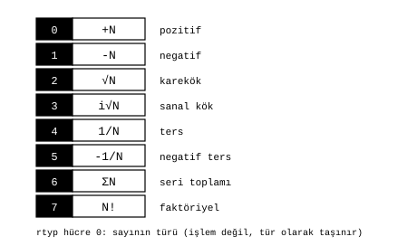

# Türler ve durumlar

James Augustus

## Özet

CTCPU'da bazı değerleri işlem olarak değil, tür olarak taşıyorum. $\sqrt{x}$, $1/x$, $\Sigma x$ ve $x!$ hesaplanmadan, sayının türü değiştirilerek tutulur ve ancak sayısal değer gerektiğinde açılır. Tür, register'ın $rtyp$ satırının ilk hücresindedir ve sekiz koddan birini alır. Aritmetik durumlar (taşma, sıfır ve benzerleri) ayrı bir bit haritasında değil, yine $rtyp$ içinde tutulur.

## İçindekiler

| Bölüm | Başlık |
|---|---|
| 1 | Sekiz tür |
| 2 | Neden tür |
| 3 | Türlerin çarpımı |
| 4 | Durumlar |
| 5 | Açık kalanlar |

## 1. Sekiz tür

| Kod | Ad | Anlamı |
|---:|---|---|
| 0 | POS | $+N$ |
| 1 | NEG | $-N$ |
| 2 | SQRT | $\sqrt{N}$, $N\ge0$ |
| 3 | ISQRT | $\sqrt{-N}=i\sqrt{N}$, $N\ge0$ |
| 4 | INV | $1/N$, $N\ne0$ |
| 5 | NINV | $1/(-N)$, $N\ne0$ |
| 6 | SIGMA | $1 + 2 + \dots + N$ |
| 7 | FACT | $N!$ |

Sekiz kod tam bir hücreye sığar. İşaret de türün içindedir. Ayrı bir işaret biti yoktur.

## 2. Neden tür

Bir değeri tür olarak taşımak, onu hesaplamayı gerektiği ana kadar ertelemektir. Birçok işlemde hesaba hiç gerek kalmaz.

Gerçek $x\ge0$ için iki SQRT türünün çarpımı, $\sqrt{x} \cdot \sqrt{x}$, doğrudan $x$'tir. $x\ne0$ için INV ile POS türünün çarpımı, $1/x \cdot x$, 1'dir. $N\ge1$ tamsayısı için iki FACT türünün bölümü, $N!/(N-1)!$, $N$'dir. $\Sigma N$ ise $1 + 2 + \dots + N$ toplamı tek tek yapılmadan $N(N+1)/2$ olarak bilinir.

Tür bilgisi korunduğu sürece sonuç kesindir. Bir değer ancak sayısal sonucu istendiğinde açılır. Kökün açılma yolları [Karekök](../ALU/Karekok/Karekok.md) belgesindedir.

## 3. Türlerin çarpımı

İşaret türlerinde çarpım, işaretlerin birleştirilmesidir. NEG ile NEG'in çarpımı POS'tur. Ters türlerde çarpım bölmeye döner. Bir kesir, pay ve payda olmak üzere iki register'da tutulur ve paydanın türü INV'dir. Bu düzen [Çarpma ve bölme](../ALU/Carpma_Bolme/Carpma_Bolme.md) belgesinde anlatılmıştır.

## 4. Durumlar

Eski tasarımda sekiz bağımsız durum biti vardı: taşma (OVF), sıfır (ZERO), rough (ROUGH), önek (PREFIX), sonek (SUFFIX), özel (SPEC), kapalı (OFF) ve bekleme (WAIT). Güncel düzende ayrı bir durum alanı yoktur.

$rc$ ilk rough çarpanı tutuyorsa ROUGH gereksizdir, çünkü $rc \ne 1$ zaten rough bir kısım olduğunu söyler. $rc$ son artığı tutuyorsa merdivenin alt katları da okunmalıdır ve ROUGH gereksinimi bu kayıt seçimine bağlıdır. İlk durumda geriye yedi durum kalır ve $rtyp$'in de hücre 0 dışında tam yedi hücresi vardır. Durumlar hücrelere taşınırsa bit değil hücre olurlar ve her biri 0 ile 7 arasında bir değer taşıyabilir. Örneğin PREFIX ve SUFFIX, açık ya da kapalı olmak yerine hangi haneyi gösterdiklerini söyleyebilir. İşaret ve sıfıra bölme için ayrı bir durum yoktur.

## 5. Açık kalanlar

ROUGH çıkarılırsa yedi durumun $rtyp$'in hangi hücresine yerleşeceği henüz belirlenmedi. Önceki emülatörde SPEC, OFF ve WAIT tanımlı olduğu halde hiç yazılmıyordu. Fiilen beş durum çalışıyordu. Tür tablosunun bütün kodları da uygulanmış davranış değildir. Önceki emülatör çekirdeği fiilen yalnız POS ve NEG türlerini atıyordu.

İlgili belgeler: [Register](../Register/Register.md), [ISA](../../ISA.md) ve [Parçalar](../README.md).
