# CTCPU-Hunter: Sayı Gösterimi, Yürütme ve Bellek Modelleri

James Augustus

[ORCID: 0009-0002-7286-7730](https://orcid.org/0009-0002-7286-7730)

## Öz

Bu birleşik çalışma, CTCPU-Hunter mimarisinin sayı gösterimlerini, aritmetik yöntemlerini, PCCPU denetleyici önerisini ve CTMemTensor bellek ve adresleme seçeneklerini ele alır. Mevcut matematiksel sonuçlar, hesaplanan örnekler ve tasarım önerileri aynı okuma düzeninde sunulur. Hunter çekirdeği, eski çok çekirdekli öneriler, sıralı C modeli ve tasarlanan simetrik bellek aynı tamamlanma düzeyinde değildir.

## Kapsam ve okuma düzeni

I. kısım kapsamlı Hunter ana metnidir. Hücre, register, Resolver, aritmetik, türler, ISA ve açık kararları içerir. II. kısım PCCPU görev modelidir. III. kısım CTMemTensor adresleme ve bellek seçenekleridir. IV. kısım mevcut C örneği ile sayısal gösterimin doğrulama kapsamını belirtir. Merkezden okuma N(9,0) = 126, klasik sütun okuması C(9,4) = 126 ile aynı katsayıyı farklı koordinatlarla seçer. PCCPU içindeki kenar başlangıçlı T gösterimi ayrı bir alternatif olarak korunmuştur.

Bu nüsha bir teknik çalışma olarak hazırlanmıştır. Yazar adı James Augustus'tur. Ana kaynakların teknik içerikleri ve kanıtları korunmuştur. Ortak başlık ve okuma düzeni eklenmiş, yinelenen belge başlıkları, yazar satırları ve ayrı içindekiler kaldırılmıştır. Kaynak metinlerdeki bölüm numaraları ve numaralı atıflar kendi ana kısımları içinde okunur. Araştırma geçmişini anlatan özgün bölümlerde yazarın anlatımı korunur.

Kod ve testler eşlik eden depo arşivindedir. Metin CC BY 4.0, özgün kod MIT lisanslıdır. Üçüncü taraf bağımlılıkları kendi lisanslarını korur. Fiziksel donanım, hız veya enerji üstünlüğü yalnız yazılım testlerinden çıkarılmaz.

## I. CTCPU ve Hunter

### 1. Renkten başlayan makine

#### 1.1 Renkten başladım

Bu işe renkten başladım. 21 Nisan 2026'da kayıtları renk etiketli, sayıları sekizlik yazan bir yardımcı işlemci düşündüm. Mersenne sayılarını yan yana koyduğumda kırmızı, sarı ve beyaz dizileri görüyordum. Bir sayı, haneleri boyunca okunabilen bir renk dizisine dönüşüyordu.

| Üs $p$ | $2^p-1$ | Sekizlik yazım | Renk dizisi |
|---:|---:|---|---|
| 3 | 7 | $7_8$ | W |
| 5 | 31 | $37_8$ | Y W |
| 7 | 127 | $177_8$ | R W W |
| 11 | 2047 | $3777_8$ | Y W W W |
| 13 | 8191 | $17777_8$ | R W W W W |
| 17 | 131071 | $377777_8$ | Y W W W W W |

8 Haziran 2026'da Doom'u assembly ile yazmak istiyordum. Önce işlemcinin nasıl çalıştığını anlamaya başladım. Işıkla hesap düşündüm. Üç ışık kanalı, sekiz renk ve bir sekizlik hane aynı kutuda buluştu. En küçük birime xbit dedim. Bir xbit üç bittir.

Kırmızıya yeşil eklediğimde sarı, mavi de eklendiğinde beyaz görüyordum. 2 Ağustos 2026'da renk harflerini sayı olarak okumaya başladım. Uzun bir beyaz dizisini tek tek yazmak yerine kaç kez tekrarlandığını tutmayı düşündüm. 4 Eylül 2026'da bu yazımdan renk kapısı kurma fikrine döndüm. Renk, sayının görünen yüzü olarak kaldı.

Mersenne dizisindeki baş rengi araştırınca kaynağını buldum. Sekizlik yazım, ikilik haneleri üçerli gruplar. $p=3t+r$ ve $0\le r<3$ için

$$2^p-1=(2^r-1)8^t+(8^t-1).$$

$r=1$ olduğunda baş hane kırmızı 1 olur. $r=2$ olduğunda sarı 3 olur. $r=0$ olduğunda baş hane eklemem, bütün haneler beyaz 7 olur. Bu desen asallığı söylemez. $31$ asaldır. $2047=23\cdot89$ bileşiktir. İkisi de sarıyla başlar. Renkle gördüğüm düzeni bir asallık testi diye kullanmıyorum.


#### 1.2 İnsan gibi hesaplayan makine

8 Temmuz 2026'da projenin omurgasını tek cümleyle yazdım: insan gibi hesaplayan makine. Çarpanına ayırır, sembolü tutar, en sonda açar.

İnsan bilgisayar olmadığı için kolay yollar bulmuş, soyutlama ve matematik biraz da böyle gelişmiş. $10\cdot9$ için dokuz tane on toplamaz, doğrudan 90 der. $21\cdot36$'yı $7\cdot108$'e çevirir. $2^3+2^4$'ü açmaz, paranteze alır: $2^3\cdot3=24$. Sınavda $3\sqrt2$ bırakır, on haneli bir virgüllü sayı yazmaz. Klasik bir işlemci ise basamak basamak, körlemesine hesaplar. Hunter'ı sınavdaki eğitimli öğrenci gibi hesaplayacak biçimde kurmak istedim.

Gölgede çarpma biraz logaritma gibi davranıyor: çarpım, üslerin toplamına dönüşüyor. Farkı, sonlu hassasiyetli logaritmik gösterimin yaklaşık olması, gölgenin ise kapasitesi içinde tamsayı üslerle kesin kalması.

Ne istediğimi 18 Temmuz 2026'da bir manifestoda yazdım. O metin [Küçük Mesaj](https://github.com/JamesAugustus/ctcpu-hunter) içinde duruyor. Bu yolda ne düşündüğümü, neleri denediğimi, neyin tutup neyin tutmadığını da günlüğümde tarih tarih yazdım.

#### 1.3 Derin nefes

18 Temmuz 2026'da amacımı hızıyla değil sakinliğiyle kazanan bir makine diye yazdım. Sayıyı her işlemde son basamağına kadar açmak istemedim. Gerekli bilgiyi taşıyıp gereksiz hesabı ertelemek istedim. Buna derin nefes dedim.

Bir sayının toplama için uygun yüzü ile çarpma için uygun yüzü aynı olmak zorunda değil. Düz yüzde sekizlik haneleri tutuyorum. Gölge yüzde seçtiğim asal kanalların üslerini ve kalan yapısını tutuyorum. Toplama geldiğinde düz yüze, uygun çarpma geldiğinde gölge yüze gidiyorum. Bir yüz değişirse öteki yüzün geçerliliğini de takip etmem gerekiyor.

$\sqrt{x}$, $i\sqrt{x}$, $1/x$, $\Sigma x$ ve $x!$ için de aynı düşünceyi kurdum. Bunları tür olarak taşıyorum. Tür, sayıya hangi anlamla bakacağımı söylüyor. Kökü hemen yaklaşık bir sayıya çevirmem gerekmiyor. Kesri açmadan pay ve paydasıyla tutabiliyorum. Faktöriyel çiftinin sadeleşmesi, büyük faktöriyel değerinin doğmasını engelleyebiliyor.

Ertelemenin de bedeli var. Türü, bağı, gölgenin geçerliliğini ve açma isteğini saklamam gerekiyor. Resolver'ın sayıyı gölgeye çevirmesi iş yapıyor. Sonunda bütün basamaklar istenirse onları üretmek gerekiyor. Bu bedelleri kaybolmuş saymıyorum.

#### 1.4 Hunter'ın sınırı

Güncel Hunter'ı tek çekirdek, tek iş parçacığı ve sekiz register ile kurdum. Bir register sekiz satır, bir satır sekiz hücredir. Eski çok çekirdekli küp ile bu çekirdeği aynı tamamlanmış makine saymıyorum. Eski modeller, parçaların nasıl düşünüldüğünü gösteriyor. Güncel yerleşimde karşılığı bulunmayan parçaların yerini açık bırakıyorum.

Yazılımda bir hesabın doğru çıkması, o hesabın devrede kaç çevrim süreceğini söylemiyor. Silikon ölçümüm yok. Eski süreleri kayıtlardaki ölçümler olarak tutuyorum. Yeniden çalıştırdığım deneyleri 25 Ekim 2026 tarihiyle ayırıyorum. Sayısal örnekleri aynı gün tam sayı ve kesin kesir hesabıyla denedim.

Bu işe renkten başladım. Makinenin amacını 18 Temmuz 2026'da "hızıyla değil sakinliğiyle kazanan bir makine" diye yazmıştım. Makine kaydının adını 3 Eylül 2026'da BILINEN.txt'den HUNTER.txt'ye çevirdim. Bu bölümde renkten register'a, türlere ve çekirdeğe kadar aynı makineyi anlatıyorum.

### 2. Hücre, ışık kümeleri ve renk kapıları

#### 2.1 Hücrenin sekiz durumu

Bir hücreye üç ikili kanal koydum. Sağdaki kanalı kırmızı, ortadakini yeşil, soldakini mavi olarak okuyorum. Bir hücre bir anda bu sekiz durumdan birini taşır. Sekiz olasılığın aynı anda bulunmasını ya da kuantum durumunu kastetmiyorum.

$$d=b_R+2b_G+4b_B,\qquad b_R,b_G,b_B\in\{0,1\}.$$

| Hane | Bitler $BGR$ | Harf | Renk | Yanan kanallar |
|---:|---|---|---|---|
| 0 | 000 | K | siyah | $\varnothing$ |
| 1 | 001 | R | kırmızı | $\{R\}$ |
| 2 | 010 | G | yeşil | $\{G\}$ |
| 3 | 011 | Y | sarı | $\{R,G\}$ |
| 4 | 100 | B | mavi | $\{B\}$ |
| 5 | 101 | M | macenta | $\{R,B\}$ |
| 6 | 110 | C | camgöbeği | $\{G,B\}$ |
| 7 | 111 | W | beyaz | $\{R,G,B\}$ |

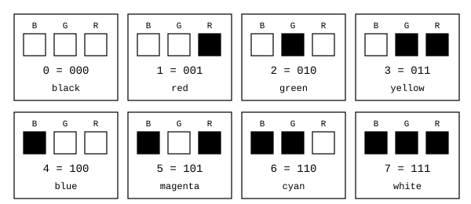

Sekizlik rakam ile renk kodu aynı değeri anlatır. Tür kodu da aynı büyüklükte bir hücreye sığar. Buna rağmen sayı hanesi ile tür hücresini aynı anlamda okumam. Hücrenin bulunduğu alan, kodun yorumunu belirler.

Üç ışık kanalının sekiz rengini sekizlik durumlar olarak kullanmayı araştırınca kaynağını buldum. Talal, Abu-Elnasr ve Elmougy, sekiz ışık rengi üzerine sekiz değerli bir mantık modeli kurdu ve onunla optik bir tam toplayıcı tasarladı ([Talal, Abu-Elnasr ve Elmougy, 2021, A Novel Design of Octal-Valued Logic Full Adder Using Light Color State Model](https://doi.org/10.32604/cmc.2021.015759)). Benim tasarımımda sekiz renk hücrenin ve sayı sisteminin hanesidir, sayının ayrıca ikinci bir biçimi, yani gölgesi vardır.

#### 2.2 Işığın kesiştiği bölgeler

Üç ışık huzmesinin uzayda aydınlattığı bölgeleri $L_R$, $L_G$ ve $L_B$ ile adlandırdım. Bir noktanın hangi bölgelere ait olduğunu okuyunca bir renk elde ediyorum. Üç kümenin üyelik deseni sekiz ayrı bölge verir.

| Bölge | Küme ifadesi | Hane |
|---|---|---:|
| Hiçbir ışık yok | $(L_R\cup L_G\cup L_B)^c$ | 0 |
| Yalnız kırmızı | $L_R\setminus(L_G\cup L_B)$ | 1 |
| Yalnız yeşil | $L_G\setminus(L_R\cup L_B)$ | 2 |
| Kırmızı ve yeşil | $(L_R\cap L_G)\setminus L_B$ | 3 |
| Yalnız mavi | $L_B\setminus(L_R\cup L_G)$ | 4 |
| Kırmızı ve mavi | $(L_R\cap L_B)\setminus L_G$ | 5 |
| Yeşil ve mavi | $(L_G\cap L_B)\setminus L_R$ | 6 |
| Üç ışık birlikte | $L_R\cap L_G\cap L_B$ | 7 |

Burada iki okuma karışabiliyor, ayırıyorum. Işığın düştüğü yerden bakınca sarı bölge, kırmızı VE yeşil ışığın ikisinin birden düştüğü, mavi ışığın düşmediği yerdir: $(L_R\cap L_G)\setminus L_B$. Bu, bölgelerin mavi bölge dışındaki kesişimidir. Renk kodlarından bakınca ise sarı, kırmızı VEYA yeşildir: $001\lor010=011=3$. Bu kodların birleşimidir, iki ışığı birlikte yakıyorum. Kodları VE kapısına verirsem $001\land010=000$ olur, ortak açık kanal yoktur ve siyah çıkar. Aynı sarıyı iki farklı yerden görüyorum: bölge olarak kesişim, kod olarak birleşim. Bu bölümdeki kapı tabloları kodlar üzerindedir.

Işık oranı fikri, bu varlık bilgisinin ötesinde yoğunluk da okumak istiyor. Sekiz durumlu hücrede yoğunluk eşiği, algılayıcı cevabı ve gürültü payı kodlanmış değil. PROJE kaydındaki ISIK / ORAN ALGISI başlığını açık bıraktım. Üç kanallı sayısal modeli fiziksel optik kapı yapılmış gibi anlatmıyorum.

#### 2.3 Renkten renge kapı

Bir renk kodunun açık kanallarına $C(d)$ dedim. Kanal evreni $U=\{R,G,B\}$ olsun. Kapı, iki renk alıp bir renk verir. Girişlerin her biri sekiz değer aldığı için iki girişli kapının tablosu $8\times8$ olur. Çıkışı yalnız doğru ya da yanlış diye tek bite indirmedim.

$$C(a\mathbin{\mathrm{VE}}b)=C(a)\cap C(b).$$

$$C(a\mathbin{\mathrm{VEYA}}b)=C(a)\cup C(b).$$

$$C(a\mathbin{\mathrm{XOR}}b)=C(a)\mathbin{\triangle}C(b).$$

$$C(\mathrm{DEĞİL}(a))=U\setminus C(a).$$

NAND, VE sonucunun tümleyenidir. NOR, VEYA sonucunun tümleyenidir. XNOR, XOR sonucunun tümleyenidir. Tümleyeni yalnız hücrenin üç kanalı içinde alıyorum. Böylece DEĞİL işlemi sayısal olarak $7-d$ verir. Programdaki sonsuz genişlikli işaretli tümleme ile karıştırmıyorum.

| Giriş | 0 | 1 | 2 | 3 | 4 | 5 | 6 | 7 |
|---|---:|---:|---:|---:|---:|---:|---:|---:|
| DEĞİL | 7 | 6 | 5 | 4 | 3 | 2 | 1 | 0 |

Sarı ve macenta olmak üzere iki hücreyi kapıya verdim. $3=011_2$ ve $5=101_2$ için VE kırmızı 1, VEYA beyaz 7, XOR camgöbeği 6 verdi. NAND camgöbeği 6, NOR siyah 0, XNOR kırmızı 1 oldu. Aynı iki hücreden altı ayrı renk işlemi çıktı.

Renk karışımını tam sayı toplaması diye genellemedim. Kırmızı VEYA kırmızı yine kırmızıdır. Sayı olarak $1+1=2$ ise yeşil koduna gider. Toplayıcıda elde ve sayı ağırlığı vardır. Renk kapısında seçtiğim küme işlemi vardır.

Renklerle ve ışıkla mantık kapısı kurmayı araştırınca kaynağını buldum. Timchenko, Kondratenko ve Kreinovich, ışık yayıcının rengini mantık değişkeni alıp renk filtreleriyle optik VE ve VEYA kapıları kurdu ([Timchenko, Kondratenko ve Kreinovich, 2023, Implementation of Optical Logic Gates Based on Color Filters](https://doi.org/10.1007/978-3-031-36118-0_12)). Aynı grup bunu bulanık renk hesabına da genişletti ([Timchenko, Kondratenko, Kozlov ve Kreinovich, 2023, Fuzzy Color Computing Based on Optical Logical Architecture](https://doi.org/10.1007/978-3-031-39774-5_55)). Kawano, renk kodlu filmleri üst üste koyarak Boolean VE hesapladı ([Kawano, 2013, Primitive Optical Computing Model with Films](https://doi.org/10.20965/jaciii.2013.p0791)). Ben aynı türden bir fikri, bir hücrenin sekiz rengiyle ve her kapı için 8 × 8 bir tabloyla kullanıyorum.

#### 2.4 Kapı tabloları

Tablolarda satır ilk girişi, sütun ikinci girişi gösteriyor. Her kesişimdeki değer çıkış renginin kodudur. Tabloları programla ürettim. Her hücreyi ayrıca kanal kümeleri üzerinde hesaplayıp karşılaştırdım.

#### 2.4.1 VE

| A / B | 0 | 1 | 2 | 3 | 4 | 5 | 6 | 7 |
|---|---:|---:|---:|---:|---:|---:|---:|---:|
| 0 | 0 | 0 | 0 | 0 | 0 | 0 | 0 | 0 |
| 1 | 0 | 1 | 0 | 1 | 0 | 1 | 0 | 1 |
| 2 | 0 | 0 | 2 | 2 | 0 | 0 | 2 | 2 |
| 3 | 0 | 1 | 2 | 3 | 0 | 1 | 2 | 3 |
| 4 | 0 | 0 | 0 | 0 | 4 | 4 | 4 | 4 |
| 5 | 0 | 1 | 0 | 1 | 4 | 5 | 4 | 5 |
| 6 | 0 | 0 | 2 | 2 | 4 | 4 | 6 | 6 |
| 7 | 0 | 1 | 2 | 3 | 4 | 5 | 6 | 7 |

#### 2.4.2 VEYA

| A / B | 0 | 1 | 2 | 3 | 4 | 5 | 6 | 7 |
|---|---:|---:|---:|---:|---:|---:|---:|---:|
| 0 | 0 | 1 | 2 | 3 | 4 | 5 | 6 | 7 |
| 1 | 1 | 1 | 3 | 3 | 5 | 5 | 7 | 7 |
| 2 | 2 | 3 | 2 | 3 | 6 | 7 | 6 | 7 |
| 3 | 3 | 3 | 3 | 3 | 7 | 7 | 7 | 7 |
| 4 | 4 | 5 | 6 | 7 | 4 | 5 | 6 | 7 |
| 5 | 5 | 5 | 7 | 7 | 5 | 5 | 7 | 7 |
| 6 | 6 | 7 | 6 | 7 | 6 | 7 | 6 | 7 |
| 7 | 7 | 7 | 7 | 7 | 7 | 7 | 7 | 7 |

#### 2.4.3 XOR

| A / B | 0 | 1 | 2 | 3 | 4 | 5 | 6 | 7 |
|---|---:|---:|---:|---:|---:|---:|---:|---:|
| 0 | 0 | 1 | 2 | 3 | 4 | 5 | 6 | 7 |
| 1 | 1 | 0 | 3 | 2 | 5 | 4 | 7 | 6 |
| 2 | 2 | 3 | 0 | 1 | 6 | 7 | 4 | 5 |
| 3 | 3 | 2 | 1 | 0 | 7 | 6 | 5 | 4 |
| 4 | 4 | 5 | 6 | 7 | 0 | 1 | 2 | 3 |
| 5 | 5 | 4 | 7 | 6 | 1 | 0 | 3 | 2 |
| 6 | 6 | 7 | 4 | 5 | 2 | 3 | 0 | 1 |
| 7 | 7 | 6 | 5 | 4 | 3 | 2 | 1 | 0 |

#### 2.4.4 NAND

| A / B | 0 | 1 | 2 | 3 | 4 | 5 | 6 | 7 |
|---|---:|---:|---:|---:|---:|---:|---:|---:|
| 0 | 7 | 7 | 7 | 7 | 7 | 7 | 7 | 7 |
| 1 | 7 | 6 | 7 | 6 | 7 | 6 | 7 | 6 |
| 2 | 7 | 7 | 5 | 5 | 7 | 7 | 5 | 5 |
| 3 | 7 | 6 | 5 | 4 | 7 | 6 | 5 | 4 |
| 4 | 7 | 7 | 7 | 7 | 3 | 3 | 3 | 3 |
| 5 | 7 | 6 | 7 | 6 | 3 | 2 | 3 | 2 |
| 6 | 7 | 7 | 5 | 5 | 3 | 3 | 1 | 1 |
| 7 | 7 | 6 | 5 | 4 | 3 | 2 | 1 | 0 |

#### 2.4.5 NOR

| A / B | 0 | 1 | 2 | 3 | 4 | 5 | 6 | 7 |
|---|---:|---:|---:|---:|---:|---:|---:|---:|
| 0 | 7 | 6 | 5 | 4 | 3 | 2 | 1 | 0 |
| 1 | 6 | 6 | 4 | 4 | 2 | 2 | 0 | 0 |
| 2 | 5 | 4 | 5 | 4 | 1 | 0 | 1 | 0 |
| 3 | 4 | 4 | 4 | 4 | 0 | 0 | 0 | 0 |
| 4 | 3 | 2 | 1 | 0 | 3 | 2 | 1 | 0 |
| 5 | 2 | 2 | 0 | 0 | 2 | 2 | 0 | 0 |
| 6 | 1 | 0 | 1 | 0 | 1 | 0 | 1 | 0 |
| 7 | 0 | 0 | 0 | 0 | 0 | 0 | 0 | 0 |

#### 2.4.6 XNOR

| A / B | 0 | 1 | 2 | 3 | 4 | 5 | 6 | 7 |
|---|---:|---:|---:|---:|---:|---:|---:|---:|
| 0 | 7 | 6 | 5 | 4 | 3 | 2 | 1 | 0 |
| 1 | 6 | 7 | 4 | 5 | 2 | 3 | 0 | 1 |
| 2 | 5 | 4 | 7 | 6 | 1 | 0 | 3 | 2 |
| 3 | 4 | 5 | 6 | 7 | 0 | 1 | 2 | 3 |
| 4 | 3 | 2 | 1 | 0 | 7 | 6 | 5 | 4 |
| 5 | 2 | 3 | 0 | 1 | 6 | 7 | 4 | 5 |
| 6 | 1 | 0 | 3 | 2 | 5 | 4 | 7 | 6 |
| 7 | 0 | 1 | 2 | 3 | 4 | 5 | 6 | 7 |

#### 2.5 Kapının makinedeki yeri

Üç kanal için aynı Boole kuralını paralel uyguladığımda bu tabloları elde ediyorum. Sekiz durumlu tek hücreyi koruyorum. Bir kapının yalnızca tek bir koşul biti üretmesi gerekmez. Daha genel bir renk işlemi için her giriş çiftine bir çıkış kodu atanabilir. O durumda tablonun nasıl uygulanacağını ayrıca seçmem gerekir. Buradaki altı kapı, kanal bazında tanımladığım kapılardır.

Haziran 2026'daki proje notlarımda renk kapısını VE, VEYA, XOR, NAND, NOR ve DEĞİL ile düşünmüştüm. 8 Haziran 2026'da ışıkla hesap fikrini ve renk haritasını yazmıştım. Hunter komut setinde AND, OR, XOR ve NOT komutlarını henüz tanımlamadım. Bu yüzden buradaki tablolar renk kapılarının mantığını gösteriyor, Hunter'ın uygulanmış komutları değiller.

25 Ekim 2026'da altı kapının toplam 384 giriş çiftini denedim. Ayrıca DEĞİL işlemini ve De Morgan eşitliklerini bütün hücre değerlerinde sınadım. Bit işlemleri ile küme işlemleri arasında fark bulmadım.

### 3. Register

#### 3.1 Büyük R ve küçük r

Çekirdeğin register'larını $R0$ ile $R7$ arasında adlandırdım. Her büyük register'ın içinde sekiz küçük satır bulunuyor. $R3$ ile $rs3$ farklı şeylerdir. $R3$ bir sayının bütün kaydıdır. $rs3$ ise o kaydın gölge satırlarından biridir. Her büyük register'ın kendi gölgesi vardır.

$$8\ \text{satır}\times8\ \text{hücre}\times3\ \text{bit}=192\ \text{bit}.$$

Bu alanın tamamına tek bir büyük tamsayı yazmıyorum. Sayının düz biçimi bir satırdadır. Kalan satırlar gölgeyi, artığı, ölçeği ve türü taşır.

| Satır | Ad | İçerik |
|---|---|---|
| r0 | $rm$ | $h_7$ ile $h_0$ arasındaki sekiz sayı hanesi |
| r1 | $rs1$ | İlk katın yedi üs hücresi, boş $a$ hücresi |
| r2 | $rs2$ | İkinci katın yedi üssü, inişte kesilen $a_2$ |
| r3 | $rs3$ | Üçüncü katın yedi üssü, $a_3$ |
| r4 | $rs4$ | Dördüncü katın yedi üssü, $a_4$ |
| r5 | $rc$ | Sekiz haneli rough önbellek |
| r6 | $rpow$ | Ölçek beyanı |
| r7 | $rtyp$ | Hücre 0'da tür, öteki hücrelerin yerleşimi açık |

Sayı hanelerini soldan sağa $h_7,\ldots,h_0$ olarak okuyorum. En düşük hane sağdadır.

$$rm=\sum_{j=0}^{7}h_j8^j,\qquad 0\le rm\le8^8-1=16\,777\,215.$$

$1342_8=738$ örneğinde $h_3=1$, $h_2=3$, $h_1=4$ ve $h_0=2$ olur. Üstteki dört haneyi sıfırla doldururum. Register'ın 192 bit olması, düz sayı alanını 192 bit yapmaz. Düz sayı alanı 24 bittir.

#### 3.2 Gölge satırının okunuşu

Gölge satırında soldan sağa 2, 3, 5, 7, 11, 13 ve 17 kanallarının üslerini tutuyorum. Sağ uçtaki hücre inişte kesilen hanedir. Kanal adları onluk asal adlarıdır. 11 kanalı, sekizlik $13_8$ asalını gösterir.

Birinci gölge satırının $a$ hücresi boştur. $rm$ ile $rs1$ arasında sekize bölerek yapılan bir iniş yoktur. $rm$ sayının düz yüzüdür. Gölge zinciri $rs1$ ile başlar. İnişin kestiği hane gidilen satıra yazılır. Dört satır arasında üç iniş ve üç kalan hücresi bulunur.

Sıfır üslerin çarpımı 1 verir. Bu, kullanılmamış satırı otomatik olarak 1 diye okumam anlamına gelmez. Kullanılan kat sayısını ve bitişi bilmem gerekir. Aksi halde boş sandığım bir satır geri kurmaya yeni bir $8\times$ adımı ekler.

#### 3.3 Bir sayının bütün kaydı

$2124=4114_8$ için ilk katta $2^2\cdot3^2=36$ soyuyorum. Kalan 59 olur. $59=8\cdot7+3$ bağıntısıyla ikinci kata 7 indiriyorum. Kesilen 3'ü $rs2.a$ hücresine koyuyorum. İkinci katta 7 kanalının üssü 1 olur.

$$2124=2^2\cdot3^2\cdot(8\cdot7+3).$$

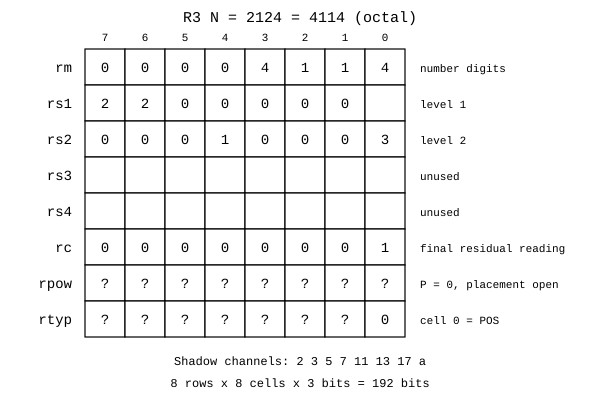

Bu örnekte $rc$'yi son işlenmemiş artık olarak okursam $rc=1$ olur. İlk rough çarpanın önbelleği olarak okursam $rc=59$ olur. Şekilde $rc=1$ kullandım. $rc$'nin kesin anlamını henüz seçmedim. Bu iki okumayı aynı çözümleyicide birbirinin yerine kullanmıyorum.

$rpow$ için bu örneğin ölçeği sıfırdır. $rtyp$ hücre 0'da POS kodu 0 bulunur. Bir hücre zaten sekiz değer taşıyor. Sekiz tür kodu tek hücreye sığıyor. Ölçek de 0 ile 7 arasında kalacaksa tek bir hücreye sığar. O zaman $rpow$ ve $rtyp$ için iki tam satır yerine birer hücre yeter ve iki satır başka işe kalır. Bu düşündüğüm bir seçenek, kesin yerleşimi henüz seçmedim. Bu yüzden şekilde bu iki satırı belirlenmiş bir bit dizisi gibi göstermiyorum.

#### 3.4 Rough ve geçerlilik

$rc$ tam bir satır genişliğindedir. İlk rough çarpanını tutan yorumda bütün sayı rough olabilir. $16\,777\,213=77777775_8$ buna örnektir. 25 Ekim 2026'da kareköküne kadar bütün aday bölenleri denedim ve asal olduğunu doğruladım. Bu sayı ilk ayrıştırmada yedi kanalın hiçbirine bölünmez.

$rc\ne1$ koşuluyla rough varlığını okumak ancak $rc$'nin neyi tuttuğu bilindiğinde güvenilirdir. Merdiven son artığı 1'e indirebilir. Bu durumda ilk katın rough çarpanı kaybolmuş değildir, alt katlara dağılmıştır. $rc$'nin anlamını açık bırakmamın aritmetik sonucu budur.

$rm=0$ olduğunda gölge kurmam. Sıfırın sonlu bir asal üs çarpımı yoktur. Bununla birlikte geçersiz ya da henüz kurulmamış gölgeyi sıfır sanmam. LOAD sonrasında sıfır olmayan bir sayı da gölgesiz durabilir. Sıfır denetimi için geçerli $rm$ hanelerini ve durum bilgisini kullanmam gerekir.

#### 3.5 Üç ayrı satır okuması

| Kaynak zamanı | Satırların anlamı | Üs okuması |
|---|---|---|
| 6 Temmuz 2026, 12 Temmuz güncellemesi | Aynı asalın üs parçaları, toplamsal cascade | Dört hücrenin toplamı, en çok 28 |
| 3 Eylül 2026 | Rough ya da taşan sayının merdiven katları | Her katta smooth ve $8v+a$ |
| 13 Ekim 2026, dişli modeli | Bir üssün sekizlik basamakları | $d_0+8d_1+64d_2+512d_3$, en çok 4095 |

Register çizimini merdiven düzenine göre kurdum. Dişli modelinde aynı dört satırı başka bir işe, bir üssün sekizlik hanelerine kullanıyorum. Fiziksel kaydın hangi okumayla kesinleşeceği açık. Merdiven katlarını ve üs sayaçlarını aynı dört satırda aynı anda tutabileceğimi varsaymıyorum.

#### 3.6 Çekirdeğin kapasitesi

| Birim | Hücre | Bit | Bayt |
|---|---:|---:|---:|
| Satır | 8 | 24 | 3 |
| Register | 64 | 192 | 24 |
| Sekiz register | 512 | 1536 | 192 |

Yalnız $rm$ yüzlerini yan yana açtığımda sekize sekizlik bir düzlem görürüm. Bu düzlem 64 hücredir. Bütün çekirdek ise her register'ın diğer satırlarını da içerir. Tam adresleme, register, alt satır ve hücreyi birlikte belirtir.

25 Ekim 2026'da boyutları, sekizlik dönüşümleri, 2124 kaydını ve geri kurmayı kodla doğruladım.

#### 3.7 Ayrı bir önbellek yok

Hunter'da ayrı bir önbellek katmanı düşünmedim. Bir register'ın içinde sayının düz hali, gölgesi ve rough önbelleği birlikte duruyor. Klasik bir işlemcide ayrı ayrı hesaplanıp önbelleğe yazılacak gösterimler burada register'ın kendisinde tutuluyor. Gölge bir kez kurulunca yeniden kullanılıyor, bir toplamadan sonra geçersiz sayılıyor. Yani önbellek register'ın içinde dönüyor.

Sınırı da açık. Sekiz register 1536 bit, yani 192 bayt. Bundan büyük veri ve program için bir bellek ve onu getiren bir yol yine gerekir. Bellek gereksinimini ortadan kaldırdığımı söylemiyorum. Çalışan değerlerin gösterimlerini register'da önbelleklediğimi söylüyorum.

### 4. Resolver biçimleri

#### 4.1 Resolver'ın tuttuğu bilgi

Pozitif bir tamsayı için kanal kümesini $Q=\{2,3,5,7,11,13,17\}$ aldım. Her kanalda $e_q$ üssünü tutuyorum. Yedi asala bölünmeyen son çarpana $rc$ diyorum. Tek kat ayrışımın eşitliği $N=rc\prod_{q\in Q}q^{e_q}$. Burada $rc$ asal olmak zorunda değil. Yalnız bu yedi asala bölünmemesi gerekiyor.

$360=2^3\cdot3^2\cdot5$ için üs vektörünü $(3,2,1,0,0,0,0)$ ve $rc=1$ buldum. $59$ için bütün üsler sıfır, $rc=59$. Sıfır üslerden oluşan satırın çarpımı sıfır değil, birdir. Sıfır girdiyi ayrı tanıyorum. Sıfırı asal soyma döngüsüne sokmuyorum. İşareti büyüklükten ayırıp türde taşıyorum. Kesri de pay ve payda olarak ele alıyorum. Bunların register bağlantısı, pozitif tamsayı Resolver'ının kendiliğinden çözdüğü bir konu değil.

| Biçim | Kaynak tarihi | Kalanı ve üssü bulma yolu | Kodun kapsamı |
|---|---|---|---|
| Akan sayaç | 12 ve 13 Ekim 2026 | Sekizlik hane akışı, bölüm akışı, elde veren üs sayacı | C çekirdeği, tek kat ayrışım ve geniş aritmetik |
| Mersenne akış katlaması | 13 Eylül 2026 | Üst parçayı alta ekleme | Belirli modüle göre kalan |
| Katlama kapısı ve üs haneleri | 9 Eylül 2026 | İkilik parçaları toplama veya çıkarma | Altı tek asalın kalan kapısı |
| Hane ağırlıkları ve kesme | 20 Temmuz, 2 Ağustos 2026 güncellemesi | Sabit hane ağırlıkları, alt üç biti kesme | Ağırlık hesabı ve iniş örnekleri |
| İki vuruşluk boru | 30 Haziran 2026 | Önce bölünebilirlik, sonra sabit asala bölme | Yedi asal için ilk tam ayrışım |

Biçimleri en yeniden en eskiye sıraladım. Kodu yazılmış ve sınanmış olanları deneysel olanlardan ayırdım. Kalan kapısının çalışması, bütün gölge yerleşiminin aynı kodda tamamlandığı anlamına gelmiyor.

#### 4.2 Akan sayaç

#### 4.2.1 Tarih, fikir ve kaynak

Bu biçimi 12 ve 13 Ekim 2026'da kurdum ve C ile yazdım. Sayı register'a bütünüyle geldikten sonra bölmeye başlamak yerine hane gelirken bölümü de üretmeyi düşündüm. Kalanı küçük bir durumda tuttum. Bölümün hanelerini sonraki geçişe aktardım. Soyulan çarpanların sayısını sekizlik bir sayaçta biriktirdim.

#### 4.2.2 Kalan akışı

Haneleri soldan sağa okuyorum. Kanalın eski kalanı $r_q$, gelen hane $d$ ise $t_q=8r_q+d$ kuruyorum. Yeni kalan $r'_q=t_q\bmod q$. Başlangıç kalanı sıfır. Her adımın sonunda işlenmiş önekin gerçek kalanı elimde kalıyor. Bunun nedeni Horner adımı. Eski öneki sekizle çarpıp yeni haneyi eklemiş oluyorum.

$0\le r_q<q$ ve $0\le d\le7$ olduğundan $0\le t_q\le8q-1$. Kadranda bütün büyük sayı dolaşmıyor. Yalnız küçük kalan dolaşıyor. Yedi kanal aynı haneyi bağımsız olarak okuyabiliyor. $q=7$ kanalında $8\equiv1\pmod7$. Bu kanalda hane toplamının 7’ye göre kalanını okuyorum. $q=3$ kanalında $8\equiv-1\pmod3$. Ağırlıklar işaret değiştiriyor. $q=2$ kanalında son bit yeterli.


Son karede kalanları sırasıyla $(0,0,0,3,8,9,3)$ buldum. Bu, 360'ın 2, 3 ve 5'e bölündüğünü söylüyor. Üslerin kaç olduğunu henüz söylemiyor. Bir kalan sıfırı ile bir üs sayacını aynı hücre gibi okumuyorum.

#### 4.2.3 Bölüm akışı

Aynı $t$ değerinden bölüm hanesini $h=\lfloor t/q\rfloor$ alıyorum. Yeni kalanı $r'=t-qh$ yapıyorum. $h$ yine sekizlik bir hane. Bölüm akışının bütünlüğünü $N=qB+r$ eşitliğiyle denetledim.

$360=550_8$ sayısını 2 kanalından geçirince bölüm haneleri $2,6,4$ çıktı. $264_8=180$. Son kalan sıfır. $45=55_8$ sayısını 3 kanalından geçirince $17_8=15$ çıktı. Bölümdeki baş sıfırları saklamak zorunlu değil. Sonraki aşamaya geçerken sayısal değeri korumam yeterli.


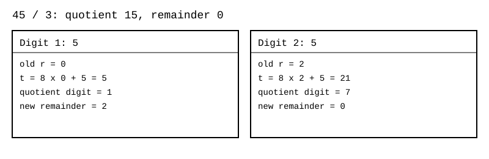

#### 4.2.4 Üs sayacı ve elde

Her tam bölünmede ilgili kanalın üssünü bir artırıyorum. Dört satırı tek bir üssün sekizlik haneleri olarak okuyorum:

$$e_q=rs1_q+8rs2_q+64rs3_q+512rs4_q.$$

Her hücre $0$ ile $7$ arasında. Dolan hücre sıfıra dönüyor. Elde bir üst hücreye gidiyor. En büyük üs $7777_8=4095$. Bu, dört satırdaki hücre değerlerini yalın topladığım eski 28 sınırından farklı.

$3^{14}=4782969=22175571_8$ örneğinde 3 kanalından on dört kez geçtim. Sonunda artık bir oldu. Üs haneleri düşükten yükseğe $(6,1,0,0)$. Okuduğum üs $6+8=14=16_8$. Sekizinci bölünmede ilk çark sıfıra dönüp ikinci çarkı ilerletti.

#### 4.2.5 Kod, sınama ve farkı

Akan sayaç çekirdeği tek kat asal ayrışımı yapıyor ve üsleri sekizlik sayaç olarak tutuyor. Aynı çekirdekte sekizlik büyük tamsayı aritmetiği de var. 25 Ekim 2026'da yeniden çalıştırdım. $1\le N\le2^{24}$ aralığındaki 16.777.216 girdide geri kurma farkı ve bağımsız elekle uyuşmazlık sıfır çıktı. Yüz bin rastgele çiftte, en çok 200 sekizlik haneye kadar, toplama, çıkarma, çarpma ve tam bölmenin hata sayaçları da sıfır çıktı. Sınama: [hunter_cekirdek](https://github.com/JamesAugustus/ctcpu-hunter).

Bu tarama katlı merdiven kodunu sınamıyor. Akan sayaçta alt satıra taşınan şey üssün hanesi. Merdivende ise işlenmekte olan değerin sekize bölünmüş kısmı aşağı iniyor. İkisini aynı test sonucu altında birleştirmedim.

#### 4.3 Mersenne akış katlaması

#### 4.3.1 Tarih, fikir ve kaynak

Bu biçimi 13 Eylül 2026'da Mersenne araştırmalarımda kurdum. Çalışan ikinci biçimdir. $M=2^p-1$ için $2^p\equiv1\pmod M$ eşitliğini kullandım. Üst parçayı atmak yerine alta geri ekledim.

#### 4.3.2 Mekanizma ve örnek

$V=HIGH\cdot2^p+LOW$ yazınca $V\equiv HIGH+LOW\pmod M$ oluyor. İşlem $V\leftarrow(V\gg p)+(V\mathbin{\&}M)$. Değer $M$'yi geçiyorsa yeniden katlıyorum. $V=M$ kaldıysa sıfıra çeviriyorum. Bu son düzeltme olmadan sıfır kalanı yanlış gösterirdim.

$p=13$ ve $M=8191$ için $37634=4\cdot8192+4866$. Katlamadan $4+4866=4870$ çıktı. Doğrudan kalanla karşılaştırdım. $37634\bmod8191=4870$.

Çok parçalı sayıda $w$ bitlik $i$. parçanın ağırlığı $2^{iw}$. Bu ağırlığı halkada $(iw)\bmod p$ konumuna taşıyorum. Parça genişliği $p$'yi aşarsa parçanın kendisini de katlıyorum. Parçaları yalnız kaydırıp sınırsız büyüyen bir toplayıcıda bırakmıyorum.

#### 4.3.3 Kod, sınama ve farkı

Kaynakta $p=13,31,61,127,521,4096$ için Python sınamaları kayıtlı. Bu altı modülde katlama örneklerini 25 Ekim 2026'da yeniden hesapladım. Sıfır, modülün kendisi ve modülden uzun değerleri doğrudan kalanla karşılaştırdım. Hata çıkmadı. Bu altı modüllü denetimin ayrı kaydı bu pakette bulunmuyor. Paketteki [test ve komut](https://github.com/JamesAugustus/ctcpu-hunter), $p=13,31,61,127,521$ değerlerini kapsıyor.

Bu biçim yedi küçük asalın üssünü bulmuyor. Tek bir büyük modül için kalanı buluyor. $p=4096$ seçimi de bir asallık iddiası değil. Katlama eşitliği için $p$'nin asal olması gerekmiyor.

#### 4.4 Katlama kapısı ve üs haneleri

#### 4.4.1 Tarih, fikir ve kaynak

9 Eylül 2026 tarihli kanal ve register modellerinde sekizlik akış yerine ikilik parçaları katladım. Bir kanal için $2^w\equiv s\pmod q$ ve $s\in\{-1,1\}$ seçtim. Sayı $LOW+2^wHIGH$ ise aynı kalanı $LOW+sHIGH$ veriyor.

| Asal $q$ | Parça genişliği $w$ | Eşitlik | Yeni değer |
|---:|---:|---|---|
| 3 | 2 | $2^2\equiv1\pmod3$ | $LOW+HIGH$ |
| 7 | 3 | $2^3\equiv1\pmod7$ | $LOW+HIGH$ |
| 5 | 2 | $2^2\equiv-1\pmod5$ | $LOW-HIGH$ |
| 17 | 4 | $2^4\equiv-1\pmod{17}$ | $LOW-HIGH$ |
| 11 | 5 | $2^5\equiv-1\pmod{11}$ | $LOW-HIGH$ |
| 13 | 6 | $2^6\equiv-1\pmod{13}$ | $LOW-HIGH$ |

2 kanalını bu tabloya koymadım. Kalan son bit. Üs ise sondaki sıfır bitlerinin sayısı.

#### 4.4.2 Mekanizma ve örnek

$738$ sayısını 7 kanalında $738\to2+92=94\to6+11=17\to1+2=3$ olarak katladım. 11 kanalında alt beş bit 2, üst kısım 23. $2-23=-21$ çıktı. İki kez 11 ekleyince kalan 1 oldu. Doğrudan işlem de $738\bmod7=3$ ve $738\bmod11=1$ verdi.

Çıkarmalı katlamada negatif ara değer oluşabiliyor. Bunun işaretini kaybetmiyorum. Son düzeltmede $0\le r<q$ aralığına dönüyorum. Sadece mutlak değeri almak kalanı değiştirebilir.

#### 4.4.3 Kod, sınama ve farkı

Altı kanalın her birinde $0\le N\le65535$ aralığını yeniden taradım. Toplam 393.216 sonucu doğrudan kalanla karşılaştırdım. 25 Ekim 2026'da yeniden çalıştırıldı. Hata çıkmadı.

Aynı 9 Eylül kaydında üsleri $e_1+8e_2+64e_3+512e_4$ olarak okuma adayı da vardı. Akan sayaç bu üs düzeninin çalışan devamı. Katlama kapısı ile üs yerleşimini ayrı tutuyorum. Birincisi bölünebilirliği, ikincisi kaç çarpan soyduğumu anlatıyor.

#### 4.5 Hane ağırlıkları ve kesme

#### 4.5.1 Tarih, fikir ve kaynak

20 Temmuz 2026 tarihli gölge mekanizması ve 2 Ağustos güncellemeli sade iniş kartında haneleri sabit ağırlıklarla topladım. $N=\sum_kd_k8^k$ olduğundan $r_q=\sum_kd_k(8^k\bmod q)\bmod q$. Ağırlıkları en düşük haneden başlayarak okudum.

| Asal | Bir ağırlık çevrimi |
|---:|---|
| 3 | $1,2$ |
| 5 | $1,3,4,2$ |
| 7 | $1$ |
| 11 | $1,8,9,6,4,10,3,2,5,7$ |
| 13 | $1,8,12,5$ |
| 17 | $1,8,13,2,16,9,4,15$ |

#### 4.5.2 Mekanizma ve örnek

$360=550_8$ için düşükten yükseğe haneler $0,5,5$. 11 kanalında $0\cdot1+5\cdot8+5\cdot9=85$ buldum. $85\bmod11=8$. 13 kanalında $0+40+60=100$ ve $100\bmod13=9$. Sonuçlar akış yöntemiyle aynı.

Kesme fikrini $59=73_8$ üzerinde kullandım. $a=59\mathbin{\&}7=3$. Geriye $59\gg3=7$ kaldı. $(59-a)/8$ yazdığım işlem sabit konumlu üç biti ayırmakla yapılabiliyor. Bunun matematiğini kanıtlamak kolay. Değişken uzunluklu taşıma, kayıt ve kontrol devresinin fiziksel maliyetini bu eşitlikten çıkarmıyorum.

#### 4.5.3 Kod, sınama ve farkı

Kaynakta ağırlıkların $2^{24}$'e kadar sınandığı kayıtlı ölçüm var. Bu tam taramayı ağırlık uygulamasıyla yeniden çalıştırmadım. 25 Ekim 2026'da çevrim tablolarını $8^k\bmod q$ ile yeniden ürettim. 360 örneğini altı kanalda karşılaştırdım. Eski Resolver emülatörünün tam taraması ise Horner akışını sınadı.

Horner biçiminde haneler sırayla akıyor. Ağırlık biçiminde her hanenin katkısı kendi konumundan geliyor. İkisi aynı kalan eşitliğinin iki hesap düzeni. Kesme tek başına sonraki katın gölgeye yerleştiğini kanıtlamıyor.

#### 4.6 İki vuruşluk boru

#### 4.6.1 Tarih, fikir ve kaynak

İlk tam birim tarifini 30 Haziran 2026'da yazdım. Özetini 3 Ağustos ve 1 Eylül 2026'da yeniden yazdım. Genel bölen yerine yalnız yedi sabit asal için çalışan yollar kurdum. Birinci vuruş bölünebilirliği buluyor. İkinci vuruş aynı asalı tekrar tekrar soyup üssü sayıyor.

#### 4.6.2 Mekanizma ve örnek

Birinci vuruşta sekiz sekizlik haneyi yedi kanala akıtıyorum. İkinci vuruşta kalanı sıfır olan asala bölüyorum. Bölünmez hale gelene kadar sayacı artırıyorum. 2 kanalında bit taramasıyla son sıfırları sayabiliyorum.

$510510=2\cdot3\cdot5\cdot7\cdot11\cdot13\cdot17=01745056_8$. Sekiz hanenin sonunda bütün kalanlar sıfır. $360$ için 2 kanalında üç, 3 kanalında iki, 5 kanalında bir bölünme yaptım. Son artık bir. $59$ ise bütün kanallardan geçip düz artık olarak kaldı.

Bu ilk sürüm her yüklemede çalışıyordu. 29 Ağustos tarihli sade Resolver kartında yüklemede çalıştırmama kararı var. Gölgeyi ilk çarpımsal işlemde kuran tembel yol güncel anlatımda esas. Tetik zamanını aritmetik eşitliğin içine gizlemiyorum.

#### 4.6.3 Kod, sınama ve farkı

Resolver emülatörünü 25 Ekim 2026'da yeniden çalıştırdım. $0\le N<2^{24}$ ve yedi asal için 117.440.512 kalan karşılaştırmasında hata çıkmadı. $1\le N<2^{24}$ aralığındaki 16.777.215 geri kurmada hata çıkmadı. Üs doğruluğu, rough içinde küçük asal kalmaması ve bütün 2'ler soyulduktan sonra artığın tek olması denetimleri geçti. Sınama: [resolver_emulator](https://github.com/JamesAugustus/ctcpu-hunter).

Bu sürüm $rc$'yi düz taşıyor. Artığı katlara indirmek kodun yaptığı iş değil. Çıktıda görünen çevrim satırları emülatörün model hesabı. Ölçülmüş saat süresi olarak kullanmadım.

#### 4.7 Deneysel Resolver biçimleri

#### 4.7.1 Üs üzerinden çözme

4 Eylül 2026'da yirmi beş haneli bir sayıyı baştan sona işlerken sayının gövdesini kurmadan biçimini okumayı denedim. Bu biçim deneysel. $2^p-1$ için sekizlik başı $p\bmod3$ belirliyor. Kalan 1 ise baş 1. Kalan 2 ise baş 3. Kalan sıfırsa ayrı bir kısa baş yok, bütün haneler 7.

$p=83$ için $83=3\cdot27+2$. Bu yüzden $2^{83}-1$ sekizlikte bir 3 ve ardından 27 tane 7. Toplam 28 sekizlik hane, 25 onluk hane. Gövdeyi sıradan sekiz haneli mantissaya sığdıramıyorum. Üs 83 ise küçük kalıyor.

$83\equiv3\pmod4$ ve $2\cdot83+1=167$ asal. $2p+1$ kapısını buradan açtım. $2^{83}\bmod167=1$ olduğu için 167 bu Mersenne sayısını bölüyor. Asal olmadığını söylemek için bütün gövdeyi registera yerleştirmedim.

Tek asal üs $p$ için asal bölen adaylarını $q=2kp+1$ ve $q\equiv\pm1\pmod8$ koşullarıyla daraltıyorum. $p\equiv3\pmod4$ ise $k\equiv0,1\pmod4$. $p\equiv1\pmod4$ ise $k\equiv0,3\pmod4$. Bunlar gerekli aday koşulları. Her aday bölen değil. Son sınama $2^p\bmod q=1$.

Bu biçim betikle gösterildi. Ayrı Resolver birimi olarak kodlanmadı. 83 örneğinin hane sayısını, 167'nin asallığını ve bölünebilirliği yeniden doğruladım. Ayrıca $p=13$ için Lucas Lehmer dizisini on bir adım çalıştırıp son kalanı sıfır buldum. Bu ayrı asallık sınamasını aday eleğiyle karıştırmadım.

#### 4.7.2 Katlı merdiven

3 Eylül 2026 tarihli register şablonunda dört gölge satırını dört kat olarak düşündüm. Her katta o kata gelen sayının küçük asal çarpanlarını soyuyorum. Kalanın son sekizlik hanesini kesiyorum. Geriye kalan haneler bir alt kata iniyor.

$$v_k=s_k(8v_{k+1}+a_{k+1}).$$

$s_k$ o katın smooth çarpımı. $a_{k+1}$ inişte kesilen hane. Haneyi inilen satırda saklıyorum. İlk satırın $a$ hücresi boş. Normal sayıdan birinci gölge satırına sekize bölerek inmedim.

$2124=4114_8$ için birinci katta $2^2\cdot3^2$ soydum. 59 kaldı. $59=8\cdot7+3$ olduğundan ikinci kata 7 indirdim. İkinci katta 7 kanalını bir kez soydum. Geri kurduğum eşitlik $2124=2^2\cdot3^2(8\cdot7+3)$.

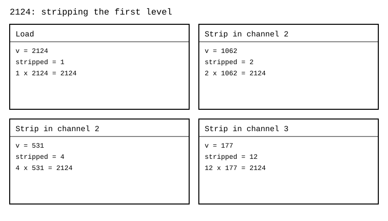

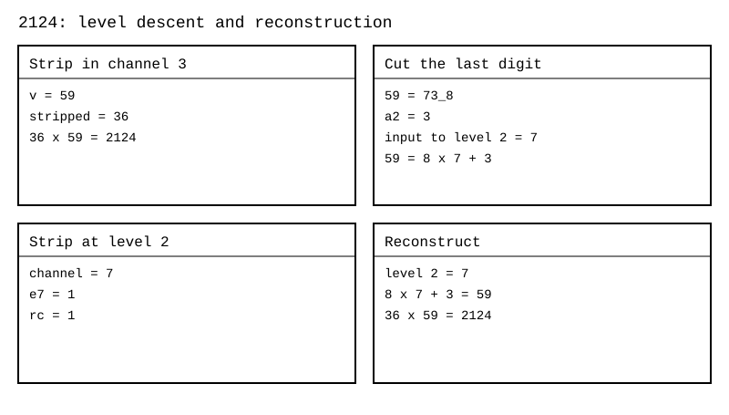

Üs hücresi dolunca da kalan değer iniyor. $3^{10}=3^7(8\cdot3+3)=59049$. Burada ikinci kattaki 3 üssünü birinci kattakine doğrudan eklemiyorum. Arada sekizle çarpma ve üç ekleme var.

Katlı Resolver bütün girdi uzayında kodlanıp sınanmış değil. Çizim örneklerini hesapladım ve eşitliklerini doğruladım. Katın bitiş işareti, dört satır tükendiğinde devam bağlantısı ve hücre tavanından sonra sekizin altında kalan değerin yerleşimi açık. Tek örneğin geri kurulması bu açıkları kapatmıyor.

#### 4.7.3 $a$ hücresinin çift görevi ve düz çarpan

Temmuz ve Ağustos 2026 gölge şemasında $a$ hücresine iki ayrı görev verdim. Bütün 2'ler soyulmuşsa rough tek. Bu durumda inişte kalan son hane $1,3,5,7$ olabilir. Boşta kalan çift kodları satır türü için kullanmayı düşündüm.

| $a$ kodu | Tarihsel anlam |
|---|---|
| $1,3,5,7$ | Gerçek merdiven inişinin kalan hanesi |
| $0$ | İniş yapmadan üst çarpıma katılan düz çarpan satırı |
| $2$ | Hücreleri normal sayı olarak okunan rough satırı |
| $4,6$ | Komşu register sınırını bildiren önek veya sonek |

$2^{11}=2048=2^7\cdot2^4$ örneğinde birinci satıra 7, ikinci satıra 4 yazdım. İkinci satırın $a=0$ değeri gerçek iniş değil. Bu sürümün kapasitesi dört hücrenin yalın toplamı olan 28. Taşma sınaması eski kaskad emülatöründe çalışıyor.

Bu çift görev ancak bütün 2'ler soyulmuşsa kalan tek olur gerekçesine dayanıyor. Hücre tavanında 2 soyma durursa çift kalan inebilir. $7936=2^8\cdot31=2^7(8\cdot7+6)$ örneğinde iniş hanesi 6. Bu yüzden eski tür kodlamasını her katın gerçek iniş yaptığı yeni merdivene doğrudan taşımadım.

#### 4.8 Dişli modeli

#### 4.8.1 Kadran, kol ve tambur

Kalanı, bölümü ve üs sayımını gözümün önüne getirmek için dişli benzetmesini kullandım. Her asalın $q$ dişli bir kadranı var. İbrenin durduğu çentik kalan. Yoklama kolu sıfır çentiğine bakıyor. Bölünme varsa kol iniyor. Bölüm akışı yeni değeri taşıyor. Üs çarkı bir diş ilerliyor. Bütün küçük asallar bittikten sonra tek katın artığı $rc$ tamburunda kalıyor.

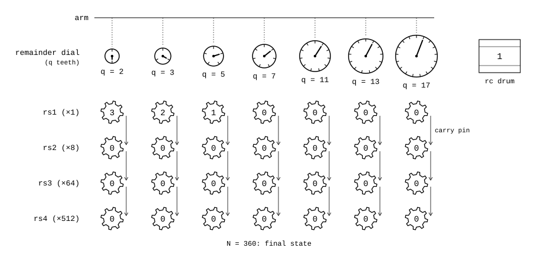

Kadran $r$ çentiğindeyken $7r+d$ diş daha döndürüyorum. Başlangıç konumu da katılınca toplam $8r+d$ oluyor. Sıfırdan geçiş sayısı bölüm hanesi. Durduğu çentik yeni kalan. $360/2$ için sıfır geçişleri $2,6,4$. Bu üç sayıyı yan yana sekizlik bölüm olarak okuyorum.

Üs çarkının her dişi bir başarılı tam bölünme. Kalan kadranının bir turu ise o an üretilen bölüm hanesinin bir birimi. Bu iki hareket aynı şey değil. Bir bölüm hanesi içinde birkaç tur atılması, birkaç asalın birden soyulduğu anlamına gelmiyor.

#### 4.8.2 Elde piminin kare kare hareketi

$256=2^8$ örneğinde her bölünmeden sonra üssü artırdım. Yedinci bölünmede ilk çark 7 oldu. Sekizinci bölünmede ilk çark sıfıra döndü. Elde pimi ikinci çarkı 1 yaptı. Düşükten yükseğe $(0,1,0,0)$ okudum. Bu üs sekizdir.

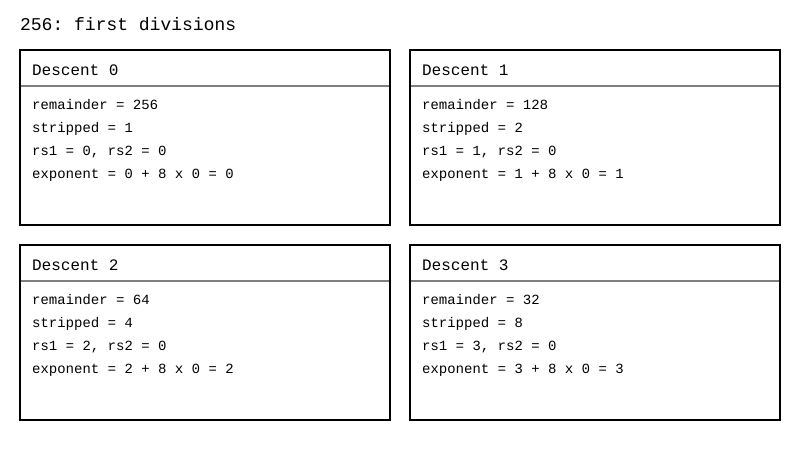


#### 4.8.3 Dişli modelinde kat inişinin yeri

Kadran ve sayaç anlatımı çalışan tek kat çekirdeğine karşılık geliyor. Tamburdaki rough'u kesip alt kata indirme ise katlı merdiven deneyine karşılık geliyor. Bunları mekanik benzetmede yan yana gösterebiliyorum. Aynı dört fiziksel satırın hem her asal için üs haneleri hem bütün sayı için merdiven katları olduğunu varsayamıyorum. Katlı biçime dört haneli üs sayacı da eklenecekse her katın kendi sayaç alanı gerekecek. Bu yerleşim açık.

#### 4.9 Tarihli ayrımlar ve yeniden çalıştırma

| Konu | Eski kayıt | Güncel esas ve açık karar |
|---|---|---|
| rs1..rs4 | Temmuz ve Ağustos düz çarpanları, 3 Eylül merdiven katları | 12 ve 13 Ekim akan sayaçta üssün sekizlik haneleri. Çalışan aritmetikte bunu kullanıyorum. Katlı temsilin birleşmesi açık |
| Üs kapasitesi | 6 ve 10 Temmuz kaskadında $4\cdot7=28$ | Akan sayaçta $7777_8=4095$. Biri diğerinin test kapsamı değil |
| $a=0$ | Eski biçimde inişsiz düz çarpan | 3 Eylül merdiveninde gerçek iniş. Aynı çözücüyle sessizce okunamaz |
| $rc$ | İlk rough veya son işlenmemiş artık adları kullanılmış | Tek kat için son rough açık. Katlı biçimde hangi artığın kalıcı tutulacağı açık |
| Tetik | 30 Haziran sürümünde yükleme | 29 Ağustos kartında ilk çarpımsal işlem. Güncel tembel yol bunu kullanıyor |

25 Ekim 2026'da yeniden çalıştırdım. [resolver_emulator](https://github.com/JamesAugustus/ctcpu-hunter) ve [hunter_cekirdek](https://github.com/JamesAugustus/ctcpu-hunter) tam sınamalarında hata çıkmadı. Ayrı bir örnek programında sekizlik akış eşitliklerini, katlama kapılarını, üs kodlarını ve merdiven geri kurmalarını denedim. Şekillerdeki her değer bu programın hesabıdır. Katlı merdivenin genel kodu ve FPGA ölçümü bu çalıştırmada yok.

### 5. Çarpma yöntemleri

#### 5.1 Yedi kanalda üs toplama

#### 5.1.1 Fikir, kaynak ve eşitlik

Çarpma biriminin temelini 6 Temmuz 2026'da kurdum. Güncel temsilde de aynı yolu izliyorum.

$A=r_A\prod_q q^{a_q}$ ve $B=r_B\prod_q q^{b_q}$ ise

$$AB=(r_Ar_B)\prod_q q^{a_q+b_q}.$$

Yedi üs toplamı birbirinden bağımsız. Bir kanaldaki toplama başka asalın sonucunu beklemiyor. Aynı kanalın üs hanelerinde elde yürüyebiliyor. Bu yüzden yedi bağımsız kanal demek her genişlikte tek fiziksel çevrim demek değil. Gölgenin hazır olup olmadığı, elde zinciri, rough çarpımı ve register yazması ayrıca iş yapıyor.

#### 5.1.2 Kanal kanal örnek

$12=2^2\cdot3$ ile $15=3\cdot5$ sayısını çarptım. 2 kanalında $2+0=2$, 3 kanalında $1+1=2$, 5 kanalında $0+1=1$ buldum. Öteki üsler sıfır kaldı. Sonuç $2^2\cdot3^2\cdot5=180$.


Üsleri toplamadan önce gölge yoksa Resolver gerekiyor. Toplama veya çıkarma mantissayı değiştirdiyse eski gölgeyi geçerli saymıyorum. İlk çarpımsal işlemde yeni gölgeyi kuruyorum. Uzun bir çarpım zincirinde aynı ayrışımı tekrar tekrar yapmamak istedim.

#### 5.1.3 İşaret türün içinde

Düz pozitif ve negatif sayıların çarpımında işaretleri birleştiriyorum. Büyüklük için aynı üs ve rough hesabını kullanıyorum. $(-6)\cdot7=-42$. İki negatif operandın çarpımını pozitif türle taşıyorum. Mimari işareti ayrıca bağımsız bir bayrak olarak tanımlamıyorum.

Kök, sanal kök ve ters türlerinde yalnız işaret kuralı yetmiyor. $\sqrt{A}\sqrt{B}=\sqrt{AB}$ kuralını gerçek, negatif olmayan girdiler için kullanıyorum. $\sqrt{A}\sqrt{A}=A$ kapanışı kökü açmadan çalışıyor. Farklı iki kökün çarpımına doğrudan $AB$ yazmıyorum. Tam tür işlem tablosunun uygulanma durumu, düz işaretli sayı emülatörünün sınamasından ayrı.

#### 5.2 Üs eldesi ve taşma

Temmuz kaskadında büyük üssü dört hücrenin toplamı olarak taşıdım. $23=7+7+7+2$. Eski kodun kapasitesi 28. 12 ve 13 Ekim akan sayacında ise dört hücre sekizlik hane. Aynı 23 değerini düşükten yükseğe $(7,2,0,0)$ olarak okuyorum. Güncel kapasite 4095.

Çarpımda her kanal için $s=a_q+b_q$ hesaplanıyor. Haneli yazımda bir hücrenin toplamı yediyi aşınca elde üst haneye gidiyor. Son üst haneden elde çıkarsa sonuç gölgeye sığmıyor. Sessiz kırpma yapmıyorum. Son taslak bu durumda taşma bildirip düz yola geçmeyi anlatıyor. 25 Ekim 2026 sınır denetiminde çalışan sayaç çekirdeği hata döndürdü. Otomatik düz yola dönüş bu çekirdekte doğrulanmadı. Taşmanın diğer registerlara bağlanması ayrı bir sistem sözleşmesi.

Eski sınır örneği $(2^{23})(2^{23})=2^{46}$. 46 eski 28 kapasitesine sığmıyor. Aynı üs güncel sayaçta $56_8$ olarak sığıyor. Eski emülatörde görülen taşmayı güncel sayacın da aynı yerde taşacağı biçiminde okumadım.

#### 5.3 Rough çarpımı

#### 5.3.1 Neden ayrı bir yol var

$r_A$ ve $r_B$ birden büyükse çarpımları yalnız yedi üs toplamından çıkmıyor. Rough, değersiz veya yaklaşık demek değil. Yedi asal dışında kalan kesin çarpan demek. Bu çarpanı çarpımın içinde koruyorum.

$19$ ve $23$ yedi kanalın hiçbirine bölünmüyor. İkisinin de üs vektörü sıfır. Bu vektörleri toplamak yalnız sıfır vektör veriyor. Sonuç 1 olamaz. Rough çarpımı $19\cdot23=437$ olarak ayrıca gerekiyor.

#### 5.3.2 İkilik kuvvet çevresinde binom

Bir sayıyı $2^k+u$, diğerini $2^m+v$ biçiminde yazdım. $u$ ve $v$ işaretli olabilir. Açılım

$$AB=2^{k+m}+u2^m+v2^k+uv.$$

Kuvvetle çarpımları kaydırmayla yapabiliyorum. $uv$ çarpımının maliyeti sapmaların büyüklüğüne bağlı. Binom yazımı tek başına küçük sapma garantisi vermiyor.

Nihai çarpma kaydındaki örneği aynen hesapladım:

$$19\cdot23=(2^4+3)(2^4+7)=2^8+10\cdot2^4+3\cdot7=256+160+21=437.$$

Aynı çarpımı $(32-13)(32-9)$ biçiminde de yazabiliyorum. Sonuç aynı. Fakat bu seçimde küçük kalanlar 13 ve 9 oluyor. Küçük çarpım yolunun yedi sınırını tek adımda sağlamıyor. Kuvvet çıpasını sırf en yakındaki büyük kuvvet olduğu için seçmiyorum.

#### 5.3.3 Sekizlik binom ve yineleme

Rough geri dönüş emülatöründe daha düzenli bir ayrım var. $A=8a+r_A$, $B=8b+r_B$ ve $0\le r_A,r_B\le7$ yazıyorum. Sonra

$$AB=64ab+8(ar_B+br_A)+r_Ar_B.$$

$ab$ için aynı ayrımı yeniden yapıyorum. Bir operand sekizden küçük kalınca küçük çarpım yordamına geçiyorum. $64$ ve $8$ çarpanları sabit kaydırma. Küçük çarpımda dar operandın bitlerine göre en çok üç kaydırılmış katkı toplanıyor. Geniş operandın kendisinin yediden küçük olması gerekmiyor. Sınır küçük çarpanın değerine ait.

$19=8\cdot2+3$ ve $23=8\cdot2+7$. Açılım $64\cdot4+8(2\cdot7+2\cdot3)+3\cdot7=437$. İkilik kuvvet çevresindeki örnekle aynı sayısal terimleri verdi. Genel yöntemde ise her adımın kalanını sekizlik kesme belirliyor.

#### 5.3.4 Kod ve sınama

Rough geri dönüş devresini 25 Ekim 2026'da yeniden çalıştırdım. İki sayının ikisi de rough olunca çarpım üs toplamaya inmez. O zaman sayıyı $A=8a+r_A$ diye sekizlik binoma açıyorum ve çarpımı $64ab+8(a\,r_B+b\,r_A)+r_A r_B$ olarak kaydırma ve küçük toplamalarla buluyorum. Beş milyon çiftte bu açılım doğrudan geniş tamsayı çarpımıyla aynı çıktı. Hata sayacı sıfır, dar çarpanın görülen en büyük değeri 7. Sınama: [rough_fallback_devre_test](https://github.com/JamesAugustus/ctcpu-hunter).

Bu çalıştırmada rough içeren iki operandın birlikte geldiği çift sayısı 4.960.826 oldu. Toplam beş milyon çiftin yaklaşık yüzde 99,2'si. Başka girdi dağılımıyla çalışan ana çarpma emülatöründe oran yüzde 96,6 çıktı. Bu oranları bütün sayılara ait sabit oran gibi kullanmıyorum.

#### 5.4 Hunter8 kaydırıp toplama yolu

#### 5.4.1 Kaynak ve durum

Hunter8 adını verdiğim ayrı bir öğretim modelinde çarpmayı ikilikte kaydırıp toplayarak yaptım. Çarpma eklemesini 10 Eylül 2026'da yazdım. Bu durum makinesini asal üs gölgesiyle aynı donanım saymıyorum. İkilik kaydırıp toplamanın açık bir hesabı olarak duruyor.

#### 5.4.2 Mekanizma

Biriken sonucu $S=0$, kaydırılan çarpılanı $A$, taranan çarpanı $B$ aldım. $B$'nin en düşük biti birse $A$'yı $S$'ye ekliyorum. Sonra $A$'yı bir bit sola, $B$'yi bir bit sağa kaydırıyorum. Her adımda $S+A B$ başlangıç çarpımına eşit kalıyor. $B=0$ olduğunda sonuç $S$.

$6\cdot7$ için $7=111_2$. Katkılar $6$, $12$, $24$. Toplam $42$. Çarpanın bir biti sıfır olsaydı o konumun katkısını eklemeyecektim. Sabit genişlikli öğretim modeli bütün bit konumlarını gezebiliyor. Kısa döngü ise kalan çarpan sıfır olduğunda durabiliyor.

Bir çarpma adımında geniş bir toplayıcı çalışabiliyor. Hunter8'deki adımı, seri toplayıcının tek bitlik adımıyla eşit iş miktarı saymıyorum. Ayrıca bu yolun bit kaydırmasını Hunter ana komut taslağındaki sekizlik hane kaydırmasıyla karıştırmıyorum.

#### 5.4.3 Kod ve sınama

Örnek programında kaydırıp toplama ve sekizlik binom çarpımını birbirinden ayrı yazdım. Örnek çiftlerde ikisini doğrudan Python tamsayı çarpımıyla karşılaştırdım. Hunter8'in C karşılığı da kendi sınama komutuyla ayrıca çalıştırıldı. Sonucun doğruluğu, yerleşik işlemci çarpıcısından daha hızlı olduğuna dair bir ölçüm değil.

#### 5.5 Küçük tabanda hane çarpımı

Sekizlik haneleri $A=\sum_i a_i8^i$ ve $B=\sum_jb_j8^j$ diye okuyorum. Çarpım $AB=\sum_{i,j}a_ib_j8^{i+j}$. Her küçük hane çarpımı $0$ ile $49$ arasında. En büyük tek hane çarpımı $7\cdot7=49=61_8$. Hane toplamına önceki eldeyi de katıyorum. O konumun yeni hanesi toplamın sekize göre kalanı, yeni elde ise sekize bölümünün tam kısmı.

$19=23_8$, $23=27_8$. En düşük sütunda $3\cdot7=21=25_8$. Son haneye 5 yazıp 2 elde taşıdım. Sonraki sütunda $2\cdot7+3\cdot2+2=22=26_8$. Haneye 6, eldeye 2 yazdım. En üstte $2\cdot2+2=6$. Sonuç $665_8=437$.

Bu düzen ile sekizlik binom aynı dağılım yasasını kullanıyor. Hane çarpımı katkıları sütunlara topluyor. Binom yolu üst parçaya aynı işlemi yinelemeli uyguluyor. Küçük hane çarpımını tabloyla, kaydırıp toplamayla veya küçük bir çarpıcıyla gerçekleştirebilirim. Nihai fiziksel seçimi bu eşitlikten çıkarmadım.

#### 5.6 Binom ve çarpan biçimini birlikte tutmak

25 Ekim 2026'da gölge sistemi için yönümü açık söyledim. Sayıyı hem binom olarak tutabiliyorum hem çarpanlarına ayırabiliyorum. $19=2^4+3$ bir binom kaydı. $360=2^3\cdot3^2\cdot5$ bir çarpan kaydı. $2124=2^2\cdot3^2(8\cdot7+3)$ ise çarpanla tabansal toplamın birlikte durduğu merdiven örneği.

Salt üs vektörü çarpım altında kapalı. İçinde toplama bulunan binomda çapraz terimler var. Merdivenin farklı katlarında gördüğüm bütün üsleri tek vektöre toplayamam. Alt kattaki asal üst sayının doğrudan asal çarpanı olmayabilir. Örneğin 59'un ikinci katında 7 var, fakat 7 sayısı 59'u bölmüyor.

Biçimin hangi kuralla okunacağını bilmem gerekiyor. Sayısal değer aynı kalsa da üs hanesi, merdiven katı ve binom sapması aynı alan anlamı değil. Ortak kayıt biçiminin seçimi açık. Mevcut aritmetik eşitlikleri yeni bir tür veya hücre kodu kesinleşmiş gibi sunmadım.

#### 5.7 Fikir kayıtlarındaki tamamlayıcı yollar

#### 5.7.1 Ortak çarpanı koruma

8 Temmuz 2026'da toplamadan önce ortak çarpanı dışarı almayı düşündüm: $a+b=g(a'+b')$. Gölge kanallarında ortak kısmı en küçük üsler veriyor. Küçük kofaktörleri pozisyonel topluyorum. $2^3+2^4=2^3(1+2)=24$. İnsan da böyle yapar, iki kuvveti tek tek açmaz, paranteze alır.

Bu işlem iki üs vektörünü doğrudan toplama yapmıyor. Ortak çarpan korunuyor. Kofaktör toplamının gölgesi gerekiyorsa yeniden çözülüyor. Çarpım zincirinde hangi parçanın değişmeden kaldığını görmeme yarıyor.

#### 5.7.2 Eşlenik ve çeyrek kare

3 Temmuz 2026'da sayıyı adres değil yol tarifi olarak tutmayı düşündüm ve $(a+b)(a-b)=a^2-b^2$ yolunu ele aldım. $(5+4)(5-4)=25-16=9$. Çeyrek kare eşitliği de $ab=((a+b)^2-(a-b)^2)/4$. $19\cdot23=(42^2-(-4)^2)/4=437$.

Araştırınca bilinen sonuç olduğunu gördüm. Bunlar bilinen cebirsel özdeşlikler. Gölgesi hazır bir sayının karesinde üsler ikiyle çarpılıyor. Ancak önceki $a+b$ ve $a-b$ işlemleri pozisyonel iş ve yeni ayrışım gerektirebilir. Çeyrek kareyi çalışan rough binom emülatörünün yerine geçirilmiş bir donanım olarak sunmadım. Fikir kaydındaki aday yol olarak tuttum.

#### 5.7.3 Kuvvet ve sapma kaydı

1 Temmuz 2026'da sayıyı taban, üs ve sapma olarak tutan bir kuvvet register'ı düşündüm. Saf kuvvetlerde $a^xa^y=a^{x+y}$. Sapma eklenince $(a^x+u)(a^y+v)$ çapraz terim istiyor. Bu yüzden kompakt saklama ile ucuz çarpma aynı vaat değil. Dinamik tabanın kayıt biçimi, alan genişliği ve açılma zamanı açık.

#### 5.8 Yeniden çalıştırma ve kapsam

25 Ekim 2026'da yeniden çalıştırıldı. Sonuçları kaynak kodun gerçekten sınadığı temsil için okudum.

| Program | Bu çalıştırmadaki denetim | Sonuç |
|---|---|---|
| `mul_div_emulator` | 20 milyon işaretli çarpım | 0 hata |
| `kaskad_uctan_uca_test` | 3 milyon smooth çarpım, eski hücre yerleşimi | 0 hata |
| `kaskad_uctan_uca_test` | 28'e kadar geri kurma, 29 ile 56 arasında taşma | Beklenen davranış |
| `rough_fallback_devre_test` | 5 milyon sekizlik binom çarpımı | 0 hata |
| `hunter_cekirdek` | 100.000 geniş çarpım çifti, tembel gölge dahil | 0 hata |
| `multiply_add` | 69.664 geçerli çarpım çağrısı ve 26 geçersiz girdi denetimi | 69.690 çağrı geçti |

Ana çarpma emülatörünün çıktı metninde eski taban 10 POW açıklaması hâlâ var. Bu programın POW'u güncel taban 8 sözleşmesiyle bütünlediğini söylemedim. POW davranışını kesir emülatöründe ayrıca sınadım. Kaskadın 28 sınırını da güncel 4095 sınırı olarak yeniden adlandırmadım.

Çarpma emülatöründe iki operandı da rough içeren 19.327.807 çift çıktı. Payda 20 milyon çift. Gölgenin yararı hakkında bu dağılımı sakladım. Smooth çarpımlarda üs işlemi küçük kalıyor. Rough çarpımda ek iş var. Alan, enerji ve saat kazancı için devre ölçümü yapmadım.

Bu bölümdeki örnekleri ve şekil değerlerini aynı doğrulama programı hesapladı. Sınamalar: [mul_div_emulator](https://github.com/JamesAugustus/ctcpu-hunter), [kaskad_uctan_uca_test](https://github.com/JamesAugustus/ctcpu-hunter) ve [rough_fallback_devre_test](https://github.com/JamesAugustus/ctcpu-hunter).

### 6. Bölme yöntemleri

#### 6.1 Gölgedeki bölme

#### 6.1.1 Üs çıkarma

6 Temmuz 2026'da bölmeyi çarpmanın tersi olarak kurdum ve güncel temsilde de aynı yolu izliyorum. $A=r_A\prod_q q^{a_q}$ ve $B=r_B\prod_q q^{b_q}$ ise

$$\frac AB=\frac{r_A}{r_B}\prod_q q^{a_q-b_q}.$$

Yedi kanalda üsleri ayrı ayrı çıkarıyorum. Smooth iki sayı için bütün farklar negatif değilse bölüm tamsayı. Rough varsa bu koşul tek başına yetmiyor. Rough oranının da tam bölünmesi gerekiyor. $19/23$ örneğinde bütün üs farkları sıfır olduğu halde bölüm tamsayı değil. Bu sınırı genel kuralın içine açıkça koydum.

#### 6.1.2 Tam bölüm örneği

$360=2^3\cdot3^2\cdot5$ ve $12=2^2\cdot3$. Üs farklarını $(1,1,1,0,0,0,0)$ buldum. Sonuç $2\cdot3\cdot5=30$. Rough oranı da $1/1$ olduğu için başka iş kalmadı.


Tam bölmeyi kabul eden çekirdekte $A=BX$ kurup sonra $A/B=X$ denedim. Tam bölünmeyen bir girdiyi zorla kesip tamsayı sonuç gibi göstermiyorum. Kesir destekleyen katmana geçiyorum veya o komutun sözleşmesine göre reddediyorum. Bu iki davranış farklı emülatörlerin kapsamına ait.

#### 6.2 Kesri çift olarak tutmak

#### 6.2.1 Negatif üs bir hesap işareti

$12/8$ işleminde 2 kanalında $2-3=-1$ çıktı. 3 kanalında $1-0=1$ kaldı. Matematiksel ifade $2^{-1}3=3/2$. Donanımda negatif üs hücresi saklamıyorum. Eksik 2 çarpanını ayrı payda kaydına geçiriyorum.


Pay ve payda ayrı registerlarda duruyor. Payda tarafını ters türle okuyorum. Üs hücreleri sıfır veya pozitif. İşaret de tür bilgisiyle birlikte taşınıyor. Bu temsil bir yaklaşık sayı üretmiyor. $3/2$ çifti hangi hassasiyetle ekrana yazarsam yazayım kendi içinde kesin kalıyor.

#### 6.2.2 Ortak çarpan ve rough politikası

İki taraftaki aynı küçük asalın ortak üssünü çıkarabiliyorum. Payda bire inerse çift kapanabiliyor. Rough taraflar için genel çarpanlara ayırmayı zorunlu tutmadım. 12 Temmuz 2026 tarihli çarpma ve bölme kaydında çift rough için otomatik genel sadeleştirme yapmayan tembel politika var. Gerekirse oranı sadeleştirmeden doğru değeriyle taşıyorum.

Kesir emülatörü küçük çarpan temizliği ve kendi sadeleşme çağrılarını içeriyor. Çıktısındaki çağrı sayısını bütün rough çiftleri için genel EBOB donanımı var diye yorumlamıyorum. Eski modelin register çifti ve bayrak adlarının güncel Hunter yerleşimine bağlanması açık. Sınama: [kesir_emulator](https://github.com/JamesAugustus/ctcpu-hunter).

#### 6.3 POW'a kesin emilim

#### 6.3.1 Taban sekiz

6 Temmuz 2026'da eski taban 10 ifadesini düzelttim. Buradaki $10_8$ sekizdir. Hunter ölçeğini $V=NUM\cdot8^{-POW}$ olarak okuyorum. POW aşağı ölçekliyor. Ölçek tek bir hücrede tutulursa $0\le POW\le7$ olur. $rpow$'u tam bir satır mı yoksa tek bir hücre mi yapacağıma henüz karar vermedim.

Sadeleşmiş kesrin paydası $2^u$ ise $k=\lceil u/3\rceil$ seçiyorum. Kesir

$$\frac{A}{2^u}=A2^{3k-u}\,8^{-k}.$$

Payı $2^{3k-u}$ ile tamamlayınca payda $8^k$ oluyor. Bu adımın kesin açılabilmesi için hem $k$ POW alanına hem yeni mantissa sayı alanına sığmalı. Paydanın yalnız 2 çarpanlarından oluşması gerekli ama kapasite kontrolünün yerine geçmiyor.

#### 6.3.2 Örnek ve sınır

$3/2$ için $u=1$, $k=1$. Payı dörtle çarptım. $3/2=12\cdot8^{-1}=1{,}4_8$. Onluk değer $1{,}5$. $1/3$ ve $1/5$ sonlu sekizlik kesre dönüşmediği için çift olarak kalıyor.

$1/2^{21}=1\cdot8^{-7}$ tek hücrelik POW sınırına sığıyor. $1/2^{23}=2\cdot8^{-8}$ ise POW 8 istiyor. Kesir emülatöründe bunu reddedip kesin çifti koruduğunu gördüm. Eski açma belgesindeki $5^{23}$ gerekçesini güncel taban 8 kuralı olarak almadım. Yeniden çalışan kodun ret nedeni POW alanı.

#### 6.4 Kesirle bölme ve ters tür

Bölen sıfır değilse payını ve paydasını yer değiştiriyorum. Sonra çarpma yoluna geçiyorum:

$$\frac ab\div\frac cd=\frac{ad}{bc}.$$

$b,c,d$ için gerekli sıfır kontrollerini önce yapıyorum. $(3/2)/(3/4)=12/6=2$. Pay ve paydanın ortak çarpanları kapanınca sonuç tek sayı oluyor.

Kesir toplamı aynı kolaylıkta değil. $3/2+1/3=(3\cdot3+1\cdot2)/(2\cdot3)=11/6$. İki çapraz çarpımın ardından payları pozisyonel topluyorum. Türün ters olması toplamı kendiliğinden üs çıkarmaya çevirmiyor.

Karantinaya alınmış $1/0$ kaydını sıradan ters sayı olarak kullanmıyorum. Kesir emülatöründe $5/0$ sayısal sonuç üretmeyen kilitli çift kuruyor. Ardından üçle çarpılınca iz 15 oluyor ve kilit kalıyor. Açma yolu bu kayıttan sayı çıkarmıyor. Bu örneği matematikte sıfıra bölmenin bir değeri var diye değil, işlemin izini kaybetmemek için tutuyorum. Karantinanın tam bağlantısı ayrı durum sözleşmesi.

#### 6.5 Sabit asala bölme

#### 6.5.1 Akış içinde bölüm hanesi

30 Haziran 2026 Resolver tarifinde genel bölen yerine sabit asal yolları kullandım. Sekizlik akışta $t=8r+d$. Kanalın böleni $q$ sabit. Bölüm hanesi $h=\lfloor t/q\rfloor$, kalan $r'=t-qh$. $h$ yediyi aşmıyor. Küçük karşılaştırma ve çıkarma ağlarıyla bu hane seçilebiliyor.

$360/2$ akışında bölüm $264_8=180$, kalan sıfır. $45/3$ akışında bölüm $17_8=15$, kalan sıfır. Her hanede $0\le r<q$ koşulunu koruduğum için bir sonraki adıma yalnız küçük kalan giriyor.

#### 6.5.2 Kaydırma ve toplama ile sabit bölen

Sabit bölenin tersini ikilik kesir olarak açınca kaydırıp toplama yolu çıkıyor. Bölü 3 için

$$\frac13=\sum_{j=1}^{\infty}2^{-2j}.$$

Sonlu genişlikte bu toplamı kesiyorum. Kesilmiş tersle elde ettiğim bölüm adayını, kalanla düzeltiyorum. Yalnız yaklaşık tersle çarpıp düzeltmeyi atlamak tam bölme garantisi vermez.

Örneği tam sayıyla kurdum. Altı terim için $S=1+4+16+64+256+1024=1365$ ve ölçek $4096$. $n=30$ için $q_0=\lfloor30S/4096\rfloor=9$. Kalan adayı $30-3\cdot9=3$. Bir kez daha 3 çıkarıp bölümü 10 yaptım. Son kalan sıfır. Buradaki $30S$ de sabit kaydırmaların toplamıyla kurulabilir.

Bu örnek bir sabit bölücünün neden düzeltme istediğini gösteriyor. Her genişlik ve her asal için aynı sayıda terim veya aynı sayıda düzeltme yeterlidir demedim. Girdi genişliği, ters katsayısı ve düzeltme sınırı ayrı doğrulama ister. Resolver emülatörünün matematiksel bölüm doğruluğunu fiziksel sabit bölme ağının sentezi saymadım.

#### 6.6 Mersenne katlama ve aday kapıları

#### 6.6.1 LOW ve HIGH

13 Eylül 2026 akış katlamasında $M=2^p-1$ için $V=HIGH\cdot2^p+LOW$ yazdım. Kalanı $HIGH+LOW$ üzerinde sürdürdüm. $p=13$ için $37634\to4+4866=4870$. Bölümün bütün hanelerini üretmedim. Burada elde ettiğim şey kalan.

İşlem sonunda $M$ kalmışsa onu sıfıra indiriyorum. Üst parçayı alta taşımak tek başına her genişlikte son kalan demek değil. Gerekirse yeniden katlıyor, sonra kanonik kalan aralığına dönüyorum.

#### 6.6.2 $2p+1$ kapısı

4 Eylül 2026 deney kaydında $p\equiv3\pmod4$ ve $q=2p+1$ asal olduğunda $q\mid2^p-1$ kapısını kullandım. $p=83$ için $q=167$. Bu bir bölen tanıma yolu. $2^p-1$ sayısını 167'ye bölüp bütün bölümünü çıkarmam gerekmiyor.

Bu kapı Mersenne asallık eleğinde iş görüyor. Açılmaması sayının asal olduğunu söylemiyor. Kapı koşullarından biri sağlanmadıysa başka bölenler hâlâ bulunabilir.

#### 6.6.3 $k$ yürüyüşü

Tek asal üs $p$ ve asal bölen $q$ için $q=2kp+1$ biçimini kullanıyorum. $q\equiv1$ veya $7\pmod8$ olmalı. $p\equiv3\pmod4$ ise yalnız $k\equiv0,1\pmod4$ sınıflarını, $p\equiv1\pmod4$ ise $k\equiv0,3\pmod4$ sınıflarını geçiriyorum.

$p=11$ için $k=1$ adayı 23, $k=4$ adayı 89. İkisi de gerçekten bölen. $2^{11}-1=2047=23\cdot89$. Bir sınıfın kapıdan geçmesi yeterli değil. Adayın $2^p\bmod q=1$ koşulunu ayrıca deniyorum. Sonlu bir yürüyüşte bölen çıkmaması tek başına asallık kararı vermiyor.

#### 6.7 Tekrarlı çıkarma

En yalın bölüm yolunda böleni kalan adayından çıkarıp sayacı artırıyorum. $r=N$, $b>0$, $q=0$ ile başlıyorum. $r\ge b$ oldukça $r\leftarrow r-b$ ve $q\leftarrow q+1$. Bittiğinde $N=qb+r$, $0\le r<b$.

$19/3$ için kalan dizisi $19,16,13,10,7,4,1$. Altı çıkarma yaptım. Bölüm 6, kalan 1. Yöntem doğru fakat bölüm büyüdükçe adım sayısı büyüyor. Resolver'ın her küçük hane adımında sınırlı aralıkta çıkarma yapması ile bütün büyük sayıdan böleni tek tek çıkarmak aynı maliyet değil.

Çıkarma yolunu referans ve mekanizma olarak tutuyorum. Hunter ana ISA'sına genel MOD ya da yeni bir bölüm komutu eklemiş değilim. Genel kalan komutunu çarpma ve bölme biriminin kapsamına almadım.

#### 6.8 Açma modu

#### 6.8.1 Sayının biçimi ile kullanım kararı

6 Temmuz 2026'da açma modunu düşünürken bir hesap makinesinin kesir ile sayısal gösterim arasında nasıl seçim yapacağını düşündüm. $3/7$'yi saklamak ile yaklaşık açmak ayrı kararlar. $(3/7)\cdot14=6$ zincirinde kesri önce açmaya gerek yok.

| Mod | Ad | Bölme sonucunda yaptığım iş |
|---|---|---|
| 00 | Kesin tut | Pay payda çiftini veya sembolik biçimi korurum |
| 01 | Aç kesin | Tam bölüm veya sığan taban 8 POW emilimi varsa açarım |
| 10 | Aç yaklaşık | Sonlu hassasiyetli değer üretir, yaklaşık durumunu işaretlerim |
| 11 | Otomatik | Kayıpsız açılabiliyorsa açarım, aksi halde kesin biçimi korurum |

Kesir emülatöründe $3/7$ için 00, 01 ve 11 modları çifti korudu. 10 modunda yaklaşık değer üretildi ve ÖZEL durumu açıldı. Çıktıda görünen onluk yazı çiftin iç değerini belirlemiyor. Çiftin kendisi kesin pay ve payda.

#### 6.8.2 Mod kodlarındaki tarihli ayrım

Açma belgesi ile karekök kaydı aynı seçim fikrini paylaşsa da 01 ve 10 kodlarını aynı sırada adlandırmıyor. Kesir tablosunda 01 kesin, 10 yaklaşık. Karekök tablosunda 01 hızlı, 10 kesin. İkisini tek bir ortak bit tablosu kesinleşmiş gibi yazmadım. Ortak mod kaydı, işlem başına geçersiz kılma ve ISA yerleşimi açık. Tür hücresini bu modlarla değiştirmiyorum.

#### 6.9 Kod ve yeniden çalıştırma

25 Ekim 2026'da yeniden çalıştırıldı. Kaynak emülatörlerin derleme seçeneklerini korudum. Çalıştırılabilir dosyaları ve çıktıları kaynak dizinlerinin dışında tuttum.

| Program | Sınama | Sonuç |
|---|---|---|
| `mul_div_emulator` | 10 milyon tam bölüm | 0 hata |
| `mul_div_emulator` | 10 milyon genel bölüm, kesir denetimi | 0 hata |
| `kaskad_uctan_uca_test` | 2 milyon tam bölüm, eski 28 kapasiteli düzen | 0 hata |
| `kesir_emulator` | 25 el ve davranış kontrolü, 200.000 rastgele işlem sınaması dahil | 25 geçti, 0 kaldı |
| `hunter_cekirdek` | 100.000 geniş tam bölüm ve ters yönde bölünemezlik denetimi | 0 hata |

Genel bölüm emülatörünün sınaması ile pay payda çiftinin sınaması aynı şey değil. İlki asal üs ve rough oranının sayısal değerini denetliyor. İkincisi çiftin korunması, POW, mod, karantina ve taşma davranışlarını da deniyor. Çıkış kodu sıfır olmasına bakmakla yetinmedim. Hata ve başarısızlık sayaçlarını da okudum.

Örneklerin akış eşitlikleri, sabit üç bölmesi, tekrar çıkarma sonucu, POW tamamlaması ve aday kapıları doğrulama programında hesaplandı. Bu sınamalar yeni bir genel bölücü devresi ya da ortak ISA yerleşimi ölçümü değil. Sınama: [kesir_emulator](https://github.com/JamesAugustus/ctcpu-hunter).

### 7. Karekök yöntemleri

#### 7.1 Kökü açmadan taşımak

Kökün üç yolunu 1 Temmuz 2026'da ayırdım. Geri gitme düşüncesini 28 Temmuz 2026'da topladım. Güncel tasarımda bu yolları tür, mod ve kesinlik sınırıyla birlikte kullanıyorum.

$\sqrt{x}$ kaydında $x$ ile kök türünü taşıyabiliyorum. Ondalık veya sekizlik yaklaşık kökü hemen üretmiyorum. $x\ge0$ için $\sqrt{x}\sqrt{x}=x$ olduğunda kök kapanıyor. İki farklı kökte $\sqrt{x}\sqrt{y}=\sqrt{xy}$. Sonucu $xy$ diye okumuyorum.

Türü yazmanın ucuz olması açılmanın her durumda ucuz olduğu anlamına gelmiyor. Sayısal sonuç istendiğinde kalan işi yapıyorum. Negatif girdide gerçek karekök yok. Sanal kök türü ayrı anlam taşıyor. Dışarıdaki eksi işareti ile kökün içine alınmış eksi de aynı değil. $-\sqrt{x}$ ifadesini $\sqrt{-x}$ diye çevirmiyorum.

#### 7.2 Sayının biçimine göre üç yol

#### 7.2.1 Bütün üsler çift

$N=\prod_q q^{e_q}$ ve bütün $e_q$ çiftse $\sqrt N=\prod_q q^{e_q/2}$. Üs sayaçlarının değerlerini ikiye bölüyorum. Çok haneli üs kaydında yalnız her hücreyi ayrı yarılamak doğru değil. Yüksek haneden gelen tek bit sonraki haneye aktarılmalı. Sayısal üs üzerinde bölme veya doğru bağlanmış kaydırma bunu koruyor.

$3600=2^4\cdot3^2\cdot5^2$. Üsleri $(2,1,1,0,0,0,0)$ yaptım. $\sqrt{3600}=2^2\cdot3\cdot5=60$.

Tam çıkış için yalnız tek üs maskesinin sıfır olması yetmiyor. Rough da bir olmalı. $2124=2^2\cdot3^2\cdot59$ örneğinde küçük asal üsleri çift. Fakat $\sqrt{2124}=6\sqrt{59}$. $rc=59$ bilgisini atarsam yanlışlıkla 6 üretirim.

#### 7.2.2 Tek üs kalması

Her üssü $e_q=2a_q+b_q$, $b_q\in\{0,1\}$ olarak ayırıyorum. Çift kısmı dışarı alıyorum. Tek kısımları kökün içinde tutuyorum:

$$\sqrt N=\left(\prod_q q^{a_q}\right)\sqrt{rc\prod_q q^{b_q}}.$$

$72=2^3\cdot3^2$ için $\sqrt{72}=6\sqrt2$. Tek kalan asalları yedi bitlik maskeyle gösterebiliyorum. Maskenin $2^7=128$ olası durumu var. Sayısal açma istenirse maskenin gösterdiği çarpımın kökü bir tablodan okunabilir. Bu tablonun sonlu hassasiyetli değeri yaklaşık. Maskenin sembolik anlamı ise kesin.

Tabloyu yalnız yedi ayrı kökten ibaret saymıyorum. Birden çok tek asal aynı maskede bulunabilir. Kaynak emülatörde maske, kök içindeki asal çarpımı belirliyor. Tablo hassasiyeti ve bu değerin dış katsayıyla nasıl birleştirileceği fiziksel uygulamada ayrıca belirlenmeli.

#### 7.2.3 Rough sayı

Rough kalan varsa kesin sayısal açmayı hane hane köke yönelttim. Sekizlik taban, çarpma ve toplama yollarının tabanıyla aynı. Önce tamsayı kökünü $R=\lfloor\sqrt N\rfloor$ ve artığı $N-R^2$ buluyorum. Tam kare değilse yalnız bu tamsayı kökü vermek bütün karekökün kesin sonlu gösterimi demek değil. Kalanı ve istenen kesir hassasiyetini de belirtmem gerekiyor.

#### 7.3 Hane hane sekizlik kök

#### 7.3.1 Temel ikili hücre

Kaynak C emülatöründe temel adımı ikili çiftlerle kurdum. Kısmi kök $R$, artık $U$, gelen iki bitin değeri $g$ olsun. Yeni artık adayı $T=4U+g$. Deneme bedeli $D=4R+1$. $T\ge D$ ise köke bir biti ekleyip $D$'yi çıkarıyorum. Değilse köke sıfır biti ekliyorum:

$$b=\begin{cases}1,&T\ge D\\0,&T<D\end{cases}\qquad R'=2R+b,\qquad U'=T-bD.$$

Gerekçe $(2R+1)^2-(2R)^2=4R+1$. Bir sonraki kök bitini bir yapmak için ödemem gereken tam fark bu. Genel çarpıcı veya bölücü kullanmadan karşılaştırma, kaydırma ve çıkarma yeterli.

#### 7.3.2 59'un kare kare hesabı

$59=111011_2$. Bit çiftleri soldan sağa $11,10,11$. İlk çiftte artık adayı 3, bedel 1. Bit bir, kök 1, artık 2. İkinci çiftte artık adayı 10, bedel 5. Bit bir, kök 3, artık 5. Son çiftte artık adayı 23, bedel 13. Bit bir, kök 7, artık 10.

| Adım | Gelen çiftin değeri | Artık adayı | Bedel | Yeni bit | Kısmi kök | Artık |
|---:|---:|---:|---:|---:|---:|---:|
| 1 | 3 | 3 | 1 | 1 | 1 | 2 |
| 2 | 2 | 10 | 5 | 1 | 3 | 5 |
| 3 | 3 | 23 | 13 | 1 | 7 | 10 |

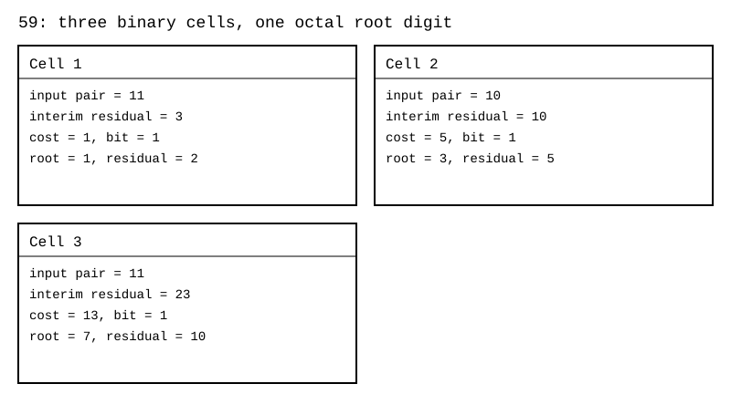

Her tam adımda işlenmiş önek $R^2+U$ olarak geri kuruluyor. Sonunda $59=7^2+10$. Ayrıca $7^2\le59<8^2$. Bu iki eşitlik kökün tam kısmını ve artığı bağımsız denetliyor.

#### 7.3.3 Sekizlik hane ve kesir devamı

Üç ikili kök hücresini ardışık bağlayınca bir sekizlik kök hanesi çıkıyor. Doğrudan sekizlik yazmak istersem sıradaki iki sekizlik hane bir grup $g\in\{0,\ldots,63\}$ oluyor. $T=64U+g$ kuruyorum. $d\in\{0,\ldots,7\}$ içinden $16Rd+d^2\le T$ koşulunu sağlayan en büyük haneyi seçiyorum. Yeni kök $R'=8R+d$, artık $U'=T-(16Rd+d^2)$.

Bu ikinci yazım, $(8R+d)^2=64R^2+16Rd+d^2$ eşitliğinden geliyor. C emülatörü doğrudan sekiz aday çarpımını hesaplamak yerine üç ikili hücreyi zincirliyor. Çarpıcısız yolun hangi uygulama olduğunu böyle ayırdım.

$3969=63^2$ örneğinde sonuç $77_8$. İki sekizlik kök hanesi ürettim. Sekizlik kök hanesini bir model çevrimine yerleştirmek üç seri hücrenin gecikmesini kaldırmıyor. Daha az model çevrimi, aynı oranda daha yüksek fiziksel hız demek değil.

Kesir devamı için girdinin sonuna sıfır çiftleri ekliyorum. Üç ek ikili çift bir sekizlik kesir hanesi verir. $f$ sekizlik kesir hanesi için kesin tamsayı hedef $R_f=\lfloor\sqrt{N8^{2f}}\rfloor$. Gösterdiğim sayı $R_f/8^f$. Bu kesilmiş yaklaşımda $R_f/8^f\le\sqrt N<(R_f+1)/8^f$ sınırı var.

59 için üç kesir hanesinde $R_f=3932=7534_8$ ve artık 5872 buldum. Gösterim $7{,}534_8$. Denetim $59\cdot8^6=3932^2+5872$. Kalanı atıp bu sonlu yazı tam olarak $\sqrt{59}$ demedim. Sembolik kök veya kök ile artık birlikte kesin bilgiyi koruyor.

#### 7.4 Mod sistemi

| Karekök modu | Ad | Seçtiğim davranış |
|---|---|---|
| 00 | Sembolik | Kök türünü taşırım, açmam |
| 01 | Hızlı | Binom veya logaritmik yaklaşık yolu seçerim |
| 10 | Kesin | Hane hane tamsayı kökü, artık ve seçilen hassasiyetle çalışırım |
| 11 | Otomatik | Sayının biçimine ve gereken kesinliğe göre yolu seçerim |

1 Temmuz karekök kaydı otomatik seçimde kuşku varsa kesin yola dönmeyi söylüyor. Son taslak küçük sayıda kesin, büyük sayıda hızlı yol yönünü veriyor. Bunları sayının büyüklüğü tek başına yaklaşık sonuca izin verir biçiminde okumadım. Yaklaşık sonucun kabulü ayrıca gerekiyor.

Kesir açma tablosunda 01 ve 10 başka adlarla kullanılmış. Kesirde 01 aç kesin, 10 aç yaklaşık. Karekök modlarının kod eşlemesini ortak ISA'ya birleştirmek açık. Bu iki tarihli tabloyu tek kod tablosu gibi üst üste koymadım.

#### 7.5 Geri gitme formülü

#### 7.5.1 Kökten artığa geri dönmek

$\sqrt{59}$ sayısını $7$ ile onun üstündeki küçük parça olarak düşündüm. $\sqrt p=t+x$ yazdım. $t$ kökün tam kısmı. Karesini açınca $t^2+2tx+x^2=p$. Buradan $x(2t+x)=p-t^2$ ve $x=(p-t^2)/(2t+x)$ çıktı. Paydadaki $x$ yine aynı küçük parça.

$$\sqrt p=t+\dfrac{p-t^2}{2t+\dfrac{p-t^2}{2t+\dfrac{p-t^2}{2t+\cdots}}}.$$

59 için $t=7$ ve $p-t^2=10$. Formül

$$\sqrt{59}=7+\dfrac{10}{14+\dfrac{10}{14+\dfrac{10}{14+\cdots}}}.$$

Araştırınca bilinen sonuç olduğunu gördüm. Bu, karekök için bilinen genelleştirilmiş sürekli kesir biçimi. Kendi yolum kökün görünen kesir kısmından geriye gitmekti.

#### 7.5.2 Yineleme ve hata

$x_0=0$ ile başladım. $x_{n+1}=10/(14+x_n)$ yazıp her adımda $7+x_n$ değerini okudum. Hesabı rasyonel sayıyla yaptım. Tablodaki ondalık değerleri en son yazdırdım. Hata sütununu 60 ondalık basamaklı bağımsız kök hesabına göre mutlak fark olarak aldım.

| Tekrar | Rasyonel yaklaşım | Ondalık değer | Mutlak hata |
|---:|---|---:|---|
| 1 | $54/7$ | $7{,}714285714286$ | $3{,}314\cdot10^{-2}$ |
| 2 | $791/103$ | $7{,}679611650485$ | $1{,}534\cdot10^{-3}$ |
| 3 | $5807/756$ | $7{,}681216931217$ | $7{,}118\cdot10^{-5}$ |
| 4 | $85253/11099$ | $7{,}681142445265$ | $3{,}303\cdot10^{-6}$ |
| 5 | $625806/81473$ | $7{,}681145901096$ | $1{,}532\cdot10^{-7}$ |
| 6 | $9187549/1196117$ | $7{,}681145740759$ | $7{,}109\cdot10^{-9}$ |
| 7 | $67441873/8780184$ | $7{,}681145748198$ | $3{,}298\cdot10^{-10}$ |

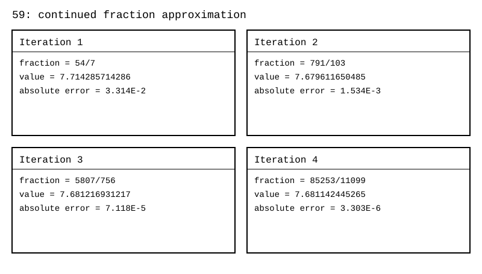

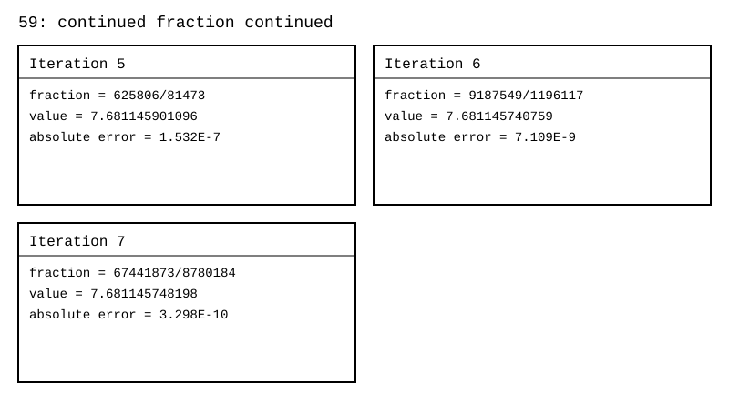

Sabit nokta $x=\sqrt p-t$. $t\ge1$ ve tam kare olmayan pozitif tamsayı için $0<x<1$. Yineleme fonksiyonu azalan. Ardışık yaklaşımlar kökün iki tarafına geçiyor. Hata bağıntısı $x_{n+1}-x=-x(x_n-x)/(2t+x_n)$. Başlangıç negatif değil ve bütün paydalar pozitif. Bu örnekte hata çarpanı $0<x/(2t+x_n)<1$ koşulunu sağladığı için hata küçülüyor. Tam karede artık sıfır ve kök zaten tam. Sıfırı doğrudan sıfır olarak ayırıyorum. $0<p<1$ için $t=0$ seçip aynı sıfır başlangıcını kullanmıyorum. Önce ölçekleme veya başka bir başlangıç gerekiyor.

#### 7.5.3 Donanımdaki yeri

Her sürekli kesir tekrarı bir bölme istiyor. Bu yüzden formülü doğrudan en ucuz donanım kök yolu olarak seçmedim. Matematiksel bağıntı kesin. Sonlu sayıda tekrarın değeri yaklaşık. Tam rasyonel yineleme, kayan nokta yuvarlamasını yinelemenin içine sokmadan bu yaklaşımı ölçmeme yarıyor.

Kökün tam kısmını veren $t$ değerinin bulunması da iş. Bir öncelik kodlayıcısı sayının büyüklüğünü bulabilir. Her girdide $\lfloor\sqrt p\rfloor$ değerini tek başına hazır verdiğini varsaymadım. Kaynak C yordamı referans kök çağrısıyla $t$ seçiyor. Bu, doğrulama kodunun olanağı. Çarpıcısız donanımın bedelsiz adımı değil.

#### 7.6 Binom ve LNS hızlı yolları

#### 7.6.1 Yakın kareye yaslanmak

$N=a^2+\delta$ yazdım. $\sqrt N=a\sqrt{1+\delta/a^2}$. Küçük sapmada ilk düzeltme $a+\delta/(2a)$. Daha fazla terim için

$$\sqrt{1+u}=1+\frac12u-\frac18u^2+\frac1{16}u^3-\frac5{128}u^4+\cdots.$$

59 için yakın kareyi 64 seçtim. $a=8$, $\delta=-5$. İlk yaklaşım $8-5/16=7{,}6875$. Kökün kendisi $7{,}681145747\ldots$. Bir terim hızlı bir yaklaşım veriyor. Kalanı veya hata sınırını göstermeden kesin sonuç saymıyorum.

Kaynak emülatörde beş terimli Taylor yolu da var. Katsayıyı $c_0=1$, $c_k=c_{k-1}(1/2-k+1)/k$ bağıntısıyla üretiyor. Büyük faktöriyeller kurmuyor. Bunun hâlâ çarpma ve bölme kullanan bir referans uygulama olduğunu korudum. Genel çarpıcısız devreye aynen bedelsiz yerleşmiş değil.

#### 7.6.2 Logaritmik yol

LNS yolunda $\sqrt N=2^{\log_2N/2}$. Logaritmayı sonlu hassasiyetle tutunca üs yarılama kolaylaşıyor. Ancak logaritmaya dönüş ve geri dönüş yaklaşık. Yedi ayrı asal üssünden oluşan kesin gölgeyle aynı temsil değil.

Kaynak emülatörde $L$ değeri $1/4096$ aralığına yuvarlanıyor. 59 için sonuç yaklaşık $7{,}68094692$. Bu değeri programla yeniden hesapladım. Kökü kesin sembolik tutmak, logaritmik yaklaşım almak ve hane hane alt sınır üretmek üç farklı sonuç sözleşmesi.

#### 7.6.3 Hata ölçümlerinin kapsamı

Son taslakta binom hızlı yolunun $2^{18}$ ile $2^{24}$ arasındaki en büyük bağıl hatası $4{,}8\cdot10^{-7}$ olarak kayıtlı. 25 Ekim 2026 doğrulamasında ayrı test_dogruluk programı bu aralığı da taradı. Sonuç Doğrulama kaydında duruyor. Yeniden çalıştırdığım emülatörün bütün 24 bit aralığından örnekleyen binom sınamasında en büyük bağıl hata $6{,}07\cdot10^{-2}$ çıktı. Aralık ve tarama farklı. İki değeri çelişen tek ölçüm gibi sunmadım.

Sürekli kesirde beş tekrardan sonraki mutlak hata yaklaşık $1{,}532\cdot10^{-7}$. C emülatörünün yazdığı yaklaşık $2{,}0\cdot10^{-8}$ ise bağıl hata. Birini diğerinin yerine kullanmadım.

#### 7.7 Kod ve yeniden çalıştırma

Karekök emülatörünü 25 Ekim 2026'da yeniden derleyip çalıştırdım. Sınama: [karekok_emulator](https://github.com/JamesAugustus/ctcpu-hunter).

| Sınama | Kapsam | Sonuç |
|---|---|---|
| Tam kareler | $n=0$ ile $3000$, girdi $n^2$ | 3001 örnekte 0 hata |
| İkili ve sekizlik yol | $N=0$ ile $200000$ | 0 uyuşmazlık |
| Tamsayı kök sınırı | $N=0$ ile $1000000$ | $R^2\le N<(R+1)^2$ koşulunda 0 hata |
| Rough ve tek üs örnekleri | Kaynakta seçilmiş katsayı, maske ve artık örnekleri | Beklenen ayrışımlar |
| Geniş tamsayı sınırları | Üç 64 bit sınır girdisi | 0 hata |

Eski kayıttaki 25 milyonun üzerindeki toplam denetim birden çok programı kapsıyor. Yalnız bu emülatörü çalıştırarak bütün eski taramayı yeniden yapmış saymıyorum. Bölümdeki sürekli kesir tablosunu, üç kesir haneli sekizlik kökü ve şekilleri doğrulama programıyla yeniden ürettim.

Hane sayısı, yuvarlama yönü, yaklaşık sonucun kabulü ve ortak mod yerleşimi açık. Sayısal doğruluk sınamalarını devre alanı, saat frekansı veya enerji ölçümü olarak yazmadım.

### 8. Formüller

#### 8.1 Sayı, gölge ve merdiven

#### 8.1.1 Sekizlik hücre okuması

Tanım $R_y=\sum_{k=0}^{7}C[y][k]8^k$. Bir alt register'ın düşükten yükseğe hücrelerini normal sekizlik sayı olarak okuyorum. Bu okumayı 3 ve 4 Eylül 2026'da yazdım. Örneğim $550_8=0\cdot8^0+5\cdot8^1+5\cdot8^2=360$.

Bir hücre üç bit, sekiz hücre 24 bit. Sekiz satır 192 bit. Sekiz register 1536 bit. Bunlar toplam alan genişlikleri. 192 bitin tamamını mantissa kapasitesi diye okumuyorum.

#### 8.1.2 Horner atomu

Tanım $acc' = b\,acc+h$. Yeni haneyi önceki öneğin sağına ekliyorum. Bu okumayı 3 ve 4 Eylül 2026'da yazdım. $550_8$ için $((0\cdot8+5)\cdot8+5)\cdot8+0=360$. Resolver'da bu eşitliği modül içinde yürütüyorum.

#### 8.1.3 Tek kat asal gölge

Tanım $N=rc\prod_{q\in Q}q^{e_q}$, $Q=\{2,3,5,7,11,13,17\}$. Pozitif sayının küçük asal üslerini ve kalan çarpanını birlikte okuyorum. Kaynak 30 Haziran Resolver, 6 Temmuz çarpma ve bölme, 12 ve 13 Ekim akan sayaç kayıtları. $360=1\cdot2^3\cdot3^2\cdot5$.

#### 8.1.4 Üssün sekizlik okuması

Tanım $e_q=rs1_q+8rs2_q+64rs3_q+512rs4_q$. Bu üs yerleşimini 9 Eylül 2026'da aday olarak yazdım, 12 ve 13 Ekim 2026'da akan sayaçta kullandım. Düşükten yükseğe $(6,1,0,0)$ hücreleri $14=16_8$ üssünü veriyor. Dört hücrenin en büyük okuması $7777_8=4095$.

#### 8.1.5 Merdiven okuması

Tanım $val_k=smooth_k(8val_{k+1}+a_{k+1})$. Bu merdiveni 3 Eylül 2026'da yazdım, açıklamalarını 4 Eylül'de ekledim. Örnek $2124=2^2\cdot3^2(8\cdot7+3)$. Burada alt kattaki 7, 2124'ün doğrudan asal çarpanı değil.

Son katta $val_L=smooth_L\,rc$ kullanıyorum. Üst katları aşağıdan yukarıya açıyorum. Bütün smooth çarpanları bir ise dört kat için $val_1=8^3val_4+8^2a_4+8a_3+a_2$. Bu bir Horner zinciri. İlk satırın $a$ hücresi boş. Kullanılan kat sayısının kodlanması açık.

#### 8.1.6 İniş ve ikinin menzili

Tanım $r=8\lfloor r/8\rfloor+(r\bmod8)$. Son haneyi kesip kalan haneyi alt satırda saklıyorum. Bunu 3 ve 4 Eylül 2026'da yazdım. $59=8\cdot7+3$. $a=0$ olan gerçek inişte sekiz çarpanı, ikinin üssüne üç katıyor.

Kaynakta verilen dört katlı ikinin menzili $7+(3+7)+(3+7)+(3+7)=37$. Bu, son hanesi sıfır olan üç gerçek inişin çarpan katkısını sayıyor. Dört hücrenin yalın toplamı 28 ile dört sekizlik haneli sayacın 4095 sınırından ayrı. $2^{11}=2^7(8\cdot2)$ örneğinde $7+3+1=11$. Aynı dizilişi 3 kanalında kurarsam $3^7(8\cdot3)=8\cdot3^8$ çıkar. $3^{11}$ çıkmaz.

#### 8.2 Çarpma, bölme ve kök cebiri

#### 8.2.1 Üs işlemleri

Bu eşitlikleri 1 ve 6 Temmuz 2026'da kurdum, güncel tasarımda da kullanıyorum. Her eşitlikte rough kısmını da koruyorum.

| Tanım | Örnek |
|---|---|
| Çarpımda $e_q(AB)=e_q(A)+e_q(B)$ | $12\cdot15=2^2\cdot3^2\cdot5=180$ |
| Oranda üs farkı $e_q(A/B)=e_q(A)-e_q(B)$ | $360/12=2\cdot3\cdot5=30$ |
| Eksik çarpanı paydaya taşıma | $12/8=2^{-1}3=3/2$ |
| Tam smooth kökte $e_q(\sqrt N)=e_q(N)/2$ | $\sqrt{3600}=60$ |
| Tek üs ayrımı $e_q=2a_q+b_q$ | $\sqrt{72}=6\sqrt2$ |

Çarpma kuralı pozitif smooth tamsayıların çarpımsal yapısını $\mathbb N^7$ üs toplamına çeviriyor. Payda girince matematiksel üs farkları $\mathbb Z^7$ içinde okunabiliyor. Donanım hücresinde negatif üs tutmuyorum. İki pozitif kayıtla pay ve paydayı ayırıyorum. Keyfi toplama bu üs vektörlerinde kapalı değil. $2^3+2^4=24=2^3\cdot3$ yeni bir asal katkı getiriyor.

#### 8.2.2 Binom çarpımı

Tanım $(2^k+u)(2^m+v)=2^{k+m}+u2^m+v2^k+uv$. Kaynak 6 Temmuz çarpma ve bölme kaydı, 25 Ekim binom ile çarpan gösterimini birlikte tutma yönü. $19\cdot23=(16+3)(16+7)=437$.

Sekizlik yinelemeli sürüm $(8a+r)(8b+s)=64ab+8(as+br)+rs$. Kaynak 10 Temmuz rough geri dönüş kapanış kaydı. $a=b=2$, $r=3$, $s=7$ için $256+160+21=437$. Yedi sınırı dar kalanlara ait.

#### 8.2.3 Tür okuması

Bu tabloyu 4 Eylül 2026'da yazdım. Türün sayısal anlamını gövdeden ayrı okuyorum.

| Tür | Anlam | Örnek |
|---:|---|---|
| 0 | $+N$ | $N=12$ için $12$ |
| 1 | $-N$ | $N=12$ için $-12$ |
| 2 | $\sqrt N$ | $N=144$ için $12$ |
| 3 | $\sqrt{-N}=i\sqrt N$, $N\ge0$ | $N=144$ için $12i$ |
| 4 | $1/N$, $N\ne0$ | $N=3$ için $1/3$ |
| 5 | $-1/N$, $N\ne0$ | $N=3$ için $-1/3$ |
| 6 | $N(N+1)/2$, negatif olmayan tamsayı $N$ | $N=5$ için $15$ |
| 7 | $N!$, negatif olmayan tamsayı $N$ | $N=5$ için $120$ |

Bu tablo türlerin anlamı. Bütün tür çiftlerinin işlem tablosunun kodda uygulanmış olduğunu söylemiyor. Kök ve ters türünü silmek için cebirsel koşulu arıyorum. $\sqrt{144}\sqrt{144}=144$. $12\cdot(1/3)=4$. $(-6)\cdot7=-42$. Türleri yalnız aynı numarayı gördüm diye birleştirmiyorum. Sigma ve faktöriyel genel çarpım altında basit bir tür kapanışı vermiyor.

#### 8.2.4 Kök geri gitme bağıntısı

Tanım $x=(p-t^2)/(2t+x)$ ve $\sqrt p=t+x$. Bu geri gitme formülünü 28 Temmuz 2026'da topladım. $p=59$, $t=7$ için $x=10/(14+x)$. Sıfırdan başlayan ilk yaklaşım $7+10/14=54/7$. Limit kök, sonlu yaklaşım kesir.

#### 8.3 POW ve ölçek

#### 8.3.1 Değer okuması

Tanım $V=NUM\,8^{-POW}$. Taban 8 düzeltmesini 6 Temmuz 2026'da, bu tanımı 4 Eylül 2026'da yazdım. $NUM=12$, $POW=1$ için $V=12/8=3/2=1{,}4_8$. Üssü negatif yazmam matematiksel değerin ifadesi. Registerda POW pozitif 1 tutuyor.

#### 8.3.2 Emilim

Tanım $A/2^u=A2^{3k-u}8^{-k}$, $k=\lceil u/3\rceil$. Kaynak 6 Temmuz kesir sistemi ve son çarpma bölme taslağı. $3/2=12\cdot8^{-1}$. Payda 3 veya 5 içeriyorsa bu tamamlamayla sonlu sekizlik kesir olmuyor. Alan sınırları da gerekiyor.

#### 8.3.3 Ortak ölçek

Tanım $a+b=8^k(a'8^m+b')$. Ortak çarpanı 3 ve 4 Eylül 2026'da yazdım. $5\cdot8^7+3\cdot8^3=8^3\cdot50003_8$. Dışarıdaki pozitif sekiz kuvvetini yalnız aşağı ölçekleyen POW'a doğrudan yerleştiremiyorum. İşaretli ölçek ya da ayrı alan kararı açık.

#### 8.4 Kalan ve tur cebiri

#### 8.4.1 Bölüm ile kalan

Tanım $n=tm+r$, $0\le r<m$, $m>0$. Buna 3 ve 4 Eylül 2026'da tornavida dedim. $360=32\cdot11+8$. Buradaki tur sayısı bölüm, açı kalan. Bu kullanım, tür kodu anlamındaki tür sözcüğünden ayrı.

#### 8.4.2 Hane toplamları

Tanım $N\equiv\sum d_k\pmod{b-1}$ ve $N\equiv\sum(-1)^kd_k\pmod{b+1}$. İşaretli toplamı birler hanesinden başlatıyorum. Bu kuralları 3 ve 4 Eylül 2026'da kullandım, araştırınca bilinen sonuç olduğunu gördüm. $550_8$ için mod 7 toplamı $0+5+5=10$, kalan 3. Mod 9 işaretli toplam $0-5+5=0$.

#### 8.4.3 Asal kanalda tur

Tanım $t=\operatorname{ord}_q(2)$, tek asal $q$ için ikinin çarpımsal devri. $q\mid2^p-1$ ancak ve ancak $t\mid p$. Buna 3 ve 4 Eylül 2026'da tur yasası dedim, araştırınca bilinen sonuç olduğunu gördüm. İlgili eserleri [günlüğün kaynakçasında](https://github.com/JamesAugustus/ctcpu-hunter) listeliyorum. $q=7$ için $2^3\equiv1\pmod7$, tur 3. $2^{83}-1$ sayısının mod 7 kalanı $2^{83\bmod3}-1=3$.

$t$ tekse blok genişliği $t$ ile düz katlama yapıyorum. $t$ çiftse tek asal modülde $2^{t/2}\equiv-1\pmod q$ ve blok genişliği $t/2$ ile işaretli katlama yapabiliyorum. Bu kanal mekanizmasını Eylül 2026'da yazdım. $q=5$ için tur 4, blok 2. $2^2\equiv-1\pmod5$. Asal olmayan keyfi modülde çift turdan aynı eksi bir sonucunu koşulsuz çıkarmıyorum.

#### 8.4.4 Resolver akışı

Tanım $t=8r+d$, $h=\lfloor t/q\rfloor$, $r'=t-qh$. Kaynak 30 Haziran Resolver ve 12 ile 13 Ekim akan sayaç. $360/2$ için bölüm haneleri $264_8=180$, son kalan sıfır. Aynı adımın yedi kanalda paralel okunması ile bölümün seçilen kanaldan akması ayrı görevler.

#### 8.5 Arşiv kartları T4 baş hane ve T5 bölen kapısı

#### 8.5.1 T4, üç baş durumu

Tanım $M_p=2^p-1$. Mersenne sayılarıyla 3 ve 4 Eylül 2026'da bu biçimde çalıştım.

| Üs | Sekizlik yazım | Hesapladığım örnek |
|---|---|---|
| $p=3k+1$ | Bir 1 ve ardından $k$ tane 7 | $p=7$, $M_p=177_8=127$ |
| $p=3k+2$ | Bir 3 ve ardından $k$ tane 7 | $p=5$, $M_p=37_8=31$ |
| $p=3k$ | $k$ tane 7 | $p=3$, $M_p=7_8=7$ |

Kaynakta kısa yazılan baş eşittir $p\bmod3$ ifadesini başın sayısal değeri olarak okumuyorum. Kalan 2 iken baş 3 oluyor. Baş değerini $2^{p\bmod3}-1$ veriyor. Kalan sıfırsa ayrı kısa baş yazmıyorum.

Büyüme bağıntısı $M_{p+3}=8M_p+7$. $M_{16}=8M_{13}+7$. Bu bir hane ekleme eşitliği. Sayının başı 1 veya 3 olup devamının 7 olması $2^p-1$ biçimini belirler. Genel olarak herhangi bir baş ve ardından 7'ler gelmesi yetmez. $27_8=23$ Mersenne biçiminde değil. Biçimi tanımak da asal olduğunu söylemez.

#### 8.5.2 T5, bölen adayının sınıfı

Tanım, tek asal $p$ ve asal $q\mid M_p$ için $q=2kp+1$ ve $q\equiv\pm1\pmod8$. Bu koşulu 3 ve 4 Eylül 2026'da kullandım, araştırınca bilinen sonuç olduğunu gördüm. $M_{11}=2047=23\cdot89$. 23 için $k=1$, 89 için $k=4$.

| Üssün sınıfı | İzin verilen $k$ sınıfları |
|---|---|
| $p\equiv1\pmod4$ | $k\equiv0,3\pmod4$ |
| $p\equiv3\pmod4$ | $k\equiv0,1\pmod4$ |

Bu sınıflar gerekli koşullar. Sınıftan geçmek bölünebilirlik kanıtı değil. Son kontrol $2^p\bmod q=1$. Kaynak formülün kısa satırında yazılmayan asal üs ve asal bölen koşullarını T5 kaydından korudum.

#### 8.5.3 $2p+1$ kapısı

Tanım $p\equiv3\pmod4$ ve $2p+1$ asal ise $(2p+1)\mid M_p$. Kaynak T5 ve 4 Eylül deney anlatımı. $p=83$ için $q=167$, $2^{83}\bmod167=1$. Kapı bir bölen verdi. Kapı kapalı kaldığında asallık sonucu vermiyor.

#### 8.6 Mersenne ve repunit eşitlikleri

Repunit'i $R_a(x)=\sum_{j=0}^{a-1}x^j=(x^a-1)/(x-1)$ olarak tanımladım. Bölüm biçiminde $x\ne1$. $x=1$ için toplam tanımı $R_a(1)=a$. Aşağıdaki eşitlikleri 3 ve 4 Eylül 2026'da yazdım.

| Tanım | Bir örnek |
|---|---|
| Kuyruk söndürme $(b+1)^a-1=bR_a(b+1)$ | $4^3-1=3(1+4+16)=63$ |
| Kesim $d\mid n$ ise $M_n=M_dR_{n/d}(2^d)$ | $M_6=7\cdot9=63$ |
| Eşit birleşme $M_a(2^a+1)=M_{2a}$ | $31\cdot33=1023=M_{10}$ |
| Repunit üretimi $R' =bR+1$ | Taban 8'de $1\to9\to73=111_8$ |
| CLIMB $M_{be+d}=M_eR_b(2^e)2^d+M_d$ | $b=3,e=2,d=1$ için $3\cdot21\cdot2+1=127$ |
| Y1, $\gcd(M_a,M_b)=M_{\gcd(a,b)}$ | $\gcd(63,511)=7$ |
| Y2, $M_{a+b}=M_a2^b+M_b$ | $M_5=7\cdot4+3=31$ |
| Y3, $M_{ab}=M_aR_b(2^a)$ | $M_6=7(1+8)=63$ |
| Y4, $M_p\equiv2^{p\bmod t}-1\pmod q$ | $t=3,q=7,p=83$ için kalan 3 |
| Mersenne saati $M_p\bmod M_r=M_{p\bmod r}$ | $8191\bmod31=7=M_3$ |

Kuyruk söndürmede $b\ge2$ ve $a>1$ için iki gerçek çarpan görüyorum. $a=1$ iken repunit çarpanı bir. Bu sınırı koymadan her üs için bileşik sonucu çıkarmıyorum. $b=1$ ailesinde görünür dış çarpan bir olduğundan $2^a-1$ çıplak kalıyor.

Saf kat bağıntısı, $p$'nin taban $b$ yazımının son $d$ hanesi sıfır olması ile $b^d\mid p$ koşulunun eşitliği. Bunu 3 ve 4 Eylül 2026'da yazdım. $512=1000_8=8^3$ için üç saf kat var. Dördüncü yok.

#### 8.7 Katlama, Lucas Lehmer ve kule

#### 8.7.1 Kalanı katlamak

Tanım $V\equiv(V\gg p)+(V\mathbin{\&}M_p)\pmod{M_p}$. Bunu 3 ve 4 Eylül 2026'da yazdım, 13 Eylül'de akış biçimine getirdim. Araştırınca bilinen sonuç olduğunu gördüm. $37634\bmod8191=4870$. Bölüm yerine kalanı hesaplıyorum. $M_p$ kalanını sıfıra çeviriyorum.

Genel repunit için $b^p\equiv1\pmod{R_p(b)}$. Bu nedenle $p$ haneli blokları toplayabilirim. Blok toplamı yine modülden büyük olabilir. Son indirgeme gerekiyor. $R_p(b)$ ile $b^p-1$ modüllerini aynı sayı sanmıyorum.

#### 8.7.2 Lucas Lehmer ve iz

Tanım $s_0=4$, $s_{i+1}=s_i^2-2\pmod{M_p}$. Tek asal $p$ için $p-2$ adımın sonundaki sıfır Mersenne asallık sınamasını veriyor. $p=2$ ayrı ele alınıyor. Bu Lucas-Lehmer sınaması, 3 ve 4 Eylül 2026'da kullandım, araştırınca bilinen sonuç olduğunu gördüm. $p=13$ için on bir adımın sonunda sıfır buldum.

$\omega=2+\sqrt3$ ve $\bar\omega=2-\sqrt3$ yazınca $\omega\bar\omega=1$. İz eşitliği $s_i=\omega^{2^i}+\bar\omega^{2^i}$. Başlangıç izi 4. İlk karesinin izi 14. $\sqrt3$ içeren ifadeyi modül üzerinde kullanırken iki katsayılı genişletilmiş halkada hesaplıyorum. Gerçek sayısal kök yaklaşımını modül içine koymuyorum.

Kaynakta asallık hükmü $\omega^{2^{p-1}}=-1\pmod{M_p}$ ve turun tam $2^p$ olmasıyla da anlatılmış. Bu ifadeyi arşiv kartı T16'nın tek asal üs ve genişletilmiş halka bağlamında tutuyorum. Keyfi bir kayan nokta $\omega$ hesabı asallık sınaması değil.

#### 8.7.3 Son kare ile mühür ayrımı

Tanım $(2^{(p+1)/2})^2=2^{p+1}\equiv2\pmod{M_p}$, tek $p$ için. Bu kare eşitliği $p=13$ için de $p=11$ için de doğru. İkinci Mersenne sayı bileşik. Dolayısıyla son karenin iki olması tek başına asallık göstermiyor.

Kaynakta sıfırdan önceki Lucas Lehmer değeri için $s_{p-3}=\pm2^{(p+1)/2}$ mühür kaydı var. $p=13$ izinde bu eşleşmeyi denedim. Genel hükmü yalnız bu bir örneğe dayanarak genişletmedim. Lucas Lehmer'in tam sıfır sınamasını bırakıp yalnız bu kareye bakmıyorum.

#### 8.7.4 Kule kaydı

Tanım $c_0=2$, $c_{k+1}=2^{c_k}-1$. Bu zinciri 3 ve 4 Eylül 2026'da yazdım. İlk değerleri $2,3,7,127$ olarak hesapladım. Mod 3 kalanı sırayla $2,0,1,1$. İkinci indisten sonra bu örnekte kalan birde kalıyor.

Kaynak genel sabitlenmeyi tur zincirinin derinliği $D(q)$ ile, $k\ge D(q)+1$ biçiminde yazıyor. Ardışık tur modüllerinde ikiyle aralarında asallık koşulu değişebiliyor. $D(q)$ tanımını ve bu yan koşulları göstermeden genel bir çekirdek kuralı olarak kullanmadım. Bu formülün bütün modüller için uygulama sözleşmesi açık. Yeniden denediğim küçük örneği genel ispat yerine koymadım.

#### 8.8 Pascal, eşik ve kare üretimi

#### 8.8.1 Eldesiz yazım eşiği

Tanım, $(x+1)^n$ açılımının katsayılarını taban $x$ haneleri olarak eldesiz tutmak için $x>\binom n{\lfloor n/2\rfloor}$. En küçük taban $\binom n{\lfloor n/2\rfloor}+1$. Bunu 3 ve 4 Eylül 2026'da yazdım. $n=4$ için eşik $6+1=7$. Taban 8'de $9^4=14641_8$ eldesiz okunuyor.

Kaynak eşik merdivenini $2,3,4,7,11,21,36,71,127,253,463,925$ diye yazıyor. Bunu $n=1$'den başlatarak yeniden ürettim. $n=0$ eklenirse başta bir 2 daha geliyor. İndisi belirtmeden aynı diziyi kaydırmıyorum.

#### 8.8.2 Orta katsayının nabzı

Tanım $\binom{2m}{m}/\binom{2m-1}{m-1}=2$ ve $\binom{2m+1}{m}/\binom{2m}{m}=(2m+1)/(m+1)$. $m=3$ için ilk oran $20/10=2$, ikinci oran $35/20=7/4$.

#### 8.8.3 Pascal satırı ve taban ailesi

Tanım $\binom nk=\binom{n-1}{k-1}+\binom{n-1}k$. $\binom52=4+6=10$. Satır hücrelerini sağa ya da sola kaydırma, çizimde seçtiğim indeks yönüne bağlı. Matematiksel işlem komşu iki önceki katsayıyı toplamak. Eldesiz paketlemede yeni satır eski satırın $11_b=b+1$ ile çarpımı.

Kaynakta çaprazın önceki çaprazın birikimi olması da var. Bunu $\sum_{j=k}^{n}\binom jk=\binom{n+1}{k+1}$ eşitliğiyle okuyorum. Örnek $1+2+3+4=10=\binom52$. Üretim tohumu tek bir 1 ve dışarıda sıfırlar.

$121_b=(b+1)^2$, $1331_b=(b+1)^3$, $14641_b=(b+1)^4$ ailelerini katsayıların tabana sığdığı yerde hane dizisi olarak okuyorum. Taban 8'de $121_8=81=9^2$. Taban 2'de 2 rakamı yok. Bu yüzden $121_2$ standart hane yazımı değil.

#### 8.8.4 Gnomon

Tanım $(n+1)^2=n^2+2n+1$. Bunu 4 Eylül 2026'da düzelttim. $X=1$, $G=1$ ile önce $G\leftarrow G+2$, sonra $X\leftarrow X+G$. Ürettiğim kareler $1,4,9,16,25$. Yeni ISA komutu gerektiren bir eşitlik olarak kullanmadım.

#### 8.9 Adres ve kapasite formülleri

Adres biçimini 3 ve 4 Eylül 2026'da `[AREA][CORE][REGISTER][subREG][CELL]` diye yazdım. Her alan bir sekizlik hane. Son hücre adresine bir eklemek sonraki hücreyi, $10_8$ eklemek sonraki satırı, $100_8$ eklemek sonraki register'ı gösteriyor. $01200_8+10_8=01210_8$. $01200_8+100_8=01300_8$. Alan sınırından elde çıkmasının izni ve kapsamı ayrıca belirlenmeli.

Kaynak kapasite notunda ham Pascal serimi hücre başına yedi tavanıyla $n\le4$ veriyor. Gerçekten $\binom42=6$ sığıyor, $\binom52=10$ sığmıyor. Katsayı başına sekiz hücreli bir sayı satırı ayrıldığında sınır $n\le26$. $\binom{26}{13}=10400600$ değeri $8^8-1=16777215$ sınırına sığıyor. $\binom{27}{13}=20058300$ sığmıyor. Bu, katsayı başına ayrı satır ayırma hesabı. Tek register'a bütün Pascal satırı yerleştiği anlamına gelmiyor.

Üç eksen ifadesini de ayrı okuyorum. Normal hanede elde konumsal üst haneye gider. Eski merdivende değer aşağı kata iner. Akan sayaçta üs eldesi sekizlik üst üs hanesine gider. Pascal katsayısı tabanı aşarsa eldesiz hane okuması bozulur. Aynı taşma sözcüğünü kullanmam aynı kayıt biçimini gerektirmiyor.

#### 8.10 Kaynakta tahmin olarak duran ifadeler

#### 8.10.1 Yoğunluk ve sonraki üs modeli

3 ve 4 Eylül 2026'da ikileme başına yoğunluğu $e^\gamma$, üs çevresindeki yoğunluğu $(e^\gamma/\ln2)/p$ olarak kullandım, yaklaşık katsayı $2{,}57$. Araştırınca bilinen bir model olduğunu gördüm. Bunları bir sonraki Mersenne asalını garanti eden yasa olarak almıyorum. Dağılım modeli olarak tutuyorum.

Aynı modelde beklenen sayı $\lambda(P,X)=2{,}57\ln(X/P)$. $X=2P$ seçince $2{,}57\ln2$ çıkıyor. Kaynakta medyan $X=P\exp(\ln2/2{,}57)$, alt çeyrek $X=P\exp(-\ln0{,}75/2{,}57)$, üst çeyrek $X=P\exp(-\ln0{,}25/2{,}57)$ yazılı. Bunlar aynı modelin olasılık varsayımı altında türeyen değerler. Gerçek bir sonraki üssün bu aralıkta bulunacağını söylemiyor.

#### 8.10.2 Ortalama satır uyumu

Yedi kanal için ortalama satır sayısını $0{,}49\log_{10}N+0{,}33$ biçiminde yazmıştım. Bu bir deneysel uyum. $N=1000$ konunca 1,8 veriyor. Tek bir sayının 1,8 fiziksel satır kullanması anlamına gelmiyor. Veri kümesini ve uyum hatasını yeniden çıkarmadığım için yeni ölçüm diye kullanmıyorum. Üs haneleri düzeninin kapasite yasası olarak da almıyorum.

#### 8.11 Kaynak tarihleri ve sınama kaydı

Bu bölümdeki formüllerin çoğunu 3 ve 4 Eylül 2026'da tek bir kayıtta topladım. Bazı satırların ilk yazım günü ayrı tutulmadığı için tarihleri bu kayıt günüdür. Resolver, çarpma, bölme ve kök formüllerinde kendi tarihlerini yazdım. Birbirinden farklı temsil anlatan eski formülleri silmedim, yanlarına güncel olanı koydum.

25 Ekim 2026'da yeniden çalıştırdım. Sayısal örnekler tam tamsayı ya da rasyonel hesapla denetlendi. Yaklaşık kök hataları için yüksek hassasiyetli ondalık referans kullandım. Tahmin modellerinin yalnız sayısal yerine koymasını kontrol ettim. Bu, modellerin deneysel doğrulaması değil. Mersenne aday eleğini asallık ispatı, tek merdiven örneğini genel kod ya da eski ölçümü yeni devre sonucu olarak yazmadım.

Örnekleri ve C programlarını aynı doğrulama programıyla yeniden derleyip çalıştırdım. Kaynak kodlara yazmadım. Okuyucu her sınamayı kendi makinesinde test klasöründeki komutla tekrarlayabilir.

### 9. Taşma, normalleştirme ve devam kaydı

#### 9.1 Hücrenin eldesi

Taşmayı tek bir olay diye okumadım. Sayı hanesindeki elde, üs hücresindeki taşma, ölçek alanının dolması ve register zincirinin bitmesi farklı olaylardır. Birinin çözümü ötekinin anlamını değiştirmemeli.

İki sayı hanesini gelen eldeyle topladığımda

$$t_j=a_j+b_j+c_j,\qquad h_j=t_j\bmod8,\qquad c_{j+1}=\left\lfloor t_j/8\right\rfloor.$$

$7+7+1=15$ için hücreye 7 yazılır, üst haneye 1 gider. Elde sağdan sola ilerler. Son hücre $h_7$'den çıkan elde artık sayı alanının dışındadır. $rc$ ise rough önbellektir. İsim benzerliğine rağmen eldeyi $rc$ diye okumuyorum.

$4114_8+3777_8=10113_8$ örneğinde $2124+2047=4171$ elde ederim. Bu sonuç sayı alanına sığar. Sınır örneği ise

$$77777777_8+1=100000000_8=16\,777\,216.$$

Sonuç dokuz sekizlik hane ister. Alt sekiz hanenin sıfıra dönmesi ile taşmanın tespit edilmesi ayrı işlerdir. Hunter'da bu durumda sarma mı doyma mı yapılacağı yazılı değil. Taşan doğru değeri yeni bir register'a aktarma yolu da henüz kesinleştirilmedi.

#### 9.2 Önek ve sonek zinciri

17 Haziran 2026 tarihli F_TASMA tasarımında komşu register'a devam eden bir zincir kurdum. Sonek, benden sonra devam var demekti. Önek, öncekinin devamıyım demekti. Taşma durumu da OVF ile bildiriliyordu.

| Zincirdeki yer | Önek | Sonek | Okuma |
|---|---|---|---|
| Baş | Yok | Var | Değer burada başlar |
| Ara kayıt | Var | Var | Önceki kaydı sürdürür |
| Son | Var | Yok | Devam burada biter |

Eski modelde çekirdek $n$ içindeki $R_y$ taşınca hedef şöyle seçiliyordu:

$$y<7\Rightarrow R_{y+1}\text{ aynı çekirdekte},$$

$$y=7\Rightarrow R_0\text{ sonraki çekirdekte}.$$

13 Temmuz 2026 tarihli CYCLE_ADIMLARI kaydı, elden sonra sonekin kurulmasını, komşunun öneki almasını ve çekirdek sınırında iletişim anlaşmasını tarif ediyor. Bunlar işlev sırasıdır. Her satırı ölçülmüş bir saat çevrimi saymıyorum. Çekirdekler arası anlaşma o kayıtta da açık.

Güncel Hunter tek çekirdeklidir. Son register'dan sonra hangi kayıt geleceği tanımlı değil. Eski küpün komşuluğunu kendiliğinden buraya taşımıyorum. Önek ve sonekin $rtyp$ içinde hangi hücrelere gireceği de açık.

#### 9.3 Sayı zincirinin kapasitesi

Her parçanın yalnız 24 bitlik sayı alanını kullandığım pozisyonel zincirde taban $B=2^{24}$ olur. $L$ parçanın değeri

$$N=\sum_{j=0}^{L-1}w_jB^j,\qquad 0\le w_j<B.$$

| Parça sayısı | Sayı biti | Sekizlik hane | En büyük değer |
|---:|---:|---:|---|
| 1 | 24 | 8 | $2^{24}-1=16\,777\,215$ |
| 2 | 48 | 16 | $2^{48}-1=281\,474\,976\,710\,655$ |
| 3 | 72 | 24 | $2^{72}-1=4\,722\,366\,482\,869\,645\,213\,695$ |
| 8 | 192 | 64 | $2^{192}-1$ |

Buradaki 192 bit, sekiz register'ın sayı satırlarının toplamıdır. Güncel modelde tek register'ın tamamı da 192 bittir, fakat o alanın çoğu gölge ve durumdur. İki kapasite hesabının nesnesi farklıdır.

19 Haziran 2026 tarihli kablolama kaydında bütün eski sistem için 32.768 kayıt varsayılmıştı. Bu kadar sayı parçasının bit sayısı $24\cdot32768$ olur. Değer kapasitesi $2^{24\cdot32768}-1$ olur. Kaynaktaki üs biçimli ifadenin yanına bit yazılması, bu iki büyüklüğü birbirine karıştırır. Yeniden hesabımda bit genişliği ile değer sayısını ayırdım.

#### 9.4 Üs taşmasının toplamsal sürümü

6 Temmuz tarihli Sayı Temsil Rehberi'nin 12 Temmuz güncellemesinde aynı asalın üssünü dört satıra parçalayarak taşıyorum. Her hücre 0 ile 7 arasında kalır. Üssü hücreleri toplayarak okurum.

$$e_q=u_{1,q}+u_{2,q}+u_{3,q}+u_{4,q},\qquad e_q\le28.$$

Örneğin $2^{23}$ için 2 kanalına sırayla 7, 7, 7 ve 2 yazılır. $7+7+7+2=23$ olur. Bu modelde birinci hücre dolduğunda katkısı 7 olarak kalır, sonraki hücreye yeni üs katkısı yazılır.

Bu gösterim rough merdivenine ait değildir. Her merdiven inişinde oluşan $8v+a$ çarpanını bu dört katkıya eklemeden geçemem. Toplamsal cascade ile merdiven satırlarının aynı adla anılması aynı çözme kuralına sahip oldukları anlamına gelmez.

#### 9.5 Üs taşmasının sekizlik sayaç sürümü

13 Ekim 2026 tarifinin ardından kullanılan dişli modelinde her asalın üssü sekizlik bir sayaçtır. Dolu hücre 7'den 0'a döner ve sonraki hücreyi bir artırır.

$$e_q=d_{0,q}+8d_{1,q}+64d_{2,q}+512d_{3,q}.$$

| Üs | $d_0$ | $d_1$ | $d_2$ | $d_3$ | Dört hücre dışına elde |
|---:|---:|---:|---:|---:|---:|
| 7 | 7 | 0 | 0 | 0 | 0 |
| 8 | 0 | 1 | 0 | 0 | 0 |
| 23 | 7 | 2 | 0 | 0 | 0 |
| 4095 | 7 | 7 | 7 | 7 | 0 |
| 4096 | 0 | 0 | 0 | 0 | 1 |

Son satırda sıfırlar üssün sıfır olduğu anlamına gelmez. Dışarı çıkan eldeyi saklamazsam bilgi kaybederim. Dişli modelinde dört hücre için 4095 sınırını kullanıyorum. Bu sınır sayaç kapasitesidir. 24 bitlik sayı girdisinde tek bir asalın ulaşabileceği üs bundan çok daha küçüktür. Büyük üslerin sembolik taşınması ile 24 bitlik düz sayının açılması ayrı sınırlara bağlıdır.

#### 9.6 Merdivendeki taşan üs

Merdivende bir hücreye en fazla yedi üs aldıktan sonra kalan sayıyı sekizlik olarak kesiyorum. Kalan yalnız rough olmak zorunda değil. Henüz soyulmamış bir asal kuvveti de içerebilir.

$2^{11}$ için ilk satırda $e_2=7$ alırım. Kalan 16'dır. $16=8\cdot2+0$ olduğu için ikinci satırda $e_2=1$ ve $a_2=0$ olur.

$$2^{11}=2^7\cdot(8\cdot2+0).$$

Burada satırlardaki üsleri toplarsam 8 bulurum. Doğru üs 11'dir. Aradaki üç, inişteki 8 çarpanından gelir. Bu örnek, merdiven için dört satırın yedişer üs taşımasını genel bir 28 üs sınırı gibi okumamam gerektiğini gösteriyor.

Tek asal taşması da aynı kanalda kalmak zorunda değil. $3^{10}=59049$ için ilk satırda $3^7$ alırım. Kalan $27=8\cdot3+3$ olur.

$$3^{10}=3^7\cdot(8\cdot3+3).$$

Bitiş daha küçük artıklarda önem kazanır. $3^8$ için kalan 3'tür. Bunu $8\cdot0+3$ olarak kapatmam gerekir. Alt değeri kullanılmamış satır diye 1 okursam $3^7\cdot11=24057$ çıkar. Doğru değer $6561$'dir. Satır sayacı ya da bitiş işareti olmadan çözümleme tamamlanmış değildir.

#### 9.7 Ölçek hizalaması ve normalleştirme

Düz değer için $x=S8^{-P}$ okumasını kullanıyorum. İki ölçeği toplarken büyük olan $P$ değerini ortak ölçek seçersem öteki sayının mantissasını sola kaydırmam gerekir. Sayı sığdığı sürece bu işlem kesindir.

$$S_a8^{-P_a}+S_b8^{-P_b}
=\left(S_a8^{P-P_a}+S_b8^{P-P_b}\right)8^{-P},$$

$$P=\max(P_a,P_b).$$

$76543210_8$ ile $7/8$ toplandığında ortak ölçek 1 olur. İlk sayının ölçeklenmiş mantissası dokuz hane ister. Tam sonuç mantissası $765432107_8$ olur. Tek sayı alanına sığmaz. Küçük terimi sıfıra yuvarlamak kesin toplama değildir. Ya daha geniş kayıt gerekir ya kesin kesir biçimi korunmalıdır. Seçilecek güncel taşma davranışı açık.

Normalleştirme ayrı bir işlemdir. $S$ sekize bölünüyorsa ve $P>0$ ise $S$'yi sekize bölüp ölçek sayacını bir azaltarak aynı değeri korurum.

$$S8^{-P}=(S/8)8^{-(P-1)}.$$

$1200_8$ ve $P=1$ çifti, $120_8$ ve $P=0$ çiftine dönüşür. İkisi de 80'dir. Bu dönüşüm sondaki sıfırı kaldırır. Keyfi bir mantissayı küçültüp hassasiyet kaybını gizlemez.

Ortak büyük ölçek için $5\cdot8^7+3\cdot8^3=8^3\cdot50003_8$ yazabilirim. Ancak Hunter'ın yalnız aşağı ölçekleyen POW alanı dışarıdaki pozitif $8^3$ çarpanını tek başına kodlayamaz. İşaretli ölçek, ayrı alan ya da kesir çiftindeki ters ölçek seçenekleri açık duruyor.

#### 9.8 Kablolama hesabının kapsamı

19 Haziran 2026 tarihli KABLOLAMA_8LI_GOLGE_TASMA_HESAP kaydı eski 30 bit register ve dört yönlü komşuluk varsayımı kullanıyor. Bu sayıların güncel 192 bit register'a ait fiziksel ölçüm olmadığını korudum.

| Eski varsayım | Hesap | Sonuç |
|---|---|---:|
| Dört yönde tek yönlü veri | $4\cdot30$ | 120 hat |
| Yön başına üç kontrol hattı | $4\cdot3$ | 12 hat |
| Veri ve kontrol birlikte | $120+12$ | 132 hat |
| Ayrı gidiş ve dönüş | $2\cdot132$ | 264 hat |

Kenarları bir kez saydığım $n\times n$ ağda bağlantı sayısı $2n(n-1)$ olur.

| $n$ | Çekirdek | Bağlantı | 30 hatlı tek yön | 60 hatlı çift yön |
|---:|---:|---:|---:|---:|
| 8 | 64 | 112 | 3360 | 6720 |
| 16 | 256 | 480 | 14400 | 28800 |
| 32 | 1024 | 1984 | 59520 | 119040 |
| 64 | 4096 | 8064 | 241920 | 483840 |

Gölge satırlarını ek mantissa deposu yapmak da aynı kayıttaki bir varsayımdır. Ana sayı ile üç gölge satırı birlikte 96 bit eder. Ana sayı ile dört gölge satırı 120 bit eder. Bu kullanımda asal üs gölgesine ayrılmış hücreleri başka iş için harcamış olurum. Güncel register'da iki görevi aynı anda yapılmış saymıyorum.

Bir hücreyi üç ikili telle taşırsam sekiz hücre yine 24 tel ister. Hücre başına tek çok seviyeli hat kullanırsam hat sayısı sekiz olur. Bunun için sekiz seviyeyi güvenilir ayıran fiziksel düzen gerekir. Bu yalnız kodlamadan çıkmış bir hız ya da enerji sonucu değildir.

25 Ekim 2026'da elde, kapasite, ölçek, iki cascade sürümü, merdiven örnekleri ve kablolama tablolarını yeniden hesapladım. Denetim aritmetik ve model denetimidir. Fiziksel hat, gecikme veya güç ölçümü yapmadım.

### 10. Türler, durumlar ve formülü tutma

#### 10.1 Sayıya verdiğim anlam

Bir sayıyı taşırken yalnız açılmış değerini tutmak zorunda olmadığımı düşündüm. Tür hücresine, o sayının nasıl okunacağını yazdım. Sekiz tür kodu şöyle:

| Kod | Tür | Yalın argüman $N$ için anlam |
|---:|---|---|
| 0 | POS | $+N$ |
| 1 | NEG | $-N$ |
| 2 | SQRT | $\sqrt{N}$ |
| 3 | ISQRT | $\sqrt{-N}=i\sqrt{N}$ |
| 4 | INV | $1/N$ |
| 5 | NINV | $-1/N$ |
| 6 | SIGMA | $1+2+\cdots+N$ |
| 7 | FACT | $N!$ |

Tür hücresi yalnız bu kodu taşır. Genel bir formül ağacını tek başına saklamaz. Argümanı sayı alanı, başka bir kaydı işaret eden bağ ya da ayrıca saklanan bir program sağlar. Bağın yeri belirlenmemişse formülün bütününü kodlanmış saymam.

Türün anlamsal olarak tanımlı olması ile emülatörde yürütülmesi de farklıdır. Önceki çekirdekte fiilen yalnız POS ve NEG yazdım. Sekiz adın tür tablosunda bulunmasını sekiz davranışın bütün ISA yollarında uygulanması diye okumuyorum.

#### 10.2 On temsil biçimi

6 Temmuz 2026 tarihli, 12 Temmuz'da güncellenmiş Sayı Temsil Rehberi'ndeki biçimleri güncel register ile birlikte okudum. Eski rehberin 30 bit kutusunu güncel 192 bit yerleşime taşımadım. Temsilin anlamını korudum.

| Biçim | Örnek | Sakladığım şey |
|---|---|---|
| Düz tam sayı | $360=2^3\cdot3^2\cdot5$ | $rm=360$, POS ve gerekince gölge |
| Negatif sayı | $-500$ | Büyüklük 500, NEG |
| Kesin virgüllü | $3/2=12\cdot8^{-1}$ | Mantissa 12, ölçek 1 |
| Kesir çifti | $3/7$ | Pay 3, INV türündeki payda 7 |
| İki ölçekli kesir | $3/(7\cdot8^{-1})=24/7$ | Pay ve paydanın ayrı ölçekleri |
| Ters | $1/7$ | Pay 1 ve payda 7 |
| Kök | $\sqrt5$, $i\sqrt2$ | Argüman ve kök türü |
| Sembolik seri | $\Sigma100$, $100!$ | Argüman 100 ve ilgili tür |
| Büyük üs | $2^{23}$ | Seçilmiş cascade kuralındaki üs |
| Rough veya geçersiz gölge | $59$ | Düz değer ve gerekirse yeniden Resolver |

Bu biçimlerin kesinliği, saklanan ilişkinin korunmasına bağlıdır. Bir alan dolduğunda kırpıp aynı kesinlik iddiasını sürdüremem. Sembolik biçim kesin olabilir. Sayısal olarak açılmış yaklaşık biçim ayrıca işaretlenmelidir.

#### 10.3 POW ve kesin virgül

Düz türde $x=S8^{-P}$ olur. Sekizlik taban yalnız 2 asalından oluşur. Bu yüzden sadeleşmiş paydanın asal çarpanları yalnız 2 ise yeterli sayı ve ölçek alanı bulunması koşuluyla kesin virgül elde ederim.

$$\frac{a}{2^k}=a2^{3P-k}8^{-P},\qquad P\ge\left\lceil\frac{k}{3}\right\rceil.$$

$3/2$ için $P=1$ seçtim. Paya 4 çarptım ve $12/8$ yazdım. $5/64$ için $S=5$, $P=2$ yeterlidir. $7/25=0{,}28$ için aynı yolu kullanamam. Paydadaki 5, sekiz kuvvetlerine emilmez. Bu sayıyı kesin kesir olarak tutarım.

Eski tek hücreli POW düzeninde aralık 0 ile 7 idi. Güncel $rpow$ bir satırdır, fakat sekiz hücrenin kesin kullanımı açık. Bu nedenle güncel ölçek kapasitesini ne tek hücreyle sınırladım ne de bütün satırı kullanıyormuş gibi genişlettim.

#### 10.4 Kesir çifti ve ters

Kesri iki bağlı register ile tutuyorum. Birinde pay, diğerinde ters türüyle payda bulunur. Temmuz modelinde bağ komşuluktur. Güncel Hunter'da bu komşuluğun ayrılması, taşınması ve korunması için gereken durum yerleşimi açık.

$$x=\frac{A8^{-P_A}}{B8^{-P_B}}
=\frac{A}{B}8^{P_B-P_A},\qquad B\ne0.$$

Paydanın ölçeği bütünü yukarı taşır. $A=3$, $B=7$, $P_A=0$ ve $P_B=1$ için sonuç $24/7$ olur. Eski iki POW hücresinin her biri 0 ile 7 arasında olduğunda farkları eksi 7 ile artı 7 arasındadır. Böylece alanların içinde negatif sayı saklamadan iki yönlü ölçek oluşur.

Temmuz rehberimde INV tek başına bırakılmaz, çiftin payda yarısıdır. Güncel türlerde de kesri iki register ile tutuyorum. Tür tablosundaki $1/N$ anlamı ile çiftin fiziksel bağını ayırdım. Payda 1'e indiğinde, başka ölçek ya da durum kalmadıysa çift tek değere sadeleşebilir.

#### 10.5 Kök türü ve ölçeğin yeri

$\sqrt5$ için 5 argümanını ve SQRT türünü tutarım. Yaklaşık basamak üretmem. $i\sqrt2$ için 2 argümanını ISQRT ile tutarım. Negatif gerçek kök $-\sqrt5$ ise $i\sqrt5$ değildir. Tür kodunu 2'den 3'e çevirmek bu işi çözmez.

Eski rehberimde negatif kökün dış işaretini ÖZEL ile taşımıştım. 12 Temmuz 2026'da dış işareti yaklaşık damgadan ayırdım. Güncel Hunter'da bu dış işaretin $rtyp$ içindeki kesin yeri açık. Farklı sürümleri tek bir kesin hücre ataması gibi birleştirmiyorum.

9 Temmuz 2026 kök virgülü kararında ölçek kökün içindedir:

$$x=\sqrt{S8^{-P}}.$$

$P$ tekse açarken

$$\sqrt{S8^{-P}}=\sqrt{8S}\,8^{-(P+1)/2}.$$

Bu okuma, her tür için önce türü uygulayıp sonra aynı $8^{-P}$ ile çarpma kuralıyla aynı değildir. Kökün ölçeğini kendi sözleşmesiyle okurum. SQRT etiketi, kökün içindeki sayıyı korur. Güncel register'a yerleşimde bu Temmuz sözleşmesini açıkça belirtmek gerekir.

#### 10.6 Seri, faktöriyel ve sadeleşme

SIGMA türünü keyfi bir toplam programı diye kullanmadım. Mevcut tür tablosundaki anlamı $1+2+\cdots+N$'dir. Formülü araştırınca bilinen sonuç olduğunu gördüm:

$$\Sigma N=\frac{N(N+1)}2.$$

$N=100$ için 5050 elde ederim. FACT türünde argüman 100 kaldığı sürece 158 basamaklı $100!$ değerini açmam gerekmez. $100!/98!=100\cdot99=9900$ sadeleşmesi daha büyük sayıyı üretmeden yapılabilir.

Faktöriyel gölgesi istenirse Legendre toplamı ilgili asalın üssünü verir:

$$v_q(N!)=\sum_{j\ge1}\left\lfloor\frac{N}{q^j}\right\rfloor.$$

$100!$ için ilk yedi kanalın üsleri 97, 48, 24, 16, 9, 7 ve 5'tir. Daha büyük asallar da vardır. Yedi kanalı yazmış olmam faktöriyelinin bütün çarpanlarını tamamladığım anlamına gelmez. Toplamsal 28 sınırını aşan üslerle sekizlik sayaç sürümünün farklı davranması da burada görünür.

| İfade | Koruduğum koşul | Sadeleşme |
|---|---|---|
| $\sqrt{x}\sqrt{x}$ | $x\ge0$ | $x$ |
| $(1/x)x$ | $x\ne0$ | 1 |
| $N!/(N-1)!$ | Tam sayı $N\ge1$ | $N$ |
| $i\sqrt{x}\,i\sqrt{y}$ | $x,y\ge0$ | $-\sqrt{xy}$ |

Koşulu kontrol etmeden etiketi silmem. Özellikle $x=0$ için tersin sadeleşmesi geçerli değildir. Karantina bunu ayrıca taşır.

#### 10.7 Formülün saklandığı yer

| Tutma yolu | Korunan bilgi | Açma bedeli |
|---|---|---|
| Tür ve argüman | Kök, ters, seri veya faktöriyel yorumu | İstenen türün sayısal hesabı |
| Asal üs vektörü | Seçili çarpanların kuvvetleri | Kuvvetleri üretme ve birleştirme |
| Rough merdiveni | Smooth çarpanlar ve $8v+a$ zinciri | Katları aşağıdan yukarı kurma |
| Kesir çifti | Pay ve payda ilişkisi | Gerekiyorsa bölme ve yuvarlama |
| Taban, üs ve düzeltme tarifi | Büyük kuvvetin kısa tanımı | İstenen basamak veya kalan hesabı |
| İşlem akışı | Değeri üreten işlemlerin sırası | Akışı istenen cebirde yürütme |

Son iki yolu birer temsil fikri olarak tutuyorum. Temmuz'daki kuvvet register'ı ve değer yerine program taşıma düşüncem bunlarla ilgili. Bunların güncel $rtyp$ ya da $rpow$ hücrelerine bit düzeyinde yerleşimini henüz yazmadım. Bir formülü metinde kısa yazabilmem, o formülün mevcut komut kelimesine sığması demek değildir.

Rough merdiveni kendi içinde hem çarpma hem toplama taşır. Bu yüzden gölgeyi yalnız düz bir asal çarpan listesine indirmiyorum. Fakat iki keyfi merdiveni yalnız üst satır üslerini toplayarak çarpamam. Alt kat ve artık bağıntılarını da hesaba katmam gerekir.

#### 10.8 Açma kipleri

Temmuz ISA'sında sembolik tutma, kesin açma, yaklaşık açma ve otomatik seçim için dört kip vardır. Hızlı açma adını kullandığım yerde yaklaşık sonucun hangi damgayla taşındığını da koruyorum.

| Kip | Eski kod | Davranış |
|---|---|---|
| Sembolik, KESİN-TUT | 00 | Açılmamış değeri korurum |
| Kesin, AÇ-KESİN | 01 | Yalnız tam temsil üretilebiliyorsa açarım |
| Hızlı, AÇ-YAKLAŞIK | 10 | Yaklaşık değeri yaklaşık damgasıyla üretirim |
| Otomatik | 11 | Uygun fırsata ve belirlenmiş politikaya göre seçerim |

Bu kipler komutun üç bitlik MOD alanıyla aynı şey değildir. Eski modelde ayrıca kalıcı bir açma kaydı ve komut başına geçersiz kılma tarif etmiştim. Hunter'ın komut kelimesinde bunların tam yerleşimi açık. Otomatik seçim de henüz her iş yükü için ölçülmüş bir üstünlük değildir.

#### 10.9 Biçim seçimi

| Karşılaştığım durum | Seçtiğim yol | Denetim |
|---|---|---|
| Kök, seri veya faktöriyel argümanı | Tür olarak tutarım | Argüman ve tanım alanı |
| Tam sayı | Düz kayıt, gerektiğinde gölge | Sayı alanının sınırı |
| Sade paydası yalnız 2 içeren kesir | POW'a emme adayı | Mantissa ve ölçek sığıyor mu |
| Başka payda içeren kesir | Kesir çifti | Payda sıfır mı |
| Geçersiz gölgeyle çarpma | Resolver | Düz değer geçerli mi |
| Taşan üs veya sayı | Seçilmiş taşma yolu | Kayıp oluşuyor mu |
| Tanımsız girdi | Karantina | Düz açma engelleniyor mu |

#### 10.10 Durum hücreleri

Eski tasarımda OVF, ZERO, ROUGH, PREFIX, SUFFIX, SPEC, OFF ve WAIT ayrı bitlerdi. Güncel Hunter ayrı FLAG alanını kaldırıyor. Tür ile durumlar $rtyp$ içindedir. ROUGH yerine $rc$ yorumundan bilgi çıkarılması düşünülüyor.

Geriye kalan yedi durumun yedi hücreye yerleşmesi bir adaydır. Yerleşim kesin değildir. Hücreye taşınırsa durum yalnız açık veya kapalı kalmak zorunda değildir. Önek ve sonek hücreleri bir hane konumu da söyleyebilir. Bunun kod tablosu açık.

25 Ekim 2026'da kesir, POW, seri, faktöriyel, üs ve sadeleşme örneklerini kesin aritmetikle denedim. Sayı Temsil Rehberi'nin eski kutu ve süre tahminlerini güncel devre sonucu olarak almadım.

### 11. Karantina ve tanımsız değer

#### 11.1 Kazayı değerin içinde tutmak

Sıfıra bölme olduğunda bütün programı kilitlemek istemedim. Yanlış bir düz sayı üretmesini de istemedim. 10 Temmuz 2026 akış kararında tanımsızlığı değer üzerinde taşımaya başladım. 12 Temmuz'da bunu karantina çiftiyle genişlettim. Kazanın çevresini sarıp bağımsız hesabın akmasına izin verdim.

Karantinadaki payda bir sayı üretmez. Kilitli hücre, INV türü ve sıfır sayı alanıyla tanınır. Pay tarafında ise kazaya giden hesabın izi kalır.

$$a\div0\ \longmapsto\ [\text{pay}=a,\ \text{kilitli payda}=(\mathrm{INV},0)].$$

Bu bir gerçek sayı eşitliği değildir. $1/0$ ifadesini hata kaydının gösterimi olarak kullanıyorum. Kilitli kayıttan sayısal sonuç açılmasına izin vermiyorum.

#### 11.2 Eski ve yeni kodlama

İlk denemede SAYI sıfır ve ÖZEL açık desenini tanımsız diye okumayı denedim. Bu desen yaklaşık sıfırla çakıştı. Eski negatif kök işareti de aynı desene gidebiliyordu. Yaklaşık sıfır ile sıfıra bölmeyi ayırt etmem gerekiyordu.

| Durum | Tür | Sayı alanı | Ek anlam |
|---|---|---:|---|
| Kesin sıfır | POS | 0 | Tanımlı sayı |
| Yaklaşık sıfır | POS | 0 | Yaklaşık damgası korunur |
| Sıfırın kökü | SQRT | 0 | Tanımlı, değeri 0 |
| Tanımsız payda | INV | 0 | Açılması kilitli |

Meşru payda üretmeden önce sıfırı kontrol ederim. Böylece INV ve sıfır deseni normal kesir paydası olarak doğmaz. Negatif tersle tanımsız desenin nasıl kanonikleştirileceği de yürütme yolunun görevidir. Yalnız bir tür adına bakıp bütün hata yayılımını çözmüş saymam.

25 Ekim 2026'da tanimsiz_kodlama_test programını değiştirmeden derleyip çalıştırdım. Eski desende 4.668 çakışma, yeni desende sıfır çakışma çıktı. Programın küçük değer taraması $8^\ell$ biçimindedir. $-12\le\ell<-6$ aralığını kullanır. Kısa test tanıtımındaki on tabanlı anlatımı kodun yerine almadım.

Testin diğer kısmı $0\le d<2^{24}$ bölen alanını model olarak dolaşır. Sıfır böleni ayrı olay sayar. Sıfır olmayan bölenlerden oluşturulan paydalarda sıfır sayı alanı üretilmediğini denetler. Bu sınama kodlamanın ayrımını gösterir. Bütün Hunter ISA'sının hata yollarını veya fiziksel devreyi sınamaz.

#### 11.3 Pay izi

$6/0$ kazasından sonra 1.365.613 ile çarpma uyguladım. Pay 8.193.678 oldu. Payda kilidi kaldı.

$$6\times1365613=8193678.$$

Görünen kayıt $8193678\times(1/0)$ olur. Buradaki çarpım işareti, kilitli hataya eşlik eden izi anlatır. Sonraki işlemleri olağan sayı aritmetiğine dönüştürmez.

| İşlem | Pay | Kilit | Düz sayı açma |
|---|---:|---|---|
| $6\div0$ | 6 | Var | Engelli |
| Önceki kayıtla $\times1365613$ | 8193678 | Var | Engelli |
| $0\div0$ | 0 | Var | Engelli |
| Yeni LOAD ile 42 | 42 | Yok | Açık |

$0/0$ ile $6/0$ aynı düz sayıya dönüşmez. İkisinin de açılması engellidir, ama payları farklıdır. Yeni LOAD, programın bilinçli olarak yeni değer yazmasıdır. Önceki kilidi temizler. Bağımsız register'ların değeri bu kazadan dolayı değiştirilmez.

25 Ekim 2026'da karantina_cift_demo programını çalıştırdım. Pay izi, açmanın engellenmesi, sıfır payın ayrılması ve LOAD ile temizlenme senaryoları geçti. Program sıfır hata verdi. Demo küçük bir C durum modelidir. Genel MUL, DIV ve ADD sözleşmesinin bütün birleşimlerini kapsamaz.

#### 11.4 Kaza sayacı

12 Temmuz 2026 akşam kaydında kilitli paydanın boşta kalan POW hücresini kaza sayacına ayırdım. Bu eski modelde bir xbit'tir. Gösterim

$$\text{iz}\times(1/0)^k$$

biçimindedir. Buradaki üs aritmetik kuvvet değil, birikmiş tanımsız girdi sayısının kaydıdır. Sayaç 7'de doyar. 7 kodunu 7 veya daha çok diye okurum.

$$k_{\mathrm{yeni}}=\min(7,k+1).$$

İki karantina kaydı birleştiğinde sayaçlar toplanıp doyurulur:

$$k_{\mathrm{birleşik}}=\min(7,k_a+k_b).$$

| Sayaç hesabı | Kod | Anlam |
|---|---:|---|
| Beş kaza | 5 | Beş tanımsız girdi |
| Beş ve dört kazalı kayıt | 7 | Yedi veya daha çok |
| 1.000.001 kaza | 7 | Yedi veya daha çok |

Sayaç geçmişin tam listesini tutmaz. Kaynağın yerini ya da kaçıncı komutta olduğunu da tek başına vermez. Pay izi ve doyan sayaç, hata ayıklama bilgisinin bir kısmıdır. Tam sayım ve ayrıntılı iz için DUR kipinin ayrıca kayıt tutması gerekir.

Kaza sayacının Temmuz ISA'sındaki v1.4 denemeleri kayıtlarda bulunuyor. Burada verdiğim sayaç örneklerini 25 Ekim 2026'da ayrıca tam sayı hesabıyla doğruladım. Bu bağımsız hesap, güncel Hunter'da sayaç alanı uygulanmış demek değildir.

#### 11.5 Yayılma ve denetim

Karantinalı bir değere dayanan sonuç karantinayı taşımalıdır. Karantina çifti, hata durumunu korurken pay izini güncellemenin yoludur. Paydaki güncellemeyi geçerli sayısal sonuç diye dışarı vermem. CMP tanımsız değeri olağan eşitlikte doğru saymaz. Tanımsızın kendisiyle karşılaştırılması da eşit sayılmaz.

Temmuz sözleşmesinde iki davranış vardır. AKIŞ kipi bağımsız işi sürdürür. DUR kipi hata ayıklama için arızayı görünür kılar. Programın akması ile hatalı değerin kullanıma açılması farklı şeylerdir. Akışın sürmesi, kilidin çözülmesi değildir.

Güncel Hunter ayrı DIVZERO biti taşımıyor. Tanımsızlığı değer üzerinde saklama düşüncesiyle bu uyumludur. Yine de karantina çiftinin bağını, kaza sayacını, yaklaşık damgasını ve dış işareti $rtyp$ ile $rpow$ içine hangi hücrelerle yerleştireceğim açık. Temmuz ISA'sının bit yerleşimini 192 bit şemaya yapılmış bir aktarım gibi göstermiyorum.

Kaynak olarak 9 ile 12 Temmuz 2026 tarihli ISA metninin 1 Ekim tarihli metin çıkarımını kullandım. Karantina çifti ve sayaç kaydını bu yayına dahil olmayan tarihsel ISA_layout metninin 207 ile 226 arasındaki satırlarından aldım. İki C sınamasının ham çıktıları 25 Ekim 2026 doğrulamasında saklandı.

### 12. Çekirdek, yürütme ve ISA

#### 12.1 Birbirine bağladığım parçalar

Güncel çekirdekte sekiz register, düz aritmetik yolu, gölge aritmetik yolu, Resolver ve kontrol görevleri bulunuyor.

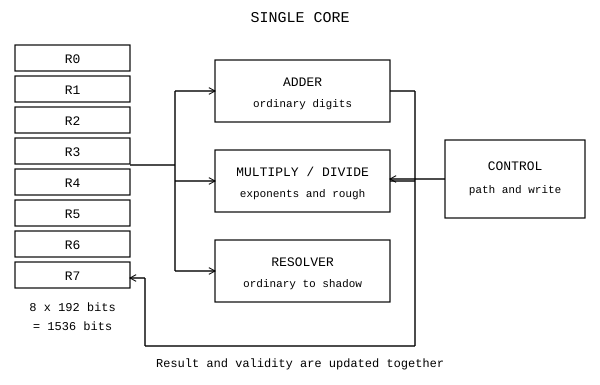

| Parça | Görev | Geçerlilik ilişkisi |
|---|---|---|
| Register'lar | Değer, gölge, artık, ölçek ve tür tutmak | Hangi yüzün geçerli olduğunu korumak |
| Toplayıcı | Toplama, çıkarma, karşılaştırma | Düz yüzü okur |
| Çarpma ve bölme yolu | Uygun gölgelerde üs hesabı | Gölge yoksa kurulmasını ister |
| Kök yolu | Tür taşıma veya seçilen açma hesabı | Açma kipine bağlıdır |
| Resolver | Düz değerden gölge kurmak | Düz yüzün geçerli olmasını ister |
| Kontrol | Komut, operand, yol ve geri yazmayı seçmek | Durum değişimini düzenler |

Kontrolün görevi ile bit düzeyinde tamamlanmış kontrol devresini ayırdım. Hunter'da komut kaynağının ve program sayacının yerini henüz belirlemedim. Eski PCCPU'yu (Program Counter CPU) bu boşluğa bitmiş bir parça gibi yerleştirmiyorum.

#### 12.2 Komutun yolculuğu


Önce komutu getiririm. İşlem ailesini ve modunu okurum. Kaynak ve hedef register'ları seçerim. Sonra aritmetik yolunu seçerim. Gölge gerekiyorsa ve hazır değilse Resolver'ı çalıştırırım. İşlemin sonucu hedefe yazılır. Değişen yüzün öteki yüz üzerindeki etkisini de kaydederim.

LOAD gölgeyi hemen kurmaz. MOV taşınan değerle birlikte geçerli gölgeyi de taşımalıdır. ADD düz yüzü değiştirir. Eski gölge yeniden kullanılacaksa önce geçersiz sayılmalıdır. Bir sonraki çarpımsal işlemde yeniden kurulabilir. Gölgenin geçerlilik bitlerinin ya da hücrelerinin güncel yeri açık.

| Başlangıç veya komut | $R1$ | $R2$ | Kullanılan yol |
|---|---:|---:|---|
| Başlangıç | 12 | 15 | Düz değerler |
| `MUL R1, R2` | 180 | 15 | $2^2\cdot3$ ile $3\cdot5$ üslerini birleştirme |
| `ADD R1, R2` | 195 | 15 | Düz toplama |
| Sonraki çarpma için Resolver | 195 | 15 | $195=3\cdot5\cdot13$ gölgesini kurma |

Bu akış tablosunu 25 Ekim 2026'da hesapla doğruladım. Tablo bir çevrim simülasyonu değildir. Hangi verinin değiştiğini gösterir.

#### 12.3 Hunter komut kelimesi

Hunter taslağında komut dört xbit'tir. Her alan üç bit olduğu için toplam 12 bit eder.

$$[\mathrm{OP}\mid\mathrm{MOD}\mid A\mid B].$$

| Kod | Komut ailesi | Anlam | Kayıttaki durum |
|---:|---|---|---|
| 0 | LOAD | Değer yükle | Sabitin tam kaynağı açık |
| 1 | MOV | Değeri ve gölgesini taşı | Aktarım ilkesi tanımlı |
| 2 | ADD | ADD, SUB, CMP | Mod ile ayrılır |
| 3 | MUL | SMUL, SDIV ve geniş havuz | Havuz yerleşimi açık |
| 4 | J | Koşullu veya koşulsuz atla | Hedefin yeri açık |
| 5 | LD | Bellekten oku | Kodda yok |
| 6 | ST | Belleğe yaz | Kodda yok |
| 7 | SYS | Durma, sistem, genişletme | Alt kod düzeni açık |

SMUL ve SDIV adlarındaki S gölgeyi anlatır. 1 Eylül 2026 adlandırmasıyla bunları shadow çarpma ve bölme olarak ayırdım. Bu adlar bütün rough ve çok katlı durumların tek üs işlemiyle çözüldüğünü söylemez.

#### 12.4 Mod ve geniş havuz

| MOD biti | ADD ailesindeki görev | MUL ailesindeki görev |
|---|---|---|
| Bit 0 | Çıkarma | Bölme veya ters yön |
| Bit 1 | Geniş işlem seçimi | Geniş havuzu açma |
| Bit 2 | Sonuç yazmayı kapatma | Yazma davranışını belirleme |

ADD için MOD 0, SUB için MOD 1 kullanılır. CMP, çıkarma ile yazma kapatmayı birleştirir ve MOD 5 olur. Hunter'da CMP'nin görevi karşılaştırmanın durumunu saklamak. Sayı sonucunu hedefe yazmamak, hiçbir durum yazmamak demek değildir.

| İfade | Komut sözcüğü | Alanlar |
|---|---|---|
| $R3\leftarrow R3+R5$ | $2035_8$ | OP 2, MOD 0, A 3, B 5 |
| $R3\leftarrow R3-R5$ | $2135_8$ | OP 2, MOD 1, A 3, B 5 |
| Aynı çıkarma için CMP | $2535_8$ | OP 2, MOD 5, A 3, B 5 |

Üç bitlik geniş havuzda SQRT için 000, SQR için 001, SHL için 010, SHR için 011, genişletme için 111 yazılı. Fakat GENİŞ biti MOD içinde kullanıldığında diğer iki bit yalnız dört durum ayırır. Üç bitlik havuz kodunun komutun neresinde tutulacağı açık. Ek sözcük ya da başka bir alan kararı olmadan bu harita tam bir makine kodu çözümü değildir.

SHL ve SHR burada bir sekizlik hane kaydırır. Bu, üç ikili bitlik konum değişimidir. Bir bit veya iki bit kaydırma değildir. SHL'de üstten taşan, SHR'de alttan düşen hane saklanmazsa kaybolur. Kaydırma tek başına POW değerini değiştirmez.

#### 12.5 Atlama koşulları

| J modu | Koşul |
|---:|---|
| 0 | $a<b$ |
| 1 | $a=b$ |
| 2 | $a>b$ |
| 3 | Tanımsız koşulu |
| 4 | $a\mid b$ |
| 5 | $b\mid a$ |
| 6 | $\gcd(a,b)=1$ |
| 7 | Koşulsuz |

Tek satırlı, rough artığı bulunmayan smooth değerlerde bölünebilirliği üsleri karşılaştırarak okuyabilirim. Alt kat ya da artık bulunduğunda yalnız ilk satırı karşılaştırmak yetmez. $288=2^5\cdot3^2$ ile $8928=2^5\cdot3^2\cdot31$ aynı ilk üsleri taşıyabilir. 8928, 288'i bölmez. Sonraki katı görmeden iki yönü aynı kabul edemem.

EBOB koşulunun çok katlı sürümü ve tanımsız koşulunun kesin durum okuması açık. Sıralı karşılaştırma koşullarını taslağa yazdım ama koda eklemedim. Atlama hedefi için de dört alanın dışında henüz belirlediğim bir yer yok.

#### 12.6 Adres ve yürütme sınırları

Hunter adres taslağında AREA, CORE, REGISTER, subREG ve CELL alanları bulunuyor. Her biri bir sekizlik hane olarak düşünülmüş. Bu mantıksal yol, bir hücrenin yerini tarif eder. Beş hanenin toplamı 15 bittir. Eski çok çekirdek modelindeki dört haneli çekirdek kimliği ve bir haneli register adresiyle aynı alan dağılımı değildir.

Güncel tek çekirdekte CORE seçimini komutun neresine koyacağım yazılı değil. AREA'nın anlamı da açık. Köşeli parantez ve süslü parantezlerin komut kelimesindeki kodlaması, LOAD'un geniş sabiti ve program belleği ayrı kararlar ister.

Hunter'da her opcode'a kendi telini verdim. Bunu bir kontrol seçimi olarak yazdım, hazır bir fiziksel devre olarak değil. Komut alanının okunması, seçim üretimi, durumun tutulması ve zamanlama yine tanımlanmalıdır.

#### 12.7 Temmuz ISA'sıyla fark

| Alan | 9 ile 12 Temmuz 2026 ISA | Hunter taslağı |
|---|---|---|
| Register kutusu | 8 sayı hücresi, POW ve TÜR | Sekiz satırlı 192 bit kayıt |
| Opcode 4 | JMP | J ve koşul MOD'u |
| Opcode 5 | JEQ | LD |
| Opcode 6 | JNE | ST |
| Geniş 010 ve 011 | CUBE ve CBRT için ayrılmış | SHL ve SHR |
| Durum alanı | Ayrı bayrak haritası | $rtyp$ içinde, yerleşim açık |
| Karantina | Çift ve doyan sayaç tarifli | Hücrelere aktarımı açık |

Temmuz programının JEQ ve JNE komutlarını Hunter'da LD ve ST diye çalıştıramam. Aynı sayısal kodun başka sürümde başka anlamı var. Eski programın geçmesi, güncel Hunter komut haritasının tamamını doğrulamaz.

Küp, lider, işçiler, ayrı PCCPU (Program Counter CPU) ve çekirdekler arası taşma önceki tasarımlarımda vardı. Güncel çekirdeğe tamamlanmış birimler olarak eklemedim. Çevrim çizelgesi, kontrol sinyalleri, bellek yolu ve Resolver bağlantısının uygulaması açık.

### 13. Hunter'da verdiğim kararlar

#### 13.1 Kesin tuttuğum omurga

Makine kaydının adını 3 Eylül 2026'da BILINEN.txt'den HUNTER.txt'ye çevirdim. Ayrı bir karar günü yazmadığım satırlara sonradan tarih uydurmadım. Kesin sözcüğünü tasarım tercihi için kullanıyorum. Devrenin tamamlandığı anlamında kullanmıyorum.

| Tarih veya kayıt | Karar | Durum |
|---|---|---|
| 8 Haziran 2026 ArGe | Hücre üç bit, sekizlik hane ve renk kodudur | Kesin |
| 8 Haziran 2026 ArGe | Renk sırası K R G Y B M C W | Kesin |
| 18 Temmuz 2026 manifesto | Türü koru, gereksiz açmayı ertele | Amaç ve tasarım ilkesi |
| 31 Ağustos 2026 günlük | Ayrı FLAG yerine geniş TYPE alanı | Hunter'da geçerli |
| 1 Eylül 2026 adlandırması | Gölge çarpma ve bölme adları SMUL, SDIV | Kesin adlandırma |
| 3 Eylül 2026 | Tek çekirdek ve tek iş parçacığı | Kesin kapsam |
| 3 Eylül 2026 | Çekirdekte sekiz register | Kesin |
| 3 Eylül 2026 | Register sekiz satır, satır sekiz hücre | Güncel tasarımda geçerli |
| 3 Eylül 2026 | Yedi asal kanal, bir kalan hücresi | Kesin satır düzeni |

#### 13.2 Temsil ve işlem kararları

| Tarih veya kayıt | Karar | Durum |
|---|---|---|
| 3 Eylül 2026 | Gölge sayının kendi register'ına aittir | Kesin |
| 3 Eylül 2026 | $rs1.a$ boş, iniş hanesi alt satırda | Güncel tasarımda geçerli |
| 3 Eylül 2026 | Merdivende her iniş $8v+a$ taşır | Matematik kuralı, eski motorla fark var |
| 3 Eylül 2026 | Sıfırın gölgesi kurulmaz | Kesin |
| Temmuz ISA ve Hunter | LOAD sırasında zorunlu Resolver yok | Tembel gölge ilkesi |
| Temmuz ISA ve Hunter | MOV gölgeyi değerle birlikte taşır | Aktarım ilkesi |
| 3 Eylül 2026 | POW yalnız aşağı ölçekler | Güncel tek değer kuralı |
| 3 Eylül 2026 | İşaret ayrı bit değildir, türdedir | Sekiz temel tür için geçerli |
| 3 Eylül 2026 | DIVZERO için ayrı bit yoktur | Değer üstündeki tanımsızlıkla uyumlu |
| 3 Eylül 2026 | CMP durum saklar | Hangi hücreye yazdığı açık |

#### 13.3 Kod ile taslak arasındaki kararlar

| Tarih veya kayıt | Konu | Durum |
|---|---|---|
| 3 Eylül 2026 | Dört xbit komut, sekiz opcode | Taslak omurgası |
| 3 Eylül 2026 | J koşulu MOD içinde | Hedef alanı açık |
| 3 Eylül 2026 | LD ve ST | Haritada var, kodda yok |
| 3 Eylül 2026 | AND, OR, XOR ve NOT | Kodda yok |
| 3 Eylül 2026 | SHL ve SHR | Bir sekizlik hane kaydırır |
| 3 Eylül 2026 | CALL ve RET | Tanımlı değil |
| 3 Eylül 2026 | Keyfi $a\bmod b$ işlemi | Mevcut yedi kanal yolu bunu sağlamaz |
| 3 Eylül 2026 | Sinüs, kosinüs, logaritma, üstel fonksiyon | Komut olarak yok |
| 25 Ekim 2026, güncel türler | Sekiz türün tümünün yürütülmesi | Eski çekirdekte yalnız POS ve NEG yazımı kayıtlı |

#### 13.4 Eski kararların güncel yeri

| Tarih | Önceki karar veya model | Güncel okuma |
|---|---|---|
| 17 Haziran 2026 | Komşu register ve sonraki çekirdeğe taşma | Tek çekirdekte devam yolu açık |
| 19 Haziran 2026 | 30 bit veri yolu, çok çekirdekli ağ | Kablolama varsayımı, güncel devre ölçüsü değil |
| 9 Temmuz 2026 | Kök ölçeği kökün içinde | Türün ölçek sözleşmesi olarak korunur |
| 10 Temmuz 2026 | Sıfıra bölme akışı kilitlemez | Karantina fikrinin tabanı |
| 12 Temmuz 2026 | Karantina çifti ve kaza sayacı | Güncel hücrelere yerleşimi açık |
| 12 Temmuz 2026 rehberi | Üs katkılarının toplamı en çok 28 | Toplamsal cascade sürümü |
| 13 Ekim 2026 tarifi | Üs sayaçları sekizlik basamaklanır | Dişli modelinde 4095 kapasitesi |
| 25 Ekim 2026 Register | Merdiven ile sayaç aynı dört satır adıyla anlatılır | Fiziksel temsil seçimi açık |

#### 13.5 Açık kayıt kararları

| Hunter'daki açık konu | Tamamlanması gereken anlam |
|---|---|
| Zincirin bitişi | Kullanılan kat sayısı veya bitirici kod |
| Pozisyonel gölge satırı | Hücrelerin üs yerine hane olarak okunacağı işaret |
| Kenar işareti | Eski $a=4$ ve $a=6$ işaretlerinin yeni yeri |
| Ortak yukarı ölçek | İşaretli POW, ayrı ölçek veya bağlı kayıt seçimi |
| $rpow$ içi | Ölçek hücresi ve diğer hücrelerin anlamı |
| $rtyp$ hücre 1 ile 7 | Durumların kesin kod ve yerleşimi |
| OVF ve ZERO | CMP'nin hangi hücreleri yazacağı |
| $rc$ | İlk rough çarpanı mı, son işlenmemiş artık mı |
| VLINK | Eski alanın kaldırılması sonrası bağın karşılığı |

VLINK'i güncel kayıtta bulunan bir alan olarak kullanmıyorum. Eski 137 bit düzenin bağlantı hücresiydi. Yeni düzende yeri yok. Bağ gerektiren bir davranış kullanacaksam onun yerini ayrıca belirlemeliyim.

#### 13.6 Açık yürütme kararları

| Hunter'daki açık konu | Tamamlanması gereken anlam |
|---|---|
| Köşeli parantezin içi | Register, sabit veya toplam adresi |
| AREA | Alanın neyi seçtiği ve varsayılanı |
| J hedefi | Dolu komut sözcüğünde hedefin kaynağı |
| Köşeli ve süslü parantezler | MOD, opcode veya ek sözcükte kodlama |
| Geniş havuz | Alt kodun komut içindeki yeri |
| SYS | Alt kod tablosu |
| LOAD sabiti | Geniş sabitin nereden okunacağı |
| Program sayacı | Yeri, komut kaynağı ve güncelleme yolu |
| CORE seçimi | Komut ya da adres içindeki karşılığı |

#### 13.7 Açık aritmetik kararları

| Hunter'daki açık konu | Tamamlanması gereken anlam |
|---|---|
| İniş kapısı | Sabit 8, 7 ile 8 çifti veya başka politika |
| Bir veya iki bit kaydırma | Hane kaydırmadan ayrı yol |
| Register'lar arası elde | Sayı alanının devam kaydı |
| Son register taşması | Zincirin ucu |
| Sayı taşınca davranış | Sarma, doyma veya geniş kayda aktarım |
| Çok katlı bölünebilirlik | İlk satır karşılaştırmasının ötesi |
| Rough bölme | Genel yolun tamamlanması |
| Renk kapısı | Hesaplanan tablonun ISA ve devre karşılığı |

Bu açıklıkları birer tamamlanmış karar gibi kapatmadım. Birbirinden farklı temsil sözleşmelerini tarihlerine göre ayrı tuttum.

### 14. Doğrulama

#### 14.1 Çalıştırma yöntemi

Test arşivinden 30 çalıştırma seçtim. Her testin kendi açıklamasındaki komutu kullandım. Derleme seçeneğini ve çalıştırma argümanlarını değiştirmedim. Her testi geçici bir kopyada çalıştırdım, kaynak kodlara yazmadım. Her çalıştırmaya derleme dahil 180 saniye sınırı koydum. Süreler derleme ve yürütmenin toplam duvar süresi, tek koşu ölçümü, hız kıyası değil.

Çıkış koduna tek başına güvenmedim. Bazı eski testler hata saydıktan sonra da sıfır koduyla bitiyor. Ham çıktılardaki hata sayaçlarını, kabul koşullarını ve kaynak kodundaki tarama sınırlarını okudum. GECTI, belirtilen kabul koşulunun sınanan alanda sağlandığını söylüyor. KALDI, iddiaya karşı örnek ya da kabul koşulu ihlali olduğunu söylüyor. OLCUM, kabul eşiği olmayan deney veya karar vermeyen gözlem. Sınanmamış kartları da OLCUM içinde açık diye ayırdım.

30 çalıştırmanın 26 tanesini GECTI, dört tanesini OLCUM olarak ayırdım. Hepsi süre sınırından önce bitti. Derleme ve yürütme sürelerinin toplamı 50,420 saniye. En uzun koşu akan sayaç çekirdeğiydi ve 11,830 saniye sürdü. Günlükte KALDI olan dört iddia, programın hata vermeden doğru karşı örnek üretmesiyle saptandı. Bunları program geçti diye kabul etmedim.

#### 14.2 Yeniden çalıştırılan testler


| İddia ve test | Kapsam | Sonuç | Süre, saniye |
|---|---|---|---:|
| Akan sayaç, geri kurma ve tembel gölge. [hunter_cekirdek](https://github.com/JamesAugustus/ctcpu-hunter) | $1..2^{24}$ geri kurma. 100000 çiftte dört işlem. Bağımsız geniş tamsayı denetçisi. Sıfır hata | GECTI | 11,830 |
| Akan sayaç yürütme izi. [hunter_iz](https://github.com/JamesAugustus/ctcpu-hunter) | $744=1350_8$ geri kurma birebir | GECTI | 0,314 |
| Horner kalan akışı ve ilk ayrışım. [resolver_emulator](https://github.com/JamesAugustus/ctcpu-hunter) | 24 bit alan ve yedi kanal. Ayrışım geri dönüşü. Ek üs ve rough taramalarında sıfır hata | GECTI | 2,066 |
| Tarihsel N6 merdiveninde çarpma. [golge_carpma](https://github.com/JamesAugustus/ctcpu-hunter) | 8386560 küçük çift, 5000000 büyük çift. Geniş sonuç ve küçük çarpım sınırı. Sıfır hata | GECTI | 6,322 |
| Tarihsel gölge kabulü. [golge_emulator](https://github.com/JamesAugustus/ctcpu-hunter) | 23 kabul kontrolü geçti. Sıfır, çarpma, bölme, faktöriyel ve kök | GECTI | 0,214 |
| Tarihsel N6 geri dönüş ve kayıt özeti. [golge_nihai](https://github.com/JamesAugustus/ctcpu-hunter) | $1..16777215$. Geri dönüş hatası, sığmayan sayı ve aynı özet sayısı sıfır | GECTI | 3,369 |
| Ana gölge uygulaması. [test_golge_merdiven](https://github.com/JamesAugustus/ctcpu-hunter) | 24 bit geri dönüş. 8386560 küçük, 2000000 büyük çarpım. 999999 taşma ve 1000000 bölüm. Sıfır hata | GECTI | 7,424 |
| Tarihsel N6 kapsamı. [test_tum_sayilar](https://github.com/JamesAugustus/ctcpu-hunter) | $1..16777215$. Geri dönüş ve sığmama sıfır. Rough kuyruğu dahil | GECTI | 3,669 |
| Toplamalı üs taşması. [kaskad_uctan_uca_test](https://github.com/JamesAugustus/ctcpu-hunter) | $e=0..56$ sınır taraması. 3000000 çarpım, 2000000 bölüm. 28 üstünde taşma. Sıfır hata | GECTI | 0,815 |
| Kesir ve karantina v1.4. [kesir_emulator](https://github.com/JamesAugustus/ctcpu-hunter) | 25 kabul kontrolü. 200000 rastgele zincir dahil. 25 OK, 0 FAIL | GECTI | 0,164 |
| Karantinada sayı sızmaması. [kesir_v13_v14_kiyas](https://github.com/JamesAugustus/ctcpu-hunter) | 1000000 temiz ve 1000000 sıfıra bölmeli zincir. Temiz değer ve kilitli pay izi doğru | GECTI | 0,615 |
| Üs aritmetiğiyle çarpma ve bölüm. [mul_div_emulator](https://github.com/JamesAugustus/ctcpu-hunter) | 20000000 çarpım, 10000000 tam ve 10000000 genel bölüm. Eski 28 sınırı. Sıfır hata | GECTI | 3,469 |
| Kaydırma ve toplamayla çarpım. [multiply_add](https://github.com/JamesAugustus/ctcpu-hunter) | 65536 byte çifti, 128 geniş sınır, 4000 örnek, 26 geçersiz çağrı. PASS | GECTI | 0,064 |
| Çarpma ve bölmenin somut örnekleri. [ornekler](https://github.com/JamesAugustus/ctcpu-hunter) | 41 örnek geçti. Smooth, rough, işaret, kesir ve sadeleşen zincir | GECTI | 0,114 |
| Sekizlik ölçeğin kanonik biçimi. [pow_tam_tarama](https://github.com/JamesAugustus/ctcpu-hunter) | 134217728 durumda değer, idempotens ve yapı hatası sıfır | GECTI | 0,264 |
| Rough çarpımda küçük işlem yolu. [rough_fallback_devre_test](https://github.com/JamesAugustus/ctcpu-hunter) | 5000000 çiftte geniş tamsayı çarpımıyla eşit. Temel küçük çarpım operandı en fazla 7 | GECTI | 0,965 |
| Çarpım katsayısı ve elde. [test_gate_model](https://github.com/JamesAugustus/ctcpu-hunter) | Dört unittest geçti. Byte kareleri, ağırlıklı toplam, elde ve geçersiz girdiler | GECTI | 0,114 |
| Sabit noktalı kök yaklaşımı. [frac_test](https://github.com/JamesAugustus/ctcpu-hunter) | 12 kök girdisi, beş çarpım ve sembolik sadeleşme. Sayısal kabul eşiği yok | OLCUM | 0,064 |
| Kesin tamsayı karekök. [karekok_emulator](https://github.com/JamesAugustus/ctcpu-hunter) | 3001 tam kare, 200001 yöntem eşitliği, 1000001 floor koşulu, üç geniş sınır. Sıfır hata | GECTI | 0,114 |
| Kök içinde ölçek. [kok_virgul_icinde_test](https://github.com/JamesAugustus/ctcpu-hunter) | 134217728 kanonik durum ve 10000000 kök çarpımı. Altı açma örneği. Sıfır hata | GECTI | 0,314 |
| Yaklaşık kökün bağıl hatası. [test_dogruluk](https://github.com/JamesAugustus/ctcpu-hunter) | $2..16777215$. Beş yaklaşımın hata taraması. Kabul eşiği yok. Kesin kök satırı ölçülmüyor | OLCUM | 0,364 |
| Kilit, pay izi ve yeni yükleme. [karantina_cift_demo](https://github.com/JamesAugustus/ctcpu-hunter) | Sıfıra bölmede kilit, iz birikimi, sıfır pay ayrımı ve LOAD temizliği. Sıfır hata | GECTI | 0,032 |
| Yaklaşık sıfır ile tanımsız ayrımı. [tanimsiz_kodlama_test](https://github.com/JamesAugustus/ctcpu-hunter) | 6001 küçük değer, 24 bit bölen taraması. Eski kodda 4668 çakışma, yeni kodda sıfır | GECTI | 0,032 |
| Tür ve ölçek kanonikliği. [tur_pow_tam_tarama](https://github.com/JamesAugustus/ctcpu-hunter) | 1073741824 durumda değer, idempotens ve yapı hatası sıfır. ISA bütünlüğü değil | GECTI | 4,771 |
| Tür çarpımı, ters ve işaret. [tur_x_tur_test](https://github.com/JamesAugustus/ctcpu-hunter) | 22500 çarpım, 14400 bölüm, 150 işaret denemesi. Sıfır hata. Yardımcı cebirsel kayıt kullanılıyor | GECTI | 0,114 |
| Günlük iddiaları. [journal_tests](https://github.com/JamesAugustus/ctcpu-hunter) | 22 kart. 15 HOLDS, 4 FAILS, 3 UNTESTED. Çalıştırma hatası sıfır. Ayrıntı aşağıda | OLCUM | 0,564 |
| Rough dağılımı ve işlem maliyeti. [hunter_golge_vs_klasik_ad96e0c4](https://github.com/JamesAugustus/ctcpu-hunter) | 24 bit dağılım, 200000 çiftte model işlem sayıları. Donanım süresi ve güç ölçülmüyor | OLCUM | 0,715 |
| İkilik kanal katlaması. [hunter_hunter_channel_fold_bb562e20](https://github.com/JamesAugustus/ctcpu-hunter) | 393216 kalan, 1681095 katlama değişmezi ve beş geçersiz girdi. PASS | GECTI | 0,565 |
| Mersenne akış katlaması. [hunter_stream026_9dd5af2c](https://github.com/JamesAugustus/ctcpu-hunter) | $p=13,31,61,127,521$. Hücre 3,8,16 bit ve 2,3,4,8 satır. Doğrudan mod ile eşit | GECTI | 0,114 |
| Katlama kapısının hata yakalaması. [hunter_test_hunter_channel_fold_32b15897](https://github.com/JamesAugustus/ctcpu-hunter) | Yedi unittest geçti. Tam tarama, iz değişmezi, geçersiz giriş ve bilerek yanlış kalan | GECTI | 0,865 |


Tablodaki bütün çalıştırmaların tarihi 25 Ekim 2026.

#### 14.3 Bağımsız ek denetim

Arşivden gelen sayımlara ek olarak yayın örneklerini ayrı hesapladım. Üç ışık kanalının kümelerini kurup VE, VEYA, XOR, NAND ve NOR işlemlerini bütün hücre çiftlerinde doğruladım. Rough dağılımını, küçük asal kuvvetlerinin bütün uygun çarpımlarını ayrı üreterek tekrar saydım. Kalan kadranlarının modül çarpımı ve çakışma örneği de bu denetimde var. Bu küçük program bir optik devreyi sınamıyor.


| İddia ve test | Kapsam | Sonuç | Süre, saniye |
|---|---|---|---:|
| Örneklerin sayısal doğruluğu. [ornekleri_dogrula](https://github.com/JamesAugustus/ctcpu-hunter) | 39046 kesin eşitlik kontrolü. Smooth sayımı, CRT, hane ağırlıkları, renk kümeleri ve rasyonel sürekli kesir yakınsakları | GECTI | 0,041213 |
| Güncel sayaç sınırı. [sayac_siniri](https://github.com/JamesAugustus/ctcpu-hunter) | Yedi kanalda bütün sayaç değerleri. $2^{4095}$ geri kurma. Bir sonraki üs ve çarpımda ret. Rough tam bölme ve sıfıra bölme reddi | GECTI | 0,329562 |


Tablodaki bütün çalıştırmaların tarihi 25 Ekim 2026.

Sayaç sınırını çekirdeğin gerçek işlevlerini çağırarak sınadım. Kaynak dosyayı değiştirmeden derlemeye dahil ettim. $4095$ temsil ediliyor. $4096$ için Resolver hata dönüyor. $2^{4095}\cdot2$ çarpımı da reddediliyor. Bu çekirdekte otomatik pozisyonel geri dönüşü doğrulamadım. Dönen hata kodunu başarı sonucu gibi kullanmamak gerekiyor.

#### 14.4 Günlük iddialarının ayrı hükmü

Günlük programı 0,564 saniyede bitti. Aşağıdaki journal_tests kartları aynı koşuya ait. Numaralarını bölüm 8’deki arşiv kartı numaralarından ayrı kullanıyorum. Her karta ayrı süre ölçmedim. HOLDS etiketini genel bir ispat saymadım. Yalnız belirtilen sonlu kapsamda eşitliğin bozulmadığını kaydettim. FAILS etiketini iddianın karşı örnekle düşmesi olarak okudum. UNTESTED olanı açık bıraktım.


| Kart | İddia ve kapsam | Sonuç | Gerekçe |
|---|---|---|---|
| T01 | d101 ailesi. Asal $p=3..31$, $k=0..3$ | GECTI | 40 eşitlik doğru |
| T02 | Mersenne mod 8. $p=3..79$ | GECTI | 77 üs doğru |
| T03 | Mersenne bölen koşulu. Asal $p=3..31$ | GECTI | 14 asal çarpan koşulu sağlıyor |
| T04 | $2p+1$ kapısı. Uygun asal $p<100$ | GECTI | Üç uygun bölen. $p=3$ durumunda bölen sayının kendisi |
| T05 | Sekizlik baş hane. $p=3..300$ | GECTI | 298 biçim doğru. Asallık sonucu değil |
| T06 | Baş haneden asallık | KALDI | $31=37_8$ asal. $2047=3777_8=23\cdot89$ bileşik. Baş hane aynı |
| T07 | Pascal haneleri | GECTI | 65 hane kontrolü. Küçük onluk örnekler ve $n=1..30$ için uygun tabanlar |
| T08 | Taşımasız Pascal tabanı eşiği | GECTI | 44 taban kontrolü. $n=1..15$ için eşik ve bir üstü, $n=2..15$ için bir altı |
| T09 | Taban içinde 11 değeri ve karesi | GECTI | 99 taban ve 98 kare |
| T10 | Kare mühür ile asallık kararı | OLCUM | Açık. Küçük Lucas Lehmer izleri var, mühür ölçütü tanımlı değil |
| T11 | Kısa paket elek ile asallık | KALDI | $2^{41}-1$ sayısının $13367=2\cdot163\cdot41+1$ böleni var. $k\le64$ araması kaçırıyor |
| T12 | Hane akışından kalan | GECTI | 491520 eşitlik. $n=0..32767$ ve $p=3..17$ |
| T13 | Çarpımda asal üs vektörü | GECTI | $a,b=1..64$ için 4096 karşılaştırma |
| T14 | İkinci derece ifadeden genel asallık | KALDI | $M=3$, $k=3$ örneği $42=2\cdot21$ veriyor |
| T15 | Asalın rakamlarını ters çevirince asallık | KALDI | $19$ ters çevrilince $91=7\cdot13$ |
| T16 | Mersenne asallarının sonsuzluğunun bu yoldan çıkması | OLCUM | Açık. Yazılmış test ya da ispat yok |
| T17 | Tarihsel imza filtresi | OLCUM | Açık. İmza işlevi ve sabit küme yok |
| T18 | Pascal orta katsayı merdiveni | GECTI | $n=0..60$ içinde komşu katsayıyla adım doğru |
| T19 | Taban farkı ve komşu katsayı | GECTI | $n=1..60$ |
| T20 | Uçlardan toplayarak orta katsayı | GECTI | Kayıtlı $N=26321361382$ için 0..37 satırları taşımasız. 38'de orta katsayı sınırı aşıyor |
| T21 | Mersenne tabanında Pascal satırı | GECTI | Sonlu üs ve modül örnekleri. $p=5$ taşması ayrıca korunmuş |
| T22 | Taban 3 zinciri ve ilişkili eşitlikler | GECTI | 6156 formül eşitliği. Sınırlı asal taramasında 11 ve 1006003 |


Bütün kartlar 25 Ekim 2026 tarihli aynı günlük çalıştırmasına ait.

KALDI olan kartları düzeltmedim. Baş renk iddiasında aynı baş hane hem asal hem bileşik sayı veriyor. Kısa elek iddiasında arama sınırı gerçek böleni dışarıda bırakıyor. İkinci derece ifade ve ters çevirme iddialarında doğrudan bileşik sonuç var. Test programı bu karşı örnekleri beklediği için başarılı çıkış veriyor. Sınama: [journal_tests](https://github.com/JamesAugustus/ctcpu-hunter).

#### 14.5 Sürüm ve kapsam ayrımları

| Konu | Tarihsel kayıt | Güncel kaynak ve testin sınırı |
|---|---|---|
| Dört gölge satırı | Temmuz ve Ağustos 2026 modellerinde üs parçaları toplanıyor. Sınır 28 | 12 ve 13 Ekim 2026 akan sayaçta sekizlik basamaklar. Sınır 4095. İkisini ayrı sınadım |
| Katlı merdiven | 3 Eylül 2026 taslağında her iniş $8v+a$ | Güncel Resolver deneyleri bu biçimin kodda uygulanmadığını söylüyor. Eski N6 testi bunu doğrulamıyor |
| $a=0$ | Eski N6 uygulamasında düz çarpan satırı | Her katın sekize bölündüğü deneyde aynı anlamda değil |
| Rough kuyruğu | Eski N6 testlerinde RR ve gerektiğinde pozisyonel satır kullanılıyor | Dört satır tek başına bütün sayıları tutuyor sonucu çıkmıyor. Kuyruk ve etiketler kapsamın içinde |
| Kayıt genişliği | Eski gölge ve tür emülatörleri ayrı C yapıları kullanıyor | Güncel 192 bit yerleşim ve bütün ISA bu koşularla bütünleşik doğrulanmış değil |
| Tür ve durum | Eski tür testlerinde ek işaret, imajiner, pay, payda ve kök alanları var | Güncel $rtyp$ hücre yerleşimi açık. Tür cebrinin geçmesi donanımda tek hücreye kapanış değil |
| Ölçek | Eski mul_div çıktısında onluk POW örneği de bulunuyor | Güncel kesir ve POW testleri sekizlik ölçeği sınadı. Onluk örneği güncel tanım olarak almadım |
| Taşma | Eski toplamalı modelde 28 üstünde pozisyonel yol gösteriliyor | Güncel akan sayaç çekirdeğinde taşma hatası var. Otomatik geri dönüşün entegrasyonu açık |

Güncel tasarımda nihai gölge satırı seçimini ve $rc$'nin anlamını açık bıraktım. Çalışan akan sayacı, karar verilmiş son fiziksel yerleşim diye sunmuyorum.

#### 14.6 Sonuçtan daha geniş iddia çıkarmadığım yerler

Küçük asal üslerinin yeterli olması tek başına tam bölünmeye yetmiyor. Rough parçanın da tam bölünmesi gerekiyor. $19/23$ örneğinde bütün kanal üsleri sıfır olduğu halde bölüm tamsayı değil. Gerçek çekirdekte bu ret yolunu ayrıca denedim.

Karekök emülatörünün kesin sonucu $r=\lfloor\sqrt N\rfloor$ ve sınaması $r^2\le N<(r+1)^2$. Bu, irrasyonel kökün bütün basamaklarını sonlu kayıtta tutmak değil. test_dogruluk içindeki octal d-by-d sıfır hata satırı sabit yazdırılıyor. O satır bağımsız tam alan ölçümü değil. Aynı programdaki binom başlangıcı da standart sqrt çağrısıyla seçiliyor. Dolayısıyla ölçülen yaklaşık hata, bu başlangıç koşuluna bağlı. Hazır karekök biriminin gecikmesini ölçmüyor.

Yaklaşık kökün $2^{18}\le N<2^{24}$ aralığında ölçülen en büyük bağıl hatası $4{,}76\cdot10^{-7}$. Bütün $2\le N<2^{24}$ aralığında aynı tek terimli binom yolunun en büyük hatası $6{,}07\cdot10^{-2}$. Aralık yazmadan küçük hata değerini kullanmadım. Sonlu sürekli kesir yakınsaklarını kesin kesirlerle kurdum. Ondalık hata kıyasını yüksek hassasiyetli karekök yaklaşımıyla yaptım. Sonlu yakınsağın kendisi köke eşit değil.

Karantina v1.4 denemesinde sıfıra bölmeden sonra olağan sayı açılması engellendi. Kesirli bölünenin sıfıra bölünmesinde yalnız pay izi korunuyor. İlk paydanın geçmişi bu modelde kayboluyor. Bu yüzden tam hata izinin korunduğunu söylemedim.

Rough çarpım testinde büyük operandlı çarpım yerine kaydırma ve küçük işlemler kullanılması doğrulandı. Bu, bütün devrenin çarpıcısız sentezlendiği ya da daha az enerji tükettiği anlamına gelmiyor. İşlem sayısı, kapı sayısı ve fiziksel çevrim süresi farklı ölçüler. Kaynak çıktılarındaki bedava, kanıt ve bütün işlevler çalışıyor ifadelerini bu sınırların dışına taşımadım.

Tür çarpım testinin makine yolu ile denetçi yolu bazı normalleştirme yardımcılarını paylaşıyor. Ayrı bir cebirsel karşılaştırma var, tamamen bağımsız iki uygulama yok. Tür ve POW tam taraması da tek kayıt kanonikliğini sınadı. Bütün operand çiftlerini ya da bütün komut zincirlerini sınamış değil. Ortak kaynak kopyalarının geçmesini bağımsız kanıt saymadım.

#### 14.7 Yeniden üretme kaydı

Seçtiğim testlerin her biri test klasöründe kendi açıklaması, kodu ve çalıştırma komutuyla duruyor. Okuyucu aynı komutla kendi makinesinde tekrarlayabilir. Ham çıktıları değiştirmedim, yayındaki sayıları bu çıktılardan aldım.

Koşulardan sonra 70 kaynak dosyasının SHA256 özetini yeniden karşılaştırdım. Fark çıkmadı. Derleyici ve Python sürümünü de bütünlük kaydına yazdım. Bu tarihsel bütünlük kaydı bu pakette bulunmuyor.

Bu koşularda fiziksel FPGA, optik kapı, güç, alan, saat frekansı, çok çekirdekli küp ve güncel ISA'nın bütünleşik yürütmesini sınamadım. Bu başlıklar açık. Önceki metinlerde geçen fakat burada yeniden koşulmayan deneyler kayıtlı ölçüm olarak kalıyor.

#### 14.8 Hücre ve mimari örneklerinin ek denetimi

Hücre, register, taşma, tür, karantina ve komut örnekleri için ayrıca 49 denetim kümesi çalıştırdım. Altı renk kapısının 384 giriş çiftini küme işlemleriyle karşılaştırdım. Boyutları, üs kodlamalarını, merdiven geri kurmalarını, kesin kesirleri ve komut sözcüklerini hesapladım. Karantina ve tanımsız kodlama C programlarını ayrı çıktılarla yeniden çalıştırdım. Bu ek çalıştırmalar 25 Ekim 2026 tarihli. Hata bulmadım. Bunları yukarıdaki 30 çalıştırmanın sayısına ekleyip yeni bir bağımsız kanıt hacmi çıkarmadım. Bu 49 kümeye ait ayrı program ve kayıtlar bu pakette bulunmuyor. Paketteki [örnek testi ve komutu](https://github.com/JamesAugustus/ctcpu-hunter), beş renk kapısının 320 giriş çiftini denetliyor.

Renk kapısı tablolarını ve örnek hesaplarını ayrı bir doğrulama programı üretti. Şekillerin sayısal kutuları bu hesaplardan geliyor. Bu ayrı program bu pakette bulunmuyor.

### 15. Ne işe yarar?

#### 15.1 Kalan kadranları ve Çin Kalan Teoremi

Resolver'da her asal için ayrı bir kalan tuttum. Yeni sekizlik hane geldiğinde $r_q\leftarrow(8r_q+d)\bmod q$ oluyor. Son hane geçince kadran, sayının o asala göre kalanını gösteriyor. Araştırınca kaynağını buldum. İkişer ikişer aralarında asal modüllerle sayı tutmak, kalan sayı sistemi olarak biliniyor. Çin Kalan Teoremi, kalanların modül çarpımı içindeki sayıyı tek olarak belirlediğini söylüyor. Garner'ın 1959 tarihli The Residue Number System çalışması bu aritmetiğin toplama, çıkarma ve çarpmada kanallar arasında elde istemeyen yapısını anlatıyor. Karşılaştırma ve bölmenin güçlüğünü de ele alıyor. [Garner, 1959, The Residue Number System](https://bitsavers.org/pdf/afips/1959-03_%2315.pdf).

Kullandığım modüller $Q=\{2,3,5,7,11,13,17\}$. Çarpımları $M=510510$. Bu yüzden yalnız kalanlardan tam sayıyı geri kuracaksam $0\le N<M$ gibi bir aralık bilmem gerekiyor. $360$ ve $510870$ aynı kalan vektörünü veriyor. Bu vektör, kanal sırasıyla $(0,0,0,3,8,9,3)$. Kadranlar tek başına bu iki sayıyı ayıramıyor. Modül çarpımını, kalanları ve geri kurmayı 25 Ekim 2026'da bağımsız kodla doğruladım. Kesin denetim.

Asal üs gölgesinde ise kalanları saklamıyorum. $N=\rho\prod_{q\in Q}q^{e_q}$ ayrışımını tutuyorum. Burada $\rho$, seçtiğim asallara bölünmeyen artık. $N\bmod q$ ile $e_q$ farklı bilgiler. Kalanın sıfır olması bölünebilirliği söyler. Üssü söylemesi için tekrar bölmek gerekir. CTCPU'nun tamamını RNS işlemcisi diye adlandıramam. Resolver'ın kalan kanalları RNS ile akraba. Üs gölgesi çarpan temsili.

#### 15.2 Sinyal işleme

Kalan kanallarını görünce filtrelerde kullanılabilir mi diye düşündüm. Araştırınca kaynağını buldum. Cardarilli, Nannarelli ve Re, FIR filtrelerini RNS ve ikiye tümleyen gösterimle karşılaştırmış. Belirli filtre uygulamalarında güç tüketiminin azalmasını incelemişler. Bu, kalan kanallarının sinyal işlemede gerçek bir uygulaması olduğunu gösteriyor. Sonucu kendi çekirdeğime aktarılmış bir ölçüm saymadım. [Cardarilli, Nannarelli ve Re, 2007, Residue number system for low-power DSP applications](https://art.torvergata.it/handle/2108/292998).

RNS içinde hem çarpım hem toplama kanal kanal yapılabilir. Benim üs gölgemde genel toplama aynı kolaylıkta değil. Filtre çarpımları toplandığında düz gösterime dönmek ve gölgeyi yeniden kurmak gerekebilir. Bu yüzden genel bir ses ya da görüntü filtresinde yalnız üs toplamayı saymak yanıltır. Giriş dönüşümü, toplamaların yeri, taşma sınırı ve çıkış dönüşümü birlikte ölçülmeli. Uzun süre aynı gösterimde kalan bir filtre yolu aday olabilir. Mevcut Resolver testleri çalışan bir FIR hızlandırıcısı göstermiyor.

#### 15.3 Kriptografi

Kriptografide kalan aritmetiğinin karşılığını araştırınca kaynağını buldum. Imbert ve Bajard, RSA işlemlerini RNS içinde yürüten bir Montgomery çarpımı düzeni kurmuş. Modül tabanları arasında genişletme yapılıyor. Bu işlemin maliyeti de hesabın parçası. Kalan kanallarının paralelliği, uzun modüler çarpım zincirlerinde kullanılabiliyor. [Imbert ve Bajard, 2004, A Full RNS Implementation of RSA](https://www.lirmm.fr/~imbert/pdfs/rsa_rns_ieeetc_2004.pdf).

Buradan benim makinem için çıkardığım aday, kalan üretme ve modüler indirgeme alt birimi. Büyük bir sayıyı küçük asallardan soymak RSA çarpanlarına ayırma sorununu çözmüyor. Büyük asal çarpanlar rough içinde kalıyor. Mevcut yedi küçük kanal kriptografik sayı genişliğini tek başına taşımıyor. Ayrıca bölünme sayısına göre değişen akışın süre ve güç izi incelenmeden güvenli bir uygulama iddiası kuramam. RNS kullanan yayımlanmış bir RSA uygulaması ile CTCPU'nun hazır bir kriptografi çekirdeği olması farklı iddialar.

#### 15.4 Logaritmik sayı sistemiyle bağ

Çarpmanın toplamaya dönüşmesini araştırınca kaynağını buldum. Logaritmik sayı sisteminde sayı yerine logaritması tutuluyor. $L(x)=\log_2 x$ için $L(xy)=L(x)+L(y)$ ve $L(x/y)=L(x)-L(y)$. Coleman ve Chester'ın aritmetik biriminde bu yaklaşım donanım düzeyinde incelenmiş. Toplama ve çıkarma için doğrusal olmayan düzeltme fonksiyonları gerekiyor. [Coleman ve Chester, 1999, A 32-Bit Logarithmic Arithmetic Unit and Its Performance Compared to Floating-Point](https://www.acsel-lab.com/arithmetic/arith14/papers/ARITH14_Coleman.pdf).

Ben tek bir yaklaşık logaritma tutmuyorum. Seçilmiş asalların tam sayı üslerini ayrı tutuyorum. $\log_2 N=\sum_{q\in Q}e_q\log_2 q+\log_2\rho$ eşitliği iki temsilin bağını gösteriyor. Gölgedeki üs toplamı, kapasite yeterliyse kesin. Rough çarpımı ayrıca ödeniyor. LNS'de ise girişin sonlu logaritma alanına çevrilmesinin hassasiyeti hesaba katılmalı. İki yapıda da çarpım kolaylaşırken genel toplamın bedeli ortadan kalkmıyor.

Benim için uygun aday, arada genel toplama istemeyen çarpım ve bölüm zinciri. Başta bir kez çözülmüş çarpanlar birçok kez kullanılıyorsa tekrar çözme azalabilir. Tek çarpım için önce Resolver'a girip sonra sonucu açmak bu fırsatı tüketebilir. Zincirin toplam maliyetini ölçmeden yalnız üs toplamına bakarak hız oranı veremem.

#### 15.5 Tür olarak taşıma ve bilgisayar cebiri

$\sqrt{x}$, $1/x$, $\Sigma x$ ve $x!$ değerlerini hemen açmak istemedim. Araştırınca kaynağını buldum. Bilgisayar cebir sistemleri ifadeleri ağaç olarak tutuyor ve dönüşümleri bu yapı üzerinde yapıyor. SymPy bunun açık kaynaklı bir örneği. [Meurer ve diğerleri, 2017, SymPy: symbolic computing in Python](https://peerj.com/articles/cs-103/). SymPy'nin ifade denetimi, otomatik sadeleştirmeyi erteleyebiliyor. Sayısal yaklaşım ayrıca isteniyor. [SymPy, 2026 erişimi, Advanced Expression Manipulation](https://docs.sympy.org/latest/tutorials/intro-tutorial/manipulation.html), [Numerical Evaluation](https://docs.sympy.org/latest/modules/evalf.html).

Benim tür hücrem, bu düşüncenin küçük bir komut kümesine bağlanmış biçimi olabilir. $x\ge0$ için $\sqrt{x}\sqrt{x}=x$, $x\ne0$ için $(1/x)x=1$ dönüşümü sayısal kök ya da bölme istemez. Hangi koşulda hangi kuralın geçerli olduğunu korumam gerekir. Kökün karmaşık düzlemdeki dalı, sıfırın tersi ve işaret bilgisi tür adından kendiliğinden çıkmaz.

Sekiz tür kodu genel bir bilgisayar cebir sisteminin ifade ağacını karşılamıyor. Karışık ifadeler için ek kayıt, çift ya da daha geniş bir ifade yapısı gerekiyor. Tür testinde kullanılan yardımcı cebirsel alanlar da bu bedelin bir parçası. Kullanım adayım, sınırlı ve açık kurallarla çalışan bir sembolik hesap birimi. Genel denklem çözümü, her ifadeyi tek hücreye sıkıştırma ve bütün ara hesapları kaldırma iddiası kurmuyorum.

#### 15.6 Kesin kesir ve karantina

Kesri pay ve payda olarak taşımanın kaynağını araştırınca buldum. GMP'nin rasyonel aritmetiğinde de pay ve payda tutuluyor. Kanonik biçimde ortak çarpan kalmıyor ve payda pozitif oluyor. [GNU MP geliştirme ekibi, 2026 erişimi, Rational Number Functions](https://gmplib.org/manual/Rational-Number-Functions).

Bu yaklaşım, oranların zincir boyunca kesin kalması gereken işlemlere uyuyor. $12/8=3/2$ örneğinde payda çifti ya da kesin sekizlik ölçek kullanılabiliyor. $3/7$ ise sonlu sekizlik kesre tam olarak çevrilemiyor. Çift olarak tuttuğum sürece yuvarlama yapmam gerekmiyor. Çarpanlar biliniyorsa sadeleşmeyi üslerden yapabilirim. Rough ortak bölenlerde ayrıca EBOB ya da bölüm hesabı gerekebilir. Kesinlik, kayıt kapasitesini sınırsız yapmıyor.

Karantinayı sayı değerinden ayırdım. Sıfıra bölmede kilitli kayıt ve iz tutmak, hatalı sonucun olağan sayı diye kullanılmasını engelleme denemesi. $1/0$ burada rasyonel sayı değil. Kilitli durumun etiketi. Çalıştırdığım kesir modeli bunu sınadı. Aynı modelde kesirli bir değerin sıfıra bölümünden sonra yalnız pay izi kalıyor. Tam ifadeyi yeniden kurmak için bu iz yeterli değil. Kullanım alanı, hesap hatasının sonraki işlemlerde kaybolmamasını sağlayan bir yürütme denetimi. Tam hata geçmişi ya da genel hata kurtarma henüz gösterilmiş değil.

#### 15.7 Mersenne katlaması ve asal arama

$M=2^p-1$ için $2^p\equiv1\pmod M$ bağıntısından katlamayı kurdum. $N=L+2^pH$ ise $N\equiv L+H\pmod M$. İşlem gerekirse tekrarlanır. Son kalan $M$ ise sıfıra çevrilir. Araştırınca kaynağını buldum. GIMPS'in matematik açıklaması, Mersenne modülünde üst bitlerin alta dönmesini ve büyük karelerin hesaplanmasında dönüşüm yöntemlerini anlatıyor. [GIMPS, 2026 erişimi, The Math](https://www.mersenne.org/various/math.php).

$37634=4\cdot2^{13}+4866$ örneğinde katlama $4870$ veriyor. Doğrudan $37634\bmod8191$ hesabıyla aynı. Bu eşitliği ve farklı genişliklerdeki akış örneklerini 25 Ekim 2026'da çalıştırdım. Buradaki kazanç adayı, özel modüle göre genel bölme yerine katlama kullanmak. Katlama tek başına büyük kareyi hesaplamıyor. Sayının asal olduğunu da söylemiyor.

GIMPS'in açıklamasında arama için kanıt dosyalı PRP, kesin asallık doğrulaması için Lucas Lehmer ayrılıyor. Benim küçük örneklerde doğru kalan üretmem bu bütün akışı hızlandırdığımı göstermiyor. Büyük sayı çarpımı, indirgeme, bellek trafiği ve hata denetimi birlikte karşılaştırılmalı. Günlük testlerinde kısa bölen aramasından asallık çıkaran iddianın karşı örneği de var. Bir eleğin aday bırakması, kalan adayın asal olduğunu kanıtlamıyor.

#### 15.8 FPGA ve çarpıcısız aritmetik

Kaydırma ve toplamayla çarpım kurmayı araştırınca kaynağını buldum. Sabit katsayılı çarpımlarda ortak ara toplamları paylaşan FIR yapıları biliniyor. Kumm, Volkova ve Filip, filtre koşulları altında toplayıcı sayısını ve derinliğini eniyileyen yöntemler yayımlamış. [Kumm, Volkova ve Filip, 2019, Design of Optimal Multiplierless FIR Filters](https://arxiv.org/abs/1912.04210).

Burada CTCPU için iki ayrı fırsat görüyorum. Küçük asal üsleri hazır bir zincirde büyük çarpımı azaltabilirim. Rough yolunda da kaydırma ve küçük çarpımlarla büyük bir çarpıcı dizisi kullanmadan doğru sonucu üretebilirim. İkinci yol, basamaklarla çarpma işini yine yapıyor. Çarpıcının yerine zaman, toplayıcı ve denetim mantığı koymuş oluyorum. İki değişken operandın rough çarpımı, sabit katsayı eniyilemesiyle aynı problem değil.

FPGA'daki hazır DSP blokları da karşılaştırmaya girmeli. Mert, Azgın, Kalalı ve Hamzaoğlu'nun çalışması, sabit çarpımların bu bloklarla verimli kurulabildiğini gösteriyor. [Mert ve diğerleri, 2018, Efficient multiple constant multiplication using DSP blocks in FPGA](https://research.sabanciuniv.edu/id/eprint/36265/). DSP kullanmamak tek başına daha az enerji tüketmek demek değil. Aynı doğruluk, aynı iş yükü ve aynı çıktı hızı altında kaynak kullanımı, gecikme ve enerji ölçülmeli. Mevcut testlerimde bunların donanım ölçümü yok.

#### 15.9 Görülebilir makine ve eğitim

Makineyi anlamak için önce sayıların hareketini görmek istedim. Araştırınca kaynağını buldum. Nisan ve Schocken, kapıdan işlemciye ve yazılıma uzanan sistemi kurarak öğrenme yaklaşımını kullanmış. [Nisan ve Schocken, 2021, The Elements of Computing Systems](https://mitpress.mit.edu/9780262361002/the-elements-of-computing-systems/).

Benim eğitim adayım, aynı sayının hane, asal üs ve tür biçimleri arasındaki geçişi göstermek. Bir elde hangi hücreyi değiştiriyor, bir kalan neden sıfıra geliyor, rough neden ayrı kalıyor soruları adım adım izlenebiliyor. Üç ışık kanalının sekiz durumu bir hücreyi görünür yapıyor. Küme kesişimi VE, birleşim VEYA, simetrik fark XOR olarak okunabiliyor. Kapının bütün giriş durumları gösterilebilir. Bunun fiziksel bir optik işlemci olduğunu ya da öğrenmeyi ölçülmüş bir oranda artırdığını söylemiyorum. Renk kodlaması ile fiziksel ışık devresini ayrı tutuyorum.

#### 15.10 İşe yaramadığı yer ve ölçülecek sınır

25 Ekim 2026'da yeniden çalıştırdığım pozitif 24 bit taramada $16777215$ sayının yalnız $15748$ tanesi seçilmiş asallardan bütünüyle oluştu. $16761467$ sayıda rough artık kaldı. Oran yaklaşık yüzde $99{,}9061$. Bağımsız olarak asal kuvvetlerinin çarpımlarını üreterek smooth sayısını tekrar saydım. Çarpma emülatörünün ayrı dağılımında $20000000$ çiftin $19327807$ tanesinde iki taraf da rough çıktı. Bu yüzde $96{,}639035$. İki oran farklı deneylere ait. Bütün rastgele dağılımlar için tek bir sabit değermiş gibi kullanmıyorum. [Tam alan taraması](https://github.com/JamesAugustus/ctcpu-hunter), [çarpma örneklemesi](https://github.com/JamesAugustus/ctcpu-hunter), bağımsız sayım.

Tek bir rough çarpımda klasik donanım çarpıcısını daha hızlı yol olarak kabul ediyorum. Resolver, seri küçük çarpımlar ve geri açma ek iş getiriyor. Bunu ölçülmüş bir CTCPU donanım hız oranına çevirmiyorum. Toplama ağırlıklı işte, sürekli değişen rough girdide ve her adımda sayısal çıktı isteyen zincirde gölgeyi tutmanın yararı azalıyor. Sembolik kök de sayısal basamaklar istendiğinde açılmak zorunda. Sürekli kesrin sonlu yakınsağı kesin bir rasyonel sayı olabilir. İrrasyonel kökün tam değeri değildir.

| Kullanım adayı | Neden aday gördüm | Eksik kanıt |
|---|---|---|
| Smooth çarpım ve bölüm zinciri | Üsleri tekrar kullanmak ve ortak çarpanları erken sadeleştirmek | Dönüşümler dahil uçtan uca karşılaştırma |
| Kesin oran ve sembolik tür | Yuvarlamayı ve gereksiz açmayı ertelemek | Kapasite, karışık ifade ve ortak bölen maliyeti |
| Modüler akış alt birimi | Kalanı küçük kanallarda ya da Mersenne katlamasıyla üretmek | Uygulamanın tamamıyla karşılaştırma |
| FPGA araştırma çekirdeği | Dar toplayıcılar ve açık taşma yolları kurmak | Sentez, zamanlama, güç ve DSP karşılaştırması |
| Eğitim ve hata izi | Temsillerin ve tanımsız durumun hareketini göstermek | Öğrenme etkisi ve kullanım deneyi |

Kaynakları 25 Ekim 2026'da çevrimiçi denetledim. CTCPU'ya ilişkin kullanım önerileri, okuduğum çalışmalar ve çalıştırdığım testlerden çıkardığım araştırma yönleri. Hazır uygulama sonucu değiller.

#### 15.11 Teorinin kısa ifadesi

Hücreyi üç bitlik sekizlik hane olarak kurdum. Üç ışık kanalının sekiz durumu haneyi renk olarak gösteriyor. Renk kapılarında küme işlemlerini tam doğruluk tablolarıyla tanımlıyorum.

Pozitif tamsayıyı $Q=\{2,3,5,7,11,13,17\}$ için $N=\rho\prod_{q\in Q}q^{e_q}$ olarak ayırdım. $\rho$ seçilmiş asallara bölünmeyen artık. Resolver hanelerden kalanları, tam bölme sayısından üsleri çıkarıyor. Hazır gölgede çarpım üsleri topluyor, bölüm çıkarıyor. Rough aritmetiği ayrıca yapılmalı. Sıfırı ayrı ele alıyorum.

12 ve 13 Ekim 2026 tarihli akan sayaçta dört satır bir üssün sekizlik haneleri. $e=rs1+8rs2+64rs3+512rs4$ ve sınır $4095$. Temmuz ve Ağustos düzenindeki toplamalı $28$ sınırı başka bir temsil. 3 Eylül 2026 katlı merdiveninde satırlar iniş katları. Çalışan sayaç ile deneysel merdivenin son kayıt yerleşimindeki seçimi açık.

Toplamayı düz gösterimde yaptım. Bayatlayan gölgeyi sonraki çarpımsal işlemde yeniden kurdum. Kesri pay ve payda çifti, kökü sembolik tür olarak taşıdım. Karantinadaki $1/0$ etiketi bir sayı değil, açılması engellenmiş durum. Bunların güncel komut ve durum düzeninde bütünleşmesi açık.

Araştırınca kaynağını buldum. Kalan kadranları Çin Kalan Teoremiyle, üs toplamı çarpan aritmetiği ve logaritmik gösterimle, tür taşıma bilgisayar cebiriyle ilişkili. Mersenne katlaması $2^p\equiv1\pmod{2^p-1}$ bağıntısına dayanıyor. Bilinen matematiği görünür bir yürütme düzeninde birleştirdim.

25 Ekim 2026'da testleri yeniden çalıştırdım. Değer korunumu sonlu kapsamlarında geçti. Baş renk ve kısa bölen taraması asallığı kanıtlamıyor. Bedelsiz çarpan bulma ve sınırsız kapasite iddia etmiyorum. Optik donanım, hız ve enerji üstünlüğü ölçülmedi. Yararı, dönüşümler ve rough yolu dahil bütün zincirde sınanmalı.

### 16. Açık kalanlar

#### 16.1 Tek bir bit yerleşimine geçiş

Sayıyı parçalayan ve geri kuran yöntemlerle tek bir CPU'nun bütün hücre yerleşimi aynı tamamlanma düzeyinde değil. Matematik örneklerini çalıştırabiliyorum. Fakat bir kaydın hangi temsil biçiminde olduğunu, kaç kat kullandığını ve hangi yüzünün geçerli olduğunu kodlamak gerekiyor.

Merdiven satırları, toplamsal cascade ve sekizlik üs sayaçları için aynı $rs1$ ile $rs4$ adlarını kullandım. Register çiziminde merdiveni, dişli modelinde sayaç okumasını gösterdim. Hangi biçimin fiziksel kayıt olacağı açık. Birden çok biçim kalacaksa biçim seçiminin hücresi ve dönüşüm kuralı da açık.

$rc$'nin ilk rough çarpanı mı yoksa son artık mı olduğu belirlenmeden genel çözümleyici kurulamıyor. Kat sayısı olmadan kullanılmamış satırın nasıl okunacağını da bilemiyorum. Bunları aritmetik formülün içine gizlenmiş varsayımlar olarak bırakmıyorum.

#### 16.2 Kesinlik ve alan sınırı

Tür olarak tutulan değerin kesinliği, her sayının sonlu sayı alanına açılabileceği anlamına gelmez. Kesin açma sığmıyorsa biçimi korumalı ya da açıkça tanımlı bir geniş kayıt kullanmalıyım. Yaklaşık açma seçilirse damga ve hata anlamı korunmalı.

Karar gerektiren yerler sayı taşmasının davranışı, ortak ölçek, karantina bağının yerleşimi ve dış işarettir. Karantina pay izi de sonlu bir alana yazılacaksa onun taşması için kural gerekir. Küçük demodaki geniş C tamsayısı, güncel register sınırının yerine geçmez.

#### 16.3 Yürütmenin kapanması

Komut sözcüğündeki alanlar sayılmış durumda. Geniş işlem havuzu, LOAD sabiti, J hedefi ve program sayacının yeri henüz kapanmış değil. LD ile ST'nin ve karşılaştırmalı atlamaların kod kapsamı ayrıca tamamlanmalı. Bir sürümün testini başka sürümün opcode tablosuna kanıt saymıyorum.

Saat çevrimi, kapı yerleşimi, enerji ve bellek gecikmesi için bu matematik dosyasından ölçüm çıkaramam. Fiziksel gerçekleme yapılırsa önce tam davranış sözleşmesi, ardından aynı girdiyle karşılaştırılabilir deney gerekir. Bugün doğruladığım hesapları bu sonraki ölçümlere dayanak olarak tutuyorum.

#### 16.4 Yayımladığım iddianın sınırı

İddiam, sayının tek bir açılmış biçime mahkûm olmaması. Sekizlik hane, asal kanal, rough merdiveni, kesir çifti ve tür bilgisi farklı işlemler için farklı iş yapıyor. Aralarındaki geçişi ve geri kurmayı açık yazdığımda, hangi hesapta neyin kazanılıp neyin ödendiği görülebiliyor.

Renk kapısı tabloları temsilin mantığını tamamlıyor. Kalan kadranları büyük değeri küçük kalanlarla okutuyor. Sembolik türler gereksiz açmayı erteliyor. Bunlardan genel hız üstünlüğü çıkarmıyorum. Açık kararları bitmiş devre özelliği saymıyorum.

### Kaynakça

Metindeki yazar ve eser adları bu listedeki kaynaklara bağlantı verir. Bilinen matematik ve mühendislik sonuçlarının kaynaklarını araştırınca buldum.

| No | Kaynak |
|---|---|
| [1] | Garner, H. L. (1959). The Residue Number System. |
| [2] | Imbert, L. ve Bajard, J.-C. (2004). A Full RNS Implementation of RSA. IEEE Transactions on Computers. |
| [3] | Cardarilli, G. C., Nannarelli, A. ve Re, M. (2007). Residue number system for low-power DSP applications. |
| [4] | Coleman, J. N. ve Chester, E. I. (1999). A 32-Bit Logarithmic Arithmetic Unit and Its Performance Compared to Floating-Point. ARITH 14. |
| [5] | Meurer, A. ve diğerleri (2017). SymPy: symbolic computing in Python. PeerJ Computer Science. |
| [6] | SymPy belgeleri (2026 erişimi). Advanced Expression Manipulation ve Numerical Evaluation. |
| [7] | GNU MP geliştirme ekibi (2026 erişimi). Rational Number Functions. |
| [8] | GIMPS (2026 erişimi). The Math. |
| [9] | Kumm, M., Volkova, A. ve Filip, S.-I. (2019). Design of Optimal Multiplierless FIR Filters. |
| [10] | Mert, A. C. ve diğerleri (2018). Efficient multiple constant multiplication using DSP blocks in FPGA. |
| [11] | Nisan, N. ve Schocken, S. (2021). The Elements of Computing Systems, 2. baskı. MIT Press. |
| [12] | Timchenko, V., Kondratenko, Y. ve Kreinovich, V. (2023). Implementation of Optical Logic Gates Based on Color Filters. Lecture Notes on Data Engineering and Communications Technologies, 181, 126-136. Springer. |
| [13] | Timchenko, V., Kondratenko, Y., Kozlov, O. ve Kreinovich, V. (2023). Fuzzy Color Computing Based on Optical Logical Architecture. Lecture Notes in Networks and Systems, 758, 491-498. Springer. |
| [14] | Kawano, T. (2013). Primitive Optical Computing Model with Films: Boolean Conjunction of the Square Matrix-Arrayed Color Codes. Journal of Advanced Computational Intelligence and Intelligent Informatics, 17(6), 791-798. |
| [15] | Talal, A., Abu-Elnasr, O. ve Elmougy, S. (2021). A Novel Design of Octal-Valued Logic Full Adder Using Light Color State Model. Computers, Materials & Continua, 67(3), 3487-3503. Tech Science Press. |

Bağlantılar metindeki atıfların yanında verilmiştir.

## II. PCCPU

### Fikir

Eski CT-CPU tasarımımda 4096 çekirdek vardı. Bunlara 4097. bir çekirdek ekledim ve ona PCCPU (Program Counter CPU) dedim. Hesap yapmaz, düdük çalar. Ritmi belirler, yani saati. Sırayı tutar, yani sayacı. Kime ne gideceğini söyler, yani adresi. Komutun içeriğini bilmek zorunda değil, yalnız dağıtır. Bir trafik polisi ya da bir iskambil dağıtıcısı gibi.

Tasarımda bir yanlışımı düzelttim. İlk başta PCCPU'nun her saat vuruşunda komut beslediğini sanıyordum. Dört bin çekirdeği tek tek beslemek darboğaz olurdu. Doğrusu şu: PCCPU işi başlatır ve geri çekilir, çekirdekler bağımsız çalışır, her birinin kendi sayacı ve kendi döngüsü vardır. PCCPU'ya yalnız dışarıyla bir iş çıktığında dönülür: bir taşma olduğunda, çekirdekler arasında veri geçeceğinde, bir iş bittiğinde ve senkronizasyon gerektiğinde. Düdükçü "başla" der, sporcular kendi çalışmasını yapar. Düdük yalnız çarpışma, zaman ya da değişim için çalar, her hareketi söylemez.

### Üç çalışma biçimi

Merkez biçiminde PCCPU her komutu tek tek yollar ve çekirdekler söyleneni yapar. Bu sıralıdır, paralellik yoktur. Bağımsız biçimde PCCPU işi dağıtır ve izler, her çekirdek kendi programını çalıştırır. Küp ve lider biçiminde çekirdekler küplere ayrılır, PCCPU yalnız liderlerle konuşur ve işçi çekirdekler yalnız hesap yapar.

Bence tek biçim seçmek yanlış, üçü birlikte çalışmalı. Sistem açılınca veriyi merkez biçimiyle yüklerim, sonra küpleri kurarım, boştaki çekirdekler bağımsız çalışır ve PCCPU hangisinin ne zaman etkin olacağına karar verir.

### Henüz açık olanlar

Programın nerede tutulacağı açık: registerlarda mı, her çekirdekte küçük bir komut tamponunda mı, yoksa PCCPU'dan yayınla mı. PCCPU'nun kendisinin nereye oturacağı da açık: ızgaranın dışına mı, içine mi, yoksa yazılımla mı. İçinde ne olacağını tartışıyorum: program sayacı, adres çözücü, komut çözücü ve belki çekirdeklerin meşgul mü boş mu olduğunu tutan bir tablo. Birden fazla PCCPU gerekir mi, buna şimdilik tek PCCPU ile başlayıp darboğaz çıkarsa bakacağım.

Hunter bugün tek çekirdekli. Orada komut kaynağının ve program sayacının yeri henüz belli değil. Eski PCCPU'yu bu boşluğa bitmiş bir parça gibi yerleştirmiyorum. Bu belge tasarımın şimdiki durumunu anlatıyor, test edilmiş bir devre göstermiyor.

### Hücre üzerinden işlem modeli

Sayıları, görevleri ve denetleyici durumunu ortak bir adres düzeninde göstermek için küçük bir C modeli hazırladım. 1000 ve 1001 adreslerindeki iki işçi, C(9,3) = 84 ve C(9,4) = 126 değerlerini üretir. 1002 adresindeki işçi ikisini bekler, sonra toplamı 1003 adresine yazar. Sonuç C(10,4) = 210'dur. 1004 adresinde denetleyici durumu vardır.

Bu adresler kayıt etiketidir, gerçek RAM bayt adresi değildir. Aritmetik işçi yordamlarında yapılır. Denetleyici hangi işin hazır ve hangisinin tamamlanmış olduğunu izler. Örnekteki tamamlanan iş sayacı bir program sayacı veya zaman ölçümü değildir. İşçi sayısının üç olması da üç fiziksel çekirdek çalıştığı anlamına gelmez. C programı sıralı bir yazılım modelidir.

Bu modeli ve bütün testlerini [sade açıklamada](https://github.com/JamesAugustus/ctcpu-hunter) adım adım anlattım. [C kaynak dosyası](https://github.com/JamesAugustus/ctcpu-hunter) ve [çalıştırma betiği](https://github.com/JamesAugustus/ctcpu-hunter) depodadır.

### Matematiksel dayanak: Pascal satırı ve N(p)

Pascal katsayıları için C(n,k) = C(n,n-k) simetrisi vardır. Ayrıca her n ≥ 0 için

`(x+1)^n = Σ C(n,k) x^k,  k = 0,...,n`

eşitliği geçerlidir. Bu, simetrik katsayıları iki farklı üs konumuna bağlamanın dayanağıdır. Eşit katsayı, eşit ağırlıklı terim demek değildir. C(n,k) x^k ve C(n,k) x^(n-k) genel olarak farklı değerlerdir.

Bir sayının hanelerini doğrudan Pascal katsayıları olarak okumak için x = b ≥ 2 bir tamsayı tabanı seçilir. En büyük katsayı c(n) = C(n,⌊n/2⌋) olsun. Eldesiz hane okuması ancak c(n) < b olduğunda geçerlidir.

Mersenne tabanında b = 2^p - 1, p ≥ 2 için

`N(p) = max { n ≥ 0 : C(n,⌊n/2⌋) < 2^p - 1 }`

olarak tanımlıyorum. Eldesiz satırlar 0 ile N(p) arasındadır. Dolayısıyla simetrik katsayı kaydını doğrudan simetrik hane kaydı olarak kullanmak için n ≤ N(p) gerekir. N(p), bu kullanımın matematiksel sınırıdır. Thread zamanlamasını, RAM yerleşimini veya donanım hızını belirlemez.

p = 3 için b = 7 ve N(3) = 4 olur. Çünkü dördüncü satırın merkezi 6 < 7, beşinci satırın merkezi 10 ≥ 7'dir. Dördüncü satır [1,4,6,4,1], 4096 sayısının 7 tabanındaki haneleridir. Beşinci satırın katsayıları hâlâ simetriktir ama elde taşındıktan sonraki haneler [1,6,4,3,5,1] olur. Hane simetrisi artık kullanılamaz.

84 + 126 = 210 işlemi tamsayı hesabı olarak geçerlidir. Fakat b = 127 tabanında N(7) = 9 olduğundan, sonuç satırı n = 10 artık eldesiz değildir. p = 8, b = 255 seçildiğinde merkez 252 < 255 olur ve N(8) = 10 sınırına kadar haneler korunur. Bu yüzden hesap sonucunun doğru olması ile seçilmiş tabanda eldesiz gösterilebilmesi ayrı kontrollerdir.

Bu bölüm, [Pascal araştırmamın](https://github.com/JamesAugustus/pascal-mersenne-rows) taban gösterimine dayanır. Yayımdaki [Türkçe matematik notu](https://github.com/JamesAugustus/pascal-mersenne-rows/blob/main/tr/note.md) belirli satır seçimini ve eldesiz koşulu açıklar. Buradaki N(p) tanımı, sabit tabanda bu koşulu sağlayan son satırı belirtir. Simetri, Pascal katsayılarının özelliğidir. N(p) ise bu katsayıların hane olarak okunabileceği aralığı sınırlar.

### Bir thread, simetrik iki konum

Bir thread kaydının aynı satırdaki iki simetrik konumu birlikte sahiplenmesini öneriyorum. Burada thread, mantıksal görev kimliğidir. İşletim sistemi thread'i veya fiziksel çekirdek olduğu varsayılmaz. Derece n = 4 için örnek şöyledir:

| Kayıt | Ortak katsayı | Birinci konum | Simetrik konum |
|---|---|---|---|
| thread_no_1 | 1 | x^0 | x^4 |
| thread_no_2 | 4 | x^1 | x^3 |
| thread_no_3 | 6 | x^2 | Aynı merkez konumu |

Böylece thread_no_1, x^0 ve x^4 değerlerini ayrı alanlarda tutabilir. Üs 0 için değer 1'dir. Üs 4 için değer x^4'tür. Ortak katsayı 1 olduğu için katsayıyı iki kez saklamak gerekmez. Ancak iki üs değerinin aynı olduğu söylenemez.

Örneğin x = 7 için thread_no_1'de kuvvet değerleri 1 ve 2401'dir. thread_no_2'de kuvvetler 7 ve 343, katsayıyla çarpılmış katkılar 28 ve 1372'dir. Merkez kaydının katkısı 6 × 49 = 294'tür. Toplam 1 + 2401 + 28 + 1372 + 294 = 4096 olur. Merkez bir kez eklenir.

Gösterim olarak `T(n,k)[a]` kullanılabilir. k, sağdan sayılan üs konumudur ve 0 ≤ k ≤ ⌊n/2⌋ koşulunu sağlar. a yalnız 0 veya 1 değerini alır. a = 0 için üs k, a = 1 için üs n-k seçilir. Böylece `T(4,0)[0]` sağ uçtaki x^0 konumunu, `T(4,0)[1]` sol uçtaki x^4 konumunu seçer. Bu gösterim çalışma önerisidir. Önceki N(p) işlevinin veya henüz kesinleşmemiş çok parametreli N gösteriminin anlamını değiştirmez.

C(4,1) = C(4,3) = 4 eşitliği, iki yerde de 4 katsayısı bulunduğunu söyler. Buradaki işlem 4^1 ve 4^3 değildir. x^1 ve x^3 ağırlıklarıyla çarpılan ortak 4 katsayısı vardır. Katsayının kendisini konum kuvvetine yükseltmek istenirse bunun için ayrı bir işlem türü gerekir.

### Simetriyi taşıyan RAM kaydı

Önerilen kayıt, n satırını, k konumunu, kullanılan x değerini veya ona bir başvuruyu ve ortak katsayıyı tutar. İki tarafın açılmış kuvvet değerleri de saklanacaksa iki ayrı değer alanı gerekir. Değerlerin hazır olup olmadığını gösteren durum alanları ayrıca tutulur. Thread kimliği işi sahiplenen kaydı, adres ise o kaydın yerini belirtir.

| Alan | Anlam |
|---|---|
| n, k | Satır ve simetrik çiftin ilk üs konumu |
| x veya x_ref | Kuvvetin tabanı ya da ona başvuru |
| coefficient | Ortak C(n,k) katsayısı |
| power[0], power[1] | Hazırsa x^k ve x^(n-k) değerleri |
| ready[0], ready[1] | Her tarafın ayrı hazır olma bilgisi |
| owner | Kaydı sahiplenen mantıksal thread |

Kuvvetlerin tamamı yerine n, k, x ve katsayı saklanabilir. O zaman değerler istenince hesaplanır. İki tam kuvvet değeri saklanırsa onları üretme ve bellekte tutma maliyeti vardır. Bu iki tercih aynı saklama biçimi değildir ve bu belge birini donanım kararı olarak sabitlemez.

n = 4, k = 2 için iki taraf da merkezdeki x^2'ye gider. Bu tek konumdur. Bir kez saklanabilir ve toplamaya bir kez katılır. n = 3 için ise üs çiftleri (0,3) ve (1,2)'dir. Ortadaki katsayılar eşit olsa da iki ayrı konum bulunur. Bu iki katkı da hesaba katılır.

x, n veya k değişirse eski kuvvet değerleri geçerliliğini kaybeder. Tasarımda bir tarafın katsayısı bağımsız değiştirilmek istenirse ortak katsayı bağlantısı da ayrılmalıdır. Aksi hâlde simetri varsayımı yanlış bir eşitlik dayatır. Yazma, geçerlilik ve tamamlanma kuralları RAM protokolünün parçası olacaktır.

Simetrik Pascal katsayılarını saklamak için ⌊n/2⌋ + 1 farklı katsayı yeterlidir. Bu, toplam donanım belleğinin aynı oranda azalacağı anlamına gelmez. İki tarafın açılmış değerleri, adresler ve durum bitleri ek yer tutabilir. Sıradan RAM üzerinde böyle bir kayıt düzeni kurulabilir. Özel RAM donanımı ise ayrıca tasarlanıp sınanmalıdır.

### Uygulama durumu ve çalışma

C örneği iki üreticinin ve bir toplayıcının bağımlılığını uygular. 20.100 komşu Pascal toplamını yalnız toplama kullanan bir karşılaştırmayla sınar. Diğer sınır ve durum kontrolleriyle birlikte 60.353 kontrol vardır. Depo kökünden:

```sh
bash kod/PCCPU/calistir.sh
```

C11 derleyicisi ve GMP geliştirme dosyaları gerekir. Simetrik thread kaydı, çift değerli RAM ve taraf seçimi bu C programına henüz uygulanmadı. Bu ek bölüm onların matematiksel anlamını ve kayıt sözleşmesini tanımlar. Programın mevcut test sayısı bu yeni RAM tasarımının test sonucu olarak okunmamalıdır.

Metin CC BY 4.0. C örneği MIT lisansıyla sunulur.

## III. CTMemTensor

### 1. Tanımlar ve kapsam

Bu belgede n, Pascal satırının numarasıdır. En üstteki tek 1, n = 0 satırıdır. Bir satırda n + 1 eleman vardır. Örneğin 1331 gösterimi dört eleman içerir, fakat karşılık gelen Pascal satırı n = 3'tür. Hane sayısı ile satır numarası aynı parametre değildir.

| Gösterim | Anlam |
|---|---|
| C(n,j) | Soldan, sıfırdan sayılan j sütunundaki klasik binom katsayısı |
| N(n,z) | Bu belgede incelenen, merkezden başlayan katsayı okuması |
| d | Merkezden veya merkez çiftinden uzaklık, negatif değildir |
| a | Seçilen taraf, örnek kodlama 0 = sol ve 1 = sağ |
| j_L, j_R | Sol ve sağ konumların klasik sütun numaraları |
| x | İşlemde kullanılan taban veya kuvvet değişkeni |
| N(p) | Tek parametreli, en büyük eldesiz satır işlevi |

N(n,z) ve N(p) burada farklı görevler için kullanılan gösterimlerdir. İlki bir satırdaki değeri okumaya, ikincisi bir tabanda geçerli satır aralığını belirlemeye yarar. Son komut biçiminde bunlar ayrı işlem adlarıyla da gösterilebilir. Parametre sayısının farklı olması, tür ve anlam ayrımının ayrıca tanımlanması gereğini ortadan kaldırmaz.

Klasik C(9,4) = 126 ifadesi matematiksel olarak doğrudur. Merkezden başlayan gösterimde aynı katsayı N(9,0) = 126 olarak okunur. Bu iki ifadedeki 4 ve 0 aynı koordinat sisteminin adresleri değildir. İç hesapta C(n,j) kullanılması, dış adreslemenin de sütun sırasını izlemesini gerektirmez.

CTMemTensor adı çok eksenli kayıt fikrini belirtir. Bu belge genel tensör çarpımı veya tensör cebiri gerçekleştiren bir donanım tanımlamaz. Satır, merkezden uzaklık, taraf, taban ve işlem türü ayrı eksenler veya kayıt alanları olarak ele alınabilir.

### 2. Merkezden başlayan işaretli adresleme

Tek orta elemanlı n = 4 satırı için merkezden başlayan adresler şöyledir:

| Katsayı | 1 | 4 | 6 | 4 | 1 |
|---|---|---|---|---|---|
| İşaretli adres z | -2 | -1 | 0 | +1 | +2 |
| Uzaklık d = abs(z) | 2 | 1 | 0 | 1 | 2 |
| Taraf | Sol | Sol | Merkez | Sağ | Sağ |

Bu düzende N(4,0) = 6, N(4,-1) = N(4,+1) = 4 ve N(4,-2) = N(4,+2) = 1 olur. İşaret yönü, mutlak değer uzaklığı belirtir. -1 ile +1 aynı konum değildir. İkisinin de uzaklığı 1'dir ve bu satırda katsayıları eşittir.

Merkezden dışarı doğru yalnız farklı katsayılar okunacaksa sıra 6, 4, 1 olur. Soldan sağa bütün konumlar okunacaksa sıra 1, 4, 6, 4, 1 olarak kalır. Okuma sırası ile satırın matematiksel yapısı ayrı kavramlardır.

Tek orta eleman bulunan n = 2m satırlarında klasik sütuna dönüşüm j = m + z'dir. Geçerli adres aralığı -m ≤ z ≤ m olur. Katsayı C(n,m+z) ile hesaplanabilir. Buradaki dönüşüm, yeni adres sisteminin mevcut binom hesabıyla birlikte kullanılmasını sağlar.

### 3. Uzaklık ve yön biti

İşareti ayrı bir alan olarak saklamak da mümkündür. Bu seçenekte kayıt (n,d,a) biçiminde düşünülür. Örnek yön kodlaması a = 0 için sol, a = 1 için sağdır. Bit değerlerinin hangi yöne karşılık geleceği henüz kesin bir mimari karar değildir.

m = floor(n/2) olsun. 0 ≤ d ≤ m için merkezden dışarı doğru iki sütun

`j_L = m - d`

`j_R = n - m + d`

ile bulunur. Ortak katsayı C(n,j_L) = C(n,j_R)'dir. Bu eşitlik j_R = n - j_L olmasından kaynaklanır.

N(n,d)[a] biçimi, bu seçeneği yazmak için kullanılabilir. Bu durumda ikinci parametre işaretli z değil, negatif olmayan d uzaklığıdır. Aynı yazılım arayüzünde hangi kipin kullanıldığı açık olmalıdır. Bu metin olası gösterimleri karşılaştırır, aynı ifadeye sessizce iki anlam yüklemez.

#### İki orta elemanlı satırlar

n = 9 satırının katsayıları [1,9,36,84,126,126,84,36,9,1]'dir. m = 4 olur. d = 0 için j_L = 4 ve j_R = 5 elde edilir. İki katsayı da 126'dır. Dolayısıyla N(9,0) = 126 merkez değerini verir, fakat tek başına hangi orta konumun seçildiğini belirtmez.

| Uzaklık d | Sol sütun | Sağ sütun | Ortak katsayı |
|---|---|---|---|
| 0 | 4 | 5 | 126 |
| 1 | 3 | 6 | 84 |
| 2 | 2 | 7 | 36 |
| 3 | 1 | 8 | 9 |
| 4 | 0 | 9 | 1 |

Konum da gerekli olduğunda taraf alanı korunur: N(9,0)[0] sol orta konumu, N(9,0)[1] sağ orta konumu seçebilir. -0 ile +0 farklı tamsayı adresleri değildir. Bu nedenle sıfırdaki iki konumu yalnız işaretle ayırmak yeterli olmaz.

n = 4 ve d = 0 için ise j_L = j_R = 2'dir. İki taraf tek merkez konumuna yönelir. Değer toplamaya bir kez katılır. n = 9 ve d = 0'da iki farklı konum bulunduğundan, eşit katsayıya rağmen iki ağırlıklı katkı vardır.

### 4. Diğer düşünülen adresleme sistemleri

#### 4.1. Kenardan başlayan sistem

Klasik sütun numarası j, soldan 0 ile n arasında ilerler. n = 4 için adresler 0,1,2,3,4 ve katsayılar 1,4,6,4,1'dir. Bu sistemde C(9,4) = 126 yazılır. Simetrik eş j ile n-j arasındadır.

Önceki PCCPU çift-konum örneğinde uçları birlikte tutan thread_no_1 kaydı bu tür bir seçeneği gösterir. Kenardan başlayan bu seçenek korunur. Merkezden başlayan N(n,z) ile aynı adres sistemi olarak okunmamalıdır.

#### 4.2. Geometrik merkez sistemi

Satırın geometrik merkezi n/2 alınabilir. u = j - n/2 koordinatı, n = 4 için -2,-1,0,+1,+2 değerlerini verir. n = 9 için ortadaki iki koordinat -1/2 ve +1/2 olur. Bu seçenekte her konum ayrı koordinata sahiptir, ancak çift merkezli satırda 0 adresinde eleman yoktur.

Kesirli koordinattan kaçınmak için q = 2j - n kullanılabilir. n = 4 adresleri -4,-2,0,+2,+4 olur. n = 9'un iki orta adresi -1 ve +1'dir. Bu q, merkez çiftinden uzaklık d ile aynı ölçeğe sahip değildir. Geometrik sistem, N(9,0) = 126 merkez okumasına alternatif bir koordinat sözleşmesidir.

#### 4.3. Ortadaki elemanlardan birini başlangıç alma

Çift merkezli satırda sol orta eleman başlangıç seçilirse t = j - floor(n/2) kullanılabilir. n = 9 için iki orta elemanın adresleri 0 ve 1 olur. Bütün adresler tamsayıdır, fakat simetrik eş t ile -t arasında değildir. Bu satırda eşleme t ile 1-t arasındadır. Simetri kuralı adresleme kipine göre değişir.

#### 4.4. Seçeneklerin özeti

| Sistem | n = 4 merkez adresi | n = 9 orta adresleri |
|---|---|---|
| Merkez çifti ve taraf | 0, tek konum | 0 ve ayrı sol/sağ alanı |
| Geometrik u | 0 | -1/2 ve +1/2 |
| İki kat geometrik q | 0 | -1 ve +1 |
| Sol orta başlangıcı t | 0 | 0 ve 1 |
| Soldan sütun j | 2 | 4 ve 5 |

Merkezden değer okuma, bu belgenin ana örneğidir. Diğer sistemler düşünülen alternatiflerdir. Uygulama, seçtiği adresleme kipini kayıtla birlikte taşımalı veya arayüzün tamamında sabit tutmalıdır.

### 5. Konum seçimi ve aritmetik işlemi

Bir konumu seçmek, o konumdan hangi büyüklüğün okunacağını tek başına belirlemez. Aynı kayıttan katsayı, kuvvet veya basamak katkısı istenebilir. Katsayının kendisini bir kuvvete yükseltmek de ayrı bir işlem olarak düşünülebilir.

| İşlem | Tanım | n = 4, sol 4, x = 10 için |
|---|---|---|
| Katsayı okuma | c = C(n,j) | 4 |
| Taban kuvveti | x^(n-j) | 1000 |
| Basamak katkısı | c × x^(n-j) | 4000 |
| Katsayı kuvveti | c^j, bu seçenekte üs soldan sütun j | 4 |

Sağdaki 4 için j = 3 olur. Katsayı yine 4, basamak katkısı 40 ve katsayı kuvveti 4³ = 64'tür. 1331 örneğinde sol 3 için j = 1 ve 3¹ = 3, sağ 3 için j = 2 ve 3² = 9 elde edilir. Bu, katsayının konum kuvvetine yükseltildiği seçeneğin somut karşılığıdır. Üs olarak uzaklık d seçilirse farklı bir işlem elde edilir. Hangi üs kuralının kullanılacağı işlem tanımında belirtilmelidir.

14641 sayısını onluk yazıyla girmek, hesapta kullanılacak x değerini kendiliğinden belirlemez. Girdi yazım tabanı ile matematiksel işlem tabanı ayrı alanlar olabilir. İki alanın da 10 seçildiği örnekte basamak katkıları 10000,4000,600,40,1 olur ve toplam 14641'dir.

### 6. Düşünülen bellek kayıtları

CTMemTensor için üç saklama biçimi ele alınmaktadır. Birincisi simetrik iki değerin tamamen hesaplanıp ayrı alanlarda tutulmasıdır. İkincisi n, konum, taraf, taban ve işlem türünün saklanarak değerin gerektiğinde üretilmesidir. Üçüncüsü bu matematiksel tarife ek olarak daha önce hesaplanmış değerlerin önbellekte tutulmasıdır.

| Alan grubu | İçerik |
|---|---|
| Adresleme | Kip, satır, konum veya uzaklık, taraf |
| Matematiksel veri | Ortak katsayı, işlem tabanı veya başvurusu |
| İşlem | Katsayı, kuvvet, basamak katkısı veya katsayı kuvveti |
| Değerler | Gerekirse sol ve sağ için ayrı tam sayılar |
| Durum | Tarafların hazır olma ve geçerlilik bilgileri |
| Sahiplik | Mantıksal thread veya görevlendirilen çekirdek kimliği |

Thread kimliği, matematiksel koordinat ve fiziksel bellek adresi farklı alanlardır. thread_no_1'in d = 0 veya j = 0 konumuna denk gelmesi zorunlu değildir. Örneğin aynı thread, n = 4 satırındaki iki ucu, yani d = 2 çiftini ve x^4 ile x^0 değerlerini sahiplenebilir. Merkezden adresleme bu sahipliği engellemez.

Tek merkezli satırda iki taraf aynı konuma yönelirse bir kez sayılır. Çift merkezli satırda katsayı aynı olsa da iki basamak ağırlığı ayrı tutulur. Satır, taban, konum veya işlem türü değiştiğinde ilişkili önbellek değerleri geçersizleştirilmelidir. Bir tarafın katsayısı bağımsız değiştirilirse ortak katsayı ilişkisi ayrılmalıdır.

Bir çekirdek veya görev de hücre kaydında temsil edilebilir. Bu, fiziksel işlemcinin bir RAM hücresinin içine yerleştirildiği anlamına gelmez. Yazılımla tutulan kayıt düzeni ile hesaplama yapabilen özel bellek donanımı ayrı geliştirme aşamalarıdır. Kayıt alanlarının bit genişliği, RAM erişim yolları ve eşzamanlı yazma kuralları açıktır.

### 7. Pascal simetrisi ve N(p) sınırı

Pascal katsayıları C(n,j) = C(n,n-j) eşitliğini sağlar. Bütün satırın değeri, b ≥ 2 tamsayı tabanı için

`(b+1)^n = Σ C(n,j) b^(n-j),  j = 0,...,n`

olarak yazılır. Katsayıların doğrudan hane olabilmesi için C(n,floor(n/2)) < b gerekir. b = 2^p - 1 ve p ≥ 2 olduğunda

`N(p) = max { n ≥ 0 : C(n,floor(n/2)) < 2^p - 1 }`

bu koşulu sağlayan son satırı verir. n ≤ N(p) aralığında katsayı simetrisi, doğrudan hane simetrisi olarak okunabilir. Sınır aşıldığında katsayılar simetrik kalır, fakat elde taşınmış haneler aynı simetriyi taşımayabilir.

Örneğin N(3) = 4'tür. Yedi tabanında n = 4 satırı [1,4,6,4,1] ve değer 4096'dır. n = 5 katsayıları [1,5,10,10,5,1] iken normalleştirilmiş haneler [1,6,4,3,5,1] olur. Bu nedenle simetrik katsayı saklama ile normalleştirilmiş hane saklama ayrı kiplerdir.

Matematiksel çalışma [pascal-mersenne-rows](https://github.com/JamesAugustus/pascal-mersenne-rows) deposundadır. Yayımdaki [önceki Türkçe not](https://github.com/JamesAugustus/pascal-mersenne-rows/blob/main/tr/note.md) taban gösterimini ve eldesiz koşulu açıklar. N(p) eki sabit tabandaki son geçerli satırı inceler. CTMemTensor, N(p)'yi bellek hızını kanıtlayan bir sonuç olarak kullanmaz.

### 8. Uygulama durumu ve açık kararlar

[PCCPU C örneği](https://github.com/JamesAugustus/ctcpu-hunter), üretici ve toplayıcı görevlerinin bağımlılığını sınar. İç hesapta klasik C(n,j) katsayıları kullanılır. 60.353 kontrol bu mevcut programa aittir. CTMemTensor'ın merkez adres çözücüsü, seçilebilir adresleme kipleri veya RAM protokolü bu C programında henüz uygulanmamıştır.

HTML rehberindeki sayısal gösterim, adres dönüşümlerini ve simetrik katsayı çiftlerini açıklayan bir tarayıcı hesabıdır. Gerçek bir thread zamanlayıcısı veya RAM gerçekleştirmesi değildir. [Test sonuçları](https://github.com/JamesAugustus/ctcpu-hunter), mevcut C testinin kapsamını belirtir.

Açık kararlar adresleme kipinin seçimi, çift merkez durumunun gösterimi, yön bitinin kodlanması, işlem türleri, tam değer veya tarif saklama, önbellek geçerliliği, çekirdek sahipliği ve fiziksel bellek yerleşimidir. Bu belge bunları düşünülen sistemler olarak kayda geçirir. CTMemTensor çalışma adıdır. Yeni bir işlemci standardı, bitmiş donanım veya kanıtlanmış performans üstünlüğü iddiası yoktur.

### Kaynak ve ilgili belgeler

[PCCPU](https://github.com/JamesAugustus/ctcpu-hunter), [C modeli açıklaması](https://github.com/JamesAugustus/ctcpu-hunter), [HTML rehberi](https://github.com/JamesAugustus/ctcpu-hunter), [English](https://github.com/JamesAugustus/ctcpu-hunter).

Metin CC BY 4.0. Telif hakkı © 2026 James Augustus.

## IV. Test kapsamı ve sonuçlar

### Sonuç

C kaynağı yeniden derlendi ve testler çalıştırıldı. **60.353 kontrol geçti, 0 hata.** Çalıştırma betiği 0 çıkış koduyla tamamlandı. Küçük örnek 210, büyük örnek aşağıdaki 59 haneli sonucu verdi:

```text
90548514656103281165404177077484163874504589675413336841320
```

[Ham çıktı](https://github.com/JamesAugustus/ctcpu-hunter), derleme mesajı, test özeti ve iki gösterimin çıktısını içerir. Kullanıcı adı, makine adı veya mutlak yerel dosya yolu içermez.

### Yeniden çalıştırma

Depo kökünden:

```sh
bash kod/PCCPU/calistir.sh
```

Bash, C11 destekleyen bir C derleyicisi ve GMP geliştirme dosyaları gerekir. Derleme seçenekleri `-std=c11 -O2 -Wall -Wextra -Werror -pedantic` ve `-lgmp`'dir. Derlenen program önce `--test`, sonra `--demo` ile çalıştırılır. Geçici derleme çıktısı sonunda kaldırılır. Ağ bağlantısı gerekmez.

### Kontrol edilen davranışlar

| Kontrol | Gözlenen sonuç |
|---|---|
| Altı hücre ve koordinat sınırları | Adresler ayrı, geçersiz koordinat reddedildi |
| Geçersiz satır ve yinelenen işçi sırası | İstek reddedildi, sayaçlar değişmedi |
| Hazır olmayan sonuç ve geçersiz adres okuması | Okuma reddedildi |
| Tüketicinin üreticileri beklemesi | İlk turda yalnız A ve B, ikinci turda C tamamlandı |
| Altı farklı işçi inceleme sırası | Aynı sonuç, 3 tamamlanan iş, 2 mantıksal tur |
| Bitmiş modeli yeniden çalıştırma | Yeni iş oluşmadı, sayaçlar artmadı |
| 20.100 komşu Pascal toplamı | Yalnız toplama ile kurulan bağımsız satır hesabıyla aynı |
| Sabit 64 bit sınırını aşan değer | GMP tam sayılarıyla doğru sonuç |
| Eldesiz satır çarpımı kararı | Taban 10, 3 ve 127 sınır örnekleri geçti |
| Katsayının tabana eşit olması | Eldesiz kabul edilmedi |
| Geçersiz taban ve satır toplamı taşması | İstek reddedildi |

Pascal karşılaştırması n = 1..200 satırlarının bütün komşu çiftlerini kapsar. Çift sayısı 1 + 2 + ... + 200 = 20.100'dür. Her çiftte kurulum, yürütme ve değer eşitliği kontrol edilir. Diğer kontrollerle toplam 60.353 koşul değerlendirilir. Bu sayı, 60.353 ayrı algoritma veya donanım deneyi anlamına gelmez.

Karşılaştırma tarafı binom katsayısı yordamını kullanmaz, satırları yalnız toplama ile kurar. Ancak iki taraf da büyük tam sayı aritmetiği için GMP kullanır. Ayrı bir aritmetik kütüphanesiyle doğrulama yapılmış sayılmaz.

### Gösterim sonuçları

| Gösterim | Değer | Denetleyici |
|---|---|---|
| C(9,3) + C(9,4) | 84 + 126 = 210 | 3 iş, 2 tur |
| C(199,99) + C(199,100) | C(200,100), 59 hane | 3 iş, 2 tur |

Terminaldeki 121 × 121 ve 1331 × 121 çarpım cümleleri açıklama metnidir. Otomatik test, bu satırların eldesiz gösterim kararını denetler. Tam sayıları bu iki çarpımla yeniden üretip karşılaştıran ayrı bir test içermez.

### Bu sonuçların kapsamadıkları

Simetrik thread kaydı, iki taraflı RAM alanı, taraf seçimi ve yazma sonrası geçersizleştirme henüz bu C programında uygulanmadı. Bu test sayısı onların doğrulandığı anlamına gelmez. C modeli N(p)'yi hesaplamaz. Fiziksel PCCPU, gerçek eşzamanlı yürütme, saat çevrimi, hız, enerji ve toplam bellek kazancı ölçülmedi.

Kodun mevcut yürütme modeli [sade açıklamada](https://github.com/JamesAugustus/ctcpu-hunter), önerilen mimari genişletme ise [PCCPU belgesinde](https://github.com/JamesAugustus/ctcpu-hunter) anlatılır.

Adresleme notu: Buradaki C(n,j), test programının klasik binom notasyonudur. CTMemTensor merkez gösteriminde aynı orta katsayı N(9,0) = 126 olur. Adresleme seçenekleri [ayrı belgede](https://github.com/JamesAugustus/ctcpu-hunter) tanımlanır.

### CTMemTensor sayısal gösterimi

CTMemTensor HTML gösteriminde n = 0..16 ve x = 2..255 aralığı üç adresleme kipinde kontrol edildi: merkez çifti, soldan sütun ve iki kat geometrik koordinat. Toplam 12.954 satır, taban ve kip birleşiminde ağırlıklı toplam (x+1)^n ile eşleşti. Katsayılar yalnız toplama ile oluşturulan bağımsız Pascal satırlarıyla karşılaştırıldı. Her sütunun tam bir kez kapsandığı ve tek merkez konumunun iki kez toplanmadığı kontrol edildi.

N(9,0) = 126 ve N(4,-2..+2) = [1,4,6,4,1] örnekleri doğrulandı. On üç geçersiz girdi reddedildi. Bu sonuçlar tarayıcıdaki matematiksel gösterime aittir. C adres çözücüsünü, eşzamanlı thread yürütmesini veya fiziksel RAM protokolünü doğrulamaz.
